# RETO 4 CLOUD · Grupo 5: informe técnico

Informe técnico de las Fases 0–5 del despliegue en AWS de la web del Gran Premio de Euskadi, con GitHub Codespaces, Terraform y
Docker Swarm. Explica qué se hizo, con qué comandos, por qué y con qué evidencias, de modo que el proyecto se pueda reproducir.

- **Repositorio:** `Lq922466/reto4-cloud-G5`, privado. El trabajo está en la rama `cloud-g5-implementacion`.
- **Imágenes:** [`innnx/reto4-f1`](https://hub.docker.com/r/innnx/reto4-f1/tags), etiquetas 1.0 y 2.0.
- **Estado por criterio:** [REVISION.md](REVISION.md). **Evidencias por criterio:** [evidencias/INDICE.md](evidencias/INDICE.md).
- **Referencias del profesor:** la Guía del Reto 4 y la Rúbrica de 42 criterios. Sus requisitos se citan en cada fase, y el
  contraste completo está en [CONTRASTE-GUIA-RUBRICA.md](entrega/CONTRASTE-GUIA-RUBRICA.md).

## Cómo leer este informe

- **Estructura.** Cada fase empieza con su **objetivo general** y lo que pide la Guía. Después se divide en apartados numerados, cada
  uno con su **procedimiento**, la **explicación técnica** necesaria y sus **evidencias**. Al final de cada fase hay un único
  **resultado y conclusión**.
- **Fechas.** Todos los resultados llevan su fecha. Los del 4, 5 y 6 de noviembre son **históricos**: describen el estado de ese
  momento, no el actual. El último estado comprobado está en [Estado del proyecto a 9 de noviembre](#estado-del-proyecto-a-9-de-noviembre-de-2026).
- **Origen de cada comando.** *Literal* procede de un script o de un registro. *Deducido* significa que el registro guarda la salida,
  pero no la línea exacta. *Procedimiento* indica los pasos para reproducirlo, sin un registro propio de esa ejecución.
- **Web definitiva y portal provisional.** Son imágenes distintas, aunque ambas responden `version=1.0`. El portal provisional
  ([`app/sitio`](app/sitio)) se usó el 4 de noviembre, y la web definitiva ([`app/f1`](app/f1)), desde el 5. Cada prueba indica cuál.
- **Sondas.** Toman una muestra por segundo y por IP. Demuestran que hubo respuesta en cada muestra, pero no acreditan disponibilidad
  continua entre muestras.
- **Capturas.** La Guía exige ver el prompt con el hostname y la fecha y hora, y un comentario con la prueba, el resultado y el autor.
  Las de [capturas-conformes/](evidencias/capturas-conformes/INDICE.md) cumplen esa norma y se generaron con el
  [procedimiento de capturas](entrega/PROCEDIMIENTO-CAPTURAS.md). Las «evidencias anteriores» son reales, pero **no muestran el
  prompt**. Las capturas que faltan se indican como **pendientes**.
- **Equipo y autoría.**
  - El grupo lo forman Cristina, Enrique, Alexandra e Ibai. Este reto es el Producto 6, Cloud, asignado a Cristina en la
    organización del equipo. Cristina figura en Git como Innnx, en GitHub como Lq922466 y en Docker Hub como innnx, y es la autora de
    los commits iniciales de las Fases 0 y 1.
  - El trabajo del 4 de noviembre se hizo con el asistente Codex, y el del 5, 6 y 9 de noviembre, con Claude Code, por encargo de
    Cristina y con su autorización expresa para cada operación que cambiaba AWS o el servicio.
  - Dentro de las capturas generadas por Claude Code, el comentario dice literalmente «por encargo de Lq922466», que es la cuenta de
    Cristina. En los pies de figura se indica «Cristina (Lq922466)».
  - La responsabilidad asignada a cada persona y el trabajo que consta realmente están en [GESTION.md](GESTION.md).
- **Regla de la Rúbrica.** Cada requisito puntúa solo si funciona durante la corrección y está respaldado por la captura
  correspondiente y por sus archivos en el repositorio.

## Estado del proyecto a 9 de noviembre de 2026

Comprobación de solo lectura de las 08:33 UTC ([registro](evidencias/auditoria/registro-2026-11-09.txt)). Después, entre las 09:22 y
las 09:27 UTC, se hicieron los cambios para B1 autorizados por Cristina ([registro](evidencias/auditoria/registro-2026-11-09-b1.txt)).

| Aspecto | Estado comprobado | Fuente |
| --- | --- | --- |
| Instancias EC2 | Las cuatro en `running`, con controles `ok/ok`, los mismos ID e IP privadas, y IP públicas nuevas | Registro del 9 de noviembre |
| Web | HTTP 200 y `version=1.0` en las cuatro IP públicas. Cada IP reparte 12 peticiones entre los mismos cuatro contenedores | Registro del 9 de noviembre |
| Puerto 8080 | Abierto en el grupo de seguridad, pero los nodos rechazan la conexión: ningún servicio lo publica | Registro del 9 de noviembre |
| SSH desde el Codespace | **Recuperado a las 09:22 UTC.** Con autorización, la regla pasó de `172.166.151.115/32` a `172.166.151.114/32`, y los cuatro nodos responden | Registro de B1 |
| SSH de los integrantes | Regla temporal `88.14.93.201/32`, abierta a las 09:26 UTC con autorización. **Cristina entró con su clave en los cuatro nodos**, entre las 10:36 y las 10:39 UTC. **Enrique, Alexandra e Ibai entraron en manager-g5**, entre las 09:34 y las 09:37 UTC, pero **no en los workers**. Todo según sus capturas y el registro de cada nodo | Registro de B1 |
| Docker Swarm | Comprobado a las 09:26 UTC, solo con lectura: cuatro nodos Ready/Active, `reto4_web` en 4/4 con `innnx/reto4-f1:1.0`, y redes con MTU 1450. **El líder es worker2-g5**, y manager-g5 y worker1-g5 son managers `Reachable`. El 6 de noviembre el líder era manager-g5. No se ha cambiado nada en Swarm | Registro de B1 |
| Claves individuales (B1) | Las de Enrique, Alexandra e Ibai están **instaladas en los cuatro nodos** desde las 09:24 UTC, y la de Cristina desde las 09:54 UTC. Sin duplicados, y conservando `vockey` y la clave del Codespace. Aún no están en GitHub | [Procedimiento](entrega/PROCEDIMIENTO-CLAVES.md), [B1-clave-nodos](evidencias/capturas-conformes/B1-clave-nodos.png) |
| Colaboración | PR #2 de Enrique, fusionada el 6 de noviembre. PR #1 de Cristina, en borrador hacia `main` | GitHub |
| Pendientes principales | Acceso de Enrique, Alexandra e Ibai a los tres workers y retirada de la regla temporal (B1), destrucción de A6, topología de C3, E4 y E8 con la web definitiva, práctica individual y exposición | [Lo que no se ha demostrado](#lo-que-no-se-ha-demostrado) |

**Último estado completo registrado (histórico).** El 6 de noviembre, entre las 10:51 y las 11:01 UTC: cuatro nodos Ready/Active,
`reto4_web` en 4/4 con `innnx/reto4-f1:1.0`, una réplica por nodo y HTTP 200 en las cuatro IP.
[Registro](evidencias/auditoria/registro-2026-11-06.txt). La captura de la Figura 1 es anterior, del 5 de noviembre.

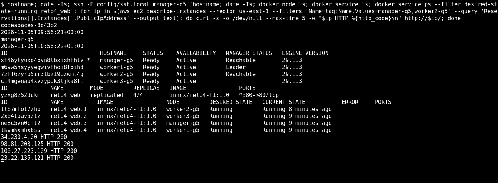

*Figura 1. Estado de nodos, servicio y HTTP. 5 de noviembre de 2026, 09:56 UTC. Captura: Claude Code. Máquinas: codespaces-8d43b2 y
manager-g5. Es un dato histórico.*

**Situación entre sesiones.** El 5 de noviembre, a las 11:13 UTC, AWS denegaba las lecturas de EC2 y las cuatro IP no respondían,
probablemente porque había terminado la sesión de Learner Lab. El 6 de noviembre, con el laboratorio activo y las credenciales
renovadas, todo volvió a responder y se actualizó la regla SSH con autorización. A las 10:27 UTC la IP del Codespace había vuelto a
cambiar, y a las 10:50 UTC se sustituyó de nuevo la regla, también con autorización. El 9 de noviembre ha vuelto a cambiar.
[Detalle de la auditoría](evidencias/auditoria/INFORME.md).

## Arquitectura


*Figura 2. Arquitectura, a partir de [diagramas/arquitectura.md](diagramas/arquitectura.md).*

Todo se despliega en `us-east-1`, en la VPC por defecto. El clúster se construye con las IP privadas, que no cambian, porque las
públicas cambian en cada sesión del laboratorio.

| Nodo | ID de instancia | Tipo y disco | IP privada | Rol que pide la Guía | Rol en Swarm el 6 de noviembre |
| --- | --- | --- | --- | --- | --- |
| manager-g5 | `i-0e6ebf2af63facc60` | t3.medium, 20 GB gp3 | 172.31.28.10 | Manager líder | Manager líder |
| worker1-g5 | `i-066a1ad3b7a8e0db9` | t3.small, 10 GB gp3 | 172.31.17.168 | Worker | **Manager** |
| worker2-g5 | `i-0ed6d9c9957251a18` | t3.small, 10 GB gp3 | 172.31.29.192 | Worker | **Manager** |
| worker3-g5 | `i-0446409b26cf0a662` | t3.small, 10 GB gp3 | 172.31.31.183 | Worker | Worker |

Los nombres no cambian, pero los roles sí: worker1-g5 y worker2-g5 se promovieron a managers para la prueba E8. La Guía pide un
manager líder y tres workers, así que hay que decidir y documentar el estado final, como se explica en el apartado 3.5. El 5 de
noviembre, el líder era worker1-g5, y no consta cuándo volvió a serlo manager-g5. El 9 de noviembre, tras reiniciarse el laboratorio, el
líder era worker2-g5. Con tres managers, el liderazgo puede cambiar al reiniciar los nodos.

## AWS Academy Learner Lab: acceso y renovación de la sesión

**Objetivo general.** Disponer de una sesión válida de AWS desde el Codespace y recuperar el control del clúster cada vez que se
reinicia el laboratorio. Learner Lab entrega credenciales temporales y detiene los recursos al terminar cada sesión, así que este
procedimiento se repite al empezar cada día de trabajo y antes de cualquier prueba o exposición.

**Qué pide la Guía.** «Todo el despliegue se realizará en la región us-east-1 (Learner Lab), usando la red por defecto de AWS. El
clúster se construye usando las IPs privadas, ya que las públicas cambian en cada sesión.»

### L.1. Entrar en Learner Lab e iniciar el laboratorio

**Procedimiento.**

1. Entrar en AWS Academy con la cuenta del alumno y abrir el curso que contiene el Learner Lab.
2. Abrir el módulo del laboratorio, *Launch AWS Academy Learner Lab*.
3. Pulsar **Start Lab** y esperar a que el indicador junto a **AWS** pase de rojo o amarillo a **verde**.

**Explicación técnica.** Learner Lab es una cuenta de AWS temporal y restringida. Mientras el indicador está en verde, la sesión está
activa, y el panel muestra el tiempo que le queda. Al agotarse ese tiempo, o con **End Lab**, el laboratorio se detiene. Las
instancias EC2 conservan su ID, su disco y su IP privada, pero al volver a arrancar reciben una **IP pública nueva**.

Así ocurrió en la prueba E5, con End Lab y Start Lab, y vuelve a verse el 9 de noviembre. Nada más iniciar el laboratorio, las cuatro
instancias ya estaban en `running`, con los controles de estado aún en `initializing`. No se había ejecutado ningún `start-instances`
desde el Codespace. Los ID coinciden con los del apply inicial, y las IP públicas son distintas de las del 6 de noviembre.

**Evidencias.** [Registro del 9 de noviembre](evidencias/auditoria/registro-2026-11-09.txt) y [verificación de E5](evidencias/E5-verificacion-final.txt).
**Captura pendiente:** panel de Learner Lab con el indicador en verde, sin mostrar credenciales.

### L.2. Acceder a AWS Console

**Procedimiento.** Con el indicador en verde, pulsar **AWS**. Se abre la consola de AWS en otra pestaña, ya autenticada. Comprobar
arriba a la derecha que la región es **N. Virginia (us-east-1)**, y abrir *EC2 → Instances*.

**Explicación técnica.** La consola y la AWS CLI usan la misma cuenta y la misma sesión. La consola sirve para ver las instancias,
sus controles de estado y las reglas del grupo de seguridad. El Codespace hace lo mismo por línea de comandos. En las capturas de la
consola no debe verse el identificador de la cuenta.

**Evidencias.** **Pendiente:** capturas de la consola de EC2 con las instancias y con las reglas del grupo de seguridad. Las capturas
actuales de A2 y A3 son de terminal.

### L.3. Obtener las credenciales temporales

**Procedimiento.** En el panel de Learner Lab, abrir **AWS Details** y, junto a **AWS CLI**, pulsar **Show**. Aparece un bloque de
cuatro líneas que se copia completo: la cabecera `[default]` y tres líneas `campo=valor`, una por cada credencial de la tabla
siguiente. Nunca se escriben las credenciales reales en el repositorio ni en una captura, y este informe no reproduce el bloque
ni con valores ocultos, para que la [revisión de secretos](scripts/revisar-secretos.py) no tenga que distinguir un ejemplo de una fuga.

**Explicación técnica.** Son tres valores que van siempre juntos, en este orden:

| Credencial | Para qué sirve |
| --- | --- |
| Identificador de la clave de acceso, `aws_access_key_id` | Identifica la clave. Las claves temporales empiezan por `ASIA`. Las permanentes, por `AKIA`, pero Learner Lab no las da |
| Clave secreta de acceso | Es la parte secreta. La CLI la usa para **firmar** cada petición, y nunca se envía a AWS. Quien la tenga puede actuar en la cuenta |
| Token de sesión | Demuestra que la clave pertenece a una sesión temporal todavía válida. Sin el token, AWS rechaza una clave temporal |

Estas credenciales dan control sobre todos los recursos del laboratorio. Por eso la Guía prohíbe mostrarlas, y
[`.gitignore`](.gitignore) excluye `.aws/` y `credentials`.

### L.4. Actualizar `~/.aws/credentials` en el Codespace

**Procedimiento.**

```bash
# Procedimiento.
umask 077                          # Los archivos nuevos solo los podrá leer el propio usuario.
nano ~/.aws/credentials            # Sustituir todo el contenido por el bloque [default] copiado y guardar.
chmod 600 ~/.aws/credentials       # Lectura y escritura solo para el propietario.
```

**Explicación técnica.** La AWS CLI, Terraform y los scripts del proyecto leen las credenciales de ese archivo, con el perfil
`[default]`. Hay que **sustituir** el bloque entero, porque las tres líneas se renuevan juntas: mezclar una clave nueva con un token
antiguo también falla. No conviene usar `aws configure` para esto, porque no pide el token de sesión.

Se comprobó que no hay variables de entorno `AWS_ACCESS_KEY_ID` ni `AWS_SESSION_TOKEN` que tengan prioridad sobre el archivo. Si las
hubiera, la CLI las usaría aunque el archivo estuviera actualizado.

### L.5. Configurar la región us-east-1

**Procedimiento.**

```bash
# Procedimiento.
aws configure set region us-east-1
aws configure set output json
cat ~/.aws/config
```

El archivo `~/.aws/config` del Codespace contiene exactamente esto:

```ini
[default]
region = us-east-1
output = json
```

**Explicación técnica.** La región decide en qué centro de datos se crean y se consultan los recursos. Si la CLI apuntara a otra
región, `describe-instances` devolvería una lista vacía aunque las instancias existan. Terraform no depende de este archivo: el
proveedor usa `var.aws_region`, que vale `us-east-1` por defecto, como se ve en el apartado 1.2. Los scripts indican además
`--region us-east-1` en cada llamada.

### L.6. Comprobar la conexión con `aws sts get-caller-identity`

**Procedimiento.**

```bash
# Procedimiento. Solo comprueba que las credenciales son válidas, sin mostrar la cuenta.
aws sts get-caller-identity > /dev/null && echo "AWS acepta las credenciales"
```

**Explicación técnica.** STS (*Security Token Service*) es el servicio que emite las credenciales temporales.
`get-caller-identity` responde **quién** firma la petición: la cuenta, el usuario y el ARN del rol asumido. No necesita permisos
especiales, así que es la forma más sencilla de saber si las credenciales siguen siendo válidas. Su salida contiene el identificador
de la cuenta, de 12 dígitos, y por eso se redirige a `/dev/null` y no se captura. El 9 de noviembre, tras renovar las credenciales,
esta orden respondió correctamente.

### L.7. Por qué caducan las credenciales y qué hacer ante RequestExpired

**Explicación técnica.** Las credenciales de Learner Lab pertenecen a una sesión de STS ligada a la sesión del laboratorio. Cuando la
sesión termina, o cuando se inicia una nueva, AWS deja de aceptarlas, aunque el archivo siga igual. En este proyecto se han registrado
tres errores de este tipo:

| Fecha | Error | Situación |
| --- | --- | --- |
| 4 de noviembre, 20:51 UTC, en E5 | `UnauthorizedOperation`, por denegación explícita de la política `voc-cancel-cred` | Credenciales de la sesión anterior tras reiniciar el laboratorio. [Registro](evidencias/E5-verificacion-posterior.txt) |
| 5 de noviembre, 11:13 UTC | `UnauthorizedOperation` en `DescribeInstances` y `DescribeSecurityGroups` | Sesión del laboratorio terminada. [Registro](evidencias/auditoria/registro-acceso-en-vivo.txt) |
| 9 de noviembre, 07:44 UTC | `RequestExpired: Request has expired` | Credenciales de una sesión ya caducada. [Registro](evidencias/auditoria/registro-2026-11-09.txt) |

**Procedimiento ante `RequestExpired` u otra denegación de este tipo.**

1. Comprobar en el panel de Learner Lab que el indicador está en verde. Si no lo está, pulsar **Start Lab**.
2. Copiar de nuevo el bloque de **AWS Details → AWS CLI** y sustituir `~/.aws/credentials`, como en L.4.
3. Repetir `aws sts get-caller-identity`. No hay que cambiar nada en Terraform ni en los scripts.

Los scripts del proyecto detectan esta situación. `comprobar-laboratorio.sh` y `actualizar-ips.sh` terminan con el código 3 y
avisan de que hay que renovar las credenciales. Antes de mostrar el error, ocultan los identificadores de cuenta.

### L.8. Comprobar las cuatro instancias EC2

**Procedimiento.**

```bash
# Procedimiento. Solo lectura: nombre, ID, estado, IP pública e IP privada.
aws ec2 describe-instances --region us-east-1 \
  --filters 'Name=tag:Name,Values=manager-g5,worker?-g5' \
  --query 'Reservations[].Instances[].[Tags[?Key==`Name`]|[0].Value,InstanceId,State.Name,PublicIpAddress,PrivateIpAddress]' \
  --output text | sort

# Controles de estado del sistema y de la instancia.
aws ec2 describe-instance-status --region us-east-1 --include-all-instances \
  --instance-ids i-0e6ebf2af63facc60 i-066a1ad3b7a8e0db9 i-0ed6d9c9957251a18 i-0446409b26cf0a662 \
  --query 'InstanceStatuses[].[InstanceId,InstanceState.Name,SystemStatus.Status,InstanceStatus.Status]' --output text
```

**Explicación técnica.**

- **El filtro** por la etiqueta `Name` selecciona solo los cuatro nodos del grupo. `worker?-g5` admite un carácter cualquiera.
- **`--query`** usa JMESPath para quedarse con los campos útiles. Así la salida no incluye el propietario ni otros datos de la cuenta.
- **`running`** solo indica que la máquina está encendida. Hasta que los dos controles de estado pasan de `initializing` a `ok`, el
  sistema operativo puede no estar listo para SSH.

El 9 de noviembre, a las 08:05 UTC, tres nodos seguían en `initializing`. A las 08:33 UTC los cuatro estaban en `ok/ok`.

**Evidencias.** [Registro del 9 de noviembre](evidencias/auditoria/registro-2026-11-09.txt) y la captura conforme
[A2-instancias](evidencias/capturas-conformes/A2-instancias.png), del 6 de noviembre, en la Fase 1.

### L.9. Verificar las IP públicas

**Procedimiento.** Las IP públicas vigentes son las que devuelve EC2, con la orden de L.8. Terraform no sirve para esto:
`terraform output nodes` muestra las IP guardadas en el estado tras el último `apply`, y el estado no se actualiza solo cuando el
laboratorio se reinicia.

**Explicación técnica.** Esto se comprobó el 6 de noviembre. Un `terraform plan` no proponía cambios en los recursos, pero sí en las
salidas, porque las IP del estado eran las del último apply. Se explica en el apartado 1.9 y en la Figura 15.

Por eso los scripts que necesitan las IP actuales, `actualizar-ips.sh`, `comprobar-laboratorio.sh` y las sondas, las leen de EC2.
Solo `generar-config-ssh.sh` usa la salida de Terraform, y está pensado para ejecutarse justo después de crear la infraestructura.

### L.10. Comprobar la regla SSH /32 del grupo de seguridad

**Procedimiento.**

```bash
# Procedimiento. IP pública con la que sale el Codespace.
curl -s https://checkip.amazonaws.com

# Origen permitido en el puerto 22 del grupo reto4-cloud-g5.
aws ec2 describe-security-groups --region us-east-1 --filters Name=group-name,Values=reto4-cloud-g5 \
  --query 'SecurityGroups[0].IpPermissions[?FromPort==`22`].IpRanges[].CidrIp' --output text
```

**Explicación técnica.** La Guía pide abrir el puerto 22 solo «desde aula/alumno». Por eso la regla admite una única dirección, con
la máscara `/32`. El SSH entre nodos, que necesita el salto, usa otra regla que solo admite el propio grupo de seguridad.

El Codespace es una máquina en la nube y su IP de salida **no es fija**. El 6 de noviembre cambió dos veces. El 9 de noviembre la regla
admitía `172.166.151.115/32` y el Codespace salía por `172.166.151.114`, así que la conexión SSH se agotaba sin respuesta:
`Connection timed out`. Un fallo así no se debe a las claves, sino a que el grupo de seguridad descarta los paquetes. A las 09:22 UTC,
con autorización de Cristina, se sustituyó la regla siguiendo el orden que se describe a continuación.

Para corregirlo se **añade** la regla nueva, se comprueba el SSH en los cuatro nodos y solo entonces se **retira** la antigua. Así nunca
se pierde el acceso a medias. Es un cambio en AWS y requiere autorización. **Nunca se abre a `0.0.0.0/0`.** Como la regla está en
`main.tf`, después hay que usar `-var ssh_cidr=IP/32` en los planes de Terraform, o el plan propondrá volver a la IP anterior.

**Evidencias.** [Sustituciones autorizadas del 6 de noviembre](evidencias/auditoria/registro-2026-11-06.txt) y
[registro del 9 de noviembre](evidencias/auditoria/registro-2026-11-09.txt), con la propuesta sin aplicar, y
[sustitución del 9 de noviembre](evidencias/auditoria/registro-2026-11-09-b1.txt), con las reglas antes y después.

### L.11. Recuperar el acceso al reiniciar el laboratorio: `comprobar-laboratorio.sh` y `actualizar-ips.sh`

**Procedimiento.**

```bash
# Literal: scripts del repositorio.
bash scripts/comprobar-laboratorio.sh   # Solo lectura: EC2, IP, regla SSH, web y Swarm.
# Si propone cambiar la regla SSH, ejecutar sus comandos solo con autorización (L.10).
bash scripts/actualizar-ips.sh          # En AWS solo lee. Regenera config/ssh.local y config/ssh_config.aplicado.
ssh manager-g5 hostname                 # Comprobar el acceso con el alias.
```

**Explicación técnica.**

[`comprobar-laboratorio.sh`](scripts/comprobar-laboratorio.sh) hace cuatro comprobaciones y no cambia nada:

1. Compara cada instancia con su ID e IP privada esperados, e indica si sus controles están en `ok/ok`.
2. Compara el origen de la regla SSH con la IP del Codespace. Si no coinciden, **muestra** los comandos `authorize` y `revoke`
   exactos, sin ejecutarlos.
3. Pide `/` e `identidad.txt` a cada IP pública.
4. Si hay SSH, consulta en el manager `docker node ls`, `docker service ls` y la MTU de las redes.

Termina con 0 si todo está correcto, con 2 si falta corregir algo y con 3 si AWS deniega la consulta.

[`actualizar-ips.sh`](scripts/actualizar-ips.sh) lee de EC2 la IP pública del manager y las IP privadas de los workers, y regenera
la configuración SSH. Los alias de la Fase 2 siguen funcionando aunque las IP hayan cambiado. Escribe en un archivo temporal y lo
mueve al final, para no dejar nunca una configuración a medias.

**Evidencias.** [Registro del 9 de noviembre](evidencias/auditoria/registro-2026-11-09.txt), que contiene una ejecución completa con
código 2.

### Resultado y conclusión de la sección Learner Lab

El procedimiento permite recuperar el control tras cada reinicio:

1. Iniciar el laboratorio.
2. Renovar las tres credenciales.
3. Comprobar la sesión con STS.
4. Revisar las instancias y sus IP en EC2.
5. Ajustar, con autorización, la regla SSH `/32`.
6. Regenerar los alias.

Los ID, los discos y las IP privadas se conservan entre sesiones, y por eso Swarm sigue funcionando. Cambian las IP públicas de los
nodos y la del Codespace.

El 9 de noviembre se completaron los seis pasos. El paso 5 se hizo a las 09:22 UTC, con autorización, y desde entonces el Codespace
vuelve a tener SSH y acceso a Swarm.

**Pendiente:** capturas de Learner Lab y de la consola de EC2.

## Fase 0: Codespaces y repositorio

**Objetivo general.** Crear un repositorio colaborativo en GitHub y una máquina de control reproducible en GitHub Codespaces, con
AWS CLI y Terraform, desde la que se gestiona todo el proyecto. Los demás miembros trabajan desde sus propios terminales e integran
sus cambios mediante Pull Requests. Criterios de la Rúbrica: F1–F5 y F12.

| Qué pide la Guía | Situación a 9 de noviembre |
| --- | --- |
| Crear el repositorio del proyecto en GitHub | **Cumple** |
| Codespace aprovisionado con un `devcontainer` que incluya AWS CLI y Terraform | **Cumple** |
| `git add`, `commit` y `push` desde el Codespace | **Cumple** |
| Invitar al resto de miembros a colaborar | **Parcial:** tres cuentas con permiso de escritura. Falta confirmar el profesor |
| Los demás miembros clonan y trabajan desde otros terminales Linux, como WSL o Git Bash | **No consta.** El único commit de otra cuenta se hizo desde la web de GitHub |
| Los demás miembros integran su código mediante Pull Requests | **Parcial:** una PR de Enrique, fusionada |

### 0.1. Repositorio en GitHub

**Procedimiento.** Cristina creó el repositorio `reto4-cloud-G5` como **privado**, con su cuenta Lq922466. El primer commit, `f5c14e9 Initial
commit`, es del 3 de noviembre de 2026.

**Explicación técnica.** El repositorio es la «carpeta master» de la que habla la Guía: la copia de referencia del código, la
documentación y las evidencias. Es privado porque la Guía lo exige, y porque contiene datos de la infraestructura, como los ID de
instancia y las IP. La Rúbrica (F1) pide además que todos los integrantes sean colaboradores y que el profesor esté invitado.

**Evidencias.** Figura 5, en el apartado 0.4.

### 0.2. Codespace y `devcontainer`

**Procedimiento.** El archivo [`.devcontainer/devcontainer.json`](.devcontainer/devcontainer.json) se añadió el 3 de noviembre, en el
commit `2f5e6ea Fase 0: configuracion de Codespaces`. Para crear el Codespace:

1. En GitHub, abrir el repositorio, pulsar **Code → Codespaces → Create codespace on `cloud-g5-implementacion`**.
2. Esperar a que se construya el contenedor. Si se modifica el `devcontainer`, usar *Rebuild Container*.
3. Comprobar las herramientas:

```bash
# Literal: comprobación del entorno del 5 de noviembre. Salida resumida.
aws --version; terraform version | head -n 1; gh --version | head -n 1
# aws-cli/2.39.3 · Terraform v1.17.1 · gh version 2.103.3
```

```json
{
  "name": "RETO4-CLOUD-G5",
  "image": "mcr.microsoft.com/devcontainers/base:ubuntu-22.04",
  "features": {
    "ghcr.io/devcontainers/features/aws-cli:1": {},
    "ghcr.io/devcontainers/features/terraform:1": {}
  }
}
```

**Explicación técnica.**

- **`image`** es la imagen base del contenedor: Ubuntu 22.04, la misma versión que se usa en las instancias EC2.
- **`features`** son paquetes de instalación reutilizables. Cada una instala una herramienta al construir el contenedor: AWS CLI y
  Terraform.

Así, cualquier miembro que abra un Codespace obtiene el mismo entorno, sin instalar nada a mano. Ese entorno es la **máquina de
control**: desde él se ejecutan Terraform, la AWS CLI, SSH y Git.

Docker no puede ejecutarse dentro de este Codespace por falta de permisos del contenedor. Por eso las imágenes se construyen en un
nodo, como se explica en la Fase 4.

**Evidencias.**


*Figura 3. Codespace aprovisionado con AWS CLI y Terraform. Resultado: El devcontainer incluye AWS CLI y Terraform, y ambos funcionan
en el Codespace. Autor: Claude Code, por encargo de Cristina (Lq922466). 2026-11-05, 12:22 UTC. Máquina: codespaces-8d43b2.*

Evidencias anteriores: [entorno](evidencias/capturas-terminal/F5-entorno.png). **Pendiente, aunque no es imprescindible:** una vista
del Codespace en el navegador.

### 0.3. Control de versiones desde el Codespace

**Procedimiento.** Cada cambio se registra y se sube desde el Codespace:

```bash
# Procedimiento: el ciclo de cada cambio.
git status                    # Qué archivos han cambiado.
git diff                      # Qué ha cambiado en cada uno.
git add RUTA                  # Prepara solo los archivos revisados.
git commit -m "Mensaje"       # Guarda el cambio en el historial local.
git push                      # Lo sube a GitHub.
```

**Explicación técnica.**

- **`git add`** pasa los cambios al índice, que es lo que se incluirá en el commit. Se añaden rutas concretas, en lugar de `git add .`,
  para no subir por error un archivo con secretos.
- **`git commit`** crea una versión con autor, fecha y mensaje.
- **`git push`** sincroniza la rama con GitHub, de modo que el trabajo no depende del Codespace.

**Evidencias.** El historial de la rama `cloud-g5-implementacion` hasta el commit `a267503`, la fusión de la PR #2, tiene 35 commits:

- 23 de Cristina, con su identidad Innnx: los 3 de `main`, 19 hechos con Claude Code y la fusión de la PR #2;
- 11 de Codex;
- 1 de Enrique.

El 9 de noviembre, a las 11:30 UTC, se añadió el commit `56e5a46` con la
[segunda revisión](entrega/segunda-revision-2026-11-09/README.md). Lleva la identidad Innnx, pero su contenido lo preparó Codex,
como indica la propia revisión.

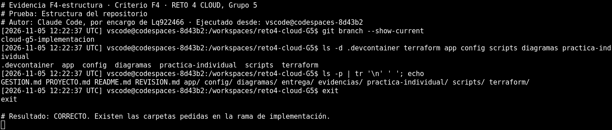

*Figura 4. Estructura del repositorio. Resultado: Existen las carpetas pedidas en la rama de implementación. Autor: Claude Code, por
encargo de Cristina (Lq922466). 2026-11-05, 12:22 UTC. Máquina: codespaces-8d43b2.*

Evidencias anteriores: [estructura](evidencias/capturas-terminal/F4-estructura.png).

### 0.4. Colaboradores

**Procedimiento.** El administrador invita a cada miembro desde **Settings → Collaborators → Add people**, y cada miembro acepta la
invitación. Las cuentas con acceso se consultan con:

```bash
# Literal: captura del 5 de noviembre.
gh repo view --json visibility --jq .visibility
gh api repos/Lq922466/reto4-cloud-G5/collaborators --jq '.[] | [.login, .role_name] | @tsv'
```

**Explicación técnica.** El permiso de escritura (*write*) permite crear ramas y Pull Requests, pero no cambiar la configuración del
repositorio, que queda en manos del administrador.

El 5 de noviembre tenían acceso las cuentas de Cristina (Lq922466), como administración, y las de Enrique (EnriZx2), Alexandra
(alexguerth) e Ibai (ibaiaretxabalaasir-collab), con escritura. La organización del equipo está en [GESTION.md](GESTION.md). La invitación al profesor **no está
confirmada**: la consulta de invitaciones no estaba disponible con el token del Codespace.

**Evidencias.**

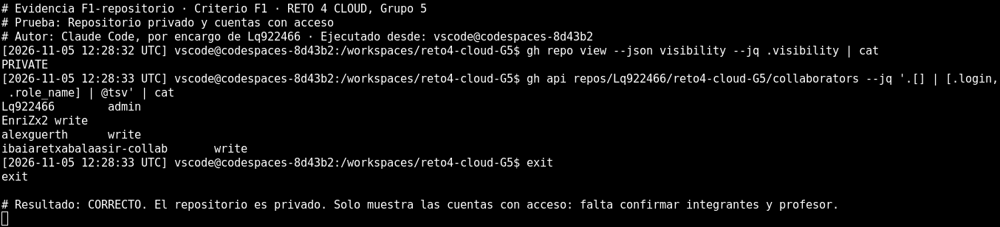

*Figura 5. Repositorio privado y cuentas con acceso. Resultado: El repositorio es privado. Solo muestra las cuentas con acceso: falta
confirmar integrantes y profesor. Autor: Claude Code, por encargo de Cristina (Lq922466). 2026-11-05, 12:22 UTC. Máquina: codespaces-8d43b2.*

Evidencias anteriores: [colaboradores](evidencias/capturas-terminal/F1-colaboradores.png). **Pendiente:** captura de
*Settings → Collaborators* con el profesor invitado.

### 0.5. Ramas y Pull Requests

**Procedimiento.** `main` contiene las Fases 0 y 1 iniciales. El resto del trabajo se hace en `cloud-g5-implementacion`, que se
integrará en `main` mediante la PR #1. Un miembro que trabaja desde WSL o Git Bash sigue este flujo:

```bash
# Procedimiento para cada integrante, desde su propio terminal.
git clone https://github.com/Lq922466/reto4-cloud-G5.git
cd reto4-cloud-G5
git switch -c nombre-de-la-tarea origin/cloud-g5-implementacion   # Rama propia a partir de la de trabajo.
# ... cambios ...
git add RUTA && git commit -m "Mensaje" && git push -u origin nombre-de-la-tarea
gh pr create --base cloud-g5-implementacion --title "Título" --body "Qué cambia y cómo se ha comprobado"
```

**Explicación técnica.** Una **rama** aísla el trabajo de cada persona. Una **Pull Request** propone integrarlo en otra rama, y
permite revisarlo y comentarlo antes de fusionarlo. Así el historial muestra quién hizo cada cambio, que es lo que evalúa F2.

| Rama o PR | Estado real en GitHub, a 9 de noviembre |
| --- | --- |
| `main` | Tres commits de Cristina, con su identidad Innnx, del 3 y 4 de noviembre: commit inicial, Fase 0 y Fase 1 |
| `cloud-g5-implementacion` y PR #1 | PR de Cristina hacia `main`, en **borrador** desde el 4 de noviembre a las 20:27 UTC |
| `enrique-revision-documentacion` y PR #2 | PR de Enrique hacia `cloud-g5-implementacion`, creada el 6 de noviembre a las 09:42 UTC y **fusionada** por Cristina a las 11:06 UTC. Añade su [revisión de la documentación](entrega/REVISION-ENRIQUE.md) |
| `alexandra-revision-evidencias` | Creada por Alexandra el 6 de noviembre. Apunta al mismo commit que `main`: **no tiene commits propios** |
| `ibai-revision-individual` | Creada por Ibai el 9 de noviembre a las 10:54 UTC. Apunta al mismo commit que `main`: **no tiene commits propios** |

El commit de Enrique tiene como confirmador a GitHub, así que se hizo desde la interfaz web, no desde un terminal. No constan
commits ni PR de Alexandra ni de Ibai. Las ramas de ambas personas parten de `main`, que no contiene el trabajo de
`cloud-g5-implementacion`: las [instrucciones de F2](entrega/INSTRUCCIONES-F2-INTEGRANTES.md) explican cómo adelantarlas sin perder
nada y cómo aportar commits y PR desde WSL o Git Bash.

**Evidencias.**

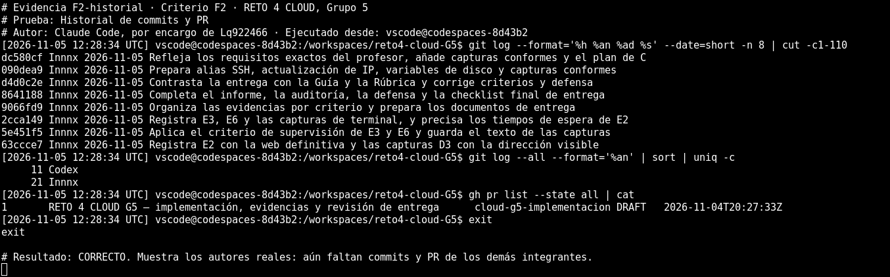

*Figura 6. Historial de commits y PR. Resultado: Muestra los autores reales: aún faltan commits y PR de los demás integrantes. Autor:
Claude Code, por encargo de Cristina (Lq922466). 2026-11-05, 12:23 UTC. Máquina: codespaces-8d43b2. Es anterior a la PR #2.*

Evidencias anteriores: [historial](evidencias/capturas-terminal/F2-historial.png). **Pendiente:** captura actualizada del historial
con la PR #2, y vista web de las PR.

### 0.6. Seguridad del repositorio

**Procedimiento.** [`.gitignore`](.gitignore) excluye lo que nunca debe versionarse, y antes de integrar cambios se revisan las líneas
añadidas:

```bash
# Literal: script del repositorio.
python3 scripts/revisar-secretos.py COMMIT_BASE HEAD
```

**Explicación técnica.**

| Excluido por `.gitignore` | Por qué |
| --- | --- |
| `*.tfstate`, `*.tfstate.*`, `*.tfplan`, `*.tfvars` y `**/.terraform/` | El estado y los planes contienen los datos reales de la infraestructura, y las variables locales contienen la IP y las claves del grupo. Se permite `*.example.tfvars`, que es una plantilla |
| `*.pem`, `*.key`, `id_rsa*`, `id_ed25519*` y `*_reto4` | Claves privadas. En `terraform/claves/` solo se admiten archivos `.pub` |
| `.aws/`, `credentials`, `.env` | Credenciales |
| `config/ssh.local` | Configuración SSH generada con las IP del momento |
| `*.docx` | Los documentos originales del profesor |

[`revisar-secretos.py`](scripts/revisar-secretos.py) busca en las líneas añadidas patrones de credenciales de AWS, tokens de Docker
Hub y de GitHub, claves privadas, tokens de Swarm y números de cuenta. Además rechaza archivos sensibles por su nombre. Antes de
revisar, comprueba que su propio detector funciona con muestras.

**Evidencias.** [Revisión de todo el historial](evidencias/auditoria/registro-repositorio.txt), sin credenciales, claves privadas ni
estado.


*Figura 7. Sin credenciales, claves ni estado de Terraform. Resultado: Solo se versiona la plantilla de variables, y la revisión no
encuentra secretos. Autor: Claude Code, por encargo de Cristina (Lq922466). 2026-11-05, 12:23 UTC. Máquina: codespaces-8d43b2.*

Evidencias anteriores: [archivos sensibles](evidencias/capturas-terminal/F12-archivos-sensibles.png).

### Resultado y conclusión de la Fase 0

El entorno de trabajo está operativo y es reproducible:

- El Codespace se crea a partir del `devcontainer`, con AWS CLI y Terraform.
- El repositorio es privado, y sus exclusiones impiden versionar estado, planes, variables, claves y credenciales.

La parte colaborativa sigue **incompleta**:

- Hay una única PR de otro integrante, la de Enrique, hecha desde la web.
- No constan commits de Alexandra ni de Ibai, ni trabajo desde WSL o Git Bash.
- No se ha confirmado que el profesor esté invitado.
- `main` solo contendrá el proyecto completo cuando se integre la PR #1.

F3, F4 y F5 se consideran listos. F1 y F2 dependen del grupo.

## Fase 1: Infraestructura con Terraform

**Objetivo general.** Definir como código, con Terraform, la infraestructura de la Guía: un manager y tres workers Ubuntu 22.04 en
`us-east-1`, con un único grupo de seguridad de mínimos, un script de arranque y unas salidas con las direcciones e ID de cada nodo.
Después, comprobar el ciclo completo: validación, plan, cambio y destrucción. Criterios de la Rúbrica: A1–A6 y F6. La Guía asigna
1,5 puntos a esta fase, y la Rúbrica, 2 puntos al bloque A.

| Qué pide la Guía | Situación a 9 de noviembre |
| --- | --- |
| Partir de la práctica individual de EC2 Ubuntu 22.04 y ampliarla a 4 nodos | **Cumple** en los cuatro nodos. Falta documentar la práctica (F13) |
| Definir como variables el número de grupo, tamaños e imagen | **Cumple:** `grupo`, tipos, discos y patrón de la imagen |
| Los 3 workers, multiplicando el recurso en el mismo archivo | **Cumple:** `count` |
| Script de arranque: hostname, zona horaria Europe/Madrid, claves públicas y Docker | **Cumple** |
| Salidas: IP pública, IP privada e ID de cada nodo | **Cumple** |
| Security Group único: 22 desde aula o alumno, 80 y 8080 desde Internet; 2377, 7946, 4789 e ICMP solo entre nodos | **Cumple.** Además, el 22 entre nodos, necesario para el salto |
| Pruebas clave de la Rúbrica (A6): validación, plan, cambio y destrucción | **Parcial:** falta la destrucción y la secuencia en capturas |

### 1.1. Organización del módulo

**Procedimiento.** El módulo está en [`terraform/`](terraform/):

| Archivo | Contenido |
| --- | --- |
| [`provider.tf`](terraform/provider.tf) | Proveedor `hashicorp/aws`, versión `~> 5.0`, y región tomada de una variable |
| [`variables.tf`](terraform/variables.tf) | Variables del grupo, tamaños, discos, imagen, regla SSH y claves públicas |
| [`main.tf`](terraform/main.tf) | Imagen, VPC por defecto, grupo de seguridad, manager y workers |
| [`outputs.tf`](terraform/outputs.tf) | Salida `nodes` con IP pública, IP privada e ID |
| [`scripts/bootstrap.sh.tftpl`](terraform/scripts/bootstrap.sh.tftpl) | Script de arranque de cada nodo |
| [`grupo.example.tfvars`](terraform/grupo.example.tfvars) | Plantilla de las variables que debe rellenar el grupo |
| `.terraform.lock.hcl` | Versión exacta del proveedor, para que todos usen la misma |
| `claves/` | Claves públicas de los integrantes. Se explica en el apartado 2.1 |

**Explicación técnica.** Separar proveedor, variables, recursos y salidas es la organización habitual de un módulo de Terraform.
Terraform lee todos los `.tf` de la carpeta como un único conjunto, así que el reparto en archivos solo sirve para leerlo mejor. El
archivo de bloqueo garantiza que `terraform init` descargue la misma versión del proveedor en cualquier máquina.

La Guía pide partir de la práctica individual de EC2. Ese trabajo previo debe documentarse en
[`practica-individual/`](practica-individual/README.md), que **todavía no tiene contenido** (F13).

**Evidencias.**

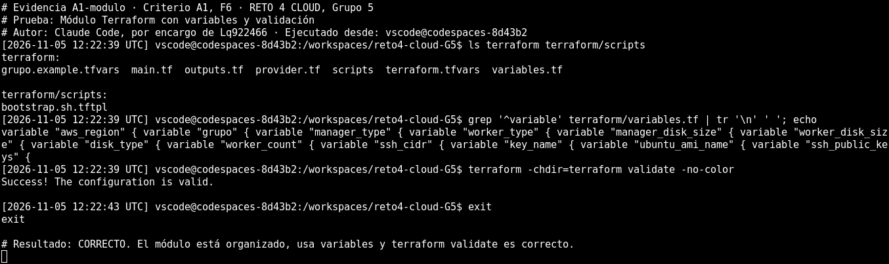

*Figura 8. Módulo Terraform con variables y validación. Resultado: El módulo está organizado, usa variables y terraform validate es
correcto. Autor: Claude Code, por encargo de Cristina (Lq922466). 2026-11-05, 12:22 UTC. Máquina: codespaces-8d43b2.*

Evidencias anteriores: [módulo y validación](evidencias/capturas-terminal/A1-modulo-terraform.png).

### 1.2. Variables

**Procedimiento.** Las variables con valor por defecto reproducen la arquitectura de la Guía. Las dos que dependen del grupo,
`ssh_cidr` y `ssh_public_keys`, no tienen valor por defecto. Se indican en un archivo local que no se versiona, a partir de la
plantilla:

```bash
# Procedimiento.
cp terraform/grupo.example.tfvars terraform/terraform.tfvars
# Editar: ssh_cidr = "IP_PROPIA/32" y ssh_public_keys = ["ssh-ed25519 AAAA... comentario", ...]
```

| Variable | Valor por defecto | Uso |
| --- | --- | --- |
| `aws_region` | `us-east-1` | Región del proveedor |
| `grupo` | `g5` | Sufijo de los nombres: `manager-g5`, `worker1-g5`… |
| `manager_type` y `worker_type` | `t3.medium` y `t3.small` | Tamaños de la Guía |
| `manager_disk_size` y `worker_disk_size` | 20 y 10 | Discos de la Guía, en GB |
| `disk_type` | `gp3` | Tipo de disco |
| `worker_count` | 3 | Número de workers |
| `ubuntu_ami_name` | `ubuntu/images/hvm-ssd/ubuntu-jammy-22.04-amd64-server-*` | Patrón de la imagen Ubuntu 22.04 |
| `key_name` | `vockey` | Par de claves de AWS que se asocia a cada instancia |
| `ssh_cidr` | Sin valor | IP autorizada para SSH, con `/32` |
| `ssh_public_keys` | Sin valor | Claves públicas que el script de arranque instala |

**Explicación técnica.** Con variables, el mismo código sirve para otro grupo o para otros tamaños sin tocar `main.tf`, que es lo que
pide A1.

`ssh_public_keys` tiene un bloque `validation`. Si una entrada no es una clave pública OpenSSH de una sola línea, Terraform se detiene
antes de crear nada. Así se evita, por ejemplo, pegar una clave privada o una clave con saltos de línea de Windows.

Las variables de disco se añadieron el 5 de noviembre con los mismos valores que ya tenían los discos. Por eso no cambian la
infraestructura.

### 1.3. Imagen y red

**Procedimiento.**

```hcl
# Extracto resumido de terraform/main.tf: cada bloque, en menos líneas. El identificador real de owners está en la línea 5.
data "aws_ami" "ubuntu" {
  most_recent = true
  owners      = ["<cuenta oficial de Canonical>"]
  filter { name = "name"  values = [var.ubuntu_ami_name] }
  filter { name = "state" values = ["available"] }
}
data "aws_vpc" "default" { default = true }
```

**Explicación técnica.** Un bloque `data` **consulta** algo que ya existe en AWS, sin crearlo.

- **`aws_ami`** busca la imagen Ubuntu 22.04 más reciente. El propietario es la cuenta pública de AWS de Canonical, cuyo número de
  12 cifras figura en [`terraform/main.tf`](terraform/main.tf#L5). Así solo se aceptan imágenes oficiales. El informe no copia ese
  número porque la revisión de secretos trata cualquier número de 12 cifras como un posible ID de cuenta.
- **`aws_vpc`** obtiene la VPC por defecto, que es la red que indica la Guía.

### 1.4. Grupo de seguridad

**Procedimiento.** `aws_security_group.cluster` define, con el nombre `reto4-cloud-g5`, todas las reglas de entrada y una salida
general.

| Puerto | Protocolo | Origen | Uso |
| --- | --- | --- | --- |
| 22 | TCP | `var.ssh_cidr`, una única IP `/32` | SSH desde la máquina de control |
| 22 | TCP | El propio grupo (`self = true`) | Salto SSH desde el manager hacia los workers |
| 80 | TCP | `0.0.0.0/0` | Web |
| 8080 | TCP | `0.0.0.0/0` | Lo exige la Guía. Ningún servicio lo publica |
| 2377 | TCP | El propio grupo | Gestión de Swarm: alta de nodos y órdenes entre managers |
| 7946 | TCP y UDP | El propio grupo | Comunicación entre nodos de Swarm |
| 4789 | UDP | El propio grupo | Tráfico VXLAN de las redes overlay |
| ICMP | ICMP | El propio grupo | Comprobaciones con `ping` entre nodos |

**Explicación técnica.**

- **`self = true`** significa que solo se admite tráfico de instancias que tengan este mismo grupo. Así los puertos internos de Swarm
  quedan cerrados a Internet sin tener que escribir las IP de los nodos. Es la «política de mínimos» de A3.
- **La regla del 22 sin descripción** se debe a que coincide con la regla que ya existía en AWS. Cambiar su descripción obligaría a
  sustituirla.
- **Las reglas son *inline***, dentro del propio recurso. Si se añade a mano una regla temporal, por ejemplo para la prueba de un
  integrante, el siguiente plan de Terraform propondrá retirarla.

**Evidencias.**


*Figura 9. Reglas de entrada del grupo de seguridad. Resultado: Entrada limitada a SSH /32, 80 y 8080 públicos, y puertos internos
entre nodos. La IP permitida es la vigente a esa hora. Autor: Claude Code, por encargo de Cristina (Lq922466). 2026-11-06, 09:17 UTC. Máquina:
codespaces-8d43b2.*

Evidencias anteriores: [reglas](evidencias/capturas-terminal/A3-grupo-seguridad.png). **Pendiente:** captura de las reglas en la
consola de EC2.

### 1.5. Instancias: un manager y tres workers con `count`

**Procedimiento.**

```hcl
# Literal y abreviado: terraform/main.tf.
resource "aws_instance" "manager" {
  ami           = data.aws_ami.ubuntu.id
  instance_type = var.manager_type
  key_name      = var.key_name
  user_data     = templatefile("${path.module}/scripts/bootstrap.sh.tftpl",
                    { hostname = "manager-${var.grupo}", public_keys = var.ssh_public_keys })
  root_block_device { volume_size = var.manager_disk_size  volume_type = var.disk_type }
  tags = { Name = "manager-${var.grupo}", PruebaA6 = "reto4-${var.grupo}" }
}

resource "aws_instance" "workers" {
  count         = var.worker_count
  instance_type = var.worker_type
  user_data     = templatefile(..., { hostname = "worker${count.index + 1}-${var.grupo}", ... })
  tags          = { Name = "worker${count.index + 1}-${var.grupo}" }
  # El resto, igual que el manager, con worker_disk_size.
}
```

**Explicación técnica.**

- **`count`** crea varias instancias a partir de un solo bloque. `count.index` vale 0, 1 y 2, de ahí `worker1-g5`, `worker2-g5` y
  `worker3-g5`. Así se cumple el requisito de no copiar el código tres veces.
- **`templatefile`** rellena el script de arranque con el nombre del nodo y las claves públicas, y lo pasa como `user_data`. EC2 lo
  ejecuta una vez, con cloud-init, en el primer arranque.
- **`key_name = "vockey"`** asocia el par de claves del laboratorio. AWS añade su clave pública a `authorized_keys`, y queda como
  acceso de reserva.
- **`associate_public_ip_address`** da a cada nodo una IP pública, necesaria para la web y para entrar al manager.
- **La etiqueta `Name`** es la que muestran la consola y los filtros de los scripts. `PruebaA6` es el cambio controlado del apartado
  1.9.

**Evidencias.**


*Figura 10. Código Terraform: workers multiplicados con un único recurso. Resultado: Los workers salen de un único recurso
multiplicado con count. Autor: Claude Code, por encargo de Cristina (Lq922466). 2026-11-05, 12:22 UTC. Máquina: codespaces-8d43b2.*

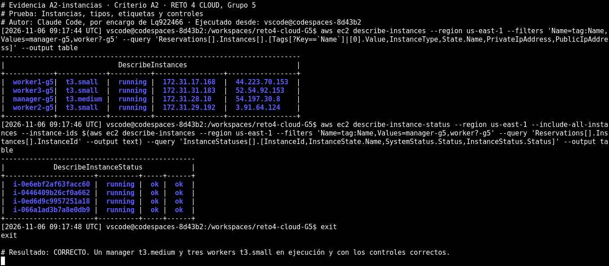

*Figura 11. Instancias, tipos, etiquetas y controles. Resultado: Un manager t3.medium y tres workers t3.small en ejecución y con los
controles correctos. Autor: Claude Code, por encargo de Cristina (Lq922466). 2026-11-06, 09:17 UTC. Máquina: codespaces-8d43b2.*

Evidencias anteriores: [código](evidencias/capturas-terminal/F6-codigo-instancias.png) e
[instancias](evidencias/capturas-terminal/A2-instancias.png). **Pendiente:** captura de la consola de EC2 (A2).

### 1.6. Script de arranque

**Procedimiento.** [`bootstrap.sh.tftpl`](terraform/scripts/bootstrap.sh.tftpl) se ejecuta como root en el primer arranque:

```bash
# Literal y abreviado.
hostnamectl set-hostname '${hostname}'                       # manager-g5, worker1-g5…
timedatectl set-timezone Europe/Madrid
install -d -m 0700 -o ubuntu -g ubuntu /home/ubuntu/.ssh      # Carpeta con permisos 700.
# Añade cada clave de ssh_public_keys a authorized_keys (600) si no estaba ya.
cat > /etc/ssh/sshd_config.d/00-reto4.conf <<'SSH'
PermitRootLogin no
PasswordAuthentication no
KbdInteractiveAuthentication no
SSH
sshd -t && systemctl reload ssh                               # Valida y aplica la configuración.
apt-get install -y docker.io && systemctl enable --now docker
usermod -aG docker ubuntu                                     # ubuntu usa Docker sin sudo.
```

**Explicación técnica.**

- **`set -euo pipefail`** detiene el script ante cualquier error, en lugar de seguir con un nodo a medio configurar.
- **Las claves se añaden con `grep -Fxq`**, que compara la línea exacta. Así repetirlo no las duplica, y no se toca la clave
  `vockey` que añade AWS.
- **`sshd -t`** comprueba la sintaxis antes de recargar. Un error en la configuración de SSH podría dejar el nodo inaccesible.
- **`docker.io`** es el paquete de Docker de Ubuntu. El grupo `docker` permite a `ubuntu` usarlo sin `sudo`.

**Evidencias.**


*Figura 12. Script de arranque: hostname, zona, claves y Docker. Resultado: El script configura hostname, zona horaria, claves
públicas, SSH y Docker. Autor: Claude Code, por encargo de Cristina (Lq922466). 2026-11-05, 12:22 UTC. Máquina: codespaces-8d43b2.*

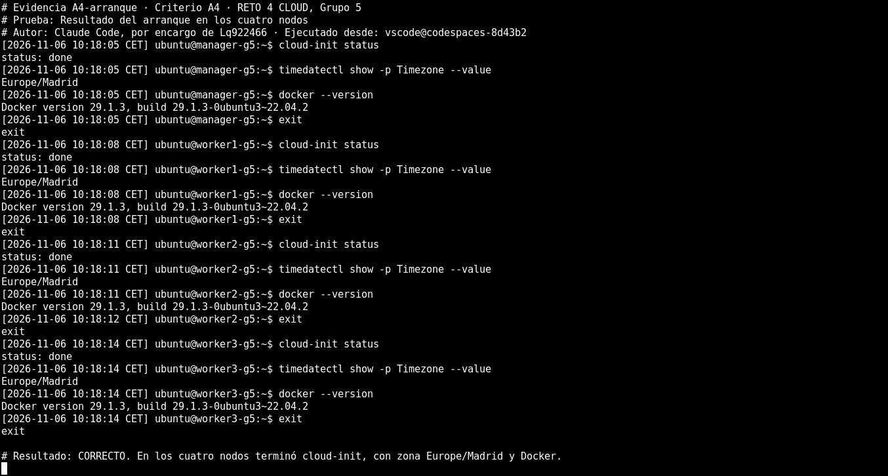

*Figura 13. Resultado del arranque en los cuatro nodos. Resultado: En los cuatro nodos terminó cloud-init, con zona Europe/Madrid y
Docker. Autor: Claude Code, por encargo de Cristina (Lq922466). 2026-11-06, 09:18 UTC. Máquinas: codespaces-8d43b2 y los cuatro nodos.*

Evidencias anteriores: [arranque](evidencias/capturas-terminal/A4-arranque.png) y
[registro de arranque del manager](evidencias/prototipo/manager-g5.txt).

### 1.7. Salidas

**Procedimiento.**

```bash
# Procedimiento.
terraform -chdir=terraform output -json nodes
```

```hcl
# Literal: terraform/outputs.tf.
output "nodes" {
  value = {
    for node in concat([aws_instance.manager], aws_instance.workers) :
    node.tags.Name => { public_ip = node.public_ip, private_ip = node.private_ip, id = node.id }
  }
}
```

**Explicación técnica.** La expresión `for` recorre el manager y los tres workers y crea un mapa por nombre. La salida en JSON la leen
[`generar-config-ssh.sh`](scripts/generar-config-ssh.sh), que necesita la IP pública del manager y las privadas de los workers, y
[`formar-swarm.sh`](scripts/formar-swarm.sh), que anuncia Swarm por la IP privada del manager.

Las IP públicas de la salida son las del último `apply`. Tras reiniciar el laboratorio, las vigentes son las de EC2, como se explica
en L.9.

**Evidencias.**

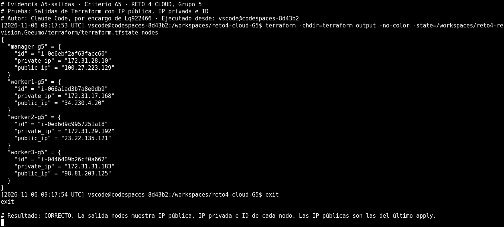

*Figura 14. Salidas de Terraform con IP pública, IP privada e ID. Resultado: La salida nodes muestra IP pública, IP privada e ID de
cada nodo. Las IP públicas son las del último apply. Autor: Claude Code, por encargo de Cristina (Lq922466). 2026-11-06, 09:17 UTC. Máquina:
codespaces-8d43b2.*

Evidencias anteriores: [salida `nodes`](evidencias/capturas-terminal/A5-salida-nodes.png).

### 1.8. Ciclo de trabajo: `init`, `validate`, `plan` y `apply`

**Procedimiento.**

```bash
# Deducido de los registros y de los planes conservados del 4 de noviembre.
terraform init
terraform validate
terraform plan -out=reto4-review-cidr.tfplan
terraform apply reto4-review-cidr.tfplan
# Plan: 5 to add, 0 to change, 0 to destroy.
# Apply complete! Resources: 5 added, 0 changed, 0 destroyed.
```

**Explicación técnica.**

| Orden | Qué hace | Por qué se usa así |
| --- | --- | --- |
| `terraform init` | Descarga el proveedor de AWS y prepara la carpeta `.terraform` | Se ejecuta una vez, o al cambiar de proveedor |
| `terraform validate` | Comprueba sintaxis y tipos, sin contactar con AWS | Detecta errores antes de gastar tiempo en un plan |
| `terraform plan -out=ARCHIVO` | Compara el código con el estado y con AWS, y guarda las acciones previstas | Se revisa el plan antes de aplicarlo |
| `terraform apply ARCHIVO` | Aplica exactamente el plan revisado | Aplicar un archivo de plan impide que se ejecute algo distinto de lo revisado |

El apply del 4 de noviembre creó los cinco recursos: el grupo `sg-0c12ecd538a29f8d6` y las instancias `i-0e6ebf2af63facc60`,
`i-066a1ad3b7a8e0db9`, `i-0ed6d9c9957251a18` e `i-0446409b26cf0a662`.

El **estado** (`terraform.tfstate`) es el registro con el que Terraform relaciona el código con los recursos reales. No se versiona y se
guarda en una carpeta privada del Codespace, fuera del repositorio. Sin él, Terraform no podría modificar ni destruir esta
infraestructura.

**Evidencias.** [Plan inicial](evidencias/prototipo/reto4-plan.log), [plan con CIDR](evidencias/prototipo/reto4-plan-cidr.log) y
[apply inicial](evidencias/prototipo/reto4-apply.log). **Pendiente:** la secuencia en capturas conformes, que pide A6.

### 1.9. Cambio controlado (A6)

**Procedimiento.** Se añadió la etiqueta `PruebaA6=reto4-g5` a manager-g5. Se regeneró el plan con la IP vigente y se revisó justo
antes de aplicarlo, con autorización:

```bash
# Literal, con rutas abreviadas. ESTADO es la carpeta privada con el estado de Terraform.
terraform -chdir=terraform plan -input=false -state=$ESTADO/terraform.tfstate \
  -var-file=$ESTADO/reto4-local.auto.tfvars.json -var ssh_cidr=IP_ACTUAL/32 -out=a6-apply.tfplan
terraform -chdir=terraform apply -input=false -state=$ESTADO/terraform.tfstate a6-apply.tfplan
# Apply complete! Resources: 0 added, 1 changed, 0 destroyed.
```

**Explicación técnica.** Una etiqueta se cambia **en el sitio** (`~ update in-place`): no detiene ni sustituye la instancia. Por eso es
un cambio seguro para demostrar el ciclo.

El plan definitivo se preparó en varios pasos:

1. El primer plan, del 4 de noviembre, ya proponía solo la etiqueta, pero no se aplicó.
2. El del 5 de noviembre a las 08:40 UTC proponía dos cambios. La regla SSH activa no tenía descripción y el código sí la declaraba,
   así que Terraform quería modificar también el grupo de seguridad. Se descartó, se alineó el código con la regla real, sin tocarla,
   y se usó la IP vigente en `ssh_cidr`.
3. El plan final, de las 08:51 UTC, contenía solo la etiqueta: `Plan: 0 to add, 1 to change, 0 to destroy`.

Tras el cambio, los ID y los discos eran los mismos, y un nuevo plan indicó `No changes`. El 6 de noviembre, con IP públicas nuevas,
el plan ya no proponía cambios en los recursos, pero sí en las salidas.

**La captura da `NO CORRECTO`, y es el resultado real.** La comprobación exige `No changes` o `Plan: 0 to add, 0 to change, 0 to
destroy`, y Terraform indica `Changes to Outputs`. Para que resultara correcta habría que guardar las salidas nuevas en el estado con
un `apply`, que no está autorizado. [Registro del plan](evidencias/auditoria/registro-2026-11-06.txt).

**Evidencias.**


*Figura 15. Plan posterior al cambio, sin aplicar nada. Resultado: NO CORRECTO. El plan propone cambios en las salidas, no en los
recursos, y la comprobación exige que no proponga ninguno. Autor: Claude Code, por encargo de Cristina (Lq922466). 2026-11-06, 10:52 UTC.
Máquina: codespaces-8d43b2.*

Planes [previo](evidencias/A6-plan-previo.txt), [descartado](evidencias/A6-plan-actual.txt) y [final](evidencias/A6-plan-final.txt),
[apply del cambio](evidencias/A6-apply.txt) y [plan posterior anterior](evidencias/capturas-terminal/A6-sin-cambios.png).

### 1.10. Destrucción (pendiente)

**Procedimiento.** No se ha ejecutado. Con autorización, sería:

```bash
# Procedimiento, sin ejecutar.
terraform -chdir=terraform plan -destroy -state=$ESTADO/terraform.tfstate -var-file=... -out=destroy.tfplan
terraform -chdir=terraform apply -state=$ESTADO/terraform.tfstate destroy.tfplan
```

**Explicación técnica.** `plan -destroy` muestra qué se eliminaría. El 5 de noviembre se generó solo como información, sin aplicarlo, y
listaba los cinco recursos: `Plan: 0 to add, 0 to change, 5 to destroy`.

Aplicarlo borra el clúster, las réplicas y los discos, y obliga a repetir las Fases 1 a 4. Por eso se deja para el final, con
autorización separada, y tras confirmar con el profesor si debe hacerse antes de la corrección, que exige que todo funcione.

**Evidencias.** [Plan de destrucción informativo](evidencias/A6-plan-actual.txt). **Pendiente:** la destrucción real y su captura.

### Resultado y conclusión de la Fase 1

Terraform creó la infraestructura de la Guía con un único módulo:

- Variables para el grupo, los tamaños, los discos y la imagen.
- Workers multiplicados con `count`.
- Un grupo de seguridad que solo abre a Internet los puertos 80 y 8080, y el 22 a una IP `/32`.
- Un script de arranque que deja cada nodo con su nombre, la zona Europe/Madrid, las claves, SSH endurecido y Docker.
- Unas salidas con IP e ID.

Del ciclo de A6 se han demostrado la validación, el plan, el apply inicial y un cambio controlado. **Falta la destrucción**, y la
secuencia completa en capturas conformes.

A1 y F6 se consideran listos. A2–A5 están demostrados y A6 es parcial. Las capturas de la consola de EC2 están pendientes.

## Fase 2: Acceso SSH

**Objetivo general.** Administrar los cuatro servidores por SSH con claves públicas propias, sin contraseñas ni acceso de root:

- entrar con un nombre corto;
- llegar a los workers por su IP privada a través del manager;
- ejecutar órdenes en todos a la vez, con `sudo`;
- copiar archivos de forma verificable.

Criterios de la Rúbrica: B1–B5. La Guía asigna 1 punto a esta fase.

| Qué pide la Guía | Situación a 9 de noviembre |
| --- | --- |
| Cada alumno usa sus propias claves SSH; `vockey` queda como reserva | **Parcial:** las tres claves de los integrantes están instaladas desde el 9 de noviembre, pero falta que cada uno entre con la suya. La Rúbrica pide además `vockey` sustituida |
| Archivo `config` en el cliente para entrar con el nombre corto | **Cumple:** comprobado el 6 de noviembre |
| Deshabilitar el acceso root y por contraseña | **Cumple:** comprobado el 6 de noviembre |
| Workers accesibles por IP privada, con el manager como salto | **Cumple:** comprobado el 6 de noviembre |

**9 de noviembre.** A las 08:37 UTC no había SSH desde el Codespace: la regla admitía `172.166.151.115/32` y el Codespace salía por
`172.166.151.114` ([registro](evidencias/auditoria/registro-2026-11-09.txt)). Con autorización de Cristina se hizo lo siguiente, comprobando
cada paso:

1. Se sustituyó la regla del Codespace.
2. Se regeneraron los alias.
3. Se instalaron las tres claves.
4. Se abrió la regla temporal de los integrantes.

[Registro completo](evidencias/auditoria/registro-2026-11-09-b1.txt).

### 2.1. Claves SSH: cuáles hay y cuáles faltan (B1)

**Procedimiento.** Las claves autorizadas en cada nodo se consultan sin mostrar su contenido:

```bash
# Literal: captura B1-claves, en cada nodo.
ssh-keygen -lf ~/.ssh/authorized_keys | cut -c1-100
```

**Explicación técnica.** `ssh-keygen -lf` muestra la **huella** de cada clave: un resumen SHA-256 que la identifica sin revelarla.
Para comprobar que dos claves son la misma, se comparan sus huellas.

| Clave | Tipo | Huella | Cómo llega al nodo | Estado |
| --- | --- | --- | --- | --- |
| `vockey` | RSA 2048 | `SHA256:dSdE2bRgx+xf29ZBOfEM7wBA9wD8+++htV5P8ROuZ9c` | La añade AWS por `key_name` | Instalada en los 4 nodos |
| `reto4-g5-codespace` | Ed25519 | `SHA256:+Z2k+zLsyhswZxNWG/HxbdnlEyyCFbiTPPUXSvUXT1Y` | `ssh_public_keys` y el script de arranque | Instalada en los 4 nodos |
| Enrique, `EnriZx2-reto4` | Ed25519 | `SHA256:qDmJbNSoN432FHt3g+C6whK0IMM7wxroJOtKo1rZJys` | Desde [`terraform/claves/`](terraform/claves/), con `instalar-clave-publica.sh` | **Instalada en los 4 nodos** el 9 de noviembre |
| Alexandra, `alexguerth-reto4` | Ed25519 | `SHA256:FJm/tkGxAxFBJKam0EQ1C5jpXbQ7konNpo8SRFHl1rs` | Desde `terraform/claves/`, con `instalar-clave-publica.sh` | **Instalada en los 4 nodos** el 9 de noviembre |
| Ibai, `ibai-reto4` | Ed25519 | `SHA256:zYEmGi4uoe3ljIm8NsFkKSXTcRw3hrm57WiWtjqSyp8` | Desde `terraform/claves/`, con `instalar-clave-publica.sh` | **Instalada en los 4 nodos** el 9 de noviembre |
| Cristina, `cristina-reto4` | Ed25519 | `SHA256:CCR0qvMqSW8DopOop+RzmuWU7lu/USgKep7m+2fN5zA` | Desde [`terraform/claves/`](terraform/claves/), con `instalar-clave-publica.sh` | **Instalada en los 4 nodos** el 9 de noviembre, a las 09:54 UTC, con autorización de Cristina |

Las tres claves de los integrantes se verificaron el 9 de noviembre:

- son claves Ed25519 válidas, de una línea, y no se repiten entre sí ni con `vockey` o la clave del Codespace;
- no consta una incidencia de saltos de línea en las claves de Enrique, Alexandra o Ibai. Solo está acreditada la de Cristina: se retiró su salto de línea de Windows sin cambiar la huella, según el [registro](evidencias/auditoria/registro-2026-11-09-b1.txt);
- no hay claves privadas en el repositorio ni en su historial.

A 9 de noviembre, los tres archivos **todavía no están en GitHub**: están en el Codespace, pendientes de commit.

**Diferencia entre la Guía y la Rúbrica.** La Guía dice que «la clave vockey queda como acceso de reserva». La Rúbrica pide «vockey
sustituida». Este proyecto conserva `vockey`, como dice la Guía, y hay que confirmarlo con el profesor.

**Evidencias.**

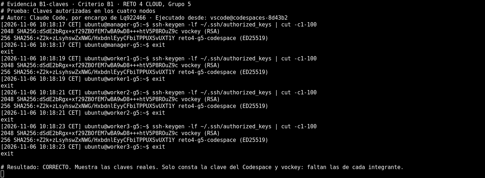

*Figura 16. Claves autorizadas en los cuatro nodos. Resultado: Muestra las claves reales. Solo consta la clave del Codespace y vockey:
faltan las de cada integrante. Autor: Claude Code, por encargo de Cristina (Lq922466). 2026-11-06, 09:18 UTC. Máquinas: codespaces-8d43b2 y los
cuatro nodos.*

Evidencias anteriores: [claves](evidencias/capturas-terminal/B1-claves-autorizadas.png). [Procedimiento de las claves de los
integrantes](entrega/PROCEDIMIENTO-CLAVES.md).

### 2.2. Instalación de las claves de los integrantes (9 de noviembre)

**Procedimiento.** Primero se comprueba, solo con lectura, y después se instala con autorización:

```bash
# Literal: 9 de noviembre, 09:23–09:25 UTC, con autorización de Cristina. Requiere antes el acceso SSH del Codespace (L.10).
for n in enrique alexandra ibai; do
    bash scripts/instalar-clave-publica.sh --comprobar "terraform/claves/${n}_reto4.pub"; echo "salida=$?"
done
# Solo con autorización expresa:
for n in enrique alexandra ibai; do
    bash scripts/instalar-clave-publica.sh --instalar "terraform/claves/${n}_reto4.pub" || break
done
```

**Explicación técnica.** [`instalar-clave-publica.sh`](scripts/instalar-clave-publica.sh) está pensado para no perder el acceso:

- **Valida la clave.** Solo acepta una clave pública Ed25519 en una línea, con comentario. Así rechaza claves privadas y archivos con
  saltos de línea de Windows.
- **Comprueba antes de cambiar nada.** Revisa los cuatro nodos y se detiene si alguno no responde.
- **Conserva lo que ya hay.** En cada nodo guarda una copia, `authorized_keys.antes-FECHA`, y **añade** la clave al final. No borra
  `vockey` ni la clave del Codespace.
- **Se verifica a sí mismo.** Después compara que el principio del archivo sigue siendo idéntico a la copia, y que `ssh-keygen` lo lee
  bien. Si no, restaura la copia.
- **Se puede repetir.** Si la clave ya estaba, no la duplica.

Resultado real del 9 de noviembre:

- **Antes de instalar:** `--comprobar` dio, con las tres claves, `ausente`, `claves=2`, `vockey=1` y `permisos=600` en los cuatro nodos,
  con código 2.
- **Instalación:** cada `--instalar` terminó con código 0, y `claves=` pasó a 3, 4 y 5.
- **Después:** cada nodo tiene 5 claves, sin huellas ni material repetidos. Siguen `vockey` y `reto4-g5-codespace` con la misma huella,
  y los permisos son 700 y 600. `--comprobar` da `presente` con las tres claves, con código 0.
- **Copias previas:** en cada nodo queda una copia de seguridad, `~/.ssh/authorized_keys.antes-20261109-*`.
- **Clave de Cristina:** a las 09:54 UTC, con su autorización, se comprobó que su huella era `SHA256:CCR0qvMq…` y se instaló.
  `--comprobar` da `presente` en los cuatro nodos, con código 0. Cada nodo tiene 6 claves, sin duplicados, con permisos 700 y 600, y
  conserva todas las anteriores.

Terraform no lee `terraform/claves/`. Las claves de los nodos salen de `ssh_public_keys`. Si se recrearan los nodos, las claves de los
integrantes no se instalarían solas hasta añadirlas a esa variable.

**Evidencias.** [Registro de la instalación](evidencias/auditoria/registro-2026-11-09-b1.txt).


*Figura 17. Claves de los cuatro integrantes autorizadas en los cuatro nodos, con vockey de reserva. Resultado: CORRECTO. Las claves de
Cristina, Enrique, Alexandra e Ibai están en los cuatro nodos. Se conservan vockey y la clave del Codespace. Autor: Claude Code, por
encargo de Cristina (Lq922466). 2026-11-09, 09:56 UTC. Máquinas: codespaces-8d43b2 y los cuatro nodos.*

**Pendiente:** la captura `B1-repositorio`, que requiere subir las claves a GitHub (apartado 2.10).

### 2.3. Permisos de `authorized_keys` y del cliente (B4)

**Procedimiento.**

```bash
# Literal: captura B4-endurecimiento.
stat -c '%a %n' ~/.ssh ~/.ssh/reto4_g5 ~/.ssh/config         # En el Codespace.
stat -c '%a %n' ~/.ssh ~/.ssh/authorized_keys               # En cada nodo.
```

**Explicación técnica.** `sshd` aplica *StrictModes*: si la carpeta `~/.ssh` o `authorized_keys` pueden escribirlas otros usuarios,
rechaza las claves, porque alguien podría añadir la suya. Por eso se usan estos permisos:

| Archivo | Permiso | Significado |
| --- | --- | --- |
| `~/.ssh` | `700` | Solo el propietario puede leerla, escribirla o entrar en ella |
| `authorized_keys`, la clave privada y `config` | `600` | Solo el propietario puede leerlos y escribirlos |

El cliente SSH también rechaza una clave privada que puedan leer otros usuarios. En los nodos, estos permisos los fija el script de
arranque.

### 2.4. Sin root ni contraseña (B4)

**Procedimiento.**

```bash
# Literal: captura B4-endurecimiento, en cada nodo.
sudo sshd -T | grep -E '^(permitrootlogin|passwordauthentication) '
```

**Explicación técnica.** El script de arranque crea
[`/etc/ssh/sshd_config.d/00-reto4.conf`](config/sshd_00-reto4.conf):

- **`PermitRootLogin no`** impide entrar como root. Se entra como `ubuntu` y se usa `sudo`, que deja registro de cada orden.
- **`PasswordAuthentication no`** y **`KbdInteractiveAuthentication no`** impiden las contraseñas, incluido el método interactivo.
  Solo quedan las claves, que no se pueden adivinar por fuerza bruta.

`sshd -T` muestra la configuración **efectiva**, después de combinar todos los archivos. Por eso es más fiable que leer el archivo.

**Evidencias.**


*Figura 18. Sin root ni contraseña, y permisos. Resultado: Root y contraseña desactivados en los nodos, y permisos 700 y 600. Autor:
Claude Code, por encargo de Cristina (Lq922466). 2026-11-06, 09:18 UTC. Máquinas: codespaces-8d43b2 y los cuatro nodos.*

Evidencias anteriores: [endurecimiento](evidencias/capturas-terminal/B4-endurecimiento.png).

### 2.5. Archivo `config` y nombre corto (B2)

**Procedimiento.** [`actualizar-ips.sh`](scripts/actualizar-ips.sh) genera `config/ssh.local`, que no se versiona, a partir de la
[plantilla](config/ssh_config.example). La última configuración aplicada se guarda en
[`config/ssh_config.aplicado`](config/ssh_config.aplicado), y la carpeta se describe en [`config/`](config/README.md).
`~/.ssh/config` solo la incluye:

```bash
# Literal: scripts y plantilla del repositorio.
bash scripts/actualizar-ips.sh
install -m 600 config/ssh_config.usuario.example ~/.ssh/config    # Contiene: Include .../config/ssh.local
ssh -G manager-g5 2>/dev/null | grep -E '^(user|hostname|hostkeyalias) '   # Cómo resuelve SSH el alias.
ssh manager-g5
```

```text
# config/ssh_config.aplicado, del 6 de noviembre. La IP pública del manager cambia en cada sesión.
Host manager-g5
    HostName 54.197.30.8
    HostKeyAlias manager-g5
Host worker1-g5
    HostName 172.31.17.168
# … worker2-g5 y worker3-g5, igual, con su IP privada.
Host worker?-g5
    ProxyJump manager-g5
Host manager-g5 worker?-g5
    User ubuntu
    IdentityFile ~/.ssh/reto4_g5
    IdentitiesOnly yes
    BatchMode yes
```

**Explicación técnica.**

| Directiva | Para qué sirve |
| --- | --- |
| `Host` | Nombre corto que se escribe en `ssh`. `worker?-g5` se aplica a los tres workers |
| `HostName` | Dirección real: la IP pública del manager, o la IP privada de cada worker |
| `HostKeyAlias manager-g5` | Guarda la huella del servidor con su nombre, no con la IP. Así no hay que volver a aceptarla cuando cambia la IP pública |
| `User ubuntu` | Usuario remoto, que no es root |
| `IdentityFile` e `IdentitiesOnly yes` | Usa solo esa clave, sin probar otras del agente |
| `BatchMode yes` | Nunca pide contraseña. Si la clave no sirve, falla en lugar de quedarse esperando |

Con `Include`, el `~/.ssh/config` no cambia aunque cambien las IP. Solo se regenera `ssh.local`.

**Evidencias.**

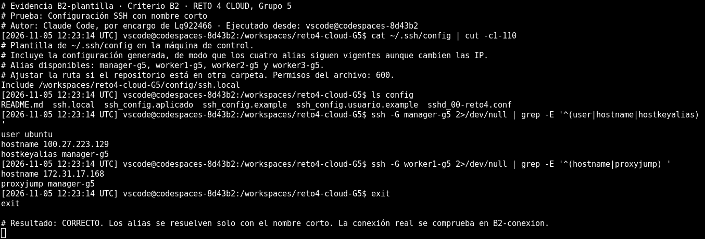

*Figura 19. Configuración SSH con nombre corto. Resultado: Los alias se resuelven solo con el nombre corto. La conexión real se
comprueba en B2-conexion. Autor: Claude Code, por encargo de Cristina (Lq922466). 2026-11-05, 12:23 UTC. Máquina: codespaces-8d43b2.*


*Figura 20. Conexión con el nombre corto. Resultado: Se entra usando solo el nombre corto, también a un worker por salto. Autor: Claude
Code, por encargo de Cristina (Lq922466). 2026-11-06, 09:18 UTC. Máquinas: codespaces-8d43b2, manager-g5 y worker3-g5.*

Evidencias anteriores: [alias](evidencias/capturas-terminal/B2-alias.png).

### 2.6. Acceso a los workers por IP privada con salto (B5)

**Procedimiento.**

```bash
# Literal: captura B5-salto.
ssh -G worker1-g5 2>/dev/null | grep -E '^(hostname|proxyjump) '   # hostname 172.31.17.168 · proxyjump manager-g5
hostname -I                     # Dentro de worker1-g5, worker2-g5 y worker3-g5, entrando con ssh workerN-g5.
```

**Explicación técnica.** Con **`ProxyJump`**, el cliente abre primero una conexión SSH con el manager y, a través de ella, otra con la
IP privada del worker. La autenticación en el worker la hace el propio cliente, con su clave, así que la clave privada **nunca** se
copia al manager.

El grupo de seguridad lo permite con la regla del puerto 22 limitada al propio grupo (`self = true`). Los workers no necesitan
aceptar SSH desde Internet.

**Evidencias.**

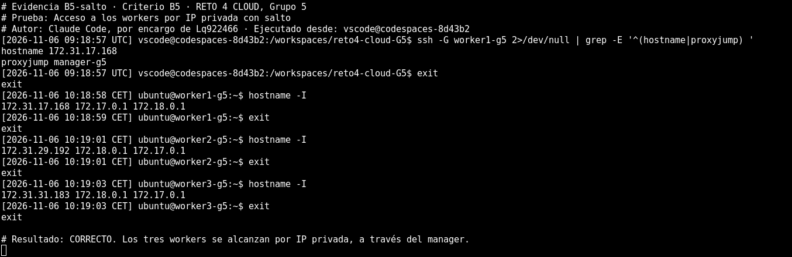

*Figura 21. Acceso a los workers por IP privada con salto. Resultado: Los tres workers se alcanzan por IP privada, a través del
manager. Autor: Claude Code, por encargo de Cristina (Lq922466). 2026-11-06, 09:18 UTC. Máquinas: codespaces-8d43b2 y los tres workers.*

Evidencias anteriores: [salto](evidencias/capturas-terminal/B5-salto.png) y [registro inicial](evidencias/prototipo/fase2-3.txt).

### 2.7. Control total y órdenes simultáneas (B3)

**Procedimiento.**

```bash
# Literal: captura B3-simultaneo.
bash scripts/comprobar-ssh.sh                          # hostname, fecha y versión de Docker en los cuatro nodos a la vez.
sudo -n true && echo permisos de sudo: correcto     # Dentro de cada uno de los cuatro nodos.
```

**Explicación técnica.** [`comprobar-ssh.sh`](scripts/comprobar-ssh.sh) lanza cada conexión en segundo plano con `&` y guarda su PID.
Después espera a todas con `wait`, así que las órdenes se ejecutan **a la vez** y el script falla si falla cualquier nodo.

`sudo -n true` comprueba que `ubuntu` tiene control total sin contraseña. `-n` hace que `sudo` falle en lugar de pedirla.

**Evidencias.**


*Figura 22. Órdenes simultáneas y control total. Resultado: La misma orden se ejecuta a la vez en los cuatro nodos, y sudo funciona en
todos. Autor: Claude Code, por encargo de Cristina (Lq922466). 2026-11-06, 09:18 UTC. Máquinas: codespaces-8d43b2 y los cuatro nodos.*

Evidencias anteriores: [simultaneidad y sudo](evidencias/capturas-terminal/B3-simultaneo-sudo.png).

### 2.8. Copia de archivos con SCP (B3)

**Procedimiento.**

```bash
# Literal: captura B3-copia.
d=$(mktemp -d); scp -q worker1-g5:/etc/hostname "$d/copia"; sha256sum "$d/copia"   # En el Codespace.
sha256sum /etc/hostname                                                            # En worker1-g5.
```

**Explicación técnica.** `scp` copia archivos por el mismo canal cifrado de SSH y usa los mismos alias, incluido el salto. Que el
SHA-256 coincida en los dos extremos demuestra que la copia es idéntica. La captura solo **descarga**, para no escribir en el nodo.
La subida se comprobó el 4 de noviembre, también con SHA-256 coincidente.

**Evidencias.**


*Figura 23. Copia de archivos con SHA-256 coincidente. Resultado: La copia por SCP tiene el mismo SHA-256 que el original. Solo se
descarga: no se escribe en el nodo. Autor: Claude Code, por encargo de Cristina (Lq922466). 2026-11-06, 09:18 UTC. Máquinas: codespaces-8d43b2 y
worker1-g5.*

Evidencias anteriores: [copia](evidencias/capturas-terminal/B3-copia-scp.png).

### 2.9. Prueba de cada integrante desde su ordenador (B1)

**Procedimiento.** Está detallado en el [procedimiento de claves](entrega/PROCEDIMIENTO-CLAVES.md). En resumen:

1. Cada integrante obtiene su IP pública con `curl -s https://checkip.amazonaws.com`.
2. Con autorización, se abre para esa IP una regla temporal `/32` en el puerto 22.
3. El integrante configura su `~/.ssh/config` como en 2.5, pero con su propia clave en `IdentityFile`.
4. Entra en los cuatro nodos, con prompt y comentario.
5. Al terminar, se retira la regla.

**Explicación técnica.** Cada integrante usa **solo su clave privada**, que no sale de su equipo. El servidor registra en
`/var/log/auth.log` la huella de la clave aceptada, lo que permite demostrar desde el nodo quién entró. Mientras exista una regla
temporal, un plan de Terraform propondrá retirarla, porque las reglas están en `main.tf`. Las capturas de A3 y A6 se hacen sin reglas
temporales.

La regla temporal `88.14.93.201/32` está abierta desde el 9 de noviembre a las 09:26 UTC, y la guía para Linux, WSL, Git Bash y
Windows está en el [procedimiento de claves](entrega/PROCEDIMIENTO-CLAVES.md#33-preparar-el-ordenador-de-cada-integrante).

**Resultado del 9 de noviembre.**

| Integrante | manager-g5 | worker1-g5 | worker2-g5 | worker3-g5 |
| --- | --- | --- | --- | --- |
| Cristina | **Demostrado** | **Demostrado** | **Demostrado** | **Demostrado** |
| Enrique | **Demostrado** | Pendiente | Pendiente | Pendiente |
| Alexandra | **Demostrado** | Pendiente | Pendiente | Pendiente |
| Ibai | **Demostrado** | Pendiente | Pendiente | Pendiente |

«Demostrado» significa que hay captura del integrante y que el nodo registra un acceso aceptado con la huella de su clave. «Pendiente»
significa que el nodo no registra ningún acceso con esa clave. Comprobado a las 10:42 UTC.

**Enrique, Alexandra e Ibai: manager-g5.** Se conectaron desde PowerShell, cada uno con su clave:

```text
ssh -i "$env:USERPROFILE\.ssh\NOMBRE_reto4" ubuntu@107.23.128.135
```

SSH pidió la frase de paso de cada clave, y después cada integrante ejecutó `whoami`, `hostname` y `date -Is`. El servidor lo confirma de
forma independiente: `/var/log/auth.log` de manager-g5 registra un acceso aceptado con cada huella, desde la IP autorizada.

| Integrante | Acceso aceptado en manager-g5 (Madrid) | Huella registrada | `date -Is` en su captura |
| --- | --- | --- | --- |
| Enrique | 10:34:22 | `SHA256:qDmJbNSoN432FHt3g+C6whK0IMM7wxroJOtKo1rZJys` | 10:35:26 |
| Alexandra | 10:36:44 | `SHA256:FJm/tkGxAxFBJKam0EQ1C5jpXbQ7konNpo8SRFHl1rs` | 10:37:03 |
| Ibai | 10:37:41 | `SHA256:zYEmGi4uoe3ljIm8NsFkKSXTcRw3hrm57WiWtjqSyp8` | 10:37:45 |

**Cristina: los cuatro nodos.** Usó un archivo `config` con un alias por nodo, su clave en `IdentityFile`, `IdentitiesOnly yes` y
`ProxyJump manager-g5` en los workers. Comprobó que existía con `Test-Path`, y que el alias resolvía su clave con `ssh -G manager-g5`.
Después entró con `ssh manager-g5`, `ssh worker1-g5`, `ssh worker2-g5` y `ssh worker3-g5`.

En cada worker, SSH pidió dos veces la frase de paso: una para el salto y otra para el worker. También mostró la huella del servidor, y las
tres coinciden con las leídas en los propios nodos.

| Nodo | Acceso aceptado (Madrid) | Origen registrado | `date -Is` en su captura |
| --- | --- | --- | --- |
| manager-g5 | 11:36:09 | IP autorizada | 11:36:24 |
| worker1-g5 | 11:37:36 | IP privada del manager, por el salto | 11:37:38 |
| worker2-g5 | 11:38:23 | IP privada del manager, por el salto | 11:38:31 |
| worker3-g5 | 11:39:16 | IP privada del manager, por el salto | 11:39:31 |

Todos los accesos se aceptaron con la huella `SHA256:CCR0qvMqSW8DopOop+RzmuWU7lu/USgKep7m+2fN5zA`. manager-g5 registra además los
saltos hacia cada worker, y dos accesos anteriores, a las 11:23:50 y a las 11:32:16, sin captura. No hay ningún fallo de autenticación
en los cuatro nodos.

**Límites:**

- **Workers.** Enrique, Alexandra e Ibai solo entraron en manager-g5.
- **Norma de capturas.** Las capturas de los integrantes muestran el prompt con el hostname y la fecha por `date -Is`, pero no el comentario
  con la prueba, el resultado y el autor. El nombre de cada integrante solo figura en el documento en el que se entregaron.
- **Equipos.** Las cuatro claves están en el mismo perfil de Windows, `C:\Users\Alumno`, y las capturas no permiten saber si se usó un
  solo equipo o varios equipos del aula con el mismo usuario. Todas las claves están protegidas con frase de paso.

**Evidencias.**

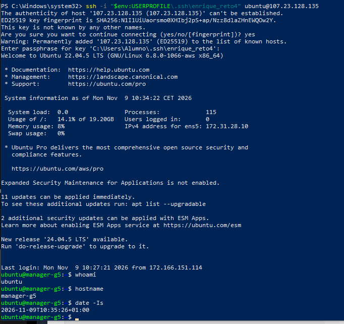

*Figura 24. Acceso de Enrique a manager-g5 con su clave `enrique_reto4`, desde PowerShell, con la huella del servidor comprobada. Captura
de Enrique, entregada por Cristina. 9 de noviembre de 2026, 10:35 en Madrid. No incluye el comentario que exige la norma.*


*Figura 25. Acceso de Alexandra a manager-g5 con su clave `alexandra_reto4`, desde PowerShell. Captura de Alexandra, entregada por
Cristina. 9 de noviembre de 2026, 10:37 en Madrid. No incluye el comentario que exige la norma.*


*Figura 26. Acceso de Ibai a manager-g5 con su clave `ibai_reto4`, desde PowerShell. Captura de Ibai, entregada por Cristina. 9 de
noviembre de 2026, 10:37 en Madrid. No incluye el comentario que exige la norma.*

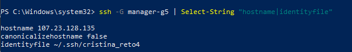

*Figura 27. `ssh -G manager-g5` en el equipo de Cristina: el alias resuelve la IP del manager y su clave `cristina_reto4`. Captura de
Cristina. 9 de noviembre de 2026. También comprobó con `Test-Path` que el archivo existía ([captura](evidencias/capturas-integrantes/B1-cristina-config-ruta.png)).*

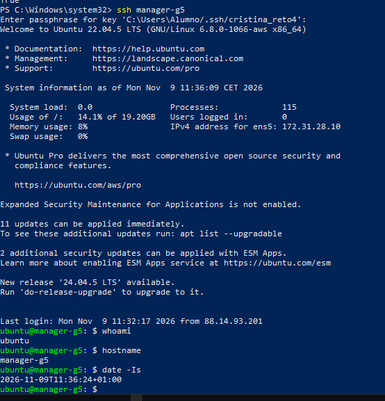

*Figura 28. Acceso de Cristina a manager-g5 con el alias y su clave `cristina_reto4`. Captura de Cristina. 9 de noviembre de 2026, 11:36
en Madrid. No incluye el comentario que exige la norma.*


*Figura 29. Acceso de Cristina a worker1-g5 por salto, con la huella del servidor `SHA256:2j/3XgX7…`. Captura de Cristina. 9 de
noviembre de 2026, 11:37 en Madrid. No incluye el comentario que exige la norma.*

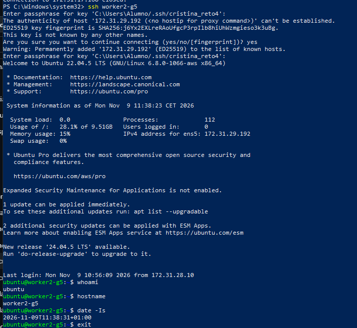

*Figura 30. Acceso de Cristina a worker2-g5 por salto, con la huella del servidor `SHA256:j6Yx2EXL…`. Captura de Cristina. 9 de
noviembre de 2026, 11:38 en Madrid. No incluye el comentario que exige la norma.*

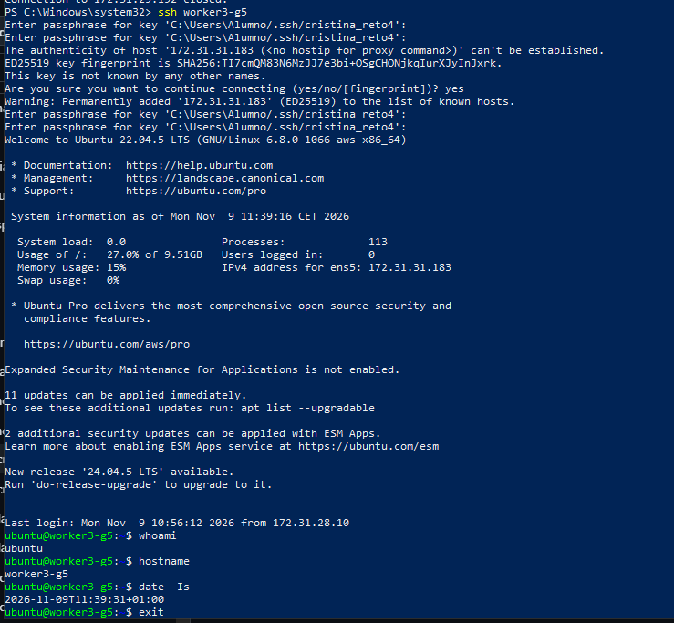

*Figura 31. Acceso de Cristina a worker3-g5 por salto, con la huella del servidor `SHA256:TI7cmQM8…`. Captura de Cristina. 9 de
noviembre de 2026, 11:39 en Madrid. No incluye el comentario que exige la norma.*


*Figura 32. Registro de manager-g5: acceso aceptado con la clave de cada integrante. Resultado: CORRECTO. manager-g5 registra un
acceso aceptado con la clave de cada integrante: Cristina, Enrique, Alexandra e Ibai. Autor: Claude Code, por encargo de Cristina
(Lq922466). 2026-11-09, 10:44 UTC. Máquina: manager-g5.*


*Figura 33. Registro de cada nodo: acceso aceptado con la clave de Cristina. Resultado: CORRECTO. Cada nodo registra un acceso aceptado
con la clave de Cristina, que antes hace su propia prueba. Autor: Claude Code, por encargo de Cristina (Lq922466). 2026-11-09, 10:44 UTC.
Máquinas: los cuatro nodos.*

[Índice de las capturas de los integrantes](evidencias/capturas-integrantes/INDICE.md) y [registro](evidencias/auditoria/registro-2026-11-09-b1.txt).

**Pendiente:** el acceso de Enrique, Alexandra e Ibai a los tres workers, por salto, y sus capturas con comentario. Para el salto hay que
usar el archivo `config` del [procedimiento](entrega/PROCEDIMIENTO-CLAVES.md#33-preparar-el-ordenador-de-cada-integrante), como hizo
Cristina, porque la opción `-i` de la línea de órdenes no se aplica a la conexión con el manager que hace de salto.

### 2.10. Capturas que acreditan B1–B5

| Criterio | Captura | Quién | Estado a 9 de noviembre |
| --- | --- | --- | --- |
| B1 | `B1-claves`: claves autorizadas en los cuatro nodos | Claude Code | Conforme del 6 de noviembre. Muestra que **faltan** las de los integrantes |
| B1 | `B1-repositorio`: las tres `.pub` en la rama de GitHub y las privadas excluidas | Claude Code | **Pendiente:** requiere commit y push autorizados |
| B1 | `B1-clave-nodos`: las tres huellas en los cuatro nodos, junto a `vockey` y con permisos 600 | Claude Code | **Conforme del 9 de noviembre:** CORRECTO |
| B1 | `B1-acceso-cristina-manager`, `-worker1`, `-worker2` y `-worker3` | **Cristina** | **Hechas el 9 de noviembre:** los cuatro nodos, sin el comentario de la norma |
| B1 | `B1-acceso-enrique`, `-alexandra` y `-ibai`: entrada en los cuatro nodos con su clave | **Cada integrante** | **Parcial:** entrada en manager-g5 el 9 de noviembre, sin el comentario de la norma. Faltan los tres workers |
| B1 | `B1-registro-manager`: acceso aceptado en manager-g5 con la huella de cada integrante | Claude Code | **Conforme del 9 de noviembre, con los cuatro integrantes:** CORRECTO |
| B1 | `B1-registro-cristina`: acceso aceptado con su huella en los cuatro nodos | Claude Code | **Conforme del 9 de noviembre:** CORRECTO |
| B1 | `B1-registro-enrique`, `-alexandra` y `-ibai`: acceso aceptado con esa huella en los cuatro nodos | Claude Code | **Pendiente:** requiere el acceso a los workers |
| B2 | `B2-plantilla` y `B2-conexion` | Claude Code | Conformes del 5 y 6 de noviembre |
| B3 | `B3-simultaneo` y `B3-copia` | Claude Code | Conformes del 6 de noviembre |
| B4 | `B4-endurecimiento` | Claude Code | Conforme del 6 de noviembre |
| B5 | `B5-salto` | Claude Code | Conforme del 6 de noviembre |

Las de Claude Code se generan con [`capturas-norma.py`](scripts/capturas-norma.py), que solo admite órdenes de lectura y calcula el
resultado a partir de la salida real. Las capturas de B2–B5 son del 6 de noviembre. Como la Rúbrica exige que funcione durante la
corrección, conviene repetirlas con el laboratorio activo antes de entregar:

```bash
python3 -I scripts/capturas-norma.py --autor "Claude Code, por encargo de Lq922466" --solo '^B[2-5]-'
```

### Resultado y conclusión de la Fase 2

El acceso SSH se demostró el 6 de noviembre con la clave del Codespace:

- **B2:** nombres cortos.
- **B5:** workers por IP privada con salto.
- **B3:** órdenes simultáneas con `sudo` y copia SCP verificada.
- **B4:** root y contraseña desactivados, y permisos 700 y 600.

Todo tiene capturas conformes.

**B1 sigue siendo parcial**, aunque ha avanzado:

- Desde el 9 de noviembre, las claves de los cuatro integrantes están instaladas en los cuatro nodos, con captura conforme.
- Cristina entró con su clave en los cuatro nodos, por salto en los workers, confirmado por el registro de cada nodo.
- La regla temporal para su IP está abierta.
- Enrique, Alexandra e Ibai entraron en manager-g5 con su propia clave, confirmado por el registro del servidor.
- **Falta** que Enrique, Alexandra e Ibai entren también en los tres workers y lo capturen con comentario, subir las claves a GitHub y retirar después la regla
  temporal.
- La política de `vockey` difiere entre la Guía y la Rúbrica.

El SSH desde el Codespace se recuperó el 9 de noviembre a las 09:22 UTC, con la regla de su IP actual.

## Fase 3: Docker Swarm y redes

**Objetivo general.** Formar un clúster Docker Swarm con los cuatro nodos, comunicados por sus IP privadas. Crear una red ingress
overlay propia con MTU 1450 y una red overlay para el servicio. Comprobar que los cuatro nodos están activos, con el manager como
líder. Criterios de la Rúbrica: C1–C4. La Guía asigna 0,8 puntos a esta fase.

| Qué pide la Guía | Situación a 9 de noviembre |
| --- | --- |
| Iniciar Swarm en el manager usando su IP privada, nunca la pública | **Cumple** |
| Red ingress overlay personalizada con MTU 1450 (`red-g5`) | **Cumple** |
| Los 4 nodos activos y el manager como líder | **No coincide.** El 6 de noviembre, los cuatro estaban activos y `manager-g5` era el líder, pero había tres managers en lugar de tres workers. [Plan de corrección](entrega/PLAN-C3-E4-E8.md) |

### 3.1. Docker en los cuatro nodos (C1)

**Procedimiento.** Docker lo instala el script de arranque (apartado 1.6) con `apt-get install -y docker.io` y
`systemctl enable --now docker`. Se comprueba en cada nodo:

```bash
# Literal: captura C1-ping y scripts/comprobar-ssh.sh.
docker --version
```

**Explicación técnica.** `enable --now` arranca el servicio y lo deja activado para los siguientes arranques, algo necesario porque
Learner Lab detiene y arranca las instancias en cada sesión. Los cuatro nodos usan el motor Docker 29.1.3, como muestra la columna
*ENGINE VERSION* de `docker node ls` en la Figura 37. Todos los nodos de un clúster deben tener la misma versión.

### 3.2. Conectividad por IP privada (C1)

**Procedimiento.**

```bash
# Literal: captura C1-ping, desde manager-g5. El 4 de noviembre se repitió entre todos los pares.
for ip in 172.31.17.168 172.31.29.192 172.31.31.183; do ping -c 2 -W 2 $ip | tail -n 3; done
```

**Explicación técnica.** Antes de formar el clúster hay que comprobar que los nodos se ven por la red privada de la VPC. El ICMP solo
se admite desde el propio grupo de seguridad, así que este `ping` también demuestra que esa regla funciona. El 4 de noviembre, los 16
`ping` entre los cuatro nodos dieron 0 % de pérdida.

**Evidencias.**


*Figura 34. Docker y ping por IP privada. Resultado: Docker funciona, y el ping por IP privada no pierde paquetes. Autor: Claude Code,
por encargo de Cristina (Lq922466). 2026-11-06, 09:19 UTC. Máquina: manager-g5.*

Evidencias anteriores: [Docker y ping](evidencias/capturas-terminal/C1-docker-ping.png) y [ping entre todos los pares y formación del
clúster](evidencias/prototipo/fase2-3.txt).

### 3.3. Inicialización del clúster por IP privada (C2)

**Procedimiento.** [`formar-swarm.sh`](scripts/formar-swarm.sh) se ejecuta desde el Codespace y modifica el clúster. Sus órdenes
principales son:

```bash
# Literal: scripts/formar-swarm.sh.
manager_ip=$(terraform -chdir=terraform output -json nodes | jq -er '."manager-g5".private_ip')
ssh manager-g5 docker swarm init --advertise-addr "$manager_ip"
token=$(ssh manager-g5 docker swarm join-token -q worker)
printf '%s\n' "$token" | ssh workerN-g5 "read -r token && docker swarm join --token \"\$token\" '$manager_ip:2377'"
ssh manager-g5 docker node ls
```

**Explicación técnica.**

- **`--advertise-addr`** fija la dirección que el manager anuncia al resto. Se usa la **IP privada**, 172.31.28.10, porque la pública
  cambia en cada sesión: si se anunciara la pública, el clúster se rompería al reiniciar el laboratorio.
- **El token de unión** (`SWMTKN-…`) es una credencial: quien lo tenga puede unir nodos. El script lo valida, lo pasa por la entrada
  estándar en lugar de escribirlo en la línea de órdenes, para que no aparezca en la lista de procesos, y lo borra al terminar.
- **Se puede repetir sin romper nada.** Antes de cada paso, el script consulta el estado de cada nodo con `docker info` y no repite lo
  que ya está hecho.

| Puerto | Uso en Swarm |
| --- | --- |
| 2377/TCP | Gestión del clúster: alta de nodos y comunicación entre managers |
| 7946/TCP y UDP | Descubrimiento y estado de los nodos |
| 4789/UDP | Datos de las redes overlay, encapsulados en VXLAN |

El 4 de noviembre, los tres workers respondieron `This node joined a swarm as a worker`.

**Evidencias.**


*Figura 35. Clúster por IP privada y MTU 1450. Resultado: El clúster usa IP privadas, y la red ingress red-g5 tiene MTU 1450. Autor:
Claude Code, por encargo de Cristina (Lq922466). 2026-11-06, 11:00 UTC. Máquina: manager-g5.*

La captura muestra `NodeAddr=172.31.28.10`, y que cada nodo está registrado con su IP privada `172.31.x.x`. Evidencias anteriores:
[red-g5](evidencias/capturas-terminal/C2-red-ingress.png).

### 3.4. Redes overlay y MTU 1450 (C2 y C4)

**Procedimiento.** [`configurar-red-swarm.sh`](scripts/configurar-red-swarm.sh) se ejecuta en el manager y modifica las redes:

```bash
# Literal: scripts/configurar-red-swarm.sh.
printf 'y\n' | docker network rm ingress
docker network create --driver overlay --ingress --opt com.docker.network.driver.mtu=1450 red-g5
docker network create --driver overlay --opt com.docker.network.driver.mtu=1450 red-app-g5
docker network inspect --format '{{.Name}} {{.Driver}} {{.Ingress}} {{index .Options "com.docker.network.driver.mtu"}}' red-g5 red-app-g5
```

**Explicación técnica.**

- **Red overlay.** Es una red virtual que se extiende por todos los nodos. Los contenedores se comunican como si estuvieran en la misma
  red, aunque estén en máquinas distintas. Los paquetes viajan encapsulados en VXLAN por el puerto 4789.
- **Red ingress.** Es la overlay especial del *routing mesh*: recibe el tráfico de un puerto publicado en **cualquier** nodo y lo
  reparte entre las réplicas, estén donde estén. Docker crea una por defecto, `ingress`. Se sustituye por `red-g5`, porque la Guía pide
  una personalizada. Solo puede haber una red ingress, y no se puede cambiar mientras haya servicios publicados, así que se hace antes
  de desplegar.
- **`red-app-g5`** es la red overlay propia a la que se conecta el servicio web (C4).
- **MTU 1450.** La red física de AWS usa una MTU de 1500 bytes, y la encapsulación overlay añade 50. Con 1450, el paquete
  encapsulado cabe en 1500 sin fragmentarse. La Guía lo explica así: la fragmentación «puede provocar cuelgues o lentitud en las
  conexiones de la web».

**Incidencia.** La primera vez, Docker pidió confirmación para retirar `ingress`. Como nadie respondió, no la retiró, y la creación de
`red-g5` falló con `AlreadyExists`. Se corrigió el script para responder automáticamente con `printf 'y\n'`.
[Registro](evidencias/prototipo/fase2-3.txt).

**Observación sobre la MTU.** Las dos redes declaran MTU 1450, pero dentro de los contenedores sus interfaces miden 1400. Se midió el
6 de noviembre en manager-g5 y worker3-g5. La diferencia de 50 bytes coincide con la cabecera VXLAN, aunque no se ha confirmado que
esa sea la causa. Falta aclarar si la Guía se refiere al valor de la red o al de la interfaz.
[Registro](evidencias/auditoria/registro-2026-11-06.txt).

```text
red-g5 driver=overlay ingress=true MTU=1450
red-app-g5 driver=overlay ingress=false MTU=1450
```

**Evidencias.**


*Figura 36. Red overlay propia para servicios. Resultado: Existe la red overlay propia red-app-g5, con MTU 1450. Autor: Claude Code,
por encargo de Cristina (Lq922466). 2026-11-06, 11:00 UTC. Máquina: manager-g5.*

Evidencias anteriores: [red-app-g5](evidencias/capturas-terminal/C4-red-aplicacion.png).

### 3.5. Validación de los nodos (C3)

**Procedimiento.**

```bash
# Literal: captura C3-nodos, en manager-g5.
docker node ls
```

**Explicación técnica.**

| Columna | Qué indica |
| --- | --- |
| `STATUS` | `Ready` si el nodo se comunica con el clúster, y `Down` si no |
| `AVAILABILITY` | `Active` si admite tareas, y `Drain` si se están retirando |
| `MANAGER STATUS` | `Leader` para el manager que dirige el clúster, `Reachable` para los demás managers, y vacío para los workers |

Los managers deciden por mayoría (cuórum, mediante Raft). Con tres managers, el clúster soporta la caída de uno. Por eso E8 exige
promover dos workers.

Tras formar el clúster, el 4 de noviembre, había un manager líder y tres workers. Para E8, a las 21:07 de Madrid de ese día, se
promovieron worker1-g5 y worker2-g5 con `docker node promote worker1-g5 worker2-g5`. Así se cumple la Guía en E8, pero C3 deja de
cumplirse: el 6 de noviembre había tres managers.

Para volver a la topología de la Guía, el [plan de corrección](entrega/PLAN-C3-E4-E8.md) propone `docker node demote` de dos nodos,
uno detrás de otro, y comprobar que `manager-g5` queda como líder. Modifica Swarm, así que **requiere autorización** y no se ha
ejecutado.

**Evidencias.**


*Figura 37. Cuatro nodos activos, manager líder y tres workers. Resultado: NO CORRECTO. Los cuatro están activos y manager-g5 es el
líder, pero worker1-g5 y worker2-g5 siguen siendo managers tras E8. Autor: Claude Code, por encargo de Cristina (Lq922466). 2026-11-06, 11:00
UTC. Máquina: manager-g5.*

Evidencias anteriores: [nodos](evidencias/capturas-terminal/C3-nodos.png), [topología inicial](evidencias/prototipo/fase2-3.txt) y
[promoción previa a E8](evidencias/prototipo/E8-quorum-previo.txt).

### Resultado y conclusión de la Fase 3

El clúster se formó por IP privada y lo componen los cuatro nodos.

- **Red ingress:** `red-g5`, personalizada, con MTU 1450.
- **Red del servicio:** `red-app-g5`, overlay, también con MTU 1450.
- **C1, C2 y C4:** demostrados, con capturas conformes del 6 de noviembre.
- **C3: no se cumple en el estado actual.** Tras E8 hay tres managers, y la Guía pide tres workers. Corregirlo requiere autorización.
- **9 de noviembre, a las 09:26 UTC:** cuatro nodos Ready/Active y `reto4_web` en 4/4. El líder es worker2-g5, y siguen los tres
  managers. No se ha cambiado nada en Swarm.

## Fase 4: Web e imágenes

**Objetivo general.** Empaquetar la web del Gran Premio de Euskadi en una imagen propia, publicar las versiones 1.0 y 2.0 en Docker
Hub y desplegarla en Swarm como un servicio de cuatro réplicas. El servicio publica el puerto 80, se conecta a la red del grupo y se
puede visitar desde la IP pública de cualquiera de los cuatro nodos. Criterios de la Rúbrica: D1–D3. La Guía asigna 0,7 puntos a esta
fase.

| Qué pide la Guía | Situación a 9 de noviembre |
| --- | --- |
| Subir la imagen a Docker Hub en dos versiones, 1.0 y 2.0 | **Cumple** |
| 4 réplicas en el puerto 80, conectadas a la red del grupo | **Cumple**, según el último estado de Swarm registrado, del 6 de noviembre |
| La web carga desde la IP pública de cualquiera de los 4 nodos | **Cumple:** comprobado de nuevo el 9 de noviembre por HTTP. Debe seguir funcionando durante la corrección |

### 4.1. La web del Gran Premio de Euskadi

**Procedimiento.** La web definitiva está en [`app/f1`](app/f1): `index.html`, `entradas.html`, `sorteo.html`, `acceso.html` y
`contacto.html`, con su hoja de estilos, su JavaScript y sus imágenes. Antes de tenerla, las pruebas del 4 de noviembre se hicieron con
un portal provisional, en [`app/sitio`](app/sitio), que tiene una carpeta por versión.

**Explicación técnica.** Es una web estática: el servidor solo entrega archivos, y no hay base de datos ni código en el servidor. Por
eso cualquier réplica puede responder a cualquier petición, que es lo que permite balancear la carga.

Según [REVISION.md](REVISION.md), el contenido de `app/f1` llegó como un ZIP del grupo, y sus autores no constan en Git. Antes de
versionarlo se retiró una credencial de demostración del JavaScript. Los formularios son de demostración y no envían datos, y los
enlaces `#` de Bilbao y de los avisos legales no tienen destino.

### 4.2. Dockerfile y Nginx

**Procedimiento.**

```dockerfile
# Literal: app/Dockerfile.
FROM nginx:alpine
ARG WEB_VERSION
COPY sitio/ /usr/share/nginx/html/
RUN test -s /usr/share/nginx/html/index.html && \
    printf 'version=%s\n' "$WEB_VERSION" > /etc/reto4-version
COPY 40-identidad.sh /docker-entrypoint.d/40-identidad.sh
RUN chmod 0755 /docker-entrypoint.d/40-identidad.sh
HEALTHCHECK --interval=5s --timeout=2s --retries=3 CMD wget -q -O /dev/null http://127.0.0.1/identidad.txt || exit 1
```

**Explicación técnica.**

| Línea | Para qué sirve |
| --- | --- |
| `FROM nginx:alpine` | Parte de Nginx sobre Alpine Linux, una imagen pequeña. Nginx sirve los archivos por el puerto 80 |
| `ARG WEB_VERSION` | Recibe la versión, 1.0 o 2.0, al construir |
| `COPY sitio/ …` | Copia la web a la carpeta que publica Nginx |
| `RUN test -s … && printf …` | Falla si no hay `index.html`, y guarda la versión dentro de la imagen |
| `COPY 40-identidad.sh /docker-entrypoint.d/` | La imagen oficial de Nginx ejecuta los scripts de esa carpeta al arrancar |
| `HEALTHCHECK` | Cada 5 segundos comprueba que Nginx responde. Swarm sustituye las réplicas que no están sanas |

[`40-identidad.sh`](app/40-identidad.sh) genera, al arrancar cada contenedor, `/identidad.txt` con la versión de la imagen y el nombre
del contenedor. El nombre es distinto en cada réplica, y por eso no puede ir dentro de la imagen. Con él se ve qué réplica responde a
cada petición, que es lo que pide D1 («imagen propia que identifica el contenedor») y lo que se usa en E1.

### 4.3. Versiones 1.0 y 2.0

**Procedimiento.**

```bash
# Literal: app/construir-f1.sh, que llama a app/construir.sh.
cp -R app/f1/. "$release/"                                   # Copia temporal: app/f1 no se modifica.
# Solo en la 2.0: añade la página de estado y su enlace en la portada.
cp app/f1-release/estado-cloud.html "$release/"
docker build --build-arg "WEB_VERSION=$VERSION" --tag "$IMAGEN:$VERSION" "$contexto"
```

**Explicación técnica.** Las dos versiones comparten la misma web, y la portada muestra su número de versión.

- **La 2.0** añade [`estado-cloud.html`](app/f1-release/estado-cloud.html), una página que consulta `identidad.txt` y muestra la
  versión y la réplica que responde.
- **Por qué esa diferencia.** Basta para comprobar visualmente la actualización y el rollback de E7.

[`construir.sh`](app/construir.sh) usa un contexto de construcción temporal, con solo lo necesario. Además, rechaza enlaces simbólicos
y archivos con apariencia de secreto, como `.env`, `.pem`, `.key`, `.aws` o el estado de Terraform, para que nunca acaben publicados en
la imagen.

### 4.4. Construcción en un nodo

**Procedimiento.**

```bash
# Literal: 5 de noviembre.
bash scripts/preparar-imagenes.sh config/ssh.local manager-g5 reto4-g5/f1-definitiva
```

**Explicación técnica.** Docker no puede ejecutarse dentro del Codespace, así que [`preparar-imagenes.sh`](scripts/preparar-imagenes.sh)
copia `app/` a manager-g5 y construye allí las dos versiones. Después las prueba en contenedores temporales sin puertos publicados, sin
tocar el servicio de Swarm.

El 5 de noviembre, a las 08:44 UTC, la comprobación previa dio 5 páginas, 30 archivos y 0 errores. Se obtuvieron dos imágenes de
unos 30 MB, con estos identificadores:

- 1.0: `sha256:622d8343…`
- 2.0: `sha256:1736eda0…`

**Evidencias.** [Construcción](evidencias/D1-imagenes-definitivas.txt) y [prueba en navegador](evidencias/D1-navegador-registro.txt),
con capturas de los contenedores temporales [1.0](evidencias/D1-navegador-1.0.png) y [2.0](evidencias/D1-navegador-2.0.png), y una
[versión candidata en local](evidencias/F1-candidata-local.png). Estas capturas no son del servicio desplegado.
[Imágenes](evidencias/capturas-terminal/D1-imagenes.png).

### 4.5. Publicación en Docker Hub

**Procedimiento.**

```bash
# Literal: 5 de noviembre.
ssh -t -F config/ssh.local manager-g5 docker login -u innnx       # Sesión abierta por Cristina, de forma interactiva.
bash scripts/publicar-imagenes.sh config/ssh.local innnx/reto4-f1  # Etiqueta, publica y cierra la sesión.
```

**Explicación técnica.**

- **`docker login`** se hace de forma interactiva, con `-t`, para que el token lo escriba la persona y no quede en ningún script ni
  registro.
- **[`publicar-imagenes.sh`](scripts/publicar-imagenes.sh)** etiqueta las imágenes como `innnx/reto4-f1:1.0` y `:2.0`, las sube con
  `docker push` y ejecuta siempre `docker logout` al terminar.
- **El *digest*** es el resumen SHA-256 del contenido publicado. Si coincide con el de la imagen construida, lo publicado es
  exactamente lo que se probó.

El primer intento, a las 09:02 UTC, falló con `access token has insufficient scopes`: el token no tenía permiso de escritura. A las
09:12 UTC se abrió una sesión nueva y se publicaron las dos etiquetas.

| Etiqueta | Digest |
| --- | --- |
| 1.0 | `sha256:622d83436cb97412b761ca8cd8d6b8e6c4940f4682a7f6fb6940921d599362ca` |
| 2.0 | `sha256:1736eda0abd63aa0ac538b1a9c11bfdb4f64dc1d36c7687cd7be9a52d2cc76f7` |

**Evidencias.**


*Figura 38. Etiquetas 1.0 y 2.0 en Docker Hub. Resultado: Docker Hub publica las dos etiquetas con los digests construidos. Autor:
Claude Code, por encargo de Cristina (Lq922466). 2026-11-05, 12:23 UTC. Máquina: codespaces-8d43b2.*

[Intento fallido](evidencias/D1-publicacion-intento-fallido.txt), [publicación](evidencias/D1-publicacion-dockerhub.txt) y
[etiquetas en Docker Hub](evidencias/D1-dockerhub-etiquetas.png).

### 4.6. Comprobación de la descarga

**Procedimiento.**

```bash
# Literal: 5 de noviembre.
bash scripts/comprobar-descarga.sh config/ssh.local innnx/reto4-f1
```

**Explicación técnica.** [`comprobar-descarga.sh`](scripts/comprobar-descarga.sh) consulta Docker Hub de forma anónima, y descarga
las dos etiquetas en los tres workers **sin sesión**. Así se demuestra que el repositorio es público y que cualquier nodo puede obtener
la imagen sin credenciales, algo imprescindible para que Swarm cree réplicas en cualquier nodo.

También compara el digest y una huella del contenido servido con lo construido en manager-g5. A las 09:13 UTC, los tres workers
descargaron ambas etiquetas con el mismo digest y el mismo contenido.

**Evidencias.** [Descarga](evidencias/D1-descarga-dockerhub.txt).

### 4.7. Despliegue con `stack.yml`

**Procedimiento.**

```bash
# Literal: 5 de noviembre.
bash scripts/desplegar-f1.sh config/ssh.local innnx/reto4-f1 evidencias/F3-despliegue
# Dentro de desplegar-f1.sh, en el manager, mediante app/desplegar.sh:
export WEB_IMAGE=innnx/reto4-f1:1.0
docker stack deploy --compose-file stack.yml reto4
```

La pila está definida en [`app/stack.yml`](app/stack.yml):

```yaml
# Literal: app/stack.yml.
services:
  web:
    image: "${WEB_IMAGE}"
    ports:
      - target: 80
        published: 80
        protocol: tcp
        mode: ingress
    networks:
      - red-app-g5
    deploy:
      replicas: 4
      restart_policy:
        condition: any
      update_config:
        parallelism: 1
        order: start-first
        failure_action: rollback
      rollback_config:
        parallelism: 1
        order: start-first
networks:
  red-app-g5:
    external: true
```

**Explicación técnica.**

| Clave | Para qué sirve |
| --- | --- |
| `image: "${WEB_IMAGE}"` | La imagen se elige al desplegar, sin cambiar el archivo |
| `published: 80`, `target: 80`, `mode: ingress` | Publica el puerto 80 de **todos** los nodos y lo envía, por el routing mesh, al puerto 80 de cualquier réplica |
| `networks: red-app-g5` y `external: true` | Conecta el servicio a la red del grupo, creada en la Fase 3, en lugar de crear una nueva |
| `replicas: 4` | Swarm mantiene siempre cuatro contenedores |
| `restart_policy: condition: any` | Si un contenedor termina, por error o no, Swarm lo sustituye. Es la base de E3 |
| `update_config` | Actualiza de una réplica en una (`parallelism: 1`), arranca la nueva antes de retirar la antigua (`start-first`) y, si falla, vuelve atrás sola (`failure_action: rollback`) |
| `rollback_config` | El rollback sigue las mismas reglas |

Una pila se despliega con `docker stack deploy`, que crea el servicio `reto4_web`: el nombre de la pila más el del servicio.

[`desplegar-f1.sh`](scripts/desplegar-f1.sh) mantiene sondas mientras dura el despliegue, espera a que el servicio converja y comprueba
que cada tarea usa la imagen de Docker Hub. Esa comprobación es necesaria porque el portal provisional y la web definitiva responden
igual, `version=1.0`. Después recorre las páginas con un navegador.

El 5 de noviembre, a las 09:19 UTC, el servicio pasó del portal provisional, `reto4-g5/f1:1.0`, a la web definitiva,
`innnx/reto4-f1:1.0`, en 4/4. Las cuatro IP dieron HTTP 200, y el navegador recorrió 5 páginas sin errores en cada una.

Las sondas registraron 328 respuestas correctas y 0 fallos: 82 por IP, durante todo el cambio.

**Evidencias.**

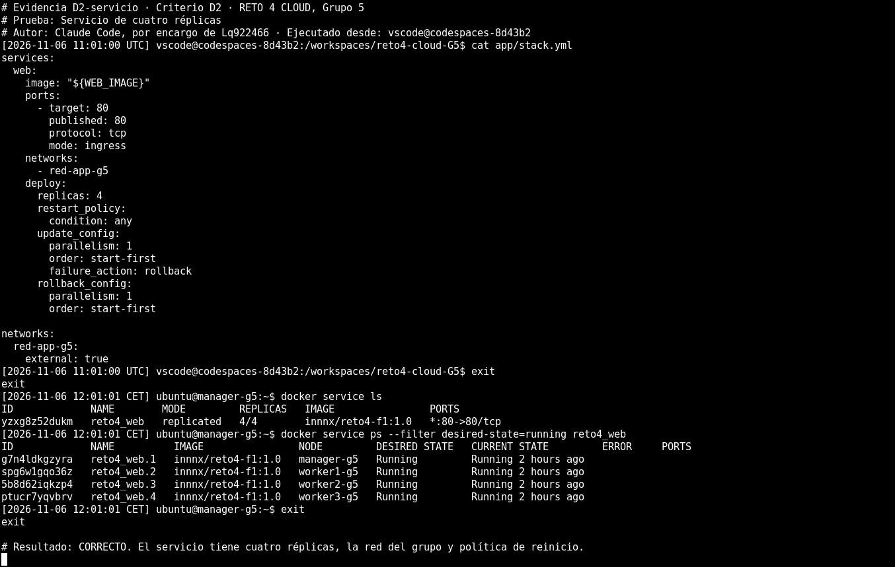

*Figura 39. Servicio de cuatro réplicas. Resultado: El servicio tiene cuatro réplicas, la red del grupo y política de reinicio. Autor:
Claude Code, por encargo de Cristina (Lq922466). 2026-11-06, 11:01 UTC. Máquinas: codespaces-8d43b2 y manager-g5.*

[Registro del despliegue](evidencias/F3-despliegue/registro.txt), con sondas y capturas por IP en
[F3-despliegue/](evidencias/F3-despliegue/), [estado final](evidencias/F3-estado-final.txt) y
[pila y servicio](evidencias/capturas-terminal/D2-pila-servicio.png).

### 4.8. Acceso por la IP pública de los cuatro nodos (D3)

**Procedimiento.**

```bash
# Procedimiento. Solo lectura: IP públicas actuales y respuesta de cada una.
aws ec2 describe-instances --region us-east-1 \
  --filters 'Name=tag:Name,Values=manager-g5,worker?-g5' 'Name=instance-state-name,Values=running' \
  --query 'Reservations[].Instances[].[Tags[?Key==`Name`]|[0].Value,PublicIpAddress]' --output text
curl -s -o /dev/null -w '%{http_code}\n' http://IP_PUBLICA/     # 200 si responde.
curl -s http://IP_PUBLICA/identidad.txt                           # Versión y contenedor.
```

En el navegador se abre `http://IP_PUBLICA/`, escribiendo `http://`, porque el portal no usa HTTPS.

**Explicación técnica.** Gracias al routing mesh, cualquier nodo acepta la conexión en el puerto 80, aunque no tenga ninguna réplica,
y la reenvía por la red ingress a una réplica sana. Por eso la web carga desde las cuatro IP.

El puerto 8080 está abierto en el grupo de seguridad porque lo indica la Guía, pero la pila no lo publica. El 9 de noviembre, los cuatro
nodos rechazaron la conexión en ese puerto.

| Comprobación | Fecha | Resultado |
| --- | --- | --- |
| Navegador gráfico real, Google Chrome for Testing, con la dirección visible | 5 de noviembre, 09:37 UTC | La web definitiva carga por las cuatro IP de ese día |
| HTTP e `identidad.txt` | 9 de noviembre, 08:33 UTC | HTTP 200 y `version=1.0` en `107.23.128.135`, `3.87.79.9`, `98.89.45.93` y `54.243.27.22`. Cada IP repartió 12 peticiones entre los mismos cuatro contenedores |

Las IP públicas cambian en cada sesión: hay que consultarlas el día de la corrección.

**Evidencias.**


*Figura 40. Web definitiva por la IP de manager-g5, en un navegador gráfico real sobre un escritorio virtual del Codespace. 5 de
noviembre de 2026, 09:37 UTC. Captura: Claude Code. Máquina: codespaces-8d43b2. No tiene el comentario que exige la norma.*

Capturas de [worker1-g5](evidencias/D3-navegador-worker1-g5.png), [worker2-g5](evidencias/D3-navegador-worker2-g5.png) y
[worker3-g5](evidencias/D3-navegador-worker3-g5.png), el [método](evidencias/D3-registro.txt), la
[portada completa](evidencias/F3-web-final-1.0-completa.png) y el
[registro del 9 de noviembre](evidencias/auditoria/registro-2026-11-09.txt).

**Pendiente:** capturas D3 conformes, con comentario, hechas con las IP del día.

### Resultado y conclusión de la Fase 4

La web del grupo se empaqueta en una imagen propia sobre Nginx, que identifica cada contenedor.

- **Docker Hub:** las versiones 1.0 y 2.0 se publicaron en `innnx/reto4-f1`, con los digests comprobados y descarga anónima desde los
  workers.
- **Servicio:** la pila define cuatro réplicas en el puerto 80, en la red `red-app-g5`, con reinicio siempre y actualización y rollback
  progresivos.
- **Despliegue:** se hizo sin fallos en las sondas.
- **Acceso:** la web respondió en las cuatro IP el 5 de noviembre, en un navegador, y de nuevo el 9 de noviembre, por HTTP.

D1 y D2 se consideran listos. D3 está demostrado, pero sus capturas de navegador no tienen el comentario que exige la norma.

## Fase 5: Orquestación

**Objetivo general.** Demostrar lo que aporta Swarm frente a un servidor único:

- reparto de carga;
- escalado;
- autorreparación;
- alta disponibilidad ante la caída de un worker y del líder;
- mantenimiento de nodos;
- actualización sin cortes con vuelta atrás.

La Guía pide documentarlo con capturas antes, durante y después, mientras un script consulta la web cada segundo. Criterios de la
Rúbrica: E1–E8. La Guía asigna 2 puntos a esta fase, y la Rúbrica, 1,5 puntos al bloque E.

| Qué pide la Guía | Situación a 9 de noviembre |
| --- | --- |
| Comprobar el reparto de tráfico y escalar a 8, 12 y bajar a 2 réplicas | **Demostrado** con la web definitiva |
| Borrar un contenedor manualmente y ver cómo Swarm lo recupera | **Demostrado** con la web definitiva |
| Apagar un worker y verificar que la web sigue activa y las réplicas se reubican | **Parcial:** solo con el portal provisional y en texto |
| Poner un nodo en modo drain y luego reactivarlo | **Demostrado** con la web definitiva |
| Pasar de 1.0 a 2.0 sin cortes, y luego revertir | **Demostrado** con la web definitiva |
| Promover 2 workers a manager, apagar el líder y comprobar que se elige uno nuevo | **Parcial:** solo con el portal provisional y sin el estado durante la parada |

### 5.0. Método común de las pruebas

**Procedimiento.** Las pruebas que modifican el servicio se lanzaron con scripts, siempre con autorización expresa:

```bash
# Literal: scripts del repositorio, 5 de noviembre.
bash scripts/probar-actualizacion.sh config/ssh.local innnx/reto4-f1 evidencias/F3-actualizacion      # E7.
bash scripts/probar-orquestacion.sh config/ssh.local innnx/reto4-f1 evidencias/F4-E2 e2              # E2. También e3 y e6.
```

Cada script:

1. Lee de EC2 las IP públicas vigentes.
2. Arranca una sonda por IP con [`sondear-web.sh`](scripts/sondear-web.sh).
3. Ejecuta la operación en el manager.
4. Espera a que el servicio vuelva a su estado.
5. Comprueba HTTP en las cuatro IP y recorre la web con un navegador.
6. Detiene las sondas y resume sus resultados.

Todo queda en un `registro.txt`, junto a la salida de cada sonda y las capturas.

**Explicación técnica.** La sonda pide `identidad.txt` **una vez por segundo y por IP**, y anota la hora, el resultado, la versión y
el contenedor. Es el «script que consulta la web cada segundo» que pide la Guía.

Una muestra por segundo demuestra que hubo respuesta en ese instante, pero no lo que ocurre entre dos muestras. Por eso este informe
habla de «muestras correctas», y no de «disponibilidad continua».

En E3 y E6 se aplicó un criterio de supervisión. La prueba se detiene si una IP acumula tres fallos seguidos, si no se recuperan las
réplicas o si alguna IP sigue fallando al terminar.

| Prueba | Fecha y hora (UTC) | Web | Evidencia principal |
| --- | --- | --- | --- |
| E1 | 5 nov. 09:24 y 09:53 · 6 nov. 10:31 · 9 nov. 08:33 | Definitiva | Estado final, captura conforme y registro del 9 de noviembre |
| E2 | 5 nov. 09:34 | Definitiva | [F4-E2](evidencias/F4-E2/) |
| E3 | 5 nov. 09:44 | Definitiva | [F4-E3](evidencias/F4-E3/) |
| E4 | 4 nov. 20:03–20:09 | **Provisional** | [E4-E5-E8](evidencias/E4-E5-E8-registro.txt) |
| E5 | 4 nov. 20:30 → 5 nov. 08:43 · 6 nov. 11:01 · 9 nov. 08:33 | Provisional y definitiva | Verificaciones de E5 y captura conforme |
| E6 | 5 nov. 09:46 | Definitiva | [F4-E6](evidencias/F4-E6/) |
| E7 | 5 nov. 09:21 | Definitiva | [F3-actualizacion](evidencias/F3-actualizacion/) |
| E8 | 4 nov. 20:14–20:18 | **Provisional** | [E8](evidencias/E8-eleccion-registro.txt) |

El 4 de noviembre, E1, E2, E3, E6 y E7 también se ejecutaron con el portal provisional. Se repitieron el 5 con la web definitiva, y
este informe presenta esas repeticiones. Las del 4 se conservan como registro: [fase 4 y 5](evidencias/prototipo/fase4-5.txt) y
[sonda: 156 correctas](evidencias/prototipo/sondeo-orquestacion.txt).

**Lo que falta en toda la fase.** Las capturas conformes de E2, E3, E6 y E7, tomadas antes, durante y después con la sonda visible,
requieren repetir las pruebas con autorización. Las capturas actuales de esas pruebas son reales, pero no muestran el prompt ni el
script.

### 5.1. E1: balanceo de carga (web definitiva)

**Procedimiento.**

```bash
# Literal, con la lista de IP abreviada: captura del 5 de noviembre, 09:53 UTC, y captura conforme del 6.
for ip in $IPS; do for i in 1 2 3 4; do curl -s --max-time 5 http://$ip/identidad.txt; done; done
```

**Explicación técnica.** Cada petición nueva abre una conexión TCP. El routing mesh, mediante IPVS en la red ingress, reparte las
conexiones entre las réplicas, sin importar a qué IP se dirijan. Si las respuestas llevan contenedores distintos, el reparto funciona.
Es la evidencia que pide la Rúbrica: «respuestas distintas».

| Fecha | Peticiones | Resultado |
| --- | --- | --- |
| 5 nov. 09:24 UTC | 12, por las cuatro IP | Cuatro contenedores distintos: 4, 3, 2 y 3 respuestas |
| 5 nov. 09:53 UTC | 16, cuatro por IP | Cada IP fue respondida por los mismos cuatro contenedores |
| 6 nov. 10:31 UTC | 16, cuatro por IP | Cada IP fue respondida por los mismos cuatro contenedores |
| 9 nov. 08:33 UTC | 48, doce por IP | Cada IP repartió exactamente 3 peticiones a cada uno de cuatro contenedores |

**Evidencias.**

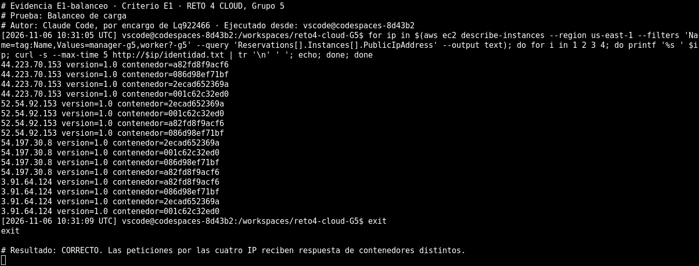

*Figura 41. Balanceo de carga. Resultado: Las peticiones por las cuatro IP reciben respuesta de contenedores distintos. Autor: Claude
Code, por encargo de Cristina (Lq922466). 2026-11-06, 10:31 UTC. Máquina: codespaces-8d43b2.*

[Estado final del 5 de noviembre](evidencias/F3-estado-final.txt), [captura anterior](evidencias/capturas-terminal/E1-reparto-peticiones.png)
y [registro del 9 de noviembre](evidencias/auditoria/registro-2026-11-09.txt).

### 5.2. E2: escalado a 8, 12 y 2 réplicas (web definitiva)

**Procedimiento.**

```bash
# Literal: dentro de probar-orquestacion.sh, en el manager.
docker service scale --detach=false reto4_web=8     # Después, 12, 2 y vuelta a 4.
docker service ps --filter desired-state=running reto4_web
```

**Explicación técnica.** `docker service scale` cambia el número deseado de réplicas. Swarm crea o elimina tareas hasta alcanzarlo, y
las reparte entre los nodos disponibles. `--detach=false` espera a que termine antes de devolver el control, para que la comprobación
siguiente vea el estado final.

| Réplicas | Reparto por nodo | HTTP en las 4 IP |
| --- | --- | --- |
| 8/8 | 2-2-2-2 | 200 |
| 12/12 | 3-3-3-3 | 200 |
| 2/2 | 1 en manager-g5 y 1 en worker2-g5 | 200 |
| 4/4 | 1-1-1-1 | 200 |

Con 2 réplicas, los nodos sin réplica siguieron respondiendo: es el routing mesh de E1.

**Observación.** Las sondas registraron 562 respuestas correctas y 2 tiempos de espera. Los dos ocurrieron durante la reducción de 12
a 2 réplicas, a las 09:35:38 UTC: una muestra de 34.230.4.20 y otra de 98.81.203.125 superaron el límite de 0,9 s. Las muestras
anterior y siguiente fueron correctas. Son 2 de 564 peticiones, y **no se ha determinado la causa**. Por esta observación, el registro
termina con código 1. Después se definió el criterio de supervisión de E3 y E6.

**Evidencias.**


*Figura 42. Doce réplicas. 5 de noviembre de 2026, 10:35 en Madrid. Captura: Claude Code. Máquina: manager-g5. No muestra el prompt
que exige la norma.*

[Registro, sondas y capturas de cada estado](evidencias/F4-E2/). **Pendiente:** capturas conformes antes, durante y después.

### 5.3. E3: autorreparación (web definitiva)

**Procedimiento.**

```bash
# Literal, en manager-g5, que alojaba la tarea.
docker rm -f 223aad67af29
docker service ps --filter name=reto4_web.1 reto4_web
```

**Explicación técnica.** `docker rm -f` elimina el contenedor a la fuerza, como si hubiera fallado. Swarm compara el estado real (3
réplicas) con el deseado (4): marca la tarea como fallida y crea otra. Es la `restart_policy: condition: any` de la pila.

Swarm registró `non-zero exit (137)`, que corresponde a un proceso terminado con `SIGKILL`, y creó la tarea `lgmt4tdycl4a` en el mismo
nodo. El contenedor se eliminó a las 09:45:01 UTC, y a las 09:45:16 UTC el servicio volvía a estar en 4/4. Las sondas registraron 308
respuestas correctas y 0 fallos.

**Evidencias.**


*Figura 43. Reemplazo de la tarea. 5 de noviembre de 2026, 10:45 en Madrid. Captura: Claude Code. Máquina: manager-g5. No muestra el
prompt que exige la norma.*

[Registro, sondas y capturas antes y después](evidencias/F4-E3/). **Pendiente:** capturas conformes.

### 5.4. E4: caída de un worker (portal provisional)

**Procedimiento.**

```bash
# Deducido de la salida: solo sobre worker3-g5, el 4 de noviembre.
aws ec2 stop-instances --instance-ids i-0446409b26cf0a662
aws ec2 start-instances --instance-ids i-0446409b26cf0a662
```

**Explicación técnica.** Al detener la instancia, el nodo deja de enviar señales al manager, y Swarm lo marca como `Down`. Sus tareas
se crean de nuevo en los nodos disponibles para mantener el número de réplicas.

| Hora (UTC) | Qué muestra el registro |
| --- | --- |
| 20:03:57 | Antes: cuatro nodos Ready/Active, 4/4 y worker3-g5 seleccionado |
| 20:05:38 | EC2 informa `stopped`. Swarm marca worker3-g5 como `Down` y muestra `5/4` |
| 20:05:40 | `reto4_web.1` ya corre en manager-g5 |
| 20:03:57–20:06:40 | Sonda: 164 respuestas correctas y 0 fallos |
| 20:08:53 | worker3-g5 `active`, cuatro nodos Ready/Active y 4/4 |

`5/4` es transitorio: la tarea del nodo caído se sigue contando hasta que Swarm puede confirmar que se ha detenido. Se normalizó al
volver el nodo.

**Límites.**

- Solo se hizo con el portal provisional.
- La URL sondeada no consta.
- No hay capturas de la consola.
- La captura web no muestra IP ni hora.

Es además la demostración en directo que pide la exposición. [Análisis completo](evidencias/auditoria/E4-E8.md) y
[plan para repetirla](entrega/PLAN-C3-E4-E8.md), que requiere autorización.

**Evidencias.** [Registro](evidencias/E4-E5-E8-registro.txt), [estado durante la parada](evidencias/prototipo/E4-worker-down.txt),
[E4 y E5](evidencias/prototipo/E4-E5.txt), [sonda](evidencias/prototipo/E4-E5-http.txt) y
[captura web](evidencias/E4-web-worker-down.png). **Pendiente:** repetirla con la web definitiva y capturas conformes.

### 5.5. E5: reincorporación, reequilibrio y reinicio del laboratorio

**Procedimiento.** La Rúbrica agrupa dos comprobaciones:

1. **Reincorporación y reequilibrio.** Al volver worker3-g5 en E4, el nodo quedó `Ready/Active`. Swarm no mueve las tareas que ya
   funcionan, así que se forzó una redistribución:

   ```bash
   # Literal.
   docker service update --quiet --detach --force reto4_web
   ```

   Se aplicó en E4, el 4 de noviembre entre las 20:09:14 y las 20:09:43 UTC, con el portal provisional. Se repitió en E6, el 5 de
   noviembre, con la web definitiva. Ver [reincorporación](evidencias/prototipo/E5-worker-recuperado.txt) y
   [reparto](evidencias/prototipo/E5-reparto.txt).

2. **Reinicio del laboratorio.** Con End Lab y Start Lab desde AWS Academy:

   ```bash
   # Literal.
   bash scripts/verificar-e5.sh ~/DIRECTORIO_PRIVADO_DE_RESPALDO
   ```

**Explicación técnica.** [`verificar-e5.sh`](scripts/verificar-e5.sh) compara el estado tras el reinicio con una referencia guardada
antes: ID de instancia, volúmenes raíz, controles, IP, SSH, Swarm, redes, réplicas y HTTP.

`--force` redistribuye las tareas réplica a réplica, con `start-first`, sin cortar el servicio.

| Momento | Qué se comprobó |
| --- | --- |
| 4 nov. 20:30–20:31 UTC | Preparación y referencia previa |
| 4 nov. 20:51 UTC | Primer intento detenido por la denegación `voc-cancel-cred`, porque faltaba renovar las credenciales |
| 5 nov. 08:43 UTC | Mismos ID y volúmenes raíz, controles `ok`, IP públicas distintas. SSH, Swarm con tres managers, redes, 4/4 y HTTP correctos. Servía aún el portal provisional |
| 6 nov. 11:01 UTC | Tras otro reinicio, y ya con la web definitiva: las mismas instancias en el clúster, con otras IP públicas y 4/4 |
| 9 nov. 08:33 UTC | Tras otro reinicio: mismas instancias, IP públicas nuevas y web en las cuatro IP. **Swarm no comprobado**, por falta de SSH |

**Evidencias.**


*Figura 44. Nodos y servicio tras el reinicio del laboratorio. Resultado: Tras reiniciar el laboratorio, las mismas instancias siguen
en el clúster con 4/4. Autor: Claude Code, por encargo de Cristina (Lq922466). 2026-11-06, 11:01 UTC. Máquinas: codespaces-8d43b2 y manager-g5.*

[Preparación](evidencias/E5-preparacion.txt), [antes](evidencias/E5-verificacion-previa.txt),
[intento interrumpido](evidencias/E5-verificacion-posterior.txt), [después](evidencias/E5-verificacion-final.txt) y
[registro del 9 de noviembre](evidencias/auditoria/registro-2026-11-09.txt). La captura
[E5-web-recuperado](evidencias/E5-web-recuperado.png) es del portal tras reincorporar un worker en E4, no tras reiniciar el
laboratorio.

### 5.6. E6: mantenimiento con modo drain (web definitiva)

**Procedimiento.**

```bash
# Literal: dentro de probar-orquestacion.sh, en el manager.
docker node update --availability drain worker3-g5
docker node update --availability active worker3-g5
docker service update --quiet --detach --force reto4_web
```

**Explicación técnica.** `drain` retira un nodo para mantenimiento: Swarm traslada sus tareas a otros nodos y deja de asignarle nuevas,
pero el nodo sigue en el clúster. Al volver a `active` puede recibir tareas, aunque Swarm no mueve las que ya funcionan. Por eso se
fuerza el reequilibrio.

Con worker3-g5 en Drain, su tarea migró a worker2-g5, con un reparto 1-1-2-0, y el servicio siguió en 4/4. Tras volver a Active, la
actualización forzada dejó una réplica por nodo. Las sondas registraron 488 respuestas correctas y 0 fallos.

**Evidencias.**

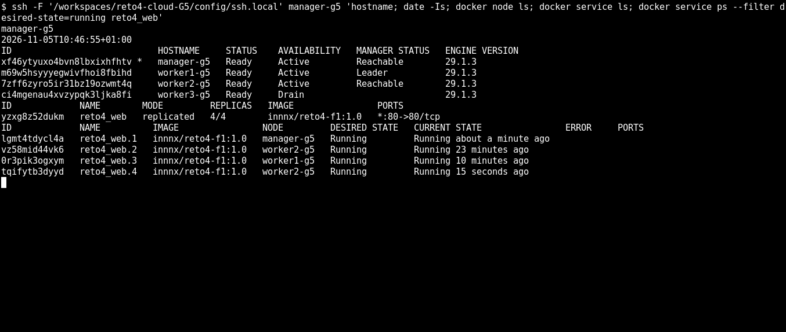

*Figura 45. worker3-g5 en Drain. 5 de noviembre de 2026, 10:46 en Madrid. Captura: Claude Code. Máquina: manager-g5. No muestra el
prompt que exige la norma.*

[Registro, sondas y capturas antes, durante y después](evidencias/F4-E6/). **Pendiente:** capturas conformes.

### 5.7. E7: actualización de 1.0 a 2.0 sin corte y rollback (web definitiva)

**Procedimiento.**

```bash
# Literal: dentro de probar-actualizacion.sh, en el manager.
docker service update --quiet --detach=false --image innnx/reto4-f1:2.0 reto4_web
docker service rollback --quiet --detach=false reto4_web
```

**Explicación técnica.** Con `update_config` (`parallelism: 1`, `order: start-first`), Swarm arranca una réplica 2.0, espera a que esté
en marcha y solo entonces retira una 1.0, y así hasta cambiar las cuatro. Siempre hay réplicas sirviendo, y por eso no hay corte.

`docker service rollback` vuelve a la configuración anterior del servicio con el mismo método. Si la actualización hubiera fallado,
`failure_action: rollback` habría vuelto atrás automáticamente.

La actualización y el rollback terminaron en 4/4, con la versión esperada en las cuatro IP. El navegador recorrió 6 páginas en la 2.0
y 5 en la 1.0, sin errores. La página de estado de la 2.0 mostró la versión y la réplica.

Las sondas registraron 620 respuestas correctas y 0 fallos, con respuestas de las dos versiones durante el cambio: unas 77 de la 1.0 y
78 de la 2.0 por IP.

**Evidencias.** [Registro](evidencias/F3-actualizacion/registro.txt), [sondas y capturas por IP](evidencias/F3-actualizacion/) e
[historial de tareas](evidencias/capturas-terminal/E7-historial-versiones.png), este último tomado después de la prueba.
**Pendiente:** captura conforme durante la actualización, con la sonda y el navegador.

### 5.8. E8: elección de un nuevo líder (portal provisional)

**Procedimiento.**

```bash
# Deducido de la salida, el 4 de noviembre.
docker node promote worker1-g5 worker2-g5                      # En manager-g5: tres managers.
aws ec2 stop-instances --instance-ids i-0e6ebf2af63facc60      # Solo el líder.
docker node ls                                                 # Desde worker1-g5, otro manager.
aws ec2 start-instances --instance-ids i-0e6ebf2af63facc60
```

**Explicación técnica.** Los managers mantienen el estado del clúster con el algoritmo **Raft**. Con tres managers, la mayoría es dos.
Si cae el líder, los otros dos siguen teniendo mayoría y eligen un líder nuevo. Por eso la Guía pide promover dos workers antes de
apagar el líder.

El listado se hace «desde otro» manager, como pide la Rúbrica, porque el líder caído no puede responder.

| Hora | Qué muestra el registro |
| --- | --- |
| 21:07:37, hora de Madrid | Tres managers, con manager-g5 como líder |
| 21:14:38, hora de Madrid | Antes de la parada, visto desde worker1-g5: manager-g5 líder y 4/4 |
| 20:14:37–20:15:14 UTC | Primer tramo de sonda: 38 respuestas correctas |
| 20:15:14–20:15:48 UTC | **34 segundos sin muestras** |
| 20:15:48–20:17:57 UTC | Segundo tramo de sonda: 130 respuestas correctas |
| 21:15:50, hora de Madrid | Desde worker1-g5: **worker2-g5 es el líder**, manager-g5 está Ready/Reachable y el servicio en 4/4 |
| 21:17:55, hora de Madrid | manager-g5 con IP pública nueva, 98.93.8.44, y activo como manager |

**Límites.**

- No hay ninguna salida de `docker node ls` tomada durante la parada. La elección se demuestra comparando antes y después.
- La parada del nodo se deduce de que cambió su IP pública: el registro no contiene `stopped`.
- Hay 34 segundos sin muestras de sonda, y la URL sondeada no consta.
- Solo se hizo con el portal provisional, y sin capturas de la consola.

[Análisis completo](evidencias/auditoria/E4-E8.md).

**Evidencias.** [Registro](evidencias/E8-eleccion-registro.txt), [cuórum previo](evidencias/prototipo/E8-quorum-previo.txt),
[elección](evidencias/prototipo/E8-eleccion.txt), [sonda del primer tramo](evidencias/prototipo/E8-http.txt),
[recuperación](evidencias/prototipo/E8-recuperacion.txt), [sonda del segundo tramo](evidencias/prototipo/E8-http-recuperacion.txt),
capturas web [durante](evidencias/E8-web-parada.png) y [después](evidencias/E8-web-recuperado.png), que no muestran IP, hora ni estado,
y [comprobación posterior](evidencias/verificacion-posterior.txt). **Pendiente:** repetirla con la web definitiva y con captura desde
otro manager durante la parada.

### Resultado y conclusión de la Fase 5

| Prueba | Web | Resultado | Sondas | Situación |
| --- | --- | --- | --- | --- |
| E1 Balanceo | Definitiva | Cuatro contenedores distintos por cualquier IP, el 5, el 6 y el 9 de noviembre | — | Demostrado |
| E2 Escalado | Definitiva | 8/8, 12/12, 2/2 y 4/4 | 562 correctas, 2 tiempos de espera aislados | Demostrado, con observación |
| E3 Autorreparación | Definitiva | Contenedor eliminado y reemplazado, 4/4 | 308 correctas, 0 fallos | Demostrado |
| E4 Caída de un worker | **Provisional** | `Down`, tarea reubicada y reincorporación | 164 correctas, 0 fallos | **Parcial** |
| E5 Reincorporación y reinicio | Provisional y definitiva | Mismas instancias y discos, Swarm y servicio correctos tras cada reinicio comprobado | — | Demostrado |
| E6 Drain | Definitiva | Tarea migrada, vuelta a Active y una réplica por nodo | 488 correctas, 0 fallos | Demostrado |
| E7 Actualización y rollback | Definitiva | 1.0 → 2.0 → 1.0, en 4/4 | 620 correctas, 0 fallos | Demostrado |
| E8 Elección de líder | **Provisional** | Líder nuevo, comparando antes y después | 38 y 130 correctas, con 34 s sin muestras | **Parcial** |

Swarm demostró balanceo, escalado, autorreparación, mantenimiento y actualización sin fallos en las muestras, con la web definitiva.
E4 y E8, que detienen instancias, solo se hicieron con el portal provisional y sin capturas conformes. Repetirlos requiere
autorización, y E4 es además la demostración que pide la exposición.

En todas las pruebas falta la serie de capturas conformes antes, durante y después con la sonda visible. Es la principal carencia
de documentación de esta fase.

## Seguridad

Resumen de las medidas explicadas en cada fase:

- **Credenciales de AWS.** Están solo en `~/.aws/credentials`, con permisos 600, fuera del repositorio. Se renuevan en cada sesión
  (sección Learner Lab), y las capturas y registros ocultan el identificador de la cuenta.
- **Secretos en Git.** `.gitignore` excluye estado, planes, variables, claves privadas y credenciales. La revisión de todo el historial
  no encontró ninguno ([registro](evidencias/auditoria/registro-repositorio.txt) y Figura 7).
- **Red.** El SSH externo se limita a una IP `/32`. Los puertos de Swarm y el ICMP se limitan al propio grupo de seguridad. A Internet
  solo se abren el 80 y el 8080.
- **SSH.** Solo con clave, sin root ni contraseña, con permisos 700 y 600 y con la huella de los servidores comprobada.
- **Docker Hub.** La sesión se abre solo para publicar y se cierra siempre. El repositorio de imágenes es público, para descargar sin
  credenciales.
- **Web.** Se retiró una credencial de demostración del JavaScript antes de versionarlo, los formularios no envían datos, y la
  construcción rechaza archivos con apariencia de secreto.

## Incidencias y soluciones

| Incidencia | Solución o estado | Evidencia |
| --- | --- | --- |
| Docker pedía confirmación al retirar la red `ingress`, y la creación de `red-g5` falló con `AlreadyExists` | Se corrigió el script para confirmar la retirada | [Registro](evidencias/prototipo/fase2-3.txt) |
| Credenciales de AWS rechazadas tras reiniciar el laboratorio (`voc-cancel-cred`) | Se renovaron y se completó E5 | [Intento](evidencias/E5-verificacion-posterior.txt) y [resultado](evidencias/E5-verificacion-final.txt) |
| Cuatro páginas enlazaban a `#escuderias`, que no existía | Se añadió el destino y un validador de enlaces | Commit `bcfceee` |
| Docker no puede ejecutarse en el Codespace, por falta de permisos del contenedor | Las imágenes se construyeron en manager-g5 | [Registro](evidencias/D1-imagenes-definitivas.txt) |
| Docker Hub rechazó el primer token (`insufficient scopes`) | Se abrió una sesión nueva y se publicó | [Intento](evidencias/D1-publicacion-intento-fallido.txt) y [resultado](evidencias/D1-publicacion-dockerhub.txt) |
| La regla SSH activa no tenía descripción, y el código sí, así que el plan de A6 incluía un segundo cambio | Se alineó el código con la regla real, sin tocarla, y se usó la IP vigente | [Plan descartado](evidencias/A6-plan-actual.txt) y [final](evidencias/A6-plan-final.txt) |
| El portal provisional y la web definitiva responden `version=1.0` | La verificación comprueba la imagen de cada tarea | [Registro](evidencias/F3-despliegue/registro.txt) |
| Reparto desigual tras el despliegue y el rollback | E6 terminó con una réplica por nodo | [Estado](evidencias/F3-estado-final.txt) y [E6](evidencias/F4-E6/registro.txt) |
| Dos tiempos de espera aislados en E2 | Causa no determinada. Se acordó un criterio de supervisión para E3 y E6 | [Registro](evidencias/F4-E2/registro.txt) |
| AWS y la web dejaron de responder a las 11:07 UTC del 5 de noviembre, y la IP del Codespace cambió | Resuelto el 6 de noviembre: credenciales renovadas y regla SSH sustituida por la IP vigente, con autorización | [Auditoría](evidencias/auditoria/INFORME.md) y [registro](evidencias/auditoria/registro-2026-11-06.txt) |
| La IP del Codespace volvió a cambiar el 6 de noviembre, entre las 09:19 y las 10:27 UTC, y se perdió el SSH | Resuelto a las 10:50 UTC con nueva autorización: se añadió la regla, se comprobó SSH en los cuatro nodos y se retiró la antigua | [Registro](evidencias/auditoria/registro-2026-11-06.txt) |
| La generación de capturas se quedó colgada en C2, porque `import` no encuentra una ventana con acento en el título | El identificador pasó a `C2-cluster`, el catálogo solo admite identificadores ASCII e `import` tiene un tiempo límite | [`capturas-norma.py`](scripts/capturas-norma.py) |
| El verificador de capturas dio por correcta la de A6 con la salida vacía, porque encontró el patrón esperado en el propio comando | Se retiró esa captura y el verificador dejó de evaluar el comando escrito. Las demás capturas se reevaluaron con esa regla, sin ningún cambio de resultado | [`capturas-norma.py`](scripts/capturas-norma.py) |
| La clave pública de Cristina llegó con un salto de línea de Windows | Se retiró sin cambiar la huella. No consta esta incidencia en las claves de Enrique, Alexandra o Ibai | [Registro de la incidencia](evidencias/auditoria/registro-2026-11-09-b1.txt) y [procedimiento de claves](entrega/PROCEDIMIENTO-CLAVES.md) |
| 9 de noviembre: credenciales caducadas (`RequestExpired`) | Se renovaron, y AWS volvió a responder | [Registro](evidencias/auditoria/registro-2026-11-09.txt) |
| 9 de noviembre: la IP del Codespace pasó a `172.166.151.114` y la regla admitía `172.166.151.115/32` | Resuelto a las 09:22 UTC, con autorización: se añadió la regla nueva, se comprobó SSH en los cuatro nodos y se retiró la antigua | [Registro](evidencias/auditoria/registro-2026-11-09-b1.txt) |

## Contraste con los 42 criterios de la Rúbrica

Valoración de **cómo está documentado** cada criterio en este informe, a 9 de noviembre. El estado técnico oficial de cada criterio
es el de [REVISION.md](REVISION.md), que coincide con el [índice de evidencias](evidencias/INDICE.md).

- **Bien documentado:** explicado, con procedimiento y con evidencia conforme a la norma.
- **Necesita más:** explicado y con evidencia real, pero falta una captura conforme o complementaria, o una explicación.
- **Sin evidencia suficiente:** el requisito no está demostrado, o la evidencia no lo cubre.

| Criterio | Qué pide la Rúbrica | Estado en REVISION | Apartado | Documentación |
| --- | --- | --- | --- | --- |
| A1 | Proyecto organizado, con variables | Listo | 1.1, 1.2 | **Bien documentado** |
| A2 | Manager + 3 workers definidos una vez; etiquetas | Demostrado, falta captura conforme | 1.5 | **Necesita más:** la Rúbrica pide la consola de EC2. Hay captura conforme de terminal |
| A3 | Security group con política de mínimos | Demostrado, falta captura conforme | 1.4, L.10 | **Bien documentado.** Captura conforme de las reglas |
| A4 | Script de arranque (hostname, zona, Docker, claves) | Demostrado, falta captura conforme | 1.6 | **Bien documentado.** Capturas conformes del script y del arranque |
| A5 | Salidas con IP pública, privada e ID | Demostrado, falta captura conforme | 1.7 | **Bien documentado.** Captura conforme |
| A6 | Pruebas clave: validación, plan, cambio, destrucción | Parcial | 1.8–1.10 | **Sin evidencia suficiente:** falta la destrucción y la secuencia en capturas |
| B1 | Clave propia en 4 nodos; vockey sustituida | Parcial | 2.1, 2.2, 2.9 | **Necesita más:** las claves de los cuatro integrantes, instaladas en los 4 nodos, con captura conforme. Cristina entró en los cuatro nodos, y Enrique, Alexandra e Ibai en manager-g5, confirmado por el registro de cada nodo. Faltan el acceso de Enrique, Alexandra e Ibai a los workers, capturas con comentario, las claves en GitHub y aclarar `vockey` |
| B2 | Archivo config SSH con nombre corto | Parcial | 2.5 | **Bien documentado.** Capturas conformes de la plantilla y de la conexión |
| B3 | Control total, órdenes simultáneas y copia ficheros | Demostrado, falta captura conforme | 2.7, 2.8 | **Bien documentado.** Capturas conformes |
| B4 | Sin contraseña ni root; permisos locales | Demostrado, falta captura conforme | 2.3, 2.4 | **Bien documentado.** Captura conforme |
| B5 | Acceso a workers por IP privada (salto) | Demostrado, falta captura conforme | 2.6 | **Bien documentado.** Captura conforme |
| C1 | Docker en 4 nodos; conectividad por IP privada | Demostrado, falta captura conforme | 3.1, 3.2 | **Bien documentado.** Captura conforme |
| C2 | Clúster por IP privada; MTU ajustado (1450) | Demostrado, falta captura conforme | 3.3, 3.4 | **Necesita más:** falta aclarar la MTU de 1400 medida dentro de los contenedores |
| C3 | 4 nodos activos, manager líder, 3 workers unidos | Parcial | 3.5 | **Sin evidencia suficiente:** hay tres managers. Corregirlo requiere autorización |
| C4 | Red overlay propia para servicios | Demostrado, falta captura conforme | 3.4 | **Bien documentado.** Captura conforme |
| D1 | Imagen propia (identifica contenedor); ver 1.0 y 2.0 | Listo | 4.2–4.6 | **Bien documentado** |
| D2 | Servicio 4 réplicas, red grupo, políticas reinicio | Listo | 4.7 | **Bien documentado** |
| D3 | Accesible por IP pública de los 4 nodos | Demostrado, falta captura conforme | 4.8 | **Necesita más:** las capturas de navegador no llevan comentario. Comprobado de nuevo por HTTP el 9 de noviembre |
| E1 | Balanceo de carga | Demostrado, falta captura conforme | 5.1 | **Bien documentado.** Captura conforme |
| E2 | Escalado (8, 12, 2) | Demostrado, falta captura conforme | 5.2 | **Necesita más:** capturas conformes con la sonda, y la causa de los dos tiempos de espera |
| E3 | Autorreparación (eliminar contenedor) | Demostrado, falta captura conforme | 5.3 | **Necesita más:** capturas conformes antes y después |
| E4 | Alta disponibilidad (caída worker) | Parcial | 5.4 | **Sin evidencia suficiente:** solo con el portal provisional y en texto |
| E5 | Reincorporación y reequilibrio; reinicio lab | Demostrado, falta captura conforme | 5.5, L.1 | **Bien documentado.** Captura conforme tras el reinicio. Falta la vista de EC2 |
| E6 | Mantenimiento (modo drain) | Demostrado, falta captura conforme | 5.6 | **Necesita más:** capturas conformes antes, durante y después |
| E7 | Actualización (1.0 a 2.0) sin corte y rollback | Demostrado, falta captura conforme | 5.7 | **Necesita más:** captura conforme durante la actualización, con la sonda y el navegador |
| E8 | Alta disp. managers (nuevo líder) | Parcial | 5.8 | **Sin evidencia suficiente:** provisional y sin listado durante la parada |
| F1 | Privado, todos colaboradores, profesor invitado | Parcial | 0.1, 0.4 | **Sin evidencia suficiente:** falta confirmar al profesor y a los integrantes |
| F2 | Commits repartidos y uso de Pull Requests por colaboradores | Parcial | 0.5 | **Sin evidencia suficiente:** una PR de Enrique, con su commit hecho desde la web. Faltan commits desde WSL o Git Bash de Enrique, Alexandra e Ibai, y las PR de Alexandra e Ibai. Ver las [instrucciones de F2](entrega/INSTRUCCIONES-F2-INTEGRANTES.md) |
| F3 | README.md (resumen, instrucciones rápidas, enlaces) | Listo | [README](README.md) | **Bien documentado** |
| F4 | Estructura (/terraform, /app, /config, y .devcontainer) | Listo | 0.3 | **Bien documentado** |
| F5 | Entorno colaborativo: .devcontainer y capturas Codespace | Listo | 0.2 | **Bien documentado** |
| F6 | Código Terraform funcional | Listo | Fase 1 | **Bien documentado** |
| F7 | Scripts comentados | Listo | Todas las fases | **Bien documentado.** [Captura conforme](evidencias/capturas-conformes/F7-scripts.png) |
| F8 | Mapa arquitectura propio | Listo | Arquitectura | **Bien documentado** |
| F9 | proyecto.md: Informe extenso Fases 0-5 paso a paso | Parcial | Este informe | **Necesita más:** el informe cubre las Fases 0–5 paso a paso, pero depende de las capturas que faltan |
| F10 | Capturas de evidencias (Fases 0-5) con normativa y comentadas | Parcial | Todas las fases | **Sin evidencia suficiente:** faltan capturas conformes en A2, A6, B1, D3, E2–E4, E6–E8 y Learner Lab |
| F11 | Reparto tareas y reflexión | Parcial | [GESTION.md](GESTION.md) | **Sin evidencia suficiente:** borrador sin completar por el grupo |
| F12 | Sin credenciales, claves ni estado de tf | Listo | 0.6, Seguridad | **Bien documentado** |
| F13 | Documentación práctica individual | Pendiente | 1.1 | **Sin evidencia suficiente:** carpeta sin contenido |
| G1 | Exposición (10 min): demo, arquitectura, código | Pendiente | [DEFENSA.md](entrega/DEFENSA.md) | No se acredita en el informe: se evalúa el día de la exposición |
| G2 | Preguntas individuales a cualquier miembro | Pendiente | [DEFENSA.md](entrega/DEFENSA.md) | No se acredita en el informe |
| G3 | Demostración técnica individual | Pendiente | [DEFENSA.md](entrega/DEFENSA.md) | No se acredita en el informe. Requiere laboratorio activo y SSH |

**Resumen:**

| Valoración | Criterios |
| --- | --- |
| Bien documentados (21) | A1, A3, A4, A5, B2, B3, B4, B5, C1, C4, D1, D2, E1, E5, F3, F4, F5, F6, F7, F8 y F12 |
| Necesitan más (9) | A2, B1, C2, D3, E2, E3, E6, E7 y F9 |
| Sin evidencia suficiente (9) | A6, C3, E4, E8, F1, F2, F10, F11 y F13 |
| Se evalúan en la exposición (3) | G1, G2 y G3 |

**Pendiente de actualizar en `REVISION.md`.** Desde el 6 de noviembre existen capturas conformes de A2–A5, B2–B5, C1–C4, D2, E1 y E5.
`REVISION.md` todavía indica «falta captura conforme» en varios de ellos, y «Parcial» en B2. Antes de cambiar esos estados hay que
subir las capturas a GitHub y revisar cada una.

## Lo que no se ha demostrado

| Aspecto | Situación a 9 de noviembre |
| --- | --- |
| Destrucción con Terraform (A6) | No ejecutada. Requiere autorización aparte |
| Claves individuales (B1) | Las de los cuatro integrantes, instaladas en los cuatro nodos el 9 de noviembre. No están en GitHub. Cristina entró con su clave en los cuatro nodos. Enrique, Alexandra e Ibai entraron en manager-g5, pero no en los workers. Regla temporal `88.14.93.201/32` abierta, que hay que retirar después |
| Topología de C3 | Tres managers desde E8. Corregirla requiere autorización |
| E4 y E8 con la web definitiva | No repetidas. Requiere autorización, porque detienen instancias |
| Estado del clúster durante la parada de E8 | Sin registro |
| Disponibilidad continua | Las sondas son muestras por segundo y, en E2, hubo dos tiempos de espera |
| Estado actual de Swarm | Comprobado el 9 de noviembre a las 09:26 UTC: 4/4, con el líder en worker2-g5 y tres managers |
| Capturas de la consola de AWS y de Learner Lab | No hay ninguna |
| Cumplimiento de la Guía y la Rúbrica | Faltan capturas conformes y trabajo del grupo. [Contraste](entrega/CONTRASTE-GUIA-RUBRICA.md) |

## Entregables y exposición

| Qué pide la Guía | Situación a 9 de noviembre |
| --- | --- |
| Repositorio privado, con el profesor antes de la fecha límite y commits y PR de todos | **Parcial:** privado y con una PR de Enrique. Falta el profesor, y commits y PR de Alexandra e Ibai |
| `/.devcontainer` con evidencias del Codespace funcionando | **Cumple** |
| `/terraform`: código, script de arranque y claves públicas | **Parcial:** las tres claves públicas están en `terraform/claves/`, pero pendientes de subir a GitHub |
| `/app`: Dockerfile, código en sus dos versiones y script de despliegue | **Cumple** |
| `/config`: plantilla SSH y configuraciones aplicadas | **Cumple** |
| `/scripts`: comentados, con actualización de IP, comprobaciones y consultas | **Cumple** |
| `/diagramas`: mapa de la arquitectura | **Cumple**, con la topología actual |
| `/practica-individual`: práctica de prueba previa | **Pendiente** |
| `README.md`, `PROYECTO.md` y `GESTION.md` | `README.md` listo. `PROYECTO.md` ampliado, con capturas por completar. `GESTION.md` en borrador |
| Exposición: arquitectura, código, caída de nodo en directo y reparto de tareas | **Pendiente.** [Material preparado](entrega/DEFENSA.md) y [presentación](entrega/presentacion-cloud-g5.pptx) |
| Individual: 2 o 3 preguntas y demostración técnica en vivo | **Pendiente** |

## Referencias

[Criterios](REVISION.md) · [evidencias](evidencias/INDICE.md) · [capturas conformes](evidencias/capturas-conformes/INDICE.md) ·
[capturas de terminal](evidencias/capturas-terminal/INDICE.md) · [auditoría](evidencias/auditoria/INFORME.md) ·
[E4 y E8](evidencias/auditoria/E4-E8.md) · [gestión](GESTION.md) · [defensa](entrega/DEFENSA.md) ·
[checklist](entrega/CHECKLIST-FINAL.md) · [contraste con la Guía y la Rúbrica](entrega/CONTRASTE-GUIA-RUBRICA.md) ·
[procedimiento de capturas](entrega/PROCEDIMIENTO-CAPTURAS.md) · [procedimiento de claves](entrega/PROCEDIMIENTO-CLAVES.md) ·
[plan de C3, E4 y E8](entrega/PLAN-C3-E4-E8.md) · [revisión de la documentación de Enrique](entrega/REVISION-ENRIQUE.md)
