# RETO 4 CLOUD · Grupo 5

**Web del Gran Premio de Euskadi en un clúster Docker Swarm creado con Terraform sobre AWS**

Informe técnico de las Fases 0 a 5 (`PROYECTO.md`)

| | |
| --- | --- |
| **Ciclo y reto** | 2.º ASIR · Reto 4 CLOUD (Producto 6 del grupo, Cloud) |
| **Grupo** | 5. Todos los recursos llevan el sufijo `g5` |
| **Integrantes** | Cristina (Lq922466), Enrique (EnriZx2), Alexandra (alexguerth) e Ibai (ibaiaretxabalaasir-collab) |
| **Responsable del producto Cloud** | Cristina |
| **Repositorio** | `Lq922466/reto4-cloud-G5`, privado. Rama única de trabajo y de entrega: `main` |
| **Imágenes de la web** | [`innnx/reto4-f1`](https://hub.docker.com/r/innnx/reto4-f1/tags), etiquetas `1.0` y `2.0` |
| **Nube** | AWS Academy Learner Lab, región `us-east-1`, VPC por defecto |
| **Revisión del informe** | 18 de noviembre de 2026 |
| **Último estado técnico registrado** | Terraform: 10 de noviembre. Swarm, SSH y web: 9 de noviembre. Desde entonces no se ha accedido a AWS ni al clúster |

La versión anterior de este informe se conserva como [copia histórica](entrega/historico/PROYECTO-2026-11-09.md).

## Introducción

El objetivo del reto es publicar en la nube la web desarrollada para el Gran Premio de Euskadi de Fórmula 1, de forma que soporte picos de tráfico y siga disponible aunque falle un servidor. Para conseguirlo, el grupo ha seguido las seis fases de la Guía del profesor:

| Fase | Qué se construye | Criterios de la Rúbrica |
| --- | --- | --- |
| 0 | Repositorio privado en GitHub y Codespace como máquina de control | F1–F5, F7, F12 |
| 1 | Cuatro servidores Ubuntu 22.04 en AWS, definidos como código con Terraform | A1–A6, F6, F13 |
| 2 | Administración por SSH con claves propias, nombres cortos y salto a los workers | B1–B5 |
| 3 | Clúster Docker Swarm por IP privada, con redes overlay de MTU 1450 | C1–C4 |
| 4 | Imagen propia de la web en Docker Hub (1.0 y 2.0) y servicio de cuatro réplicas | D1–D3 |
| 5 | Pruebas de balanceo, escalado, autorreparación, alta disponibilidad, mantenimiento y actualización | E1–E8 |
| Entregables | Mapa de arquitectura, este informe con sus capturas y reparto de tareas | F8, F9, F10, F11 |
| Exposición | Presentación de 10 minutos con caída de un nodo en directo, preguntas y demostración individual | G1–G3 |

Este documento es el informe principal que pide la Guía y que evalúan los criterios **F9** («informe extenso Fases 0-5 paso a paso») y **F10** («capturas de evidencias con normativa y comentadas»). Explica qué se hizo, cómo, por qué, con qué herramientas y cómo se comprobó cada resultado, de forma que el procedimiento se pueda repetir y defender.

**Autoría del trabajo.** Cristina es la responsable del producto Cloud y la autora de los commits iniciales de las Fases 0 y 1. La mayor parte de la implementación posterior se hizo con dos asistentes de IA, por encargo de Cristina y con su autorización expresa para cada operación que cambiaba AWS, el clúster o GitHub: **Codex** y **Claude Code**. Enrique, Alexandra e Ibai aportaron sus claves públicas y sus pruebas de acceso SSH, y Enrique, además, una Pull Request. El reparto de tareas y la reflexión del grupo están en [GESTION.md](GESTION.md).

## Índice

<!-- INDICE:INICIO -->
- [Introducción](#introducción)
- [Cómo leer el informe](#cómo-leer-el-informe)
- [Arquitectura general y herramientas](#arquitectura-general-y-herramientas)
- [Fase 0 — GitHub y Codespaces](#fase-0--github-y-codespaces)
  - [0.1. Repositorio privado en GitHub](#01-repositorio-privado-en-github)
  - [0.2. Codespace y devcontainer](#02-codespace-y-devcontainer)
  - [0.3. Control de versiones desde el Codespace](#03-control-de-versiones-desde-el-codespace)
  - [0.4. Colaboradores](#04-colaboradores)
  - [0.5. Ramas y Pull Requests de los integrantes](#05-ramas-y-pull-requests-de-los-integrantes)
  - [0.6. Estructura del repositorio, README y scripts](#06-estructura-del-repositorio-readme-y-scripts)
  - [0.7. Seguridad del repositorio](#07-seguridad-del-repositorio)
  - [0.8. Capturas conformes a la norma de la Guía](#08-capturas-conformes-a-la-norma-de-la-guía)
  - [0.9. Incidencias reales y soluciones](#09-incidencias-reales-y-soluciones)
  - [0.10. Posibles incidencias y soluciones](#010-posibles-incidencias-y-soluciones)
  - [0.11. Resultado y conclusión de la Fase 0](#011-resultado-y-conclusión-de-la-fase-0)
- [Fase 1 — AWS y Terraform](#fase-1--aws-y-terraform)
  - [1.1. Learner Lab, consola de AWS y región](#11-learner-lab-consola-de-aws-y-región)
  - [1.2. Credenciales temporales en el Codespace](#12-credenciales-temporales-en-el-codespace)
  - [1.3. Comprobación del laboratorio tras cada reinicio](#13-comprobación-del-laboratorio-tras-cada-reinicio)
  - [1.4. Organización del módulo Terraform](#14-organización-del-módulo-terraform)
  - [1.5. Variables](#15-variables)
  - [1.6. Imagen Ubuntu y red por defecto](#16-imagen-ubuntu-y-red-por-defecto)
  - [1.7. Grupo de seguridad (A3)](#17-grupo-de-seguridad-a3)
  - [1.8. Manager y workers con count (A2)](#18-manager-y-workers-con-count-a2)
  - [1.9. Script de arranque (A4)](#19-script-de-arranque-a4)
  - [1.10. Salidas (A5)](#110-salidas-a5)
  - [1.11. Creación de la infraestructura: init, validate, plan y apply](#111-creación-de-la-infraestructura-init-validate-plan-y-apply)
  - [1.12. Cambio controlado (A6)](#112-cambio-controlado-a6)
  - [1.13. Sincronización del estado con refresh-only](#113-sincronización-del-estado-con-refresh-only)
  - [1.14. Destrucción (pendiente)](#114-destrucción-pendiente)
  - [1.15. Incidencias reales y soluciones](#115-incidencias-reales-y-soluciones)
  - [1.16. Posibles incidencias y soluciones](#116-posibles-incidencias-y-soluciones)
  - [1.17. Resultado y conclusión de la Fase 1](#117-resultado-y-conclusión-de-la-fase-1)
- [Fase 2 — Acceso SSH](#fase-2--acceso-ssh)
  - [2.1. Claves SSH del proyecto (B1)](#21-claves-ssh-del-proyecto-b1)
  - [2.2. Instalación de las claves de los integrantes (B1)](#22-instalación-de-las-claves-de-los-integrantes-b1)
  - [2.3. Archivo config y nombres cortos (B2)](#23-archivo-config-y-nombres-cortos-b2)
  - [2.4. Acceso a los workers por IP privada con salto (B5)](#24-acceso-a-los-workers-por-ip-privada-con-salto-b5)
  - [2.5. Sin root ni contraseña, y permisos (B4)](#25-sin-root-ni-contraseña-y-permisos-b4)
  - [2.6. Órdenes simultáneas y control total (B3)](#26-órdenes-simultáneas-y-control-total-b3)
  - [2.7. Copia de archivos con SCP (B3)](#27-copia-de-archivos-con-scp-b3)
  - [2.8. Acceso de cada integrante desde su equipo (B1)](#28-acceso-de-cada-integrante-desde-su-equipo-b1)
  - [2.9. Incidencias reales y soluciones](#29-incidencias-reales-y-soluciones)
  - [2.10. Posibles incidencias y soluciones](#210-posibles-incidencias-y-soluciones)
  - [2.11. Resultado y conclusión de la Fase 2](#211-resultado-y-conclusión-de-la-fase-2)
- [Fase 3 — Docker Swarm](#fase-3--docker-swarm)
  - [3.1. Docker y conectividad por IP privada (C1)](#31-docker-y-conectividad-por-ip-privada-c1)
  - [3.2. Inicialización del clúster por IP privada (C2)](#32-inicialización-del-clúster-por-ip-privada-c2)
  - [3.3. Redes overlay red-g5 y red-app-g5 con MTU 1450 (C2 y C4)](#33-redes-overlay-red-g5-y-red-app-g5-con-mtu-1450-c2-y-c4)
  - [3.4. Validación de los nodos y de sus roles (C3)](#34-validación-de-los-nodos-y-de-sus-roles-c3)
  - [3.5. Incidencias reales y soluciones](#35-incidencias-reales-y-soluciones)
  - [3.6. Posibles incidencias y soluciones](#36-posibles-incidencias-y-soluciones)
  - [3.7. Resultado y conclusión de la Fase 3](#37-resultado-y-conclusión-de-la-fase-3)
- [Fase 4 — Despliegue web](#fase-4--despliegue-web)
  - [4.1. La web del Gran Premio de Euskadi](#41-la-web-del-gran-premio-de-euskadi)
  - [4.2. Dockerfile, Nginx e identidad del contenedor (D1)](#42-dockerfile-nginx-e-identidad-del-contenedor-d1)
  - [4.3. Versiones 1.0 y 2.0 y construcción en un nodo (D1)](#43-versiones-10-y-20-y-construcción-en-un-nodo-d1)
  - [4.4. Publicación en Docker Hub (D1)](#44-publicación-en-docker-hub-d1)
  - [4.5. Descarga anónima desde los workers (D1)](#45-descarga-anónima-desde-los-workers-d1)
  - [4.6. Despliegue con stack.yml (D2)](#46-despliegue-con-stackyml-d2)
  - [4.7. Acceso por la IP pública de los cuatro nodos (D3)](#47-acceso-por-la-ip-pública-de-los-cuatro-nodos-d3)
  - [4.8. Incidencias reales y soluciones](#48-incidencias-reales-y-soluciones)
  - [4.9. Posibles incidencias y soluciones](#49-posibles-incidencias-y-soluciones)
  - [4.10. Resultado y conclusión de la Fase 4](#410-resultado-y-conclusión-de-la-fase-4)
- [Fase 5 — Pruebas de orquestación](#fase-5--pruebas-de-orquestación)
  - [5.1. Método común: scripts y sondas](#51-método-común-scripts-y-sondas)
  - [5.2. E1: balanceo de carga](#52-e1-balanceo-de-carga)
  - [5.3. E2: escalado a 8, 12 y 2 réplicas](#53-e2-escalado-a-8-12-y-2-réplicas)
  - [5.4. E3: autorreparación](#54-e3-autorreparación)
  - [5.5. E4: caída de un worker](#55-e4-caída-de-un-worker)
  - [5.6. E5: reincorporación, reequilibrio y reinicio del laboratorio](#56-e5-reincorporación-reequilibrio-y-reinicio-del-laboratorio)
  - [5.7. E6: mantenimiento con modo drain](#57-e6-mantenimiento-con-modo-drain)
  - [5.8. E7: actualización de 1.0 a 2.0 sin corte y rollback](#58-e7-actualización-de-10-a-20-sin-corte-y-rollback)
  - [5.9. E8: elección de un nuevo líder](#59-e8-elección-de-un-nuevo-líder)
  - [5.10. Incidencias reales y soluciones](#510-incidencias-reales-y-soluciones)
  - [5.11. Posibles incidencias y soluciones](#511-posibles-incidencias-y-soluciones)
  - [5.12. Resultado y conclusión de la Fase 5](#512-resultado-y-conclusión-de-la-fase-5)
- [Conclusión general](#conclusión-general)
- [Referencias y páginas web utilizadas](#referencias-y-páginas-web-utilizadas)
<!-- INDICE:FIN -->

## Cómo leer el informe

**Estructura de cada fase.** Todas las fases siguen el mismo orden:

1. **Objetivo:** qué se pretende conseguir.
2. **Contenidos:** qué se hace y qué requisitos de la Guía y criterios de la Rúbrica cubre, con su estado.
3. **Apartados numerados:** procedimiento paso a paso, explicación técnica, comandos, herramientas, archivos, comprobación y captura.
4. **Incidencias reales y soluciones:** problemas que ocurrieron de verdad, cómo se diagnosticaron y cómo se resolvieron.
5. **Posibles incidencias y soluciones:** problemas que podrían aparecer al repetir el procedimiento o durante la defensa.
6. **Resultado y conclusión:** un único resumen de la fase.

<a id="incidencias-y-soluciones"></a>Las incidencias técnicas reales están en el apartado correspondiente de cada fase: [Fase 0](#09-incidencias-reales-y-soluciones), [Fase 1](#115-incidencias-reales-y-soluciones), [Fase 2](#29-incidencias-reales-y-soluciones), [Fase 3](#35-incidencias-reales-y-soluciones), [Fase 4](#48-incidencias-reales-y-soluciones) y [Fase 5](#510-incidencias-reales-y-soluciones).

**Estados.** Se usan tres valores en todo el informe:

- **Cumplido:** hecho, comprobado y con evidencia en el repositorio. Si falta alguna captura concreta que pide la Rúbrica, se indica
  junto al estado.
- **Parcial:** una parte del requisito está sin hacer.
- **Pendiente:** todavía no se ha hecho.

[REVISION.md](REVISION.md) usa la misma clasificación con un grado más: allí «Cumplido» se divide en **Listo** y **Demostrado, falta
captura conforme**. Los estados de los dos documentos coinciden criterio a criterio.

**Puntuación.** La Rúbrica tiene 42 criterios en siete bloques: A, Terraform (2 puntos); B, SSH (1); C, Swarm (1); D, web (0,5);
E, orquestación (1,5); F, repositorio y entorno (2); y G, exposición y defensa (2). Un ítem completo puntúa entero, uno parcial la
mitad y uno no conseguido, 0.

**Tipos de evidencia.**

- **Capturas conformes** ([`evidencias/capturas-conformes/`](evidencias/capturas-conformes/INDICE.md)). Cumplen la norma de la Guía: muestran el prompt con el hostname y la fecha y hora, y un comentario con la prueba, el resultado y el autor. Las genera [`capturas-norma.py`](scripts/capturas-norma.py) a partir de la salida real (apartado [0.8](#08-capturas-conformes-a-la-norma-de-la-guía)). Si el resultado no es el esperado, la captura dice **NO CORRECTO**, y se conserva así.
- **Capturas de los integrantes** ([`evidencias/capturas-integrantes/`](evidencias/capturas-integrantes/INDICE.md)). Las hizo cada persona desde su propio equipo.
- **Capturas anteriores** ([`evidencias/capturas-terminal/`](evidencias/capturas-terminal/INDICE.md) y carpetas de cada prueba). Son reales, pero no muestran el prompt ni el comentario que exige la norma.
- **Registros de texto** (`registro.txt`, `sonda-*.txt` y [`evidencias/auditoria/`](evidencias/auditoria/INFORME.md)). Guardan la salida completa de los scripts.
- **Registros no versionados.** Algunas comprobaciones del 9 y del 10 de noviembre solo constan en los registros de sesión de Codex y de Claude Code, y en una carpeta privada del Codespace que no se sube a Git porque contiene el estado de Terraform. Se indica en cada caso, junto con la evidencia que falta versionar.

Cuando falta una captura, el informe lo indica con **Evidencia pendiente** y explica qué debe mostrar.

**Fechas e IP.** Cada resultado indica su fecha. Learner Lab asigna IP públicas nuevas en cada sesión, así que las IP que aparecen en capturas y registros son las de ese día.

**Web definitiva y portal provisional.** La web del grupo ([`app/f1`](app/f1)) se desplegó el 5 de noviembre. Antes, las primeras pruebas se hicieron con un portal provisional ([`app/sitio`](app/sitio)). Ambas imágenes responden `version=1.0`, así que cada prueba indica con cuál se hizo.

**Sondas.** Durante las pruebas, un script consulta la web una vez por segundo y por IP. Una muestra correcta demuestra que hubo respuesta en ese instante, pero no lo que ocurre entre dos muestras. Por eso el informe habla de «muestras correctas» y no de «disponibilidad continua».

**Comandos.** Se copian de los scripts del repositorio o de los registros. Las palabras en mayúsculas, como `IP_PUBLICA` o `ESTADO`, son valores que hay que sustituir.

**Regla de la Rúbrica.** Cada requisito puntúa solo si funciona durante la corrección y está respaldado por su captura y sus archivos en el repositorio. Por eso las comprobaciones deben repetirse con el laboratorio activo antes de la corrección.

## Arquitectura general y herramientas

### Arquitectura

Todo se despliega en la región `us-east-1` de AWS, en la VPC por defecto. El clúster se construye con las **IP privadas**, que no cambian, porque las públicas cambian en cada sesión del laboratorio. El Codespace actúa como máquina de control: desde él se ejecutan Git, la AWS CLI, Terraform y SSH.

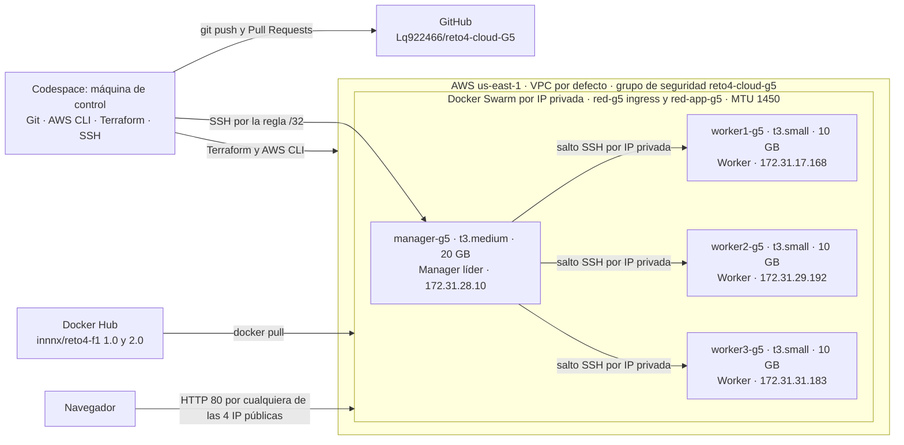

| Nodo | ID de instancia | Tipo y disco | IP privada | Rol que pide la Guía | Rol comprobado el 9 de noviembre |
| --- | --- | --- | --- | --- | --- |
| manager-g5 | `i-0e6ebf2af63facc60` | t3.medium, 20 GB gp3 | 172.31.28.10 | Manager líder | Manager líder |
| worker1-g5 | `i-066a1ad3b7a8e0db9` | t3.small, 10 GB gp3 | 172.31.17.168 | Worker | Worker |
| worker2-g5 | `i-0ed6d9c9957251a18` | t3.small, 10 GB gp3 | 172.31.29.192 | Worker | Worker |
| worker3-g5 | `i-0446409b26cf0a662` | t3.small, 10 GB gp3 | 172.31.31.183 | Worker | Worker |

Los roles son los comprobados el 9 de noviembre, después de devolver el clúster a la topología de la Guía (apartado [3.4](#34-validación-de-los-nodos-y-de-sus-roles-c3)). Entre la prueba E8 y esa corrección, worker1-g5 y worker2-g5 fueron managers. El laboratorio se reinició el 10 de noviembre y los roles no se han vuelto a comprobar.

El mapa de arquitectura del repositorio (criterio F8) está en [`diagramas/`](diagramas/arquitectura.md):

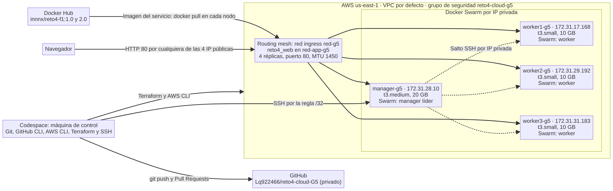

*Figura 1. Mapa de arquitectura de [`diagramas/arquitectura.md`](diagramas/arquitectura.md): Codespace, GitHub, AWS, Swarm, redes, servicio y Docker Hub, con un manager líder y tres workers. Actualizado el 18 de noviembre de 2026 a partir de su código Mermaid; la versión anterior mostraba los roles temporales posteriores a E8.*

### Flujo de trabajo

1. Desde el Codespace, **Terraform** crea en AWS el grupo de seguridad y las cuatro instancias. Cada instancia ejecuta en su primer arranque un script que le pone nombre y zona horaria, instala las claves públicas, endurece SSH e instala Docker.
2. Con **SSH**, usando alias cortos y el manager como salto, se administra cada nodo.
3. Se forma el clúster **Docker Swarm** por IP privada y se crean las redes overlay del grupo.
4. La web se empaqueta con **Docker** en una imagen propia, se publica en **Docker Hub** y se despliega como un servicio de cuatro réplicas.
5. Con scripts y **sondas** que consultan la web cada segundo, se prueban las capacidades de orquestación de Swarm.
6. Todo el código, la configuración y las evidencias se guardan en **GitHub**.

### Herramientas utilizadas

| Herramienta | Versión o detalle | Para qué se usó | Fases |
| --- | --- | --- | --- |
| GitHub y GitHub CLI (`gh`) | `gh` 2.103.3 | Repositorio, colaboradores, ramas y Pull Requests | 0 |
| GitHub Codespaces y `devcontainer` | Ubuntu 22.04 | Máquina de control reproducible | 0–5 |
| Git | — | Control de versiones | 0 |
| AWS Academy Learner Lab y consola de AWS | Cuenta temporal del alumno | Acceso a AWS, credenciales y consulta de EC2 | 1 |
| AWS CLI | 2.39.3 | Consultas de EC2 y cambios autorizados en el grupo de seguridad | 1–5 |
| Terraform y proveedor `hashicorp/aws` | Terraform 1.17.1, proveedor 5.100.0 | Infraestructura como código | 1 |
| cloud-init | De Ubuntu 22.04 | Ejecuta el script de arranque en cada instancia | 1 |
| OpenSSH: `ssh`, `scp`, `ssh-keygen` | — | Acceso remoto, salto, copia de archivos y huellas | 2–5 |
| Docker Engine y Docker Swarm | 29.1.3 (`docker.io`) | Contenedores y orquestación | 3–5 |
| Docker Hub | Repositorio público `innnx/reto4-f1` | Registro de las imágenes | 4 |
| Nginx | Imagen `nginx:alpine` | Servidor web dentro de cada contenedor | 4 |
| `curl` y `jq` | — | Sondas HTTP y lectura de JSON | 1–5 |
| Chrome for Testing, Playwright y Xvfb | — | Pruebas de la web en un navegador real y capturas | 4–5 |
| `xterm` e ImageMagick | — | Capturas de terminal conformes a la norma | 0–5 |
| Python 3 | — | Scripts de capturas, revisión de secretos y comprobación de la web | 0–5 |
| Codex y Claude Code | Asistentes de IA | Ejecución y documentación por encargo de Cristina | 1–5 |

## Fase 0 — GitHub y Codespaces

**Objetivo.** Disponer de un repositorio privado y colaborativo en GitHub y de una máquina de control reproducible en GitHub Codespaces, con AWS CLI y Terraform, desde la que se gestiona todo el proyecto.

**Contenidos.**

| Requisito de la Guía | Criterio | Apartado | Estado |
| --- | --- | --- | --- |
| Crear el repositorio del proyecto, que actúa como carpeta master, y que sea privado | F1 | 0.1 | Cumplido |
| Codespace aprovisionado con un `devcontainer` que incluya AWS CLI y Terraform | F5 | 0.2 | Cumplido |
| `git add`, `commit` y `push` desde el Codespace | F2 | 0.3 | Cumplido |
| Invitar al resto de miembros y al profesor | F1 | 0.4 | Cumplido. Falta la vista web de Settings |
| Los demás miembros trabajan desde WSL o Git Bash e integran su código con Pull Requests | F2 | 0.5 | Parcial |
| Estructura de carpetas, README y scripts comentados | F3, F4, F7 | 0.6 | Cumplido |
| Sin credenciales, claves privadas ni estado de Terraform | F12 | 0.7 | Cumplido, con los límites indicados |
| Capturas con prompt, fecha y comentario | F10 | 0.8 | Parcial |

### 0.1. Repositorio privado en GitHub

**Qué se hizo y para qué.** Cristina creó el repositorio `reto4-cloud-G5` con su cuenta Lq922466. Es la «carpeta master» de la Guía: la copia de referencia del código, la configuración, la documentación y las evidencias. El primer commit es del 3 de noviembre de 2026.

**Procedimiento.**

1. En [github.com](https://github.com), pulsar **New repository**.
2. Escribir el nombre `reto4-cloud-G5`, marcar **Private** y crear el repositorio con un README inicial.

**Explicación.** El repositorio es **privado** porque lo exige la Guía y porque contiene datos de la infraestructura, como los identificadores de las instancias y del grupo de seguridad. La Rúbrica (F1) pide además que todos los integrantes sean colaboradores y que el profesor esté invitado (apartado [0.4](#04-colaboradores)).

### 0.2. Codespace y `devcontainer`

**Qué se hizo y para qué.** El Codespace es la **máquina de control** del proyecto. Para que cualquier miembro obtenga el mismo entorno sin instalar nada a mano, se describe en [`.devcontainer/devcontainer.json`](.devcontainer/devcontainer.json), añadido el 3 de noviembre en el commit `2f5e6ea`.

**Herramientas y archivos:** GitHub Codespaces y `.devcontainer/devcontainer.json`.

```json
{
  "name": "RETO4-CLOUD-G5",
  "image": "mcr.microsoft.com/devcontainers/base:ubuntu-22.04",
  "features": {
    "ghcr.io/devcontainers/features/aws-cli:1": {},
    "ghcr.io/devcontainers/features/terraform:1": {}
  }
}
```

**Explicación.**

- **`image`** es la imagen base del contenedor: Ubuntu 22.04, la misma versión que se usa en las instancias EC2.
- **`features`** son paquetes de instalación reutilizables. Cada una instala una herramienta al construir el contenedor: AWS CLI y Terraform.

**Procedimiento.**

1. En GitHub, abrir el repositorio y pulsar **Code → Codespaces → Create codespace on `main`**.
2. Esperar a que se construya el contenedor. Si se modifica el `devcontainer`, usar **Rebuild Container**.
3. Comprobar las herramientas desde el terminal:

```bash
aws --version
terraform version | head -n 1
gh --version | head -n 1
```

**Comprobación.** El 5 de noviembre, el Codespace respondió `aws-cli/2.39.3`, `Terraform v1.17.1` y `gh version 2.103.3`.


*Figura 2. El `devcontainer` incluye AWS CLI y Terraform, y ambos funcionan en el Codespace. Captura conforme. Claude Code, por encargo de Cristina (Lq922466). 5 de noviembre de 2026. Máquina: codespaces-8d43b2.*

> **Evidencia pendiente (complementaria):** vista del Codespace en el navegador, desde **GitHub → Codespaces**, con el nombre del Codespace y su estado *Active*.

### 0.3. Control de versiones desde el Codespace

**Qué se hizo y para qué.** Cada cambio se registra y se sube a GitHub desde el Codespace, para que el trabajo no dependa de una sola máquina.

**Procedimiento.**

```bash
git status                  # Qué archivos han cambiado.
git diff                    # Qué ha cambiado en cada uno.
git add RUTA                # Prepara solo los archivos revisados.
git commit -m "Mensaje"     # Guarda el cambio en el historial local.
git push                    # Lo sube a GitHub.
```

**Explicación.** Se añaden rutas concretas, en lugar de `git add .`, para no subir por error un archivo con secretos. Antes de subir cambios se ejecuta la revisión de secretos del apartado [0.7](#07-seguridad-del-repositorio).

**Comprobación.** Antes de esta revisión, la rama de trabajo `cloud-g5-implementacion` tenía 44 commits: 32 con la identidad de Cristina (Innnx), incluidos el commit inicial y la fusión de la PR #2; 11 firmados por Codex; y 1 de Enrique (EnriZx2). Los commits con la identidad de Cristina incluyen trabajo preparado con Claude Code o con Codex, como indica su mensaje cuando lo declara. A ellos se suman el commit de esta revisión, con Claude Code, y la fusión de la PR #1, que llevó todo ese historial a `main` el 18 de noviembre (apartado [0.5](#05-ramas-y-pull-requests-de-los-integrantes)).

### 0.4. Colaboradores

**Procedimiento.**

1. El administrador abre **Settings → Collaborators → Add people** e invita a cada cuenta.
2. Cada miembro acepta la invitación desde su correo o desde GitHub.
3. Desde el Codespace se comprueba quién tiene acceso:

```bash
gh repo view --json visibility --jq .visibility
gh api repos/Lq922466/reto4-cloud-G5/collaborators --jq '.[] | [.login, .role_name] | @tsv'
```

**Explicación.** El permiso de escritura (*write*) permite crear ramas y Pull Requests, pero no cambiar la configuración del repositorio, que queda en manos del administrador.

**Comprobación.** El 5 de noviembre, el repositorio era privado y tenían acceso Cristina (Lq922466), como administradora, y Enrique (EnriZx2), Alexandra (alexguerth) e Ibai (ibaiaretxabalaasir-collab), con escritura. En la consulta del 18 de noviembre aparece además la cuenta del profesor, **jc-csl**, con permiso de escritura: el profesor aceptó la invitación. Cristina confirmó que esa cuenta es la del profesor.


*Figura 3. Repositorio privado, con acceso de los cuatro integrantes y del profesor (jc-csl). Captura conforme. Claude Code, por encargo de Cristina (Lq922466). 18 de noviembre de 2026. Máquina: codespaces-8d43b2.*

> **Evidencia pendiente:** la Rúbrica indica como evidencia de F1 la página **Settings → Collaborators**. Falta su captura desde el navegador, con la cuenta del profesor visible.

### 0.5. Ramas y Pull Requests de los integrantes

**Qué se hizo y para qué.** Hasta el 18 de noviembre, `main` solo contenía las Fases 0 y 1 iniciales, y el resto del trabajo estaba en la rama `cloud-g5-implementacion`. Ese día se integró todo en `main` con la PR #1 y se eliminó la rama antigua: desde entonces, **`main` es la única rama de trabajo y de entrega**. Cada integrante debe trabajar en su propia rama, desde su terminal Linux, y proponer sus cambios con una Pull Request (PR) hacia `main`. Una **rama** aísla el trabajo de cada persona; una **Pull Request** propone integrarlo en otra rama y permite revisarlo antes de fusionarlo. Así el historial muestra quién hizo cada cambio, que es lo que evalúa F2.

**Procedimiento para cada integrante, desde WSL o Git Bash.** Las instrucciones completas están en [INSTRUCCIONES-F2-INTEGRANTES.md](entrega/INSTRUCCIONES-F2-INTEGRANTES.md).

```bash
git clone https://github.com/Lq922466/reto4-cloud-G5.git
cd reto4-cloud-G5
git switch -c NOMBRE-DE-LA-TAREA origin/main
# ... cambios ...
git add RUTA && git commit -m "Mensaje" && git push -u origin NOMBRE-DE-LA-TAREA
gh pr create --base main --title "Título" --body "Qué cambia y cómo se ha comprobado"
```

**Integración en `main`.** La PR #1 se fusionó con un *merge commit*, que conserva intactos los commits, sus identificadores y sus autores, incluida la fusión de la PR #2 de Enrique. Antes de fusionarla se comprobaron los enlaces, las pruebas y la ausencia de secretos (apartado [0.7](#07-seguridad-del-repositorio)), y se cambió el destino de las PR #3, #4 y #5 a `main` para que no se cerraran al eliminar su rama de destino.

**Comprobación.** Estado de las PR en GitHub a 18 de noviembre:

| PR | Rama → destino | Quién la abrió | Estado | Observaciones |
| --- | --- | --- | --- | --- |
| #1 | `cloud-g5-implementacion` → `main` | Cristina | Fusionada el 18 de noviembre | Integra todo el proyecto en `main`. La rama de origen se eliminó después, sin trabajo pendiente |
| #2 | `enrique-revision-documentacion` → `cloud-g5-implementacion` | Enrique | Fusionada el 6 de noviembre | Commit de Enrique hecho desde la web de GitHub (el confirmador es GitHub), no desde un terminal. Su contenido está en `main` |
| #3 | `enrique-correccion-revision` → `main` | Cuenta de Cristina | Abierta, con conflictos | Borrador de revisión preparado con Codex, pendiente de validación por Enrique |
| #4 | `alexandra-revision-evidencias` → `main` | Cuenta de Cristina | Abierta, con conflictos | Borrador preparado con Codex, pendiente de validación por Alexandra |
| #5 | `ibai-revision-individual` → `main` | Cuenta de Cristina | Abierta, con conflictos | Borrador preparado con Codex, pendiente de validación por Ibai |

Las PR #3, #4 y #5 tienen commits con la identidad de Cristina, así que **no cuentan como commits de Enrique, Alexandra o Ibai**. Siguen abiertas, sin modificar su contenido, para que cada persona las valide o las corrija. Tienen conflictos con `main` en su revisión personal y en `GESTION.md`, que debe resolver quien las valide. Para F2 faltan commits y PR hechos por Alexandra e Ibai desde sus cuentas y sus terminales, y un commit de Enrique desde un terminal.


*Figura 4. Historial de commits y PR con los autores reales. Es del 5 de noviembre, anterior a las PR #2 a #5 y a la integración en `main`. Captura conforme. Claude Code, por encargo de Cristina (Lq922466).*

> **Evidencia pendiente:** captura actualizada del historial de `main` (`git log --format='%h %an/%cn %s'`) y de la lista de Pull Requests en GitHub, con commits y PR de cada integrante desde su propia cuenta.

### 0.6. Estructura del repositorio, README y scripts

**Qué se hizo y para qué.** El repositorio sigue la estructura de entregables de la Guía (F4), tiene un [README.md](README.md) con el resumen, las instrucciones rápidas y los enlaces (F3), y todos los scripts explican al principio qué hacen, cuándo se usan y qué efecto tienen (F7).

| Carpeta o archivo | Contenido |
| --- | --- |
| [`.devcontainer/`](.devcontainer/devcontainer.json) | Entorno del Codespace con AWS CLI y Terraform |
| [`terraform/`](terraform/) | Código de la infraestructura, script de arranque y claves públicas de los integrantes |
| [`app/`](app/) | Web en sus dos versiones, `Dockerfile`, pila `stack.yml` y script de despliegue en Swarm |
| [`config/`](config/README.md) | Plantillas SSH, configuración SSH aplicada y configuración de `sshd` |
| [`scripts/`](scripts/) | Scripts comentados: actualización de IP, comprobaciones, despliegue, pruebas, capturas y seguridad |
| [`diagramas/`](diagramas/arquitectura.md) | Mapa de la arquitectura |
| [`practica-individual/`](practica-individual/README.md) | Práctica previa de cada integrante. **Sin contenido** (F13) |
| [`evidencias/`](evidencias/INDICE.md) | Capturas y registros, ordenados por criterio |
| [`entrega/`](entrega/) | Documentos de apoyo: defensa, checklist, procedimientos y revisiones |
| [`tests/`](tests/) | Pruebas automáticas de los scripts, con AWS, SSH y Terraform simulados |
| `README.md`, `PROYECTO.md`, `GESTION.md` | Resumen, este informe y reparto de tareas |

**Comprobación.** Las carpetas existen en `main` desde la integración del 18 de noviembre, y la cabecera de cada script describe su uso.


*Figura 5. Existen las carpetas pedidas por la Guía. Se tomó el 5 de noviembre en la rama de implementación, cuyo árbol es el que se integró en `main`. Captura conforme. Claude Code, por encargo de Cristina (Lq922466).*


*Figura 6. Los scripts están en `/scripts` y su cabecera explica qué hacen. Captura conforme. Claude Code, por encargo de Cristina (Lq922466). 5 de noviembre de 2026.*

Las pruebas automáticas de [`tests/`](tests/) comprueban, sin recursos reales, que los scripts no dan falsos positivos y que Terraform rechaza un SSH abierto a todo Internet. El 18 de noviembre, antes de integrar en `main`, se ejecutaron las 29 pruebas, todas correctas:

```bash
python3 -m unittest discover -s tests      # Ran 29 tests ... OK
```

### 0.7. Seguridad del repositorio

**Qué se hizo y para qué.** El criterio F12 exige que no se publiquen credenciales, claves privadas ni el estado de Terraform. Se consigue con dos medidas: exclusiones en [`.gitignore`](.gitignore) y una revisión automática antes de integrar cambios.

| Excluido por `.gitignore` | Por qué |
| --- | --- |
| `*.tfstate`, `*.tfstate.*`, `*.tfplan`, `*.tfvars`, `*.auto.tfvars.json` y `**/.terraform/` | El estado y los planes contienen los datos reales de la infraestructura, y las variables locales, la IP autorizada y las claves. Se permite `*.example.tfvars`, que es una plantilla |
| `*.pem`, `*.key`, `*.ppk`, `id_rsa*`, `id_ed25519*`, `*_reto4`, `.ssh/` | Claves privadas. En `terraform/claves/` solo se admiten archivos `.pub` |
| `.aws/`, `credentials`, `.env` | Credenciales |
| `config/ssh.local` | Configuración SSH generada con las IP del momento |
| `*.docx` | Documentos originales del profesor y documentos de trabajo |

**Procedimiento.**

```bash
python3 scripts/revisar-secretos.py COMMIT_BASE HEAD
```

**Explicación.** [`revisar-secretos.py`](scripts/revisar-secretos.py) revisa las líneas añadidas entre dos commits y busca patrones de credenciales de AWS, tokens de Docker Hub y de GitHub, claves privadas, tokens de Swarm y números de cuenta. También rechaza archivos sensibles por su nombre. Antes de revisar, comprueba con muestras que su propio detector funciona. Sale con error si encuentra algo, sin mostrar el secreto.

**Comprobación.** La revisión del 9 de noviembre, hecha con Codex, dio este resultado:

- 20 997 líneas añadidas en 380 archivos respecto a `main`: **0 coincidencias** y ningún archivo sensible.
- 405 versiones de archivos de texto en todo el historial accesible: **ningún secreto**.
- Las credenciales locales vigentes no aparecen en ninguna versión del historial.

**Límites.** Los 118 archivos binarios del historial, casi todos imágenes, no se revisaron de nuevo visualmente en esa comprobación. Su resultado consta en el registro de sesión de Codex; en el repositorio está la [revisión anterior del historial](evidencias/auditoria/registro-repositorio.txt).

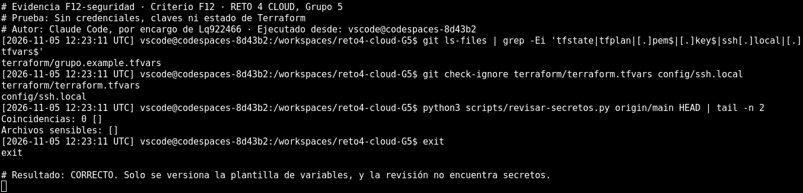

*Figura 7. Solo se versiona la plantilla de variables, y la revisión no encuentra secretos. Captura conforme. Claude Code, por encargo de Cristina (Lq922466). 5 de noviembre de 2026.*

> **Evidencia pendiente:** repetir la captura `F12-seguridad` con la revisión de todo el historial actual, antes de integrar la PR #1.

### 0.8. Capturas conformes a la norma de la Guía

**Qué se hizo y para qué.** La Guía exige que cada captura muestre el prompt con el hostname y la fecha y hora, y un comentario con la prueba, el resultado y el autor, sin credenciales ni claves privadas. Para cumplirlo de forma repetible se creó [`capturas-norma.py`](scripts/capturas-norma.py).

**Procedimiento.**

```bash
python3 -I scripts/capturas-norma.py --listar                                   # Catálogo de capturas.
python3 -I scripts/capturas-norma.py --autor "Nombre (cuenta)" --solo '^C3-nodos$'
```

**Explicación.** El script:

- abre una sesión real en un terminal `xterm`, en el Codespace o por SSH en cada nodo, con un prompt como `[2026-11-05 10:53:32 CET] ubuntu@manager-g5:~$`;
- escribe en la cabecera la prueba, el criterio y el autor real, que es obligatorio indicar;
- calcula el resultado comprobando la salida real, y escribe **CORRECTO** o **NO CORRECTO**;
- rechaza cualquier orden que pueda modificar algo: las operaciones de las pruebas las ejecuta aparte quien esté autorizado, y el script solo toma las instantáneas;
- guarda junto a cada imagen un `.txt` con la misma salida.

**Comprobación.** Hay 32 capturas conformes, de los días 5, 6, 9 y 18 de noviembre, listadas en su [índice](evidencias/capturas-conformes/INDICE.md). El 18 de noviembre solo se repitieron dos capturas locales, sin AWS ni SSH: `F1-repositorio` y `F12-seguridad`. Dos capturas dan **NO CORRECTO** y se conservan como resultado real de ese día: `A6-sin-cambios` y `C3-nodos`.

### 0.9. Incidencias reales y soluciones

**I0.1. La generación de capturas se quedaba bloqueada** · Estado: **resuelta**

- *Síntomas:* `capturas-norma.py` no terminaba al llegar a la captura de C2.
- *Causa:* la herramienta `import` de ImageMagick busca la ventana por su título, y no encontraba un título con acento.
- *Diagnóstico:* se repitió la captura aislada y se comprobó que `import` esperaba indefinidamente esa ventana.
- *Solución aplicada:* el identificador pasó a `C2-cluster`, el catálogo solo admite identificadores ASCII, e `import` tiene un tiempo límite.
- *Comprobación:* se generaron todas las capturas del catálogo sin bloqueos.

**I0.2. El verificador de capturas dio por correcta una salida vacía** · Estado: **resuelta**

- *Síntomas:* la primera captura de A6 salió como CORRECTO aunque la orden no había mostrado nada.
- *Causa:* el verificador buscaba el texto esperado en toda la pantalla y lo encontraba en la propia orden escrita.
- *Diagnóstico:* revisión manual del `.txt` de la captura.
- *Solución aplicada:* se retiró esa captura y el verificador dejó de evaluar la línea de la orden.
- *Comprobación:* se reevaluaron las demás capturas con la regla nueva y ninguna cambió de resultado.

**I0.3. Las ramas de Alexandra e Ibai partían de un `main` sin el trabajo del proyecto** · Estado: **parcialmente resuelta**

- *Síntomas:* las ramas `alexandra-revision-evidencias` e `ibai-revision-individual` existían en GitHub pero no tenían commits propios y apuntaban a `main`, que no contiene el trabajo de `cloud-g5-implementacion`.
- *Causa:* se crearon desde la rama por defecto del repositorio.
- *Diagnóstico:* `git merge-base` y `git log` de cada rama frente a `cloud-g5-implementacion`.
- *Solución aplicada:* el 9 de noviembre las tres ramas de revisión se rehicieron a partir del commit `a81b3d5` de `cloud-g5-implementacion`, que desde el 18 de noviembre está en `main`. Las [instrucciones de F2](entrega/INSTRUCCIONES-F2-INTEGRANTES.md) explican cómo actualizarlas con `git merge origin/main`.
- *Pendiente:* los commits de esas ramas tienen la identidad de Cristina; faltan commits hechos por cada integrante.

**I0.4. Tres PR abiertas apuntaban a la rama que se iba a eliminar** · Estado: **resuelta**

- *Síntomas:* las PR #3, #4 y #5 tenían como destino `cloud-g5-implementacion`, la rama que había que eliminar tras integrar la PR #1.
- *Causa:* se abrieron cuando esa rama era la de trabajo.
- *Diagnóstico:* `gh pr list` y la API de GitHub mostraban su rama de destino. Al eliminar la rama de destino de una PR, GitHub puede cerrarla.
- *Solución aplicada:* antes de eliminar la rama, se cambió su destino a `main` con `gh pr edit NÚMERO --base main`, sin tocar sus commits.
- *Comprobación:* las tres siguen abiertas, con destino `main` y con los mismos commits.

**I0.5. La revisión de secretos se habría quedado sin nada que revisar tras la fusión** · Estado: **resuelta**

- *Síntomas:* la captura `F12-seguridad` revisaba el rango `origin/main..HEAD`. Tras fusionar la PR #1 ese rango queda vacío, y la captura habría dado CORRECTO sin revisar ninguna línea.
- *Causa:* el rango dependía de que `main` estuviera por detrás de la rama de trabajo.
- *Diagnóstico:* revisión del catálogo de `capturas-norma.py` antes de integrar. Al revisar todo el árbol desde cero, la única coincidencia es el número público de la cuenta de Canonical en `main.tf`, que no es un secreto.
- *Solución aplicada:* la captura usa una base fija, `6f3d838`, el último commit de `main` antes de la integración. Así revisa todo lo que trajo la PR #1 y lo que se añada después.
- *Comprobación:* la captura regenerada revisa las líneas añadidas desde esa base, con 0 coincidencias (apartado [0.7](#07-seguridad-del-repositorio)).

### 0.10. Posibles incidencias y soluciones

| Síntoma o error | Causa probable | Diagnóstico | Solución |
| --- | --- | --- | --- |
| `aws: command not found` o `terraform: command not found` en el Codespace | El contenedor no se construyó con el `devcontainer` actual | `cat .devcontainer/devcontainer.json` | **Rebuild Container** |
| `! [rejected] ... (non-fast-forward)` al hacer `git push` | La rama remota tiene commits que no están en local | `git fetch` y `git status` | `git pull --rebase` y repetir el `push` |
| `Permission denied` o error 403 al hacer `push` desde WSL | La invitación no está aceptada o la sesión de GitHub no es la correcta | `gh auth status` | Aceptar la invitación y ejecutar `gh auth login` |
| Conflictos al abrir una PR | La rama parte de un commit antiguo | `git merge-base RAMA origin/main` | Actualizar la rama con `git merge origin/main` y resolver los conflictos antes de pedir la revisión |
| Una PR se cierra sola | Se eliminó su rama de destino | `gh pr view NÚMERO --json baseRefName,state` | Cambiar antes el destino con `gh pr edit NÚMERO --base main`; si ya se cerró, reabrirla desde GitHub, porque la rama de origen se conserva |
| Se ha subido un secreto | `git add .` sin revisar | `revisar-secretos.py` | Revocar o renovar la credencial de inmediato y retirarla del historial |
| Se elimina el Codespace | El estado de Terraform solo está en este Codespace, fuera de Git | Comprobar que existe la copia privada del estado | Conservar una copia privada del estado; sin él, Terraform no puede modificar ni destruir la infraestructura |

### 0.11. Resultado y conclusión de la Fase 0

El entorno de trabajo está operativo y es reproducible. El Codespace se crea a partir del `devcontainer` con AWS CLI y Terraform, el repositorio es privado, tiene la estructura de la Guía, y sus exclusiones y la revisión automática impiden publicar estado, variables, claves y credenciales. Desde el 18 de noviembre todo el proyecto está en `main`, la única rama de trabajo y de entrega, y el profesor tiene acceso al repositorio.

La parte colaborativa sigue incompleta. Solo hay una PR fusionada de otro integrante, la de Enrique, hecha desde la web; las PR #3 a #5 se abrieron desde la cuenta de Cristina con borradores preparados con Codex; y no constan commits de Alexandra ni de Ibai desde sus cuentas, ni trabajo desde WSL o Git Bash.

- **Cumplidos:** F3, F4, F5, F7 y F12. F1, con la captura de Settings pendiente.
- **Parciales:** F2 (commits y PR de los integrantes) y F10 (capturas pendientes en varias fases).

## Fase 1 — AWS y Terraform

**Objetivo.** Acceder a AWS desde el Codespace y definir como código, con Terraform, la infraestructura de la Guía: un manager y tres workers Ubuntu 22.04 en `us-east-1`, con un único grupo de seguridad de mínimos, un script de arranque y unas salidas con las direcciones y el ID de cada nodo. Después, recorrer el ciclo completo de Terraform: validación, plan, cambio y destrucción.

**Contenidos.**

| Requisito de la Guía | Criterio | Apartado | Estado |
| --- | --- | --- | --- |
| Región `us-east-1` de Learner Lab y red por defecto | — | 1.1–1.3 | Cumplido |
| Partir de la práctica individual de EC2 Ubuntu 22.04 | F13 | 1.4 | Pendiente: la carpeta no tiene contenido |
| Proyecto organizado con variables de grupo, tamaños e imagen | A1, F6 | 1.4, 1.5 | Cumplido |
| Imagen Ubuntu y red por defecto | A1 | 1.6 | Cumplido |
| Grupo de seguridad único: 22 desde aula o alumno, 80 y 8080 públicos, puertos internos solo entre nodos | A3 | 1.7 | Cumplido. Falta la captura de la consola de EC2 |
| Tres workers multiplicando el recurso; etiquetas | A2 | 1.8 | Cumplido. Falta la captura de la consola de EC2 |
| Script de arranque: hostname, zona horaria, claves y Docker | A4 | 1.9 | Cumplido |
| Salidas con IP pública, IP privada e ID | A5 | 1.10 | Cumplido |
| Validación, plan, cambio y destrucción, en secuencia de capturas | A6 | 1.11–1.14 | Parcial |

### 1.1. Learner Lab, consola de AWS y región

**Qué se hizo y para qué.** AWS Academy Learner Lab proporciona una cuenta de AWS temporal y restringida. Todo el proyecto se despliega en ella, en la región `us-east-1`.

**Herramientas:** [AWS Academy](https://awsacademy.instructure.com/), consola de AWS y AWS CLI.

**Procedimiento.**

1. Entrar en AWS Academy, abrir el curso y el módulo **Launch AWS Academy Learner Lab**.
2. Pulsar **Start Lab** y esperar a que el indicador junto a **AWS** se ponga en **verde**.
3. Pulsar **AWS** para abrir la consola, comprobar arriba a la derecha que la región es **N. Virginia (us-east-1)** y abrir **EC2 → Instances**.
4. En el Codespace, fijar la región de la AWS CLI:

```bash
aws configure set region us-east-1
aws configure set output json
cat ~/.aws/config          # [default] · region = us-east-1 · output = json
```

**Explicación.** Mientras el indicador está en verde, la sesión está activa. Al terminar la sesión, Learner Lab detiene las instancias. Al volver a arrancar, cada instancia **conserva su ID, su disco y su IP privada, pero recibe una IP pública nueva**. Por eso el clúster se construye con las IP privadas. Si la CLI apuntara a otra región, `describe-instances` devolvería una lista vacía aunque las instancias existan. Terraform no depende de este archivo: usa la variable `aws_region`, que vale `us-east-1`.

**Comprobación.** Tras cada inicio del laboratorio, la orden del apartado [1.3](#13-comprobación-del-laboratorio-tras-cada-reinicio) muestra las cuatro instancias con los mismos ID e IP privadas.

> **Evidencia pendiente:** captura del panel de Learner Lab con el indicador en verde, y de **EC2 → Instances** en la consola, sin mostrar el identificador de la cuenta ni las credenciales.

### 1.2. Credenciales temporales en el Codespace

**Qué se hizo y para qué.** La AWS CLI y Terraform necesitan las credenciales de la sesión del laboratorio. Son temporales y se renuevan en cada sesión.

**Procedimiento.**

1. En el panel de Learner Lab, abrir **AWS Details** y, junto a **AWS CLI**, pulsar **Show**.
2. Copiar el bloque completo, que empieza por `[default]` y contiene tres valores.
3. Sustituir con él todo el contenido de `~/.aws/credentials` en el Codespace:

```bash
umask 077                          # Los archivos nuevos solo los podrá leer el propio usuario.
nano ~/.aws/credentials            # Pegar el bloque [default] completo y guardar.
chmod 600 ~/.aws/credentials       # Lectura y escritura solo para el propietario.
aws sts get-caller-identity > /dev/null && echo "AWS acepta las credenciales"
```

**Explicación.**

| Valor | Para qué sirve |
| --- | --- |
| Identificador de la clave de acceso | Identifica la clave. Las temporales empiezan por `ASIA` |
| Clave secreta de acceso | Firma cada petición. Nunca se envía a AWS, y quien la tenga puede actuar en la cuenta |
| Token de sesión | Demuestra que la clave pertenece a una sesión temporal todavía válida |

Los tres valores se renuevan juntos, así que hay que sustituir el bloque entero. No se usa `aws configure`, porque no pide el token de sesión. `aws sts get-caller-identity` pregunta a AWS quién firma la petición; no necesita permisos especiales, así que es la forma más sencilla de saber si las credenciales siguen siendo válidas. Su salida se envía a `/dev/null` porque contiene el número de la cuenta.

Las credenciales nunca se escriben en el repositorio ni aparecen en una captura: `.gitignore` excluye `.aws/` y `credentials`, y la Guía prohíbe mostrarlas.

**Comprobación.** El 9 y el 10 de noviembre, tras renovar las credenciales, `sts get-caller-identity` respondió correctamente. No se toma captura de esta orden porque mostraría la cuenta.

### 1.3. Comprobación del laboratorio tras cada reinicio

**Qué se hizo y para qué.** Cada vez que se inicia el laboratorio hay que saber, sin cambiar nada, si las instancias están listas, cuáles son sus IP públicas nuevas, si la regla SSH admite la IP actual del Codespace, si la web responde y cómo está el clúster. Para ello se creó [`comprobar-laboratorio.sh`](scripts/comprobar-laboratorio.sh).

**Procedimiento.**

```bash
bash scripts/comprobar-laboratorio.sh      # Solo lectura. Termina con 0, 2 o 3.
```

**Explicación.** El script hace cuatro comprobaciones:

1. **EC2:** compara cada instancia con su ID e IP privada esperados y muestra sus controles de estado. `running` solo indica que la máquina está encendida; hasta que los dos controles pasan de `initializing` a `ok`, el sistema puede no aceptar SSH.
2. **Regla SSH:** compara la IP pública del Codespace (`curl -s https://checkip.amazonaws.com`) con los orígenes del puerto 22. Si falta, **muestra** la orden `aws ec2 authorize-security-group-ingress` exacta, pero no la ejecuta ni retira otros accesos autorizados. Rechaza un SSH abierto a `0.0.0.0/0`.
3. **Web:** pide `/` e `/identidad.txt` a cada IP pública. No basta con HTTP 200: la respuesta debe identificar la versión y el contenedor.
4. **Swarm:** si hay SSH, consulta en el manager los nodos, el servicio, las réplicas y la MTU de las redes, y rechaza que haya más de un manager.

Termina con **0** si todo es correcto, con **2** si falta corregir algo y con **3** si AWS deniega la consulta, por ejemplo con credenciales caducadas. Antes de mostrar un error de AWS, oculta el identificador de la cuenta.

**Comprobación.** El 9 de noviembre por la mañana el script terminó con código 2: la web respondía, pero no había SSH porque la IP del Codespace había cambiado ([registro](evidencias/auditoria/registro-2026-11-09.txt)). Ese mismo día, después de corregir la regla SSH y la topología del clúster, Codex lo ejecutó de nuevo y terminó con código 0: cuatro instancias `running` con controles `ok/ok`, el origen SSH del Codespace permitido, HTTP 200 con identidad en las cuatro IP y manager-g5 como único líder. Esta segunda ejecución consta en el registro de sesión de Codex.

> **Evidencia pendiente:** captura conforme de `comprobar-laboratorio.sh` terminando con código 0, hecha el día de la corrección.

### 1.4. Organización del módulo Terraform

**Qué se hizo y para qué.** El módulo de [`terraform/`](terraform/) separa proveedor, variables, recursos y salidas (A1, F6).

| Archivo | Contenido |
| --- | --- |
| [`provider.tf`](terraform/provider.tf) | Proveedor `hashicorp/aws`, versión `~> 5.0`, y región tomada de una variable |
| [`variables.tf`](terraform/variables.tf) | Grupo, tamaños, discos, imagen, accesos SSH y claves públicas, con validaciones |
| [`main.tf`](terraform/main.tf) | Imagen, VPC por defecto, grupo de seguridad, manager y workers |
| [`outputs.tf`](terraform/outputs.tf) | Salida `nodes` con IP pública, IP privada e ID |
| [`scripts/bootstrap.sh.tftpl`](terraform/scripts/bootstrap.sh.tftpl) | Script de arranque de cada nodo |
| [`grupo.example.tfvars`](terraform/grupo.example.tfvars) | Plantilla de las variables que rellena el grupo |
| `.terraform.lock.hcl` | Versión exacta del proveedor, para que todos usen la misma |
| [`claves/`](terraform/claves/) | Claves públicas de los cuatro integrantes (apartado [2.1](#21-claves-ssh-del-proyecto-b1)) |

**Procedimiento.**

```bash
terraform -chdir=terraform init            # Descarga el proveedor de AWS.
terraform -chdir=terraform fmt -check      # Comprueba el formato.
terraform -chdir=terraform validate        # Comprueba sintaxis y tipos, sin contactar con AWS.
```

**Explicación.** Terraform lee todos los `.tf` de la carpeta como un único conjunto; el reparto en archivos solo sirve para leerlo mejor. El archivo de bloqueo garantiza que `init` descargue la misma versión del proveedor en cualquier máquina.

**Práctica individual (F13).** La Guía pide partir de la práctica individual de EC2 con Ubuntu 22.04. El módulo de este reto es su ampliación a cuatro nodos, pero la documentación de esa práctica previa todavía no está en [`practica-individual/`](practica-individual/README.md).

**Comprobación.** `fmt` y `validate` fueron correctos el 5 y el 9 de noviembre.


*Figura 8. El módulo está organizado, usa variables y `terraform validate` es correcto. Captura conforme. Claude Code, por encargo de Cristina (Lq922466). 5 de noviembre de 2026.*

> **Evidencia pendiente:** la práctica individual previa de cada integrante en `practica-individual/` (F13).

### 1.5. Variables

**Qué se hizo y para qué.** Con variables, el mismo código sirve para otro grupo o para otros tamaños sin tocar `main.tf`, que es lo que pide A1.

| Variable | Valor por defecto | Uso |
| --- | --- | --- |
| `aws_region` | `us-east-1` | Región del proveedor |
| `grupo` | `g5` | Sufijo de los nombres: `manager-g5`, `worker1-g5`… |
| `manager_type` y `worker_type` | `t3.medium` y `t3.small` | Tamaños de la Guía |
| `manager_disk_size` y `worker_disk_size` | 20 y 10 | Discos de la Guía, en GB |
| `disk_type` | `gp3` | Tipo de disco |
| `worker_count` | 3 | Número de workers |
| `ubuntu_ami_name` | `ubuntu/images/hvm-ssd/ubuntu-jammy-22.04-amd64-server-*` | Patrón de la imagen Ubuntu 22.04 |
| `key_name` | `vockey` | Par de claves de AWS asociado a cada instancia |
| `ssh_cidr` | Sin valor | IP de la máquina de control para SSH |
| `ssh_additional_cidrs` | `{}` | Otros accesos SSH autorizados, con su descripción |
| `ssh_public_keys` | Sin valor | Claves públicas que instala el script de arranque |

**Procedimiento.** Las variables que dependen del grupo se escriben en un archivo local que no se versiona, a partir de la plantilla:

```bash
cp terraform/grupo.example.tfvars terraform/terraform.tfvars
# Editar: ssh_cidr = "IP_PROPIA/32", ssh_additional_cidrs = { "IP/32" = "Descripción" } y ssh_public_keys = ["ssh-ed25519 AAAA... comentario"]
```

**Explicación.** Las variables sensibles tienen bloques `validation`, así que Terraform se detiene antes de crear nada si:

- `ssh_cidr` o algún acceso de `ssh_additional_cidrs` es `0.0.0.0/0` o no es un CIDR IPv4 válido;
- alguna entrada de `ssh_public_keys` no es una clave pública OpenSSH de una sola línea, por ejemplo una clave privada o una clave con saltos de línea de Windows.

**Comprobación.** Las pruebas de [`tests/test_terraform_variables.py`](tests/test_terraform_variables.py) comprueban que se aceptan varios orígenes restringidos y que se rechazan los abiertos a todo Internet o mal escritos. Pasaron el 10 y el 18 de noviembre.

### 1.6. Imagen Ubuntu y red por defecto

**Procedimiento.** Extracto de [`main.tf`](terraform/main.tf):

```hcl
data "aws_ami" "ubuntu" {
  most_recent = true
  owners      = ["<cuenta oficial de Canonical>"]   # El número real está en main.tf.
  filter { name = "name"  values = [var.ubuntu_ami_name] }
  filter { name = "state" values = ["available"] }
}
data "aws_vpc" "default" { default = true }
```

**Explicación.** Un bloque `data` **consulta** algo que ya existe en AWS, sin crearlo.

- **`aws_ami`** busca la imagen Ubuntu 22.04 más reciente publicada por la cuenta de Canonical, para aceptar solo imágenes oficiales. El informe no copia ese número de 12 cifras porque la revisión de secretos trata cualquier número así como un posible ID de cuenta.
- **`aws_vpc`** obtiene la VPC por defecto, que es la red que indica la Guía.

`most_recent = true` tiene una consecuencia importante: cuando Canonical publica una imagen nueva, Terraform la elige, y como la imagen no se puede cambiar en una instancia que ya existe, el plan propone **sustituir** las instancias. Ocurrió el 10 de noviembre (incidencia [I1.4](#115-incidencias-reales-y-soluciones)).

### 1.7. Grupo de seguridad (A3)

**Qué se hizo y para qué.** Un único grupo de seguridad, `reto4-cloud-g5` (`sg-0c12ecd538a29f8d6`), aplica la política de mínimos de la Guía: solo se abre a Internet lo imprescindible, y los puertos de Swarm quedan limitados a los propios nodos.

| Puerto | Protocolo | Origen | Uso |
| --- | --- | --- | --- |
| 22 | TCP | `var.ssh_cidr`, una IP `/32` | SSH desde el Codespace |
| 22 | TCP | `var.ssh_additional_cidrs`, IP `/32` con descripción | Accesos SSH autorizados de los integrantes |
| 22 | TCP | El propio grupo (`self = true`) | Salto SSH desde el manager hacia los workers |
| 80 | TCP | `0.0.0.0/0` | Web |
| 8080 | TCP | `0.0.0.0/0` | Lo pide la Guía. Ningún servicio lo publica |
| 2377 | TCP | El propio grupo | Gestión de Swarm |
| 7946 | TCP y UDP | El propio grupo | Comunicación entre nodos de Swarm |
| 4789 | UDP | El propio grupo | Tráfico VXLAN de las redes overlay |
| ICMP | ICMP | El propio grupo | `ping` entre nodos |
| Salida | Todos | `0.0.0.0/0` | Actualizaciones y descarga de imágenes |

**Explicación.**

- **`self = true`** admite solo tráfico de instancias que tienen este mismo grupo. Así los puertos internos de Swarm quedan cerrados a Internet sin escribir las IP de los nodos.
- **`/32`** es una máscara que admite una única dirección IP.
- **Reglas *inline*.** Las reglas se declaran dentro del propio recurso. Si se añade una regla a mano en AWS, el siguiente plan propone retirarla. Por eso los accesos SSH adicionales se declaran en `ssh_additional_cidrs` (incidencia [I1.5](#115-incidencias-reales-y-soluciones)).

**Diferencia con la Guía.** La Guía abre el puerto 22 «desde aula/alumno» y limita a los nodos solo 2377, 7946, 4789 e ICMP. En este proyecto, el «alumno» que administra es el Codespace, con su IP `/32`, y los integrantes entran con reglas `/32` temporales. Además, el 22 se abre al propio grupo, porque el salto SSH del manager a los workers (B5) entra por la red privada. Ninguna de estas reglas abre SSH a Internet.

**Procedimiento de comprobación.**

```bash
aws ec2 describe-security-groups --region us-east-1 --filters Name=group-name,Values=reto4-cloud-g5 \
  --query 'SecurityGroups[].IpPermissions[].{Desde:FromPort,Hasta:ToPort,Protocolo:IpProtocol,CIDR:join(`,`,IpRanges[].CidrIp),Grupo:join(`,`,UserIdGroupPairs[].GroupId)}' \
  --output table
```

**Comprobación.** El 9 de noviembre, Codex leyó las reglas reales de AWS: once reglas, todas de mínimos. El SSH externo admite solo la IP del Codespace (`172.166.151.114/32`) y una regla temporal, `88.14.93.201/32`, con la descripción «Enrique, Alexandra e Ibai, temporal para B1». Esa regla **se mantiene a propósito**, porque Enrique, Alexandra e Ibai todavía tienen que entrar en los workers (apartado [2.8](#28-acceso-de-cada-integrante-desde-su-equipo-b1)); se retirará con autorización cuando terminen. El resto coincide con la tabla. Esta lectura consta en el registro de sesión de Codex.

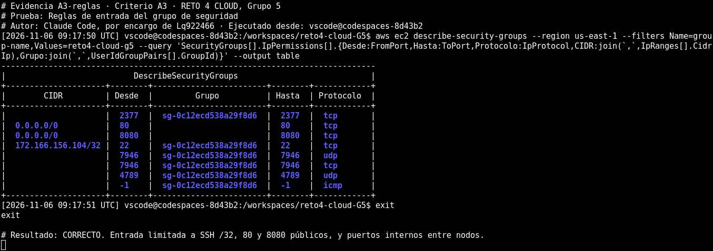

*Figura 9. Entrada limitada a SSH `/32`, 80 y 8080 públicos y puertos internos solo entre nodos. La IP SSH es la vigente ese día, antes de la regla temporal. Captura conforme. Claude Code, por encargo de Cristina (Lq922466). 6 de noviembre de 2026.*

> **Evidencia pendiente:** captura de las reglas de entrada en la consola de EC2 (la Rúbrica pide «reglas EC2») y captura conforme actualizada después de retirar la regla temporal.

### 1.8. Manager y workers con `count` (A2)

**Procedimiento.** Extracto de [`main.tf`](terraform/main.tf):

```hcl
resource "aws_instance" "manager" {
  ami                         = data.aws_ami.ubuntu.id
  instance_type               = var.manager_type
  key_name                    = var.key_name
  vpc_security_group_ids      = [aws_security_group.cluster.id]
  associate_public_ip_address = true
  user_data = templatefile("${path.module}/scripts/bootstrap.sh.tftpl", {
    hostname    = "manager-${var.grupo}"
    public_keys = var.ssh_public_keys
  })
  root_block_device { volume_size = var.manager_disk_size  volume_type = var.disk_type }
  tags = { Name = "manager-${var.grupo}", PruebaA6 = "reto4-${var.grupo}" }
}

resource "aws_instance" "workers" {
  count         = var.worker_count
  instance_type = var.worker_type
  user_data     = templatefile(..., { hostname = "worker${count.index + 1}-${var.grupo}", ... })
  tags          = { Name = "worker${count.index + 1}-${var.grupo}" }
  # El resto, igual que el manager, con worker_disk_size.
}
```

**Explicación.**

- **`count`** crea varias instancias a partir de un solo bloque. `count.index` vale 0, 1 y 2, de ahí `worker1-g5`, `worker2-g5` y `worker3-g5`. Así se cumple el requisito de no copiar el código tres veces.
- **`templatefile`** rellena el script de arranque con el nombre del nodo y las claves públicas, y lo entrega como `user_data`. EC2 lo ejecuta una vez, con cloud-init, en el primer arranque.
- **`key_name = "vockey"`** asocia el par de claves del laboratorio, que queda como acceso de reserva.
- **La etiqueta `Name`** es la que muestran la consola y los filtros de los scripts. `PruebaA6` es el cambio controlado del apartado [1.12](#112-cambio-controlado-a6).


*Figura 10. Los tres workers salen de un único recurso multiplicado con `count`. Captura conforme. Claude Code, por encargo de Cristina (Lq922466). 5 de noviembre de 2026.*

**Comprobación.**

```bash
aws ec2 describe-instances --region us-east-1 --filters 'Name=tag:Name,Values=manager-g5,worker?-g5' \
  --query 'Reservations[].Instances[].[Tags[?Key==`Name`]|[0].Value,InstanceType,State.Name,PrivateIpAddress,PublicIpAddress]' \
  --output table
```


*Figura 11. Un manager t3.medium y tres workers t3.small en ejecución, con los controles de estado correctos. Captura conforme. Claude Code, por encargo de Cristina (Lq922466). 6 de noviembre de 2026.*

> **Evidencia pendiente:** captura de **EC2 → Instances** en la consola con las cuatro instancias, sus tipos y sus etiquetas (la Rúbrica pide «consola EC2»).

### 1.9. Script de arranque (A4)

**Procedimiento.** [`bootstrap.sh.tftpl`](terraform/scripts/bootstrap.sh.tftpl) se ejecuta como root en el primer arranque. Extracto:

```bash
set -euo pipefail
hostnamectl set-hostname '${hostname}'                        # manager-g5, worker1-g5…
timedatectl set-timezone Europe/Madrid
install -d -m 0700 -o ubuntu -g ubuntu /home/ubuntu/.ssh       # Carpeta con permisos 700.
# Añade cada clave de ssh_public_keys a authorized_keys (600) si no estaba ya, con grep -Fxq.
cat > /etc/ssh/sshd_config.d/00-reto4.conf <<'SSH'
PermitRootLogin no
PasswordAuthentication no
KbdInteractiveAuthentication no
SSH
sshd -t && systemctl reload ssh                                # Valida y aplica la configuración.
apt-get install -y docker.io && systemctl enable --now docker
usermod -aG docker ubuntu                                      # ubuntu usa Docker sin sudo.
```

**Explicación.**

- **`set -euo pipefail`** detiene el script ante cualquier error, en lugar de dejar un nodo a medio configurar.
- **`grep -Fxq`** compara la línea exacta: repetir el script no duplica claves, y no se toca la clave `vockey` que añade AWS.
- **`sshd -t`** comprueba la sintaxis antes de recargar SSH, porque un error podría dejar el nodo inaccesible.
- **`systemctl enable --now docker`** arranca Docker y lo deja activado para los siguientes arranques, algo necesario porque Learner Lab detiene y arranca las instancias.


*Figura 12. El script configura hostname, zona horaria, claves públicas, SSH y Docker. Captura conforme. Claude Code, por encargo de Cristina (Lq922466). 5 de noviembre de 2026.*

**Comprobación.** En cada nodo: `cloud-init status`, `timedatectl show -p Timezone --value` y `docker --version`.


*Figura 13. En los cuatro nodos terminó cloud-init, con la zona Europe/Madrid y Docker instalado. Captura conforme. Claude Code, por encargo de Cristina (Lq922466). 6 de noviembre de 2026. Máquinas: codespaces-8d43b2 y los cuatro nodos.*

El registro completo del primer arranque del manager está en [`evidencias/prototipo/manager-g5.txt`](evidencias/prototipo/manager-g5.txt).

### 1.10. Salidas (A5)

**Procedimiento.** [`outputs.tf`](terraform/outputs.tf):

```hcl
output "nodes" {
  value = {
    for node in concat([aws_instance.manager], aws_instance.workers) :
    node.tags.Name => { public_ip = node.public_ip, private_ip = node.private_ip, id = node.id }
  }
}
```

```bash
terraform -chdir=terraform output -state=ESTADO/terraform.tfstate -json nodes
```

**Explicación.** La expresión `for` recorre el manager y los tres workers y crea un mapa por nombre. La leen [`generar-config-ssh.sh`](scripts/generar-config-ssh.sh), para crear los alias SSH, y [`formar-swarm.sh`](scripts/formar-swarm.sh), que anuncia Swarm por la IP privada del manager. `ESTADO` es la carpeta privada del Codespace donde se guarda el estado de Terraform, fuera del repositorio.

Las salidas reflejan el **estado** guardado, no AWS en tiempo real. Tras reiniciar el laboratorio, las IP públicas de la salida quedan antiguas hasta que se sincroniza el estado (apartado [1.13](#113-sincronización-del-estado-con-refresh-only)).


*Figura 14. La salida `nodes` muestra la IP pública, la IP privada y el ID de cada nodo. Las IP públicas son las del último `apply` de ese momento. Captura conforme. Claude Code, por encargo de Cristina (Lq922466). 6 de noviembre de 2026.*

### 1.11. Creación de la infraestructura: `init`, `validate`, `plan` y `apply`

**Procedimiento.** Ciclo seguido el 4 de noviembre, deducido de los planes y registros conservados:

```bash
terraform init
terraform validate
terraform plan -out=reto4-review-cidr.tfplan      # Plan: 5 to add, 0 to change, 0 to destroy.
terraform apply reto4-review-cidr.tfplan          # Apply complete! Resources: 5 added, 0 changed, 0 destroyed.
```

**Explicación.**

| Orden | Qué hace | Por qué se usa así |
| --- | --- | --- |
| `terraform init` | Descarga el proveedor y prepara `.terraform` | Una vez, o al cambiar de proveedor |
| `terraform validate` | Comprueba sintaxis y tipos sin contactar con AWS | Detecta errores antes del plan |
| `terraform plan -out=ARCHIVO` | Compara código, estado y AWS, y guarda las acciones previstas | Se revisa antes de aplicar |
| `terraform apply ARCHIVO` | Aplica exactamente el plan revisado | Impide que se ejecute algo distinto de lo revisado |

El **estado** (`terraform.tfstate`) es el registro con el que Terraform relaciona el código con los recursos reales. No se versiona: está en una carpeta privada del Codespace. Sin él, Terraform no podría modificar ni destruir esta infraestructura.

**Comprobación.** El apply creó cinco recursos: el grupo de seguridad y las cuatro instancias. [Plan inicial](evidencias/prototipo/reto4-plan.log), [plan con la IP SSH](evidencias/prototipo/reto4-plan-cidr.log) y [apply](evidencias/prototipo/reto4-apply.log).

> **Evidencia pendiente (A6):** la secuencia en capturas conformes de validación, plan, cambio y destrucción. Hoy esa secuencia solo consta en registros de texto.

### 1.12. Cambio controlado (A6)

**Qué se hizo y para qué.** Para demostrar el ciclo de cambio sin riesgo, se añadió a manager-g5 la etiqueta `PruebaA6=reto4-g5`. Una etiqueta se cambia **en el sitio** (`~ update in-place`): no detiene ni sustituye la instancia.

**Procedimiento.**

```bash
terraform -chdir=terraform plan -input=false -state=ESTADO/terraform.tfstate \
  -var-file=ESTADO/reto4-local.auto.tfvars.json -var ssh_cidr=IP_ACTUAL/32 -out=a6-apply.tfplan
terraform -chdir=terraform apply -input=false -state=ESTADO/terraform.tfstate a6-apply.tfplan
```

**Comprobación.** El 5 de noviembre, el plan final contenía solo la etiqueta (`Plan: 0 to add, 1 to change, 0 to destroy`) y el apply terminó con `Apply complete! Resources: 0 added, 1 changed, 0 destroyed`. Los ID y los discos no cambiaron, y un nuevo plan indicó `No changes`. Planes [previo](evidencias/A6-plan-previo.txt), [descartado](evidencias/A6-plan-actual.txt) y [final](evidencias/A6-plan-final.txt), y [apply](evidencias/A6-apply.txt).

El 6 de noviembre, tras un reinicio del laboratorio, la captura conforme del plan posterior dio **NO CORRECTO**: Terraform no proponía cambios en los recursos, pero sí en las salidas (`Changes to Outputs`), porque el estado guardaba las IP públicas anteriores.

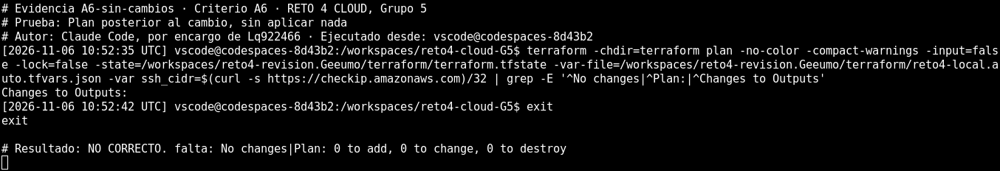

*Figura 15. Plan posterior al cambio. NO CORRECTO: propone cambios en las salidas, no en los recursos, y la comprobación exige que no proponga ninguno. Captura conforme. Claude Code, por encargo de Cristina (Lq922466). 6 de noviembre de 2026.*

### 1.13. Sincronización del estado con `refresh-only`

**Qué se hizo y para qué.** Para que el estado y las salidas vuelvan a coincidir con AWS sin tocar ningún recurso se usa el modo **refresh-only**: Terraform lee los recursos reales y actualiza solo el estado.

**Procedimiento.** `ESTADO` es la carpeta privada con el estado, y `COPIA`, una carpeta privada de respaldo, ambas fuera de Git.

```bash
# 1. Copia de seguridad del estado y de sus huellas SHA-256.
cp -p ESTADO/terraform.tfstate COPIA/ && (cd ESTADO && sha256sum terraform.tfstate) > COPIA/SHA256SUMS

# 2. Plan refresh-only guardado en un archivo, y revisión de que no hay acciones sobre recursos.
terraform -chdir=terraform plan -refresh-only -input=false -lock-timeout=30s \
  -state=ESTADO/terraform.tfstate -var-file=ESTADO/reto4-local.auto.tfvars.json -out=COPIA/refresh-only.tfplan
terraform -chdir=terraform show -json COPIA/refresh-only.tfplan     # resource_changes debe estar vacío.

# 3. Aplicar exactamente ese plan y comprobar las salidas.
terraform -chdir=terraform apply -input=false -lock-timeout=30s -state=ESTADO/terraform.tfstate COPIA/refresh-only.tfplan
terraform -chdir=terraform output -state=ESTADO/terraform.tfstate -json nodes
```

**Explicación.** Aplicar el archivo de plan, en lugar de un `apply -refresh-only` interactivo, garantiza que se aplica exactamente lo revisado. Un plan refresh-only nunca crea, cambia ni destruye recursos; solo recoge lo que ha cambiado fuera de Terraform.

**Comprobación.**

- **9 de noviembre, solo lectura.** Codex ejecutó `plan -refresh-only` sobre una copia del estado: cero acciones sobre recursos. Lo desactualizado eran la IP y el DNS públicos de las cuatro instancias y las reglas SSH guardadas. No se aplicó.
- **10 de noviembre, con autorización de Cristina.** Claude Code hizo la copia de seguridad, revisó que el plan no tenía acciones sobre recursos y lo aplicó: `Apply complete! Resources: 0 added, 0 changed, 0 destroyed`. Las salidas pasaron a coincidir con AWS en ID, IP privada e IP pública de los cuatro nodos.

El registro de esta ejecución y la copia de seguridad están en una carpeta privada del Codespace, fuera de Git, porque contienen el estado de Terraform.

> **Evidencia pendiente:** versionar un extracto del registro del `apply -refresh-only`, sin datos de la cuenta, y una captura conforme de `terraform output nodes` coincidiendo con EC2.

Después de sincronizar el estado, el `plan` normal de solo lectura **no** dio `No changes`: proponía sustituir las cuatro instancias por una imagen Ubuntu nueva (incidencia [I1.4](#115-incidencias-reales-y-soluciones)). Por eso A6 no queda cerrado.

### 1.14. Destrucción (pendiente)

**Procedimiento.** No se ha ejecutado. Con autorización, sería:

```bash
terraform -chdir=terraform plan -destroy -state=ESTADO/terraform.tfstate -var-file=ESTADO/reto4-local.auto.tfvars.json -out=destroy.tfplan
terraform -chdir=terraform apply -state=ESTADO/terraform.tfstate destroy.tfplan
```

**Explicación.** `plan -destroy` muestra qué se eliminaría; el 5 de noviembre se generó solo como información, sin aplicarlo, y listaba los cinco recursos: `Plan: 0 to add, 0 to change, 5 to destroy` ([registro](evidencias/A6-plan-actual.txt)). Aplicarlo borra las instancias, sus discos y el clúster, y obliga a repetir las Fases 1 a 4. Como la Rúbrica exige que todo funcione durante la corrección, la destrucción se deja para el final, con autorización separada y tras confirmarlo con el profesor.

> **Evidencia pendiente:** la destrucción real y su captura, cuando se decida.

### 1.15. Incidencias reales y soluciones

**I1.1. Credenciales de AWS caducadas o revocadas** · Estado: **resuelta** (se repite en cada sesión)

- *Síntomas:* las consultas fallaban con `UnauthorizedOperation` por la política `voc-cancel-cred` (4 de noviembre, durante E5), con `UnauthorizedOperation` en `DescribeInstances` (5 de noviembre) y con `RequestExpired: Request has expired` (9 de noviembre).
- *Causa:* las credenciales pertenecían a una sesión de Learner Lab ya terminada o sustituida.
- *Diagnóstico:* `comprobar-laboratorio.sh` terminó con código 3, y `aws sts get-caller-identity` fallaba. El indicador del laboratorio no estaba en verde o la sesión era nueva.
- *Solución aplicada:* iniciar el laboratorio y sustituir el bloque completo de `~/.aws/credentials` (apartado [1.2](#12-credenciales-temporales-en-el-codespace)).
- *Comprobación:* `sts get-caller-identity` respondió y AWS volvió a aceptar las consultas. [Registro del 4 de noviembre](evidencias/E5-verificacion-posterior.txt), [del 5](evidencias/auditoria/registro-acceso-en-vivo.txt) y [del 9](evidencias/auditoria/registro-2026-11-09.txt).

**I1.2. El plan del cambio controlado incluía un segundo cambio** · Estado: **resuelta**

- *Síntomas:* el plan de A6 del 5 de noviembre proponía cambiar la etiqueta y también el grupo de seguridad.
- *Causa:* la regla SSH real no tenía descripción, y el código sí la declaraba.
- *Diagnóstico:* lectura del plan: la diferencia estaba en la descripción de la regla del puerto 22.
- *Solución aplicada:* se descartó ese plan, se alineó el código con la regla real, sin tocar AWS, y se usó la IP vigente en `ssh_cidr`.
- *Comprobación:* el plan final contenía solo la etiqueta. [Plan descartado](evidencias/A6-plan-actual.txt) y [final](evidencias/A6-plan-final.txt).

**I1.3. Estado y salidas desactualizados tras reiniciar el laboratorio** · Estado: **resuelta**; falta versionar la evidencia

- *Síntomas:* la captura del plan posterior al cambio dio NO CORRECTO por `Changes to Outputs`, y `terraform output` mostraba IP públicas que ya no existían.
- *Causa:* el estado guarda las IP del último `apply`, y Learner Lab asigna IP nuevas en cada sesión. Además, las reglas SSH sustituidas a mano no constaban en el estado.
- *Diagnóstico:* `plan -refresh-only` de solo lectura del 9 de noviembre: cero acciones sobre recursos y diferencias solo en IP, DNS y reglas SSH.
- *Solución aplicada:* `apply -refresh-only` del 10 de noviembre, autorizado por Cristina, con copia de seguridad previa (apartado [1.13](#113-sincronización-del-estado-con-refresh-only)).
- *Comprobación:* las salidas coinciden con EC2. El registro está fuera de Git; la captura conforme versionada sigue siendo la del 6 de noviembre.

**I1.4. El plan normal propone sustituir las cuatro instancias** · Estado: **pendiente**

- *Síntomas:* el 10 de noviembre, el `plan` normal de solo lectura dio `Plan: 4 to add, 0 to change, 4 to destroy`, con `ami ... # forces replacement` en las cuatro instancias.
- *Causa:* `data "aws_ami"` usa `most_recent = true`. Canonical publicó el 9 de noviembre una imagen Ubuntu 22.04 nueva (`...-server-20261109`), y las instancias usan la del 21 de octubre (`ubuntu/images/hvm-ssd/ubuntu-jammy-22.04-amd64-server-20261021`). Cambiar la imagen obliga a recrear la instancia.
- *Diagnóstico:* `terraform show -json` del plan: el único atributo que fuerza la sustitución es `ami`. El grupo de seguridad y el `user_data` no cambian.
- *Solución propuesta, no aplicada:* fijar la imagen de las instancias actuales, por ejemplo con `ubuntu_ami_name = "ubuntu/images/hvm-ssd/ubuntu-jammy-22.04-amd64-server-20261021"` en las variables privadas, o añadir `lifecycle { ignore_changes = [ami] }` a las instancias; después, repetir el plan de solo lectura hasta obtener `No changes`. Requiere autorización.
- *Precaución:* se borró el archivo de ese plan para que nadie pueda aplicarlo por error. **No debe ejecutarse un `terraform apply` normal** hasta corregirlo: destruiría y recrearía los cuatro nodos y el clúster.

**I1.5. Las reglas SSH añadidas a mano quedaban fuera de Terraform** · Estado: **resuelta**

- *Síntomas:* la regla temporal de los integrantes y las sustituciones de la regla del Codespace no estaban en el código, así que un plan habría propuesto retirarlas.
- *Causa:* las reglas del grupo de seguridad son *inline*: Terraform considera sobrante cualquier regla que no declare.
- *Diagnóstico:* el `plan -refresh-only` del 9 de noviembre mostraba las reglas reales distintas de las guardadas.
- *Solución aplicada:* la variable `ssh_additional_cidrs` (commit `9dab86d`) declara los accesos SSH adicionales con su descripción, sin retirar los existentes, y rechaza `0.0.0.0/0`.
- *Comprobación:* el plan normal del 10 de noviembre no proponía ningún cambio en el grupo de seguridad.

**I1.6. Interrupción del primer plan refresh-only** · Estado: **resuelta**

- *Síntomas:* el 10 de noviembre, el primer `plan -refresh-only` terminó con código 137 antes de acabar.
- *Causa:* se reinició la sesión del editor y el proceso de Terraform se detuvo.
- *Diagnóstico:* se comprobó con `sha256sum -c` que el estado era idéntico a la copia de seguridad y que no quedaba ningún bloqueo (`.terraform.tfstate.lock.info`) ni proceso de Terraform.
- *Solución aplicada:* se repitió el plan.
- *Comprobación:* el segundo plan terminó correctamente y su revisión mostró cero acciones sobre recursos.

### 1.16. Posibles incidencias y soluciones

| Síntoma o error | Causa probable | Diagnóstico | Solución |
| --- | --- | --- | --- |
| `RequestExpired`, `ExpiredToken` o `UnauthorizedOperation` | Credenciales de una sesión terminada | `aws sts get-caller-identity` | Iniciar el laboratorio y sustituir `~/.aws/credentials` |
| `describe-instances` devuelve una lista vacía | Región distinta de `us-east-1` | `aws configure get region` | `aws configure set region us-east-1` |
| La CLI ignora el archivo de credenciales | Variables `AWS_*` en el entorno con prioridad | `env \| grep '^AWS_'` | `unset` de esas variables |
| `Error acquiring the state lock` | Otro Terraform en marcha o una ejecución interrumpida | `ps aux \| grep terraform` | Esperar; usar `terraform force-unlock ID` solo si no hay ningún proceso activo |
| Error de validación de `ssh_cidr` o `ssh_public_keys` | CIDR abierto o mal escrito, o clave con saltos de línea | Mensaje de `validation` | Corregir el archivo de variables privado |
| El plan muestra `forces replacement` o `to destroy` | Cambio de imagen u otro atributo inmutable | `terraform show -json PLAN` | No aplicar. Fijar el atributo y repetir el plan |
| Terraform quiere crear todo de nuevo | Falta el estado o se usa otra ruta | `terraform state list -state=RUTA` | Usar la ruta privada del estado, o restaurar su copia |
| cloud-init no termina, o falta Docker o el hostname | Error del script de arranque o sin salida a Internet | `cloud-init status --long` y `/var/log/cloud-init-output.log` | Corregir el script y recrear la instancia con autorización |
| Learner Lab rechaza crear una instancia | Tipo o número de instancias no permitido en el laboratorio | Mensaje de error de AWS | Usar los tipos de la Guía, t3.medium y t3.small |

### 1.17. Resultado y conclusión de la Fase 1

Terraform creó la infraestructura de la Guía con un único módulo: variables para el grupo, los tamaños, los discos y la imagen; workers multiplicados con `count`; un grupo de seguridad que solo abre a Internet los puertos 80 y 8080, y el 22 a direcciones `/32`; un script de arranque que deja cada nodo con su nombre, la zona Europe/Madrid, las claves, SSH endurecido y Docker; y unas salidas con IP e ID. El estado se sincronizó con AWS el 10 de noviembre y las salidas vuelven a coincidir con EC2.

Del ciclo de A6 están demostrados la validación, el plan, el apply inicial y un cambio controlado. **No está cerrado** por tres motivos: el plan normal propone sustituir las instancias por la imagen nueva (I1.4), falta la destrucción, y la secuencia no está en capturas conformes.

- **Cumplidos:** A1, A4, A5 y F6. A2 y A3 cumplidos, con la captura de la consola de EC2 pendiente.
- **Parcial:** A6.
- **Pendiente:** F13.

## Fase 2 — Acceso SSH

**Objetivo.** Administrar los cuatro servidores por SSH con claves públicas propias, sin contraseñas ni acceso de root: entrar con un nombre corto, llegar a los workers por su IP privada a través del manager, ejecutar órdenes en todos a la vez con `sudo` y copiar archivos de forma verificable.

**Contenidos.**

| Requisito de la Guía y la Rúbrica | Criterio | Apartado | Estado |
| --- | --- | --- | --- |
| Cada alumno usa sus propias claves; `vockey` queda de reserva (Guía) o sustituida (Rúbrica) | B1 | 2.1, 2.2, 2.8 | Parcial |
| Archivo `config` en el cliente para entrar con el nombre corto | B2 | 2.3 | Cumplido |
| Workers accesibles por IP privada con el manager como salto | B5 | 2.4 | Cumplido |
| Sin acceso root ni por contraseña; permisos locales | B4 | 2.5 | Cumplido |
| Control total, órdenes simultáneas y copia de ficheros | B3 | 2.6, 2.7 | Cumplido |

### 2.1. Claves SSH del proyecto (B1)

**Qué se hizo y para qué.** Cada integrante generó su propio par de claves Ed25519, protegido con frase de paso. La clave **privada** no sale de su equipo; la **pública** se guarda en [`terraform/claves/`](terraform/claves/), versionada desde el 9 de noviembre. El Codespace usa además su propia clave, `~/.ssh/reto4_g5`.

**Procedimiento en el equipo de cada integrante.**

```bash
ssh-keygen -t ed25519 -C "NOMBRE-reto4" -f ~/.ssh/NOMBRE_reto4     # Pide una frase de paso.
ssh-keygen -lf ~/.ssh/NOMBRE_reto4.pub                              # Huella para comprobarla después.
```

**Explicación.** `ssh-keygen -lf` muestra la **huella** de una clave: un resumen SHA-256 que la identifica sin revelarla. Para saber si dos claves son la misma se comparan sus huellas.

| Clave | Tipo | Huella | Cómo llega a los nodos |
| --- | --- | --- | --- |
| `vockey` | RSA 2048 | `SHA256:dSdE2bRgx+xf29ZBOfEM7wBA9wD8+++htV5P8ROuZ9c` | AWS, por `key_name` |
| `reto4-g5-codespace` | Ed25519 | `SHA256:+Z2k+zLsyhswZxNWG/HxbdnlEyyCFbiTPPUXSvUXT1Y` | `ssh_public_keys` y script de arranque |
| Cristina, `cristina-reto4` | Ed25519 | `SHA256:CCR0qvMqSW8DopOop+RzmuWU7lu/USgKep7m+2fN5zA` | `instalar-clave-publica.sh` |
| Enrique, `EnriZx2-reto4` | Ed25519 | `SHA256:qDmJbNSoN432FHt3g+C6whK0IMM7wxroJOtKo1rZJys` | `instalar-clave-publica.sh` |
| Alexandra, `alexguerth-reto4` | Ed25519 | `SHA256:FJm/tkGxAxFBJKam0EQ1C5jpXbQ7konNpo8SRFHl1rs` | `instalar-clave-publica.sh` |
| Ibai, `ibai-reto4` | Ed25519 | `SHA256:zYEmGi4uoe3ljIm8NsFkKSXTcRw3hrm57WiWtjqSyp8` | `instalar-clave-publica.sh` |

**Diferencia entre la Guía y la Rúbrica.** La Guía dice que «la clave vockey queda como acceso de reserva», y la Rúbrica pide «vockey sustituida». El proyecto conserva `vockey`, como indica la Guía, porque retirarla elimina el acceso de emergencia. Hay que confirmarlo con el profesor antes de cambiarlo.

**Comprobación.** El 9 de noviembre se comprobó que las cuatro claves públicas son Ed25519 válidas, de una línea, distintas entre sí y de `vockey` y la del Codespace, y que no hay claves privadas en el repositorio ni en su historial.

> **Evidencia pendiente:** captura `B1-repositorio` con las cuatro `.pub` en `main` y las privadas excluidas por `.gitignore`.

### 2.2. Instalación de las claves de los integrantes (B1)

**Qué se hizo y para qué.** Las claves de los integrantes se añadieron a `authorized_keys` de los cuatro nodos sin recrear las instancias y sin perder el acceso existente. Para ello se usa [`instalar-clave-publica.sh`](scripts/instalar-clave-publica.sh): primero se comprueba, solo con lectura, y después se instala con autorización.

**Procedimiento.**

```bash
for n in cristina enrique alexandra ibai; do
    bash scripts/instalar-clave-publica.sh --comprobar "terraform/claves/${n}_reto4.pub"; echo "salida=$?"
done
# Solo con autorización expresa:
for n in cristina enrique alexandra ibai; do
    bash scripts/instalar-clave-publica.sh --instalar "terraform/claves/${n}_reto4.pub" || break
done
```

**Explicación.** El script está pensado para no perder nunca el acceso:

- **Valida la clave:** solo acepta una clave pública Ed25519 en una línea, con comentario.
- **Comprueba antes de cambiar nada:** revisa los cuatro nodos y se detiene si alguno no responde.
- **Conserva lo que hay:** guarda una copia, `authorized_keys.antes-FECHA`, y **añade** la clave al final, sin borrar `vockey` ni la clave del Codespace.
- **Se verifica a sí mismo:** comprueba que el principio del archivo sigue idéntico a la copia y que `ssh-keygen` lo lee bien; si no, restaura la copia.
- **Se puede repetir:** si la clave ya está, no la duplica.

**Diferencia con la Guía.** La Guía pone las claves públicas en el script de arranque. Terraform no lee `terraform/claves/`: el script de arranque instala las claves de `ssh_public_keys`, que al crear los nodos solo contenía la del Codespace. Las de los integrantes llegaron después y se instalaron con este script, sin recrear las instancias. Si se recrearan los nodos, habría que añadirlas a esa variable.

**Comprobación.** El 9 de noviembre, con autorización de Cristina, `--comprobar` dio `ausente` antes de instalar y `presente` después, con código 0 en los cuatro nodos. Cada nodo quedó con seis claves, sin duplicados, con permisos 700 y 600 y con `vockey` y la clave del Codespace intactas. Esa tarde, Codex volvió a comprobar las cuatro claves en los cuatro nodos. [Registro de la instalación](evidencias/auditoria/registro-2026-11-09-b1.txt).


*Figura 16. CORRECTO: las claves de Cristina, Enrique, Alexandra e Ibai están en los cuatro nodos, y se conservan `vockey` y la clave del Codespace. Captura conforme. Claude Code, por encargo de Cristina (Lq922466). 9 de noviembre de 2026. Máquinas: codespaces-8d43b2 y los cuatro nodos.*

### 2.3. Archivo `config` y nombres cortos (B2)

**Qué se hizo y para qué.** Para entrar con `ssh manager-g5` en lugar de escribir usuario, IP y clave, el cliente SSH usa un archivo de configuración. Como la IP pública del manager cambia en cada sesión, ese archivo se **genera** con [`actualizar-ips.sh`](scripts/actualizar-ips.sh) a partir de la [plantilla](config/ssh_config.example).

**Procedimiento.**

```bash
bash scripts/actualizar-ips.sh                                       # Lee de EC2 las IP y regenera config/ssh.local.
install -m 600 config/ssh_config.usuario.example ~/.ssh/config       # Una sola vez: contiene «Include .../config/ssh.local».
ssh -G manager-g5 2>/dev/null | grep -E '^(user|hostname|hostkeyalias) '   # Cómo resuelve SSH el alias.
ssh manager-g5
```

Extracto de la configuración generada ([`config/ssh_config.aplicado`](config/ssh_config.aplicado)):

```text
Host manager-g5
    HostName IP_PUBLICA_DEL_MANAGER
    HostKeyAlias manager-g5
Host worker1-g5
    HostName 172.31.17.168
# … worker2-g5 y worker3-g5, igual, con su IP privada.
Host worker?-g5
    ProxyJump manager-g5
Host manager-g5 worker?-g5
    User ubuntu
    IdentityFile ~/.ssh/reto4_g5
    IdentitiesOnly yes
    BatchMode yes
```

**Explicación.**

| Directiva | Para qué sirve |
| --- | --- |
| `Host` | Nombre corto. `worker?-g5` se aplica a los tres workers |
| `HostName` | Dirección real: la IP pública del manager o la IP privada de cada worker |
| `HostKeyAlias` | Guarda la huella del servidor con su nombre y no con la IP, así que no hay que volver a aceptarla cuando cambia la IP |
| `User ubuntu` | Usuario remoto, que no es root |
| `IdentityFile` e `IdentitiesOnly yes` | Usa solo esa clave, sin probar otras |
| `BatchMode yes` | Nunca pide contraseña: si la clave no sirve, falla en lugar de quedarse esperando |
| `ProxyJump` | Llega a los workers a través del manager (apartado [2.4](#24-acceso-a-los-workers-por-ip-privada-con-salto-b5)) |

Con `Include`, el `~/.ssh/config` no cambia aunque cambien las IP: solo se regenera `config/ssh.local`. El script escribe en un archivo temporal y lo mueve al final, para no dejar nunca una configuración a medias.


*Figura 17. Los alias se resuelven solo con el nombre corto. Captura conforme. Claude Code, por encargo de Cristina (Lq922466). 5 de noviembre de 2026.*

**Comprobación.** `ssh manager-g5` y `ssh worker3-g5` entran sin escribir IP, usuario ni clave.

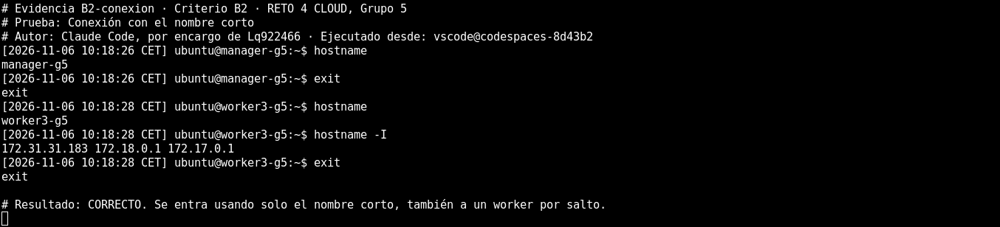

*Figura 18. Se entra usando solo el nombre corto, también en un worker por salto. Captura conforme. Claude Code, por encargo de Cristina (Lq922466). 6 de noviembre de 2026. Máquinas: codespaces-8d43b2, manager-g5 y worker3-g5.*

### 2.4. Acceso a los workers por IP privada con salto (B5)

**Procedimiento.**

```bash
ssh -G worker1-g5 2>/dev/null | grep -E '^(hostname|proxyjump) '   # hostname 172.31.17.168 · proxyjump manager-g5
ssh worker1-g5 hostname -I                                         # Repetir con worker2-g5 y worker3-g5.
```

**Explicación.** Con **`ProxyJump`**, el cliente abre primero una conexión SSH con el manager y, a través de ella, otra con la IP privada del worker. La autenticación en el worker la hace el propio cliente, con su clave, así que la clave privada **nunca** se copia al manager. El grupo de seguridad lo permite con la regla del puerto 22 limitada al propio grupo: los workers no necesitan aceptar SSH desde Internet.

**Comprobación.** Los tres workers responden con su IP privada `172.31.x.x`. Codex volvió a comprobar el 9 de noviembre que la configuración efectiva de los tres workers usa `proxyjump manager-g5`.


*Figura 19. Los tres workers se alcanzan por IP privada a través del manager. Captura conforme. Claude Code, por encargo de Cristina (Lq922466). 6 de noviembre de 2026. Máquinas: codespaces-8d43b2 y los tres workers.*

### 2.5. Sin root ni contraseña, y permisos (B4)

**Procedimiento.**

```bash
sudo sshd -T | grep -E '^(permitrootlogin|passwordauthentication) '   # En cada nodo.
stat -c '%a %n' ~/.ssh ~/.ssh/authorized_keys                          # En cada nodo.
stat -c '%a %n' ~/.ssh ~/.ssh/reto4_g5 ~/.ssh/config                   # En el Codespace.
```

**Explicación.** El script de arranque crea [`/etc/ssh/sshd_config.d/00-reto4.conf`](config/sshd_00-reto4.conf):

- **`PermitRootLogin no`** impide entrar como root. Se entra como `ubuntu` y se usa `sudo`, que deja registro de cada orden.
- **`PasswordAuthentication no`** y **`KbdInteractiveAuthentication no`** impiden las contraseñas, también por el método interactivo. Solo quedan las claves, que no se pueden adivinar por fuerza bruta.

`sshd -T` muestra la configuración **efectiva**, después de combinar todos los archivos, así que es más fiable que leer uno solo.

En cuanto a los permisos, `sshd` aplica *StrictModes*: si otros usuarios pueden escribir en `~/.ssh` o en `authorized_keys`, rechaza las claves, porque alguien podría añadir la suya. Por eso la carpeta tiene **700** (solo el propietario) y los archivos, **600** (lectura y escritura solo para el propietario). El cliente SSH también rechaza una clave privada que puedan leer otros.

**Comprobación.** Root y contraseña desactivados en los cuatro nodos y permisos 700 y 600. Codex lo comprobó de nuevo el 9 de noviembre.


*Figura 20. Root y contraseña desactivados en los nodos, y permisos 700 y 600. Captura conforme. Claude Code, por encargo de Cristina (Lq922466). 6 de noviembre de 2026. Máquinas: codespaces-8d43b2 y los cuatro nodos.*

### 2.6. Órdenes simultáneas y control total (B3)

**Procedimiento.**

```bash
bash scripts/comprobar-ssh.sh                     # hostname, fecha y versión de Docker en los cuatro nodos a la vez.
sudo -n true && echo "permisos de sudo: correcto"  # Dentro de cada nodo.
```

**Explicación.** [`comprobar-ssh.sh`](scripts/comprobar-ssh.sh) lanza cada conexión en segundo plano con `&`, guarda su PID y espera a todas con `wait`: las órdenes se ejecutan **a la vez** y el script falla si falla cualquier nodo. `sudo -n true` comprueba que `ubuntu` tiene control total sin contraseña; `-n` hace que `sudo` falle en lugar de pedirla.

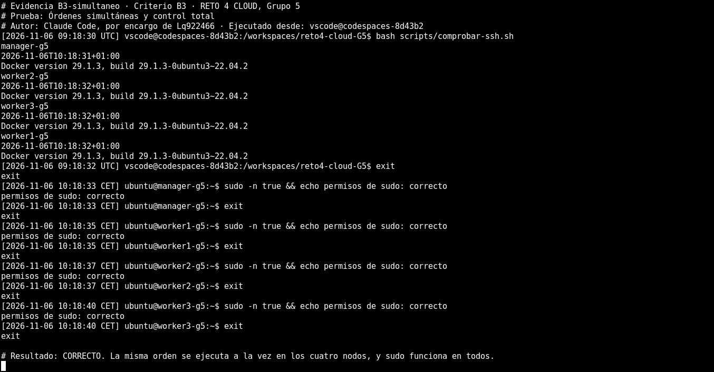

*Figura 21. La misma orden se ejecuta a la vez en los cuatro nodos, y `sudo` funciona en todos. Captura conforme. Claude Code, por encargo de Cristina (Lq922466). 6 de noviembre de 2026.*

### 2.7. Copia de archivos con SCP (B3)

**Procedimiento.**

```bash
d=$(mktemp -d); scp -q worker1-g5:/etc/hostname "$d/copia"; sha256sum "$d/copia"   # En el Codespace.
sha256sum /etc/hostname                                                            # En worker1-g5.
```

**Explicación.** `scp` copia archivos por el mismo canal cifrado de SSH y usa los mismos alias, incluido el salto. Si el SHA-256 coincide en los dos extremos, la copia es idéntica. La captura solo descarga, para no escribir en el nodo; la subida se comprobó el 4 de noviembre, también con SHA-256 coincidente ([registro](evidencias/prototipo/fase2-3.txt)).


*Figura 22. La copia por SCP tiene el mismo SHA-256 que el original. Captura conforme. Claude Code, por encargo de Cristina (Lq922466). 6 de noviembre de 2026. Máquinas: codespaces-8d43b2 y worker1-g5.*

### 2.8. Acceso de cada integrante desde su equipo (B1)

**Qué se hizo y para qué.** Para demostrar que cada integrante entra con su propia clave, cada uno debe conectarse desde su equipo a los cuatro nodos. El procedimiento completo, para Linux, WSL, Git Bash y Windows, está en [PROCEDIMIENTO-CLAVES.md](entrega/PROCEDIMIENTO-CLAVES.md).

**Procedimiento.**

1. El integrante obtiene su IP pública con `curl -s https://checkip.amazonaws.com`.
2. Con autorización, se añade una regla temporal `/32` en el puerto 22 para esa IP, declarada en `ssh_additional_cidrs`.
3. El integrante configura su `~/.ssh/config` como en el apartado [2.3](#23-archivo-config-y-nombres-cortos-b2), con su propia clave en `IdentityFile` y `ProxyJump manager-g5` en los workers.
4. Entra en `manager-g5`, `worker1-g5`, `worker2-g5` y `worker3-g5`, ejecuta `whoami`, `hostname` y `date -Is`, y hace la captura con el comentario de la norma.
5. Al terminar todos, se retira la regla temporal.

**Explicación.** El servidor registra en `/var/log/auth.log` la huella de la clave aceptada en cada conexión. Así se puede demostrar **desde el nodo** quién entró, de forma independiente de la captura del integrante.

**Comprobación.** La regla temporal `88.14.93.201/32` está abierta desde el 9 de noviembre. Ese día:

| Integrante | manager-g5 | worker1-g5 | worker2-g5 | worker3-g5 |
| --- | --- | --- | --- | --- |
| Cristina | Demostrado | Demostrado | Demostrado | Demostrado |
| Enrique | Demostrado | Pendiente | Pendiente | Pendiente |
| Alexandra | Demostrado | Pendiente | Pendiente | Pendiente |
| Ibai | Demostrado | Pendiente | Pendiente | Pendiente |

«Demostrado» significa que hay captura del integrante y que el nodo registra un acceso aceptado con la huella de su clave. Enrique, Alexandra e Ibai se conectaron desde PowerShell con `ssh -i`, y SSH les pidió la frase de paso de su clave. Cristina usó un archivo `config` con un alias por nodo y entró en los workers por salto; en cada worker aceptó la huella del servidor, que coincide con la leída en el propio nodo. No hay ningún fallo de autenticación en los registros de los cuatro nodos.


*Figura 23. Enrique entra en manager-g5 con su clave `enrique_reto4` desde PowerShell. Captura de Enrique. 9 de noviembre de 2026. No incluye el comentario que exige la norma.*

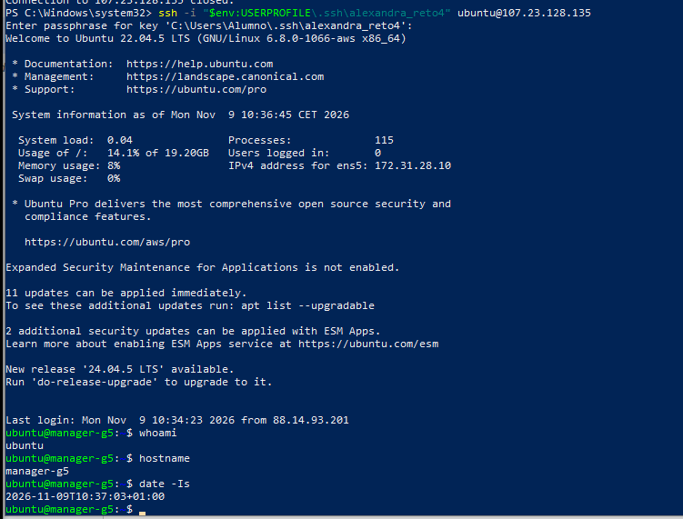

*Figura 24. Alexandra entra en manager-g5 con su clave `alexandra_reto4`. Captura de Alexandra. 9 de noviembre de 2026. No incluye el comentario que exige la norma.*

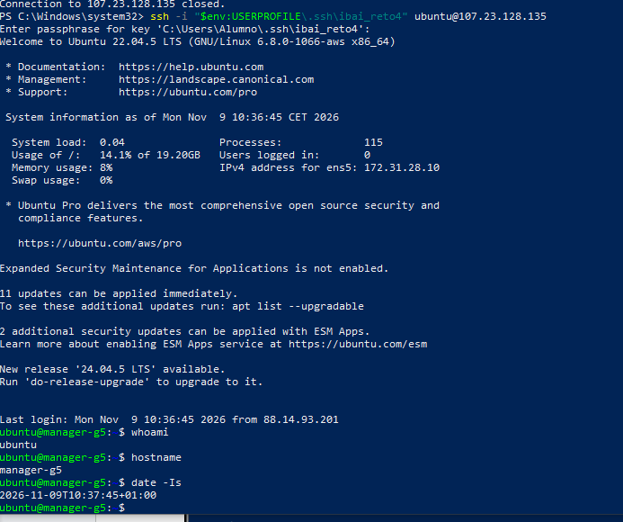

*Figura 25. Ibai entra en manager-g5 con su clave `ibai_reto4`. Captura de Ibai. 9 de noviembre de 2026. No incluye el comentario que exige la norma.*


*Figura 26. En el equipo de Cristina, `ssh -G manager-g5` resuelve la IP del manager y su clave `cristina_reto4`. Captura de Cristina. 9 de noviembre de 2026.*


*Figura 27. Cristina entra en worker1-g5 por salto, con su clave, tras comprobar la huella del servidor. Captura de Cristina. 9 de noviembre de 2026. No incluye el comentario que exige la norma. También hay capturas de [manager-g5](evidencias/capturas-integrantes/B1-acceso-cristina-manager.png), [worker2-g5](evidencias/capturas-integrantes/B1-acceso-cristina-worker2.png) y [worker3-g5](evidencias/capturas-integrantes/B1-acceso-cristina-worker3.png).*

El registro de cada nodo lo confirma:


*Figura 28. CORRECTO: manager-g5 registra un acceso aceptado con la clave de cada integrante: Cristina, Enrique, Alexandra e Ibai. Captura conforme. Claude Code, por encargo de Cristina (Lq922466). 9 de noviembre de 2026.*

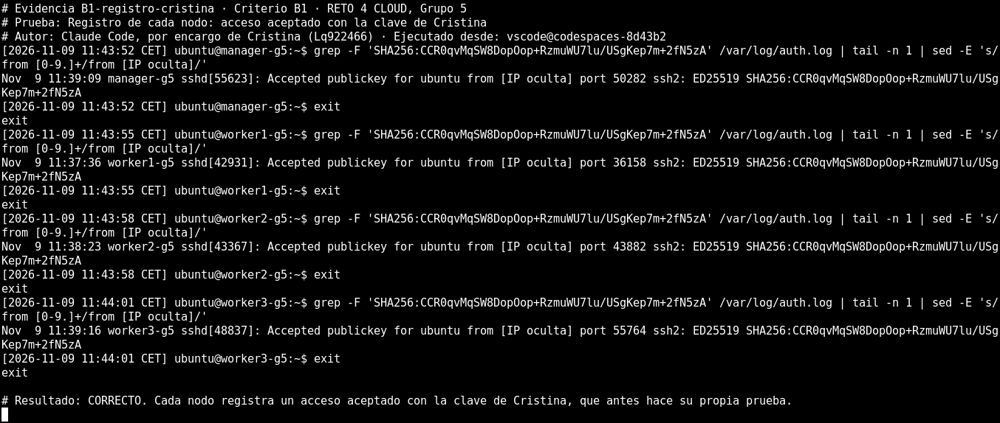

*Figura 29. CORRECTO: cada uno de los cuatro nodos registra un acceso aceptado con la clave de Cristina. Captura conforme. Claude Code, por encargo de Cristina (Lq922466). 9 de noviembre de 2026.*

**Límites.** Las capturas de los integrantes muestran el prompt y la fecha por `date -Is`, pero no el comentario con la prueba, el resultado y el autor. Además, los cuatro usaron el mismo perfil de Windows, `C:\Users\Alumno`, y las capturas no permiten saber si fue un solo equipo o varios equipos del aula.

> **Evidencia pendiente:** acceso de Enrique, Alexandra e Ibai a los tres workers por salto, con capturas que incluyan el comentario de la norma; capturas `B1-registro-enrique`, `B1-registro-alexandra` y `B1-registro-ibai` con el registro de los cuatro nodos; y, al terminar, retirada autorizada de la regla temporal.

### 2.9. Incidencias reales y soluciones

**I2.1. Pérdida del SSH al cambiar la IP pública del Codespace** · Estado: **resuelta** (se repitió tres veces)

- *Síntomas:* `ssh: connect to host IP_DEL_MANAGER port 22: Connection timed out`, mientras la web seguía respondiendo por HTTP. Ocurrió dos veces el 6 de noviembre y una el 9.
- *Causa:* el Codespace es una máquina en la nube y su IP de salida no es fija. El grupo de seguridad solo admitía la IP anterior y descartaba los paquetes. No era un problema de claves.
- *Diagnóstico:* la sección 2 de `comprobar-laboratorio.sh` comparó `curl -s https://checkip.amazonaws.com` con el origen de la regla. El 9 de noviembre, la regla admitía `172.166.151.115/32` y el Codespace salía por `172.166.151.114`.
- *Solución aplicada:* con autorización, primero se **añade** la regla nueva, después se comprueba el SSH en los cuatro nodos y solo entonces se **retira** la antigua, para no perder nunca el acceso a medias. Después se regeneran los alias y se usa la IP nueva en `ssh_cidr`.

```bash
aws ec2 authorize-security-group-ingress --region us-east-1 --group-id sg-0c12ecd538a29f8d6 --protocol tcp --port 22 --cidr IP_NUEVA/32
bash scripts/comprobar-ssh.sh
aws ec2 revoke-security-group-ingress --region us-east-1 --group-id sg-0c12ecd538a29f8d6 --protocol tcp --port 22 --cidr IP_ANTIGUA/32
bash scripts/actualizar-ips.sh
```

- *Comprobación:* los cuatro nodos respondieron por SSH después de cada sustitución. [Registro del 6 de noviembre](evidencias/auditoria/registro-2026-11-06.txt) y [del 9](evidencias/auditoria/registro-2026-11-09-b1.txt).

**I2.2. Los alias apuntaban a la IP pública anterior del manager** · Estado: **resuelta** con un procedimiento

- *Síntomas:* tras cada reinicio del laboratorio, `ssh manager-g5` intentaba conectar con una IP que ya no era del manager.
- *Causa:* Learner Lab asigna IP públicas nuevas a las instancias en cada sesión.
- *Diagnóstico:* `ssh -G manager-g5 | grep hostname` frente a la IP que muestra EC2.
- *Solución aplicada:* `actualizar-ips.sh` lee las IP de EC2 y regenera `config/ssh.local`. `HostKeyAlias` evita tener que aceptar de nuevo la huella del manager.
- *Comprobación:* tras cada reinicio, `comprobar-ssh.sh` responde en los cuatro nodos.

**I2.3. La clave pública de Cristina tenía un salto de línea de Windows** · Estado: **resuelta**

- *Síntomas:* el archivo `cristina_reto4.pub` entregado terminaba con un salto de línea de Windows (`CRLF`). Con ese carácter `\r`, la clave no cumple el formato de una sola línea limpia que exigen `instalar-clave-publica.sh` y la validación de `ssh_public_keys`.
- *Causa:* el archivo se había guardado en Windows.
- *Diagnóstico:* comprobación de solo lectura del archivo antes de instalarlo.
- *Solución aplicada:* se retiró el `\r` sin modificar la clave.
- *Comprobación:* la huella siguió siendo `SHA256:CCR0qvMq…`, `--comprobar` aceptó la clave y se instaló en los cuatro nodos. En las claves de Enrique, Alexandra e Ibai no ocurrió.

### 2.10. Posibles incidencias y soluciones

| Síntoma o error | Causa probable | Diagnóstico | Solución |
| --- | --- | --- | --- |
| `Connection timed out` | La regla SSH no admite la IP actual | `curl -s https://checkip.amazonaws.com` y `comprobar-laboratorio.sh` | Añadir la IP nueva, comprobar y retirar la antigua, con autorización |
| `Permission denied (publickey)` | Clave equivocada o no instalada en el nodo | `ssh -v manager-g5` y `ssh -G manager-g5 \| grep identityfile` | Corregir `IdentityFile`; comprobar con `instalar-clave-publica.sh --comprobar` |
| `UNPROTECTED PRIVATE KEY FILE` | La clave privada la pueden leer otros usuarios | `ls -l ~/.ssh` | `chmod 600` en Linux; en Windows, quitar permisos heredados a otros usuarios |
| `REMOTE HOST IDENTIFICATION HAS CHANGED` | El nodo se ha recreado o la IP es de otra máquina | Comparar la huella con `ssh-keygen -lf /etc/ssh/ssh_host_ed25519_key.pub` en el nodo | Si es legítimo, `ssh-keygen -R manager-g5` y aceptar la nueva |
| Se entra en el manager con `-i`, pero no en los workers | La opción `-i` no se aplica a la conexión de salto | `ssh -G worker1-g5` | Usar un `config` con `IdentityFile` en todos los alias |
| `sudo: a password is required` | El usuario no tiene `sudo` sin contraseña | `sudo -n true` | Usar el usuario `ubuntu` |
| Se pierde el acceso tras tocar `sshd` o `authorized_keys` | Error de sintaxis o archivo sobrescrito | `sudo sshd -t` antes de recargar | Mantener otra sesión abierta, restaurar la copia `authorized_keys.antes-*` o entrar con `vockey` |

### 2.11. Resultado y conclusión de la Fase 2

El acceso SSH cumple la Guía con la clave del Codespace: nombres cortos (B2), workers por IP privada con salto (B5), órdenes simultáneas con `sudo` y copia SCP verificada (B3), y root y contraseña desactivados con permisos 700 y 600 (B4), todo con capturas conformes. Las claves de los cuatro integrantes están instaladas en los cuatro nodos, y Cristina entró con la suya en todos.

**B1 sigue parcial:** Enrique, Alexandra e Ibai solo han entrado en manager-g5, sus capturas no tienen el comentario de la norma, falta la captura del repositorio con las claves y hay que aclarar con el profesor la política de `vockey`. La regla temporal `88.14.93.201/32` se mantiene hasta que terminen sus pruebas.

- **Cumplidos:** B2, B3, B4 y B5.
- **Parcial:** B1.

## Fase 3 — Docker Swarm

**Objetivo.** Formar un clúster Docker Swarm con los cuatro nodos comunicados por sus IP privadas, crear una red ingress overlay propia con MTU 1450 y una red overlay para el servicio, y comprobar que los cuatro nodos están activos con el manager como líder.

**Contenidos.**

| Requisito de la Guía y la Rúbrica | Criterio | Apartado | Estado |
| --- | --- | --- | --- |
| Docker en los cuatro nodos y conectividad por IP privada | C1 | 3.1 | Cumplido |
| Iniciar Swarm en el manager con su IP privada | C2 | 3.2 | Cumplido |
| Red ingress overlay personalizada `red-g5` con MTU 1450 | C2 | 3.3 | Cumplido |
| Red overlay propia para los servicios | C4 | 3.3 | Cumplido |
| Cuatro nodos activos, el manager como líder y tres workers | C3 | 3.4 | Cumplido el 9 de noviembre, sin comprobar tras el reinicio del 10. Falta la captura conforme |

### 3.1. Docker y conectividad por IP privada (C1)

**Qué se hizo y para qué.** Antes de formar el clúster hay que comprobar que Docker funciona en los cuatro nodos y que los nodos se ven por la red privada de la VPC.

**Procedimiento.** Docker lo instala el script de arranque (apartado [1.9](#19-script-de-arranque-a4)). Desde manager-g5:

```bash
docker --version
for ip in 172.31.17.168 172.31.29.192 172.31.31.183; do ping -c 2 -W 2 $ip | tail -n 3; done
```

**Explicación.** El ICMP solo se admite desde el propio grupo de seguridad, así que este `ping` también demuestra que esa regla funciona. Los cuatro nodos usan el motor Docker 29.1.3; en un clúster, todos los nodos deben tener la misma versión.

**Comprobación.** El 4 de noviembre se hicieron los 16 `ping` entre todos los pares de nodos, con 0 % de pérdida ([registro](evidencias/prototipo/fase2-3.txt)). La captura conforme lo repite desde el manager.

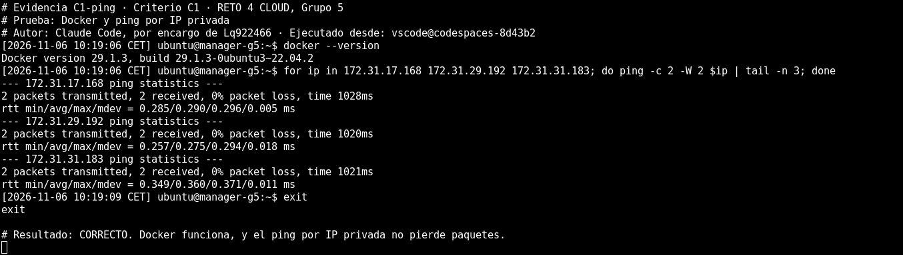

*Figura 30. Docker funciona y el `ping` por IP privada no pierde paquetes. Captura conforme. Claude Code, por encargo de Cristina (Lq922466). 6 de noviembre de 2026. Máquina: manager-g5.*

### 3.2. Inicialización del clúster por IP privada (C2)

**Procedimiento.** [`formar-swarm.sh`](scripts/formar-swarm.sh) se ejecuta una vez desde el Codespace y modifica el clúster. Sus órdenes principales son:

```bash
manager_ip=$(terraform -chdir=terraform output -json nodes | jq -er '."manager-g5".private_ip')
ssh manager-g5 docker swarm init --advertise-addr "$manager_ip"
token=$(ssh manager-g5 docker swarm join-token -q worker)
printf '%s\n' "$token" | ssh workerN-g5 "read -r token && docker swarm join --token \"\$token\" '$manager_ip:2377'"
ssh manager-g5 docker node ls
```

**Explicación.**

- **`--advertise-addr`** fija la dirección que el manager anuncia al resto. Se usa la **IP privada**, 172.31.28.10: si se anunciara la pública, el clúster se rompería al reiniciar el laboratorio.
- **El token de unión** (`SWMTKN-…`) es una credencial: quien lo tenga puede unir nodos. El script comprueba su formato, lo pasa por la entrada estándar, para que no aparezca en la lista de procesos, y lo borra de la memoria con `unset` al terminar.
- **Se puede repetir sin romper nada:** antes de cada paso consulta el estado del nodo con `docker info` y no repite lo que ya está hecho.

| Puerto | Uso en Swarm |
| --- | --- |
| 2377/TCP | Gestión del clúster: alta de nodos y comunicación entre managers |
| 7946/TCP y UDP | Descubrimiento y estado de los nodos |
| 4789/UDP | Datos de las redes overlay, encapsulados en VXLAN |

**Comprobación.** El 4 de noviembre, los tres workers respondieron `This node joined a swarm as a worker`. `docker info` muestra `NodeAddr=172.31.28.10`, y cada nodo está registrado con su IP privada.


*Figura 31. El clúster usa IP privadas, y la red ingress `red-g5` tiene MTU 1450. Captura conforme. Claude Code, por encargo de Cristina (Lq922466). 6 de noviembre de 2026. Máquina: manager-g5.*

### 3.3. Redes overlay `red-g5` y `red-app-g5` con MTU 1450 (C2 y C4)

**Procedimiento.** [`configurar-red-swarm.sh`](scripts/configurar-red-swarm.sh) se ejecuta en el manager antes de publicar el primer servicio:

```bash
printf 'y\n' | docker network rm ingress
docker network create --driver overlay --ingress --opt com.docker.network.driver.mtu=1450 red-g5
docker network create --driver overlay --opt com.docker.network.driver.mtu=1450 red-app-g5
docker network inspect --format '{{.Name}} {{.Driver}} {{.Ingress}} {{index .Options "com.docker.network.driver.mtu"}}' red-g5 red-app-g5
```

**Explicación.**

- **Red overlay:** red virtual que se extiende por todos los nodos. Los contenedores se comunican como si estuvieran en la misma red, aunque estén en máquinas distintas. Los paquetes viajan encapsulados en VXLAN por el puerto 4789.
- **Red ingress:** overlay especial del *routing mesh*. Recibe el tráfico de un puerto publicado en **cualquier** nodo y lo reparte entre las réplicas, estén donde estén. Docker crea una por defecto, `ingress`, que se sustituye por `red-g5` porque la Guía pide una personalizada. Solo puede haber una, y no se puede cambiar mientras haya servicios publicados.
- **`red-app-g5`:** red overlay propia a la que se conecta el servicio web (C4).
- **MTU 1450:** la red de AWS usa paquetes de 1500 bytes y la encapsulación añade 50. Con 1450, el paquete encapsulado cabe sin fragmentarse; como explica la Guía, la fragmentación «puede provocar cuelgues o lentitud en las conexiones de la web».

**Comprobación.**

```text
red-g5 driver=overlay ingress=true MTU=1450
red-app-g5 driver=overlay ingress=false MTU=1450
```

**Observación.** Las dos redes declaran MTU 1450, pero dentro de los contenedores sus interfaces miden 1400 (medido el 6 de noviembre en manager-g5 y worker3-g5). La diferencia de 50 bytes coincide con la cabecera VXLAN, pero no se ha confirmado que esa sea la causa. Conviene aclarar con el profesor si la Guía se refiere al valor de la red, que es el que se ha configurado.

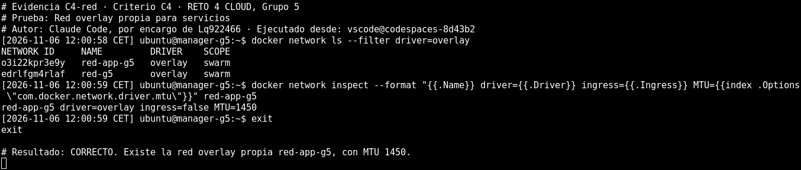

*Figura 32. Existe la red overlay propia `red-app-g5`, con MTU 1450. Captura conforme. Claude Code, por encargo de Cristina (Lq922466). 6 de noviembre de 2026. Máquina: manager-g5.*

### 3.4. Validación de los nodos y de sus roles (C3)

**Qué se hizo y para qué.** La Guía pide que los cuatro nodos estén activos, con el manager como líder y tres workers. La prueba E8 (apartado [5.9](#59-e8-elección-de-un-nuevo-líder)) obliga a promover temporalmente dos workers a managers, así que después hay que devolver el clúster a su topología.

**Procedimiento de comprobación.**

```bash
docker node ls
```

| Columna | Qué indica |
| --- | --- |
| `STATUS` | `Ready` si el nodo se comunica con el clúster, y `Down` si no |
| `AVAILABILITY` | `Active` si admite tareas, y `Drain` si se están retirando |
| `MANAGER STATUS` | `Leader` para el manager que dirige el clúster, `Reachable` para los demás managers, y vacío para los workers |

**Explicación.** Los managers deciden por mayoría con el algoritmo **Raft**. Con un solo manager no hay tolerancia a su caída: si se detiene, los contenedores siguen sirviendo la web, pero nadie puede gestionar el clúster hasta que vuelva. Con tres managers, la mayoría es dos y el clúster soporta la caída de uno. Por eso la Guía pide la topología de un manager para el funcionamiento normal y la promoción de dos workers solo para la prueba E8.

**Historia de los roles.**

1. Tras formar el clúster, el 4 de noviembre, había un manager líder y tres workers.
2. Ese mismo día, para E8, se promovieron worker1-g5 y worker2-g5 (`docker node promote worker1-g5 worker2-g5`).
3. Con tres managers, el líder cambió con la prueba y con los reinicios del laboratorio. El 6 de noviembre, la captura conforme de C3 dio **NO CORRECTO** porque worker1-g5 y worker2-g5 seguían siendo managers.
4. El **9 de noviembre**, con autorización de Cristina, Codex devolvió el clúster a la topología de la Guía.

**Procedimiento de la corrección.** Se bajan los dos managers de uno en uno, **primero el que no es líder**, para no dejar nunca el clúster sin mayoría:

```bash
docker node ls                     # Antes: tres managers. Identificar el líder; ese día era worker1-g5.
docker node demote worker2-g5      # 1. El manager que no es líder. Quedan dos managers alcanzables.
docker node ls                     # Comprobar: dos managers Reachable y cuatro nodos Ready/Active.
docker node demote worker1-g5      # 2. El líder. El liderazgo pasa a manager-g5.
docker node ls                     # Comprobar sin repetir nada, aunque la orden anterior dé un error.
```

Mientras tanto, una sonda consultó la web cada segundo en las cuatro IP públicas.

**Comprobación.** Salida de `docker node ls` tras la corrección, del registro de sesión de Codex:

```text
ID                            HOSTNAME     STATUS    AVAILABILITY   MANAGER STATUS   ENGINE VERSION
xf46ytyuxo4bvn8lbxixhfhtv *   manager-g5   Ready     Active         Leader           29.1.3
m69w5hsyyyegwivfhoi8fbihd     worker1-g5   Ready     Active                          29.1.3
7zff6zyro5ir31bz19ozwmt4q     worker2-g5   Ready     Active                          29.1.3
ci4mgenau4xvzypqk3ljka8fi     worker3-g5   Ready     Active                          29.1.3
```

manager-g5 es el único manager y el líder, y los tres workers están `Ready/Active`. El servicio siguió en 4/4, con una réplica por nodo, y la sonda registró **100 muestras correctas y ningún fallo** (25 por IP). A continuación, `comprobar-laboratorio.sh` y `verificar-despliegue.sh` confirmaron el mismo estado y HTTP 200 en las cuatro IP.

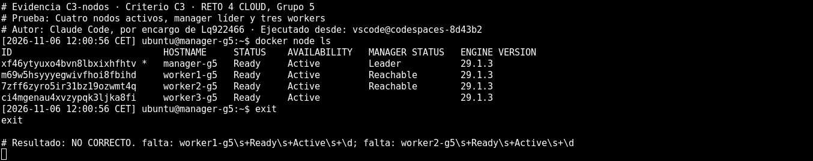

*Figura 33. Listado de nodos del 6 de noviembre, **anterior a la corrección**. NO CORRECTO: los cuatro nodos están activos y manager-g5 es el líder, pero worker1-g5 y worker2-g5 siguen siendo managers tras E8. Captura conforme. Claude Code, por encargo de Cristina (Lq922466). Máquina: manager-g5.*

> **Evidencia pendiente:** nueva captura conforme `C3-nodos` con manager-g5 como único `Leader` y tres workers `Ready/Active`, con `capturas-norma.py --solo '^C3-nodos$'`. La corrección se verificó el 9 de noviembre, pero ese registro no está versionado y el laboratorio se ha reiniciado después.

### 3.5. Incidencias reales y soluciones

**I3.1. Docker pedía confirmación al retirar la red `ingress`** · Estado: **resuelta**

- *Síntomas:* la primera ejecución de `configurar-red-swarm.sh` falló al crear `red-g5` con el error `AlreadyExists`.
- *Causa:* `docker network rm ingress` pide confirmación. Como nadie respondió, no retiró la red, y no puede haber dos redes ingress.
- *Diagnóstico:* `docker network ls` seguía mostrando `ingress`.
- *Solución aplicada:* el script responde automáticamente con `printf 'y\n' | docker network rm ingress`.
- *Comprobación:* `red-g5` se creó con `ingress=true` y MTU 1450. [Registro](evidencias/prototipo/fase2-3.txt).

**I3.2. Tres managers y líder cambiante tras la prueba E8** · Estado: **resuelta** el 9 de noviembre; falta la captura conforme

- *Síntomas:* `docker node ls` mostraba tres managers en lugar de uno, y el líder iba cambiando: worker1-g5 el 5 de noviembre, manager-g5 el 6, worker2-g5 la mañana del 9 y de nuevo worker1-g5 ese mediodía.
- *Causa:* worker1-g5 y worker2-g5 se promovieron para E8 y no se bajaron después. Con varios managers, Raft elige un líder nuevo cada vez que el anterior se reinicia.
- *Diagnóstico:* `docker node ls` y la captura `C3-nodos` (NO CORRECTO). `comprobar-laboratorio.sh` rechaza desde el 9 de noviembre más de un manager.
- *Solución aplicada:* dos `docker node demote`, primero el manager no líder y después el líder (apartado [3.4](#34-validación-de-los-nodos-y-de-sus-roles-c3)).
- *Comprobación:* manager-g5 único líder, tres workers `Ready/Active`, servicio 4/4 y 100 muestras correctas.

**I3.3. La comprobación automática falló durante el cambio de líder** · Estado: **resuelta**

- *Síntomas:* tras `docker node demote worker1-g5`, Docker respondió `Manager worker1-g5 demoted in the swarm`, pero el script que comprobaba el resultado terminó con `AssertionError`.
- *Causa:* el script comprobó el estado mientras el liderazgo todavía pasaba de worker1-g5 a manager-g5.
- *Diagnóstico:* se volvió a consultar `docker node inspect` y `docker node ls` **sin repetir** el `demote`.
- *Solución aplicada:* ninguna orden adicional: la topología ya era la correcta.
- *Comprobación:* manager-g5 `Leader` y los tres workers sin rol de manager. Lección: después de bajar al líder hay que esperar unos segundos y consultar, nunca repetir la orden.

### 3.6. Posibles incidencias y soluciones

| Síntoma o error | Causa probable | Diagnóstico | Solución |
| --- | --- | --- | --- |
| `docker swarm join` se queda esperando | Puerto 2377 bloqueado o IP equivocada | `nc -zv 172.31.28.10 2377` desde el worker | Revisar la regla `self` del grupo de seguridad y usar la IP privada |
| Un nodo aparece `Down` tras reiniciar | Docker no arrancó o el nodo sigue arrancando | `systemctl status docker` en el nodo | `sudo systemctl enable --now docker` y esperar |
| `This node is not a swarm manager` | La orden se lanza en un worker | `docker info \| grep -i 'is manager'` | Ejecutar las órdenes de gestión en manager-g5 |
| No se puede retirar o crear la red ingress | Hay servicios publicados que la usan | `docker service ls` | Retirar la pila antes de cambiar la red |
| Clúster sin mayoría con dos managers | Se perdió uno de dos managers | `docker node ls` devuelve un error de cuórum | Evitar números pares de managers; en último caso, `docker swarm init --force-new-cluster` en el manager que queda |
| La web se queda colgada con páginas grandes | MTU demasiado alta en la overlay | `docker network inspect red-g5` | Recrear la red con MTU 1450 |
| El token de unión se ha expuesto | Copiado en un registro o una captura | Revisar el registro | `docker swarm join-token --rotate worker` |

### 3.7. Resultado y conclusión de la Fase 3

El clúster se formó por IP privada con los cuatro nodos. La red ingress es `red-g5`, personalizada y con MTU 1450, y el servicio usa la red overlay `red-app-g5`, también con MTU 1450. Tras la prueba E8, el clúster volvió el 9 de noviembre a la topología de la Guía: manager-g5 como único manager y líder, y tres workers activos, sin interrumpir la web.

- **Cumplidos:** C1, C2 y C4, con capturas conformes.
- **C3:** cumplido técnicamente desde el 9 de noviembre; la captura conforme versionada es anterior y da NO CORRECTO, así que hay que repetirla.

## Fase 4 — Despliegue web

**Objetivo.** Empaquetar la web del Gran Premio de Euskadi en una imagen propia, publicarla en Docker Hub en las versiones 1.0 y 2.0, y desplegarla en Swarm como un servicio de cuatro réplicas en el puerto 80, conectado a la red del grupo y accesible desde la IP pública de cualquiera de los cuatro nodos.

**Contenidos.**

| Requisito de la Guía y la Rúbrica | Criterio | Apartado | Estado |
| --- | --- | --- | --- |
| Imagen propia que identifica el contenedor, en versiones 1.0 y 2.0, publicada en Docker Hub | D1 | 4.1–4.5 | Cumplido |
| Servicio de 4 réplicas en el puerto 80, en la red del grupo, con políticas de reinicio | D2 | 4.6 | Cumplido |
| La web carga desde la IP pública de los cuatro nodos | D3 | 4.7 | Cumplido. Faltan capturas conformes |

### 4.1. La web del Gran Premio de Euskadi

**Qué se hizo y para qué.** La web definitiva está en [`app/f1`](app/f1): `index.html`, `entradas.html`, `sorteo.html`, `acceso.html` y `contacto.html`, con su hoja de estilos, su JavaScript y sus imágenes. Llegó como un ZIP del grupo, y sus autores no constan en Git. Las primeras pruebas, del 4 de noviembre, se hicieron con un portal provisional ([`app/sitio`](app/sitio)), con una carpeta por versión.

**Explicación.** Es una web **estática**: el servidor solo entrega archivos, sin base de datos ni código en el servidor. Por eso cualquier réplica puede responder cualquier petición, que es lo que permite repartir la carga. Los formularios son de demostración y no envían datos.

### 4.2. Dockerfile, Nginx e identidad del contenedor (D1)

**Procedimiento.** [`app/Dockerfile`](app/Dockerfile):

```dockerfile
FROM nginx:alpine
ARG WEB_VERSION
COPY sitio/ /usr/share/nginx/html/
RUN test -s /usr/share/nginx/html/index.html && \
    printf 'version=%s\n' "$WEB_VERSION" > /etc/reto4-version
COPY 40-identidad.sh /docker-entrypoint.d/40-identidad.sh
RUN chmod 0755 /docker-entrypoint.d/40-identidad.sh
HEALTHCHECK --interval=5s --timeout=2s --retries=3 CMD wget -q -O /dev/null http://127.0.0.1/identidad.txt || exit 1
```

**Explicación.**

| Línea | Para qué sirve |
| --- | --- |
| `FROM nginx:alpine` | Nginx sobre Alpine Linux, una imagen pequeña. Nginx sirve los archivos por el puerto 80 |
| `ARG WEB_VERSION` | Recibe la versión, 1.0 o 2.0, al construir |
| `COPY sitio/ …` | Copia la web a la carpeta que publica Nginx |
| `RUN test -s … && printf …` | Falla si no hay `index.html`, y guarda la versión dentro de la imagen |
| `COPY 40-identidad.sh /docker-entrypoint.d/` | La imagen oficial de Nginx ejecuta al arrancar los scripts de esa carpeta |
| `HEALTHCHECK` | Cada 5 segundos comprueba que Nginx responde. Swarm sustituye las réplicas que no están sanas |

[`40-identidad.sh`](app/40-identidad.sh) genera al arrancar cada contenedor el archivo `/identidad.txt`, con la versión de la imagen y el nombre del contenedor, por ejemplo `version=1.0` y `contenedor=0ec98a04e2fe`. El nombre es distinto en cada réplica, así que no puede ir dentro de la imagen. Con él se sabe qué réplica responde a cada petición: es lo que pide D1 («imagen propia que identifica el contenedor») y lo que usan las sondas y la prueba E1.

### 4.3. Versiones 1.0 y 2.0 y construcción en un nodo (D1)

**Procedimiento.**

```bash
bash scripts/preparar-imagenes.sh config/ssh.local manager-g5 reto4-g5/f1-definitiva
```

[`preparar-imagenes.sh`](scripts/preparar-imagenes.sh) copia a manager-g5 los archivos necesarios de `app/` y llama allí a [`construir-f1.sh`](app/construir-f1.sh) para cada versión:

```bash
cp -R app/f1/. "$release/"                        # Copia temporal: app/f1 no se modifica.
cp app/f1-release/estado-cloud.html "$release/"   # Solo en la 2.0.
docker build --build-arg "WEB_VERSION=$VERSION" --tag "$IMAGEN:$VERSION" "$contexto"
```

**Explicación.**

- Las dos versiones comparten la misma web, y la portada muestra su número de versión. **La 2.0** añade [`estado-cloud.html`](app/f1-release/estado-cloud.html), una página que consulta `identidad.txt` y muestra la versión y la réplica que responde. Esa diferencia basta para comprobar a simple vista la actualización y el rollback de E7.
- [`construir.sh`](app/construir.sh) usa un contexto de construcción temporal con solo lo necesario, y rechaza enlaces simbólicos y archivos con apariencia de secreto (`.env`, `.pem`, `.key`, `.aws` o estado de Terraform), para que nunca acaben dentro de la imagen.
- Las imágenes se construyen en un nodo porque Docker no funciona dentro del Codespace (incidencia [I4.1](#48-incidencias-reales-y-soluciones)).

**Comprobación.** El 5 de noviembre, la comprobación previa de la web dio 5 páginas, 30 archivos y 0 errores, y se obtuvieron dos imágenes de unos 30 MB. Cada versión se probó en un contenedor temporal sin puertos publicados, con un navegador, sin tocar el servicio de Swarm: [construcción](evidencias/D1-imagenes-definitivas.txt), [prueba en navegador](evidencias/D1-navegador-registro.txt) y capturas de las versiones [1.0](evidencias/D1-navegador-1.0.png) y [2.0](evidencias/D1-navegador-2.0.png).

### 4.4. Publicación en Docker Hub (D1)

**Procedimiento.**

```bash
ssh -t -F config/ssh.local manager-g5 docker login -u innnx          # Cristina escribe el token de forma interactiva.
bash scripts/publicar-imagenes.sh config/ssh.local innnx/reto4-f1     # Etiqueta, publica y cierra la sesión.
```

**Explicación.**

- **`docker login`** se hace de forma interactiva, con `-t`, para que el token lo escriba la persona y no quede en ningún script ni registro.
- **[`publicar-imagenes.sh`](scripts/publicar-imagenes.sh)** etiqueta las imágenes como `innnx/reto4-f1:1.0` y `:2.0`, las sube con `docker push` y ejecuta siempre `docker logout` al terminar.
- **El *digest*** es el resumen SHA-256 del contenido publicado. Si coincide con el de la imagen construida, lo publicado es exactamente lo que se probó.

**Comprobación.**

| Etiqueta | Digest |
| --- | --- |
| 1.0 | `sha256:622d83436cb97412b761ca8cd8d6b8e6c4940f4682a7f6fb6940921d599362ca` |
| 2.0 | `sha256:1736eda0abd63aa0ac538b1a9c11bfdb4f64dc1d36c7687cd7be9a52d2cc76f7` |


*Figura 34. Docker Hub publica las etiquetas 1.0 y 2.0 con los digests construidos. Captura conforme. Claude Code, por encargo de Cristina (Lq922466). 5 de noviembre de 2026.*

[Publicación](evidencias/D1-publicacion-dockerhub.txt) y [vista web de las etiquetas](evidencias/D1-dockerhub-etiquetas.png).

### 4.5. Descarga anónima desde los workers (D1)

**Procedimiento.**

```bash
bash scripts/comprobar-descarga.sh config/ssh.local innnx/reto4-f1
```

**Explicación.** [`comprobar-descarga.sh`](scripts/comprobar-descarga.sh) consulta Docker Hub de forma anónima y descarga las dos etiquetas en los tres workers **sin iniciar sesión**. Así se demuestra que el repositorio es público y que cualquier nodo puede obtener la imagen, algo imprescindible para que Swarm cree réplicas en cualquier nodo. También compara el digest y una huella del contenido servido con lo construido en el manager.

**Comprobación.** El 5 de noviembre, los tres workers descargaron ambas etiquetas con el mismo digest y el mismo contenido ([registro](evidencias/D1-descarga-dockerhub.txt)).

### 4.6. Despliegue con `stack.yml` (D2)

**Procedimiento.**

```bash
bash scripts/desplegar-f1.sh config/ssh.local innnx/reto4-f1 evidencias/F3-despliegue
# Dentro, en el manager, app/desplegar.sh ejecuta:
export WEB_IMAGE=innnx/reto4-f1:1.0
docker stack deploy --compose-file stack.yml reto4
```

[`app/stack.yml`](app/stack.yml):

```yaml
services:
  web:
    image: "${WEB_IMAGE}"
    ports:
      - target: 80
        published: 80
        protocol: tcp
        mode: ingress
    networks:
      - red-app-g5
    deploy:
      replicas: 4
      restart_policy:
        condition: any
      update_config:
        parallelism: 1
        order: start-first
        failure_action: rollback
      rollback_config:
        parallelism: 1
        order: start-first
networks:
  red-app-g5:
    external: true
```

**Explicación.**

| Clave | Para qué sirve |
| --- | --- |
| `image: "${WEB_IMAGE}"` | La imagen se elige al desplegar, sin cambiar el archivo |
| `published: 80`, `target: 80`, `mode: ingress` | Publica el puerto 80 en **todos** los nodos y lo envía, por el routing mesh, al puerto 80 de cualquier réplica |
| `networks: red-app-g5` y `external: true` | Conecta el servicio a la red del grupo, creada en la Fase 3, en lugar de crear una nueva |
| `replicas: 4` | Swarm mantiene siempre cuatro contenedores |
| `restart_policy: condition: any` | Si un contenedor termina, por error o no, Swarm lo sustituye. Es la base de E3 |
| `update_config` | Actualiza de una réplica en una, arranca la nueva antes de retirar la antigua (`start-first`) y, si falla, vuelve atrás sola |
| `rollback_config` | El rollback sigue las mismas reglas |

**Diferencia con la Guía.** La Guía llama «red del grupo» a una sola red, `red-gX`, que define como la red ingress personalizada. Aquí `red-g5` es esa red ingress, y el servicio se conecta además a una segunda red overlay propia, `red-app-g5`, que es la que pide C4 («red overlay propia para servicios»). El puerto 80 publicado entra siempre por `red-g5`.

`docker stack deploy` crea el servicio `reto4_web`: el nombre de la pila más el del servicio. [`desplegar-f1.sh`](scripts/desplegar-f1.sh) mantiene sondas durante el despliegue, espera a que el servicio converja, comprueba que **cada tarea** usa la imagen de Docker Hub y recorre las páginas con un navegador.

**Comprobación.** El 5 de noviembre, el servicio pasó del portal provisional a la web definitiva, `innnx/reto4-f1:1.0`, en 4/4. Las cuatro IP dieron HTTP 200, el navegador recorrió 5 páginas sin errores en cada una, y las sondas registraron **328 muestras correctas y 0 fallos** durante todo el cambio ([registro](evidencias/F3-despliegue/registro.txt)).


*Figura 35. El servicio tiene cuatro réplicas, la red del grupo y política de reinicio. Captura conforme. Claude Code, por encargo de Cristina (Lq922466). 6 de noviembre de 2026. Máquinas: codespaces-8d43b2 y manager-g5.*

### 4.7. Acceso por la IP pública de los cuatro nodos (D3)

**Procedimiento.**

```bash
aws ec2 describe-instances --region us-east-1 \
  --filters 'Name=tag:Name,Values=manager-g5,worker?-g5' 'Name=instance-state-name,Values=running' \
  --query 'Reservations[].Instances[].[Tags[?Key==`Name`]|[0].Value,PublicIpAddress]' --output text
curl -s -o /dev/null -w '%{http_code}\n' http://IP_PUBLICA/     # 200 si responde.
curl -s http://IP_PUBLICA/identidad.txt                           # Versión y contenedor.
bash scripts/verificar-despliegue.sh config/ssh.local innnx/reto4-f1 1.0
```

En el navegador se abre `http://IP_PUBLICA/`, escribiendo `http://`, porque la web no usa HTTPS.

**Explicación.** Gracias al routing mesh, cualquier nodo acepta la conexión en el puerto 80, aunque no aloje ninguna réplica, y la reenvía por la red ingress a una réplica sana. Por eso la web carga desde las cuatro IP. El puerto 8080 está abierto en el grupo de seguridad porque lo indica la Guía, pero la pila no lo publica, así que los nodos rechazan la conexión en ese puerto.

[`verificar-despliegue.sh`](scripts/verificar-despliegue.sh) comprueba, solo con lectura, las réplicas, la imagen de cada tarea en estado `Running`, el HTTP de las cuatro IP y que las peticiones lleguen a más de un contenedor.

**Comprobación.**

- **5 de noviembre:** la web definitiva cargó en un navegador gráfico real por las cuatro IP de ese día.
- **9 de noviembre, por la mañana:** HTTP 200 y `version=1.0` en las cuatro IP ([registro](evidencias/auditoria/registro-2026-11-09.txt)).
- **9 de noviembre, tras corregir C3:** `verificar-despliegue.sh` dio 4/4 con `innnx/reto4-f1:1.0` y HTTP 200 en las cuatro IP (registro de sesión de Codex).


*Figura 36. Web definitiva cargada por la IP pública de manager-g5, con la dirección visible, en un navegador gráfico real. Captura anterior: Claude Code, 5 de noviembre de 2026. No tiene el comentario que exige la norma. Capturas de [worker1-g5](evidencias/D3-navegador-worker1-g5.png), [worker2-g5](evidencias/D3-navegador-worker2-g5.png) y [worker3-g5](evidencias/D3-navegador-worker3-g5.png).*

> **Evidencia pendiente:** capturas D3 conformes, con comentario, de la web en el navegador por las cuatro IP públicas del día de la corrección.

### 4.8. Incidencias reales y soluciones

**I4.1. Docker no funciona dentro del Codespace** · Estado: **resuelta** con una alternativa

- *Síntomas:* las órdenes `docker` fallaban en el Codespace.
- *Causa:* el contenedor del Codespace no tiene los permisos necesarios para ejecutar el motor de Docker.
- *Diagnóstico:* `docker info` desde el Codespace.
- *Solución aplicada:* las imágenes se construyen y se prueban en manager-g5 con `preparar-imagenes.sh`, que copia allí los archivos necesarios de `app/`.
- *Comprobación:* las dos imágenes se construyeron y probaron en el manager ([registro](evidencias/D1-imagenes-definitivas.txt)).

**I4.2. Docker Hub rechazó la primera publicación** · Estado: **resuelta**

- *Síntomas:* `docker push` falló con `access token has insufficient scopes`.
- *Causa:* el token de acceso de Docker Hub no tenía permiso de escritura.
- *Diagnóstico:* mensaje de error del primer intento ([registro](evidencias/D1-publicacion-intento-fallido.txt)).
- *Solución aplicada:* se abrió una sesión nueva con un token con permiso de escritura y se repitió la publicación.
- *Comprobación:* las dos etiquetas se publicaron con los digests esperados ([registro](evidencias/D1-publicacion-dockerhub.txt)).

**I4.3. El portal provisional y la web definitiva respondían igual** · Estado: **resuelta**

- *Síntomas:* tras el despliegue, `identidad.txt` decía `version=1.0` tanto con el portal provisional como con la web definitiva, así que no bastaba para saber cuál se servía.
- *Causa:* ambas imágenes se construyeron como versión 1.0.
- *Diagnóstico:* `docker service ps reto4_web` mostraba imágenes distintas con la misma versión.
- *Solución aplicada:* la verificación comprueba la **imagen de cada tarea** (`innnx/reto4-f1:1.0`), no solo la versión.
- *Comprobación:* el despliegue del 5 de noviembre terminó con las cuatro tareas en la imagen de Docker Hub ([registro](evidencias/F3-despliegue/registro.txt)).

**I4.4. Enlaces internos rotos y una credencial de demostración en la web** · Estado: **resuelta**

- *Síntomas:* cuatro páginas enlazaban a `#escuderias`, que no existía, y el JavaScript contenía una credencial de demostración.
- *Causa:* contenido recibido en el ZIP del grupo.
- *Diagnóstico:* [`comprobar-web.py`](scripts/comprobar-web.py) revisa los enlaces internos; la credencial se detectó al revisar el código antes de versionarlo.
- *Solución aplicada:* se añadió el destino `#escuderias` y el validador de enlaces (commit `bcfceee`), y se retiró la credencial antes del primer commit de la web.
- *Comprobación:* la comprobación previa dio 0 errores en 5 páginas y 30 archivos.

### 4.9. Posibles incidencias y soluciones

| Síntoma o error | Causa probable | Diagnóstico | Solución |
| --- | --- | --- | --- |
| `pull access denied` o `manifest unknown` en un worker | Repositorio privado o etiqueta mal escrita | `comprobar-descarga.sh` | Hacer público el repositorio de Docker Hub o corregir la etiqueta |
| `denied: requested access to the resource is denied` al publicar | Sin sesión, o espacio de nombres equivocado | `docker info \| grep Username` | `docker login -u innnx` y etiquetar como `innnx/reto4-f1:VERSION` |
| `network red-app-g5 not found` al desplegar | La red externa no existe | `docker network ls` | Ejecutar `configurar-red-swarm.sh` antes del despliegue |
| La imagen aparece vacía en el servicio | No se exportó `WEB_IMAGE` | `docker service inspect reto4_web` | `export WEB_IMAGE=innnx/reto4-f1:1.0` antes de `docker stack deploy` |
| Réplicas reiniciándose sin parar | Falla el `HEALTHCHECK` o Nginx no arranca | `docker service ps --no-trunc reto4_web` y `docker service logs reto4_web` | Corregir la imagen, publicarla de nuevo y actualizar el servicio |
| El navegador no carga la web | Se abrió con `https://` o la IP es de otra sesión | `curl -I http://IP_PUBLICA/` | Usar `http://` y las IP actuales de EC2 |
| El navegador muestra una versión antigua | Caché del navegador | `curl -s http://IP_PUBLICA/identidad.txt` | Recargar sin caché |

### 4.10. Resultado y conclusión de la Fase 4

La web del grupo se empaqueta en una imagen propia sobre Nginx que identifica cada contenedor. Las versiones 1.0 y 2.0 se publicaron en `innnx/reto4-f1`, con los digests comprobados y descarga anónima desde los workers. La pila define cuatro réplicas en el puerto 80, en la red `red-app-g5`, con reinicio siempre y actualización y rollback progresivos. El despliegue se hizo sin fallos en las sondas, y la web respondió por las cuatro IP públicas el 5 y el 9 de noviembre.

- **Cumplidos:** D1 y D2.
- **D3:** cumplido técnicamente; las capturas de navegador no tienen el comentario de la norma.

<a id="fase-5-orquestación"></a>

## Fase 5 — Pruebas de orquestación

**Objetivo.** Demostrar lo que aporta Swarm frente a un servidor único: reparto de carga, escalado, autorreparación, alta disponibilidad ante la caída de un worker y del líder, mantenimiento de nodos y actualización sin cortes con vuelta atrás. La Guía pide documentarlo con capturas antes, durante y después, mientras un script consulta la web cada segundo.

**Contenidos.**

| Prueba de la Guía | Criterio | Apartado | Web | Estado |
| --- | --- | --- | --- | --- |
| Reparto de tráfico | E1 | 5.2 | Definitiva | Realizada |
| Escalar a 8, 12 y bajar a 2 réplicas | E2 | 5.3 | Definitiva | Realizada, con dos tiempos de espera |
| Borrar un contenedor y ver cómo Swarm lo recupera | E3 | 5.4 | Definitiva | Realizada |
| Apagar un worker: la web sigue activa y las réplicas se reubican | E4 | 5.5 | Provisional | Prueba histórica |
| Reincorporación, reequilibrio y reinicio del laboratorio | E5 | 5.6 | Provisional y definitiva | Realizada |
| Poner un nodo en modo drain y reactivarlo | E6 | 5.7 | Definitiva | Realizada |
| Pasar de 1.0 a 2.0 sin cortes, y revertir | E7 | 5.8 | Definitiva | Realizada |
| Promover 2 workers, apagar el líder y comprobar el nuevo líder | E8 | 5.9 | Provisional | Realizada, con 34 s sin muestras |

En todas las pruebas falta la serie de **capturas conformes** antes, durante y después con la sonda visible.

### 5.1. Método común: scripts y sondas

**Qué se hizo y para qué.** Las pruebas que modifican el servicio se lanzan con scripts, siempre con autorización expresa, para que sean repetibles y dejen un registro completo.

**Procedimiento.**

```bash
bash scripts/probar-orquestacion.sh config/ssh.local innnx/reto4-f1 evidencias/F4-E2 e2   # También e3 y e6.
bash scripts/probar-actualizacion.sh config/ssh.local innnx/reto4-f1 evidencias/F3-actualizacion   # E7.
bash scripts/sondear-web.sh http://IP_PUBLICA/identidad.txt                               # Una sonda, en otra terminal.
```

Cada script:

1. lee de EC2 las IP públicas vigentes;
2. arranca una sonda por IP con [`sondear-web.sh`](scripts/sondear-web.sh);
3. ejecuta la operación en el manager;
4. espera a que el servicio vuelva a su estado;
5. comprueba HTTP en las cuatro IP y recorre la web con un navegador;
6. detiene las sondas y resume sus resultados en `registro.txt`, junto con la salida de cada sonda y las capturas.

**Explicación.** La sonda pide `identidad.txt` **una vez por segundo y por IP**, con un límite de 0,9 s por petición, y anota la hora, el resultado, la versión y el contenedor. Es el «script que consulta la web cada segundo» de la Guía. [`lib-sondas.sh`](scripts/lib-sondas.sh) detiene la prueba si una IP acumula tres fallos seguidos. Desde el 9 de noviembre, además, la sonda exige que la respuesta identifique versión y contenedor, y el resumen comprueba que cada sonda siguió viva hasta el final (incidencia [I5.4](#510-incidencias-reales-y-soluciones)).

El 4 de noviembre, E1, E2, E3, E6 y E7 se hicieron también con el portal provisional ([registro](evidencias/prototipo/fase4-5.txt)). Se repitieron el 5 con la web definitiva, y este informe presenta esas repeticiones.

> **Evidencia pendiente (toda la fase):** capturas conformes antes, durante y después de cada prueba, con la sonda visible. `capturas-norma.py` las toma con la variable `SONDA` apuntando al registro de la sonda, mientras la persona autorizada ejecuta la operación.

### 5.2. E1: balanceo de carga

**Procedimiento.**

```bash
for ip in $IPS; do for i in 1 2 3 4; do curl -s --max-time 5 http://$ip/identidad.txt; done; done
```

**Explicación.** Cada petición nueva abre una conexión TCP. El routing mesh, mediante IPVS en la red ingress, reparte las conexiones entre las réplicas, sin importar a qué IP se dirijan. Si las respuestas llevan contenedores distintos, el reparto funciona: es la evidencia que pide la Rúbrica, «respuestas distintas».

**Comprobación.**

| Fecha | Peticiones | Resultado |
| --- | --- | --- |
| 5 de noviembre | 16, cuatro por IP | Cada IP fue respondida por los mismos cuatro contenedores |
| 6 de noviembre | 16, cuatro por IP | Cada IP fue respondida por los mismos cuatro contenedores |
| 9 de noviembre, mañana | 48, doce por IP | Cada IP repartió exactamente 3 peticiones a cada uno de los cuatro contenedores |
| 9 de noviembre, tras corregir C3 | 12 | Cuatro contenedores distintos, con 3 respuestas cada uno |


*Figura 37. Las peticiones por las cuatro IP reciben respuesta de contenedores distintos. Captura conforme. Claude Code, por encargo de Cristina (Lq922466). 6 de noviembre de 2026.*

### 5.3. E2: escalado a 8, 12 y 2 réplicas

**Procedimiento.** Dentro de `probar-orquestacion.sh`, en el manager:

```bash
docker service scale --detach=false reto4_web=8      # Después, 12, 2 y vuelta a 4.
docker service ps --filter desired-state=running reto4_web
```

**Explicación.** `docker service scale` cambia el número deseado de réplicas, y Swarm crea o elimina tareas hasta alcanzarlo, repartiéndolas entre los nodos disponibles. `--detach=false` espera a que termine, para que la comprobación siguiente vea el estado final.

**Comprobación.** 5 de noviembre, con la web definitiva:

| Réplicas | Reparto por nodo | HTTP en las 4 IP |
| --- | --- | --- |
| 8/8 | 2-2-2-2 | 200 |
| 12/12 | 3-3-3-3 | 200 |
| 2/2 | 1 en manager-g5 y 1 en worker2-g5 | 200 |
| 4/4 | 1-1-1-1 | 200 |

Con 2 réplicas, los nodos sin réplica siguieron respondiendo gracias al routing mesh. Las sondas registraron **562 muestras correctas y 2 tiempos de espera**, los dos durante la reducción de 12 a 2 réplicas (incidencia [I5.1](#510-incidencias-reales-y-soluciones)).


*Figura 38. Doce réplicas repartidas tres por nodo. Captura anterior: Claude Code, 5 de noviembre de 2026. Máquina: manager-g5. No muestra el prompt ni el comentario de la norma. Capturas de los estados [inicial](evidencias/F4-E2/terminal-e2-inicial-4.png), [8](evidencias/F4-E2/terminal-e2-escalado-8.png), [2](evidencias/F4-E2/terminal-e2-escalado-2.png) y [vuelta a 4](evidencias/F4-E2/terminal-e2-escalado-4.png), y [registro](evidencias/F4-E2/registro.txt).*

### 5.4. E3: autorreparación

**Procedimiento.** En el nodo que aloja la tarea elegida, manager-g5:

```bash
docker rm -f ID_DEL_CONTENEDOR                       # Ese día, 223aad67af29.
docker service ps --filter name=reto4_web.1 reto4_web
```

**Explicación.** `docker rm -f` elimina el contenedor a la fuerza, como si hubiera fallado. Swarm compara el estado real (3 réplicas) con el deseado (4), marca la tarea como fallida y crea otra: es la `restart_policy: condition: any` de la pila.

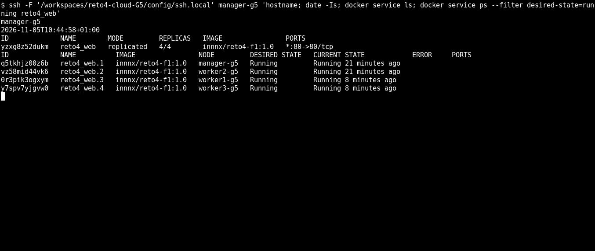

*Figura 39. Antes: servicio en 4/4, una réplica por nodo. Captura anterior: Claude Code, 5 de noviembre de 2026. Máquina: manager-g5. No muestra el prompt ni el comentario de la norma.*

**Comprobación.** Swarm registró `non-zero exit (137)`, que corresponde a un proceso terminado con `SIGKILL`, y creó una tarea nueva en el mismo nodo. En unos 15 segundos el servicio volvía a estar en 4/4. Las sondas registraron **308 muestras correctas y 0 fallos** ([registro](evidencias/F4-E3/registro.txt)).


*Figura 40. Después: la tarea eliminada aparece como fallida y una nueva la sustituye; el servicio vuelve a 4/4. Captura anterior: Claude Code, 5 de noviembre de 2026. No muestra el prompt ni el comentario de la norma.*

### 5.5. E4: caída de un worker

**Procedimiento.** Prueba histórica del 4 de noviembre, hecha con Codex y con el **portal provisional**, solo sobre worker3-g5:

```bash
aws ec2 stop-instances --region us-east-1 --instance-ids i-0446409b26cf0a662    # Detiene worker3-g5.
docker node ls; docker service ps reto4_web                                      # En el manager, durante la parada.
aws ec2 start-instances --region us-east-1 --instance-ids i-0446409b26cf0a662   # Lo vuelve a arrancar.
```

**Explicación.** Al detener la instancia, el nodo deja de enviar señales al manager y Swarm lo marca como `Down`. Sus tareas se crean de nuevo en los nodos disponibles para mantener el número de réplicas. Mientras tanto, el routing mesh deja de enviar tráfico al nodo caído.

**Comprobación.**

- Antes: cuatro nodos `Ready/Active` y 4/4.
- Durante la parada: EC2 informa `stopped`, Swarm marca worker3-g5 como `Down` y la réplica `reto4_web.1` ya corre en manager-g5. El servicio muestra `5/4` de forma transitoria: la tarea del nodo caído se sigue contando hasta que Swarm puede confirmar que se ha detenido.
- La sonda registró **164 muestras correctas y 0 fallos** durante la parada.
- Después: worker3-g5 vuelve `Ready/Active` y el servicio, a 4/4.

[Registro](evidencias/E4-E5-E8-registro.txt), [estado durante la parada](evidencias/prototipo/E4-worker-down.txt), [sonda](evidencias/prototipo/E4-E5-http.txt) y [análisis](evidencias/auditoria/E4-E8.md).


*Figura 41. Portal provisional respondiendo durante la parada de worker3-g5. Captura de Codex, 4 de noviembre de 2026. No muestra IP, hora ni estado del clúster, así que no prueba por sí sola el momento de la captura.*

**Límites.** Se hizo con el portal provisional, no consta la URL sondeada, no hay capturas de la consola y la captura web no muestra IP ni hora.

> **Evidencia pendiente:** repetir E4 con la web definitiva y capturas conformes antes, durante y después, según el [plan](entrega/PLAN-C3-E4-E8.md). Detiene una instancia, así que requiere autorización. Es además la demostración en directo de caída de nodo que pide la exposición.

### 5.6. E5: reincorporación, reequilibrio y reinicio del laboratorio

**Procedimiento.** La Rúbrica agrupa dos comprobaciones:

1. **Reincorporación y reequilibrio.** Al volver worker3-g5 en E4, el nodo quedó `Ready/Active`, pero Swarm no mueve las tareas que ya funcionan. Para repartirlas de nuevo se fuerza una actualización:

   ```bash
   docker service update --quiet --detach --force reto4_web
   ```

2. **Reinicio del laboratorio.** Tras **End Lab** y **Start Lab** en AWS Academy, se compara el estado con una referencia guardada antes:

   ```bash
   bash scripts/verificar-e5.sh ~/DIRECTORIO_PRIVADO_DE_RESPALDO
   ```

**Explicación.** `--force` vuelve a crear las tareas réplica a réplica, con `start-first`, sin cortar el servicio, y el planificador las reparte entre todos los nodos disponibles. [`verificar-e5.sh`](scripts/verificar-e5.sh) compara ID de instancia, volúmenes, controles de estado, IP, SSH, Swarm, redes, réplicas y HTTP.

**Comprobación.**

- **Reequilibrio:** aplicado en E4 con el portal provisional y en E6 con la web definitiva ([reincorporación](evidencias/prototipo/E5-worker-recuperado.txt) y [reparto](evidencias/prototipo/E5-reparto.txt)).
- **Reinicio del 4 al 5 de noviembre:** mismos ID y volúmenes, controles `ok`, IP públicas distintas, y SSH, Swarm, redes, 4/4 y HTTP correctos ([antes](evidencias/E5-verificacion-previa.txt) y [después](evidencias/E5-verificacion-final.txt)).
- **Reinicios del 6 y del 9 de noviembre:** el clúster volvió solo, con las mismas instancias y 4/4.
- **Reinicio del 10 de noviembre:** las salidas sincronizadas de Terraform muestran los mismos ID con IP públicas nuevas. **Swarm no se ha comprobado** después de ese reinicio.


*Figura 42. Tras reiniciar el laboratorio, las mismas instancias siguen en el clúster con el servicio en 4/4. Captura conforme. Claude Code, por encargo de Cristina (Lq922466). 6 de noviembre de 2026. Máquinas: codespaces-8d43b2 y manager-g5. Es anterior a la corrección de C3.*

### 5.7. E6: mantenimiento con modo drain

**Procedimiento.** Dentro de `probar-orquestacion.sh`, en el manager:

```bash
docker node update --availability drain worker3-g5
docker node update --availability active worker3-g5
docker service update --quiet --detach --force reto4_web
```

**Explicación.** `drain` retira un nodo para mantenimiento: Swarm traslada sus tareas a otros nodos y deja de asignarle nuevas, pero el nodo sigue en el clúster. Al volver a `active` puede recibir tareas, aunque Swarm no mueve las que ya funcionan; por eso se fuerza el reequilibrio.


*Figura 43. Durante el mantenimiento: worker3-g5 en `Drain`, su tarea trasladada a worker2-g5 y el servicio en 4/4. Captura anterior: Claude Code, 5 de noviembre de 2026. No muestra el prompt ni el comentario de la norma. Capturas [antes](evidencias/F4-E6/terminal-e6-antes.png), [tras volver a Active](evidencias/F4-E6/terminal-e6-active.png) y [tras el reequilibrio](evidencias/F4-E6/terminal-e6-despues-force.png).*

**Comprobación.** Con worker3-g5 en `Drain`, el reparto fue 1-1-2-0 y el servicio siguió en 4/4. Tras volver a `Active` y forzar la actualización, quedó una réplica por nodo. Las sondas registraron **488 muestras correctas y 0 fallos** ([registro](evidencias/F4-E6/registro.txt)).

### 5.8. E7: actualización de 1.0 a 2.0 sin corte y rollback

**Procedimiento.** Dentro de `probar-actualizacion.sh`, en el manager:

```bash
docker service update --quiet --detach=false --image innnx/reto4-f1:2.0 reto4_web
docker service rollback --quiet --detach=false reto4_web
```

**Explicación.** Con `update_config` (`parallelism: 1`, `order: start-first`), Swarm arranca una réplica 2.0, espera a que esté en marcha y solo entonces retira una 1.0, y así hasta cambiar las cuatro. Siempre hay réplicas sirviendo, y por eso no hay corte. `docker service rollback` vuelve a la configuración anterior con el mismo método; si la actualización hubiera fallado, `failure_action: rollback` habría vuelto atrás sola.

**Comprobación.** El 5 de noviembre, la actualización y el rollback terminaron en 4/4 con la versión esperada en las cuatro IP. El navegador recorrió 6 páginas en la 2.0 y 5 en la 1.0, sin errores, y la página de estado de la 2.0 mostró la versión y la réplica. Las sondas registraron **620 muestras correctas y 0 fallos**, con respuestas de las dos versiones mientras convivían ([registro](evidencias/F3-actualizacion/registro.txt)).

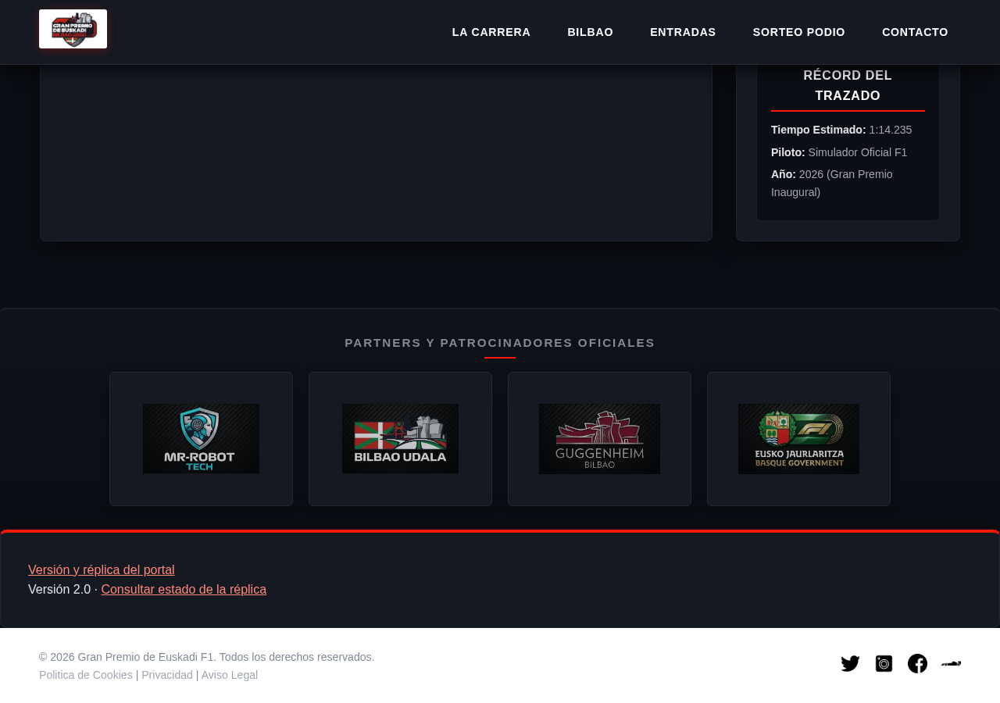

*Figura 44. Después de la actualización: el pie de la portada muestra «Versión 2.0» y el enlace a la página de estado de la réplica. Captura anterior: Claude Code, 5 de noviembre de 2026, por la IP de manager-g5 de ese día. No muestra la dirección ni el comentario de la norma.*

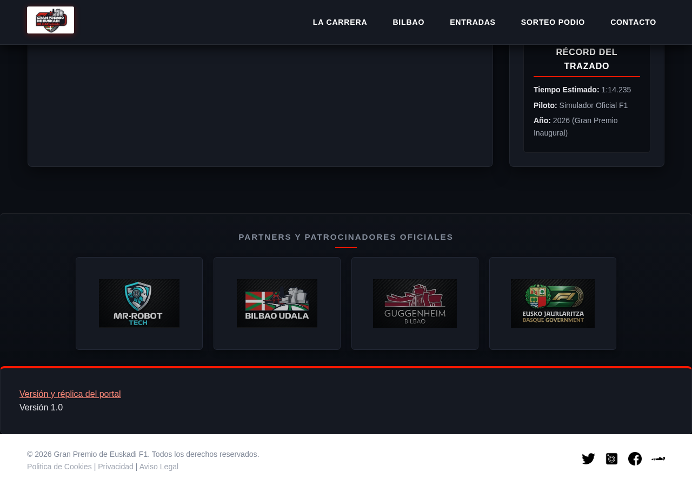

*Figura 45. Después del rollback: la portada vuelve a la versión 1.0. Captura anterior: Claude Code, 5 de noviembre de 2026. No muestra la dirección ni el comentario de la norma.*

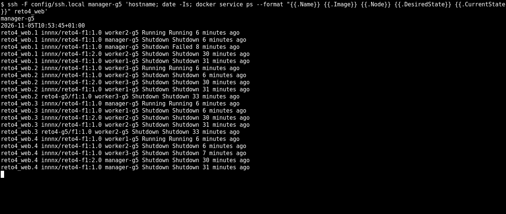

*Figura 46. Historial de tareas de `reto4_web`: tareas `innnx/reto4-f1:2.0` en `Shutdown` y tareas 1.0 en `Running` tras el rollback. Captura anterior: Claude Code, 5 de noviembre de 2026. Máquina: manager-g5. No muestra el prompt ni el comentario de la norma.*

> **Evidencia pendiente:** captura conforme **durante** la actualización, con la sonda mostrando respuestas de ambas versiones y el navegador.

### 5.9. E8: elección de un nuevo líder

**Procedimiento.** Prueba histórica del 4 de noviembre, hecha con Codex y con el **portal provisional**:

```bash
docker node promote worker1-g5 worker2-g5                                       # En manager-g5: tres managers.
aws ec2 stop-instances --region us-east-1 --instance-ids i-0e6ebf2af63facc60     # Detiene solo el líder.
docker node ls                                                                  # Desde worker1-g5, otro manager.
aws ec2 start-instances --region us-east-1 --instance-ids i-0e6ebf2af63facc60
```

**Explicación.** Con tres managers, la mayoría de Raft es dos. Si cae el líder, los otros dos siguen teniendo mayoría y eligen un líder nuevo. Por eso la Guía pide promover dos workers antes de apagar el líder. El listado se hace «desde otro» manager, como pide la Rúbrica, porque el líder caído no puede responder.

**Comprobación.** Extractos de `docker node ls` tomados desde worker1-g5 ([registro](evidencias/E8-eleccion-registro.txt)):

```text
ANTES
xf46ytyuxo4bvn8lbxixhfhtv     manager-g5   Ready     Active         Leader           29.1.3
m69w5hsyyyegwivfhoi8fbihd *   worker1-g5   Ready     Active         Reachable        29.1.3
7zff6zyro5ir31bz19ozwmt4q     worker2-g5   Ready     Active         Reachable        29.1.3

DESPUÉS DE LA PARADA Y LA REINCORPORACIÓN
xf46ytyuxo4bvn8lbxixhfhtv     manager-g5   Ready     Active         Reachable        29.1.3
m69w5hsyyyegwivfhoi8fbihd *   worker1-g5   Ready     Active         Reachable        29.1.3
7zff6zyro5ir31bz19ozwmt4q     worker2-g5   Ready     Active         Leader           29.1.3
```

El liderazgo pasó de manager-g5 a **worker2-g5**, el servicio siguió en 4/4 y manager-g5 volvió como manager `Reachable`, con una IP pública nueva. La sonda registró 38 muestras correctas antes de la parada y 130 después, con **34 segundos sin muestras** entre ambos tramos (incidencia [I5.2](#510-incidencias-reales-y-soluciones)).

**Límites.** No hay ninguna salida de `docker node ls` tomada **durante** la parada: la elección se demuestra comparando antes y después. La parada se deduce de que cambió la IP pública del manager, porque el registro no contiene `stopped`. No consta la URL sondeada. Las capturas web de [durante](evidencias/E8-web-parada.png) y [después](evidencias/E8-web-recuperado.png) no muestran IP, hora ni estado del clúster. [Análisis completo](evidencias/auditoria/E4-E8.md).

**Relación con C3.** Esta prueba dejó tres managers, que se corrigieron el 9 de noviembre (apartado [3.4](#34-validación-de-los-nodos-y-de-sus-roles-c3)). Repetirla obliga a promover de nuevo dos workers, detener el líder y volver después a un solo manager.

> **Evidencia pendiente:** repetir E8 con la web definitiva, con una sonda continua y una captura conforme de `docker node ls` desde otro manager **durante** la parada, y restaurar C3 al terminar. Requiere autorización.

### 5.10. Incidencias reales y soluciones

**I5.1. Dos tiempos de espera durante el escalado (E2)** · Estado: **pendiente de explicar**; no se repitió en las pruebas siguientes

- *Síntomas:* durante la reducción de 12 a 2 réplicas, una muestra de la sonda de worker1-g5 y otra de la de worker3-g5 superaron el límite de 0,9 s, en el mismo segundo. Las muestras anterior y siguiente fueron correctas.
- *Causa:* **no determinada.** Coincide con la retirada simultánea de diez réplicas, pero no hay datos para demostrarlo.
- *Diagnóstico:* resumen de las sondas en el [registro](evidencias/F4-E2/registro.txt): 140 correctas y 1 fallo en esas dos IP, y 141 correctas en las otras dos. El registro termina con `exit=1` por esos fallos.
- *Solución aplicada:* no se ocultaron. Se definió un criterio de supervisión para las pruebas siguientes: detener la prueba si una IP acumula tres fallos seguidos, si no se recuperan las réplicas o si alguna IP sigue fallando al terminar.
- *Comprobación:* E3, E6 y E7 terminaron con 0 fallos. Son 2 de 564 muestras, y E2 no debe presentarse como prueba sin fallos.

**I5.2. Treinta y cuatro segundos sin muestras en E8** · Estado: **pendiente**

- *Síntomas:* la sonda de E8 tiene dos tramos separados por 34 segundos sin ninguna muestra, justo durante la parada del líder.
- *Causa:* **no registrada.** La sonda se ejecutó en dos tramos, guardados en archivos distintos ([primero](evidencias/prototipo/E8-http.txt) y [segundo](evidencias/prototipo/E8-http-recuperacion.txt)), y no consta por qué se interrumpió.
- *Diagnóstico:* comparación de las horas de la última muestra del primer tramo y la primera del segundo.
- *Solución:* no puede corregirse sobre la prueba histórica. Solo la repetición de E8 con una sonda continua cerraría este hueco.
- *Comprobación:* la elección del nuevo líder sí está demostrada comparando antes y después; la disponibilidad durante esos 34 segundos, no.

**I5.3. Reparto desigual de réplicas tras el despliegue y el rollback** · Estado: **resuelta**

- *Síntomas:* tras el despliegue y el rollback del 5 de noviembre, una réplica en manager-g5, otra en worker1-g5, dos en worker2-g5 y ninguna en worker3-g5.
- *Causa:* Swarm coloca las tareas cuando las crea, y no mueve las que ya funcionan aunque un nodo quede libre.
- *Diagnóstico:* `docker service ps --filter desired-state=running --format '{{.Node}}' reto4_web | sort | uniq -c` ([estado](evidencias/F3-estado-final.txt)).
- *Solución aplicada:* `docker service update --force reto4_web`, dentro de E6.
- *Comprobación:* una réplica por nodo al terminar E6 ([registro](evidencias/F4-E6/registro.txt)).

**I5.4. Las comprobaciones podían dar falsos positivos** · Estado: **resuelta**

- *Síntomas:* en la revisión del 9 de noviembre se vio que la sonda aceptaba como correcta cualquier respuesta HTTP 200, aunque fuera una página de error; que una sonda que hubiera muerto con su última muestra correcta no se detectaba; y que `verificar-despliegue.sh` aceptaba tareas que no estaban `Running` o respuestas de un solo contenedor.
- *Causa:* las comprobaciones miraban el código HTTP y la imagen, pero no la identidad completa de la respuesta ni el estado de los procesos.
- *Diagnóstico:* revisión del código y pruebas con datos simulados.
- *Solución aplicada:* commit `9dab86d`: la sonda exige `version=1.0|2.0` y `contenedor=…`, el resumen comprueba que cada sonda sigue viva, y la verificación exige tareas `Running` y más de un contenedor. Se añadieron pruebas automáticas.
- *Comprobación:* las 29 pruebas de `tests/` pasaron el 10 y el 18 de noviembre. Además, se revisaron los registros de las pruebas anteriores: las **2306 muestras correctas** de despliegue, E2, E3, E6 y E7 contienen todas la versión y el contenedor, así que sus resultados siguen siendo válidos.

La verificación de E5 que se detuvo por credenciales revocadas se explica en la incidencia [I1.1](#115-incidencias-reales-y-soluciones).

### 5.11. Posibles incidencias y soluciones

| Síntoma o error | Causa probable | Diagnóstico | Solución |
| --- | --- | --- | --- |
| Las réplicas quedan en `Pending` al escalar | Falta memoria en los t3.small | `docker service ps reto4_web` y `docker node inspect --pretty NODO` | Reducir réplicas o liberar recursos |
| Tras reincorporar un nodo, no recibe tareas | Swarm no mueve las tareas que funcionan | `docker service ps` | `docker service update --force reto4_web` |
| La actualización se queda en `paused` | Falla el `HEALTHCHECK` de la versión nueva | `docker service inspect --format '{{json .UpdateStatus}}' reto4_web` | `docker service rollback reto4_web` y revisar la imagen |
| El rollback no vuelve a la versión esperada | La configuración anterior no era la que se creía | `docker service inspect --pretty reto4_web` | Usar `docker service update --image innnx/reto4-f1:1.0` |
| Al apagar el líder, el clúster no se puede gestionar | Solo hay un manager, o dos | `docker node ls` desde otro manager | Promover dos workers antes de E8 y volver a un manager después |
| La sonda no muestra fallos, pero ha dejado de escribir | El proceso de la sonda ha muerto | `ps` y la hora de la última línea de la sonda | Usar las sondas actuales, que lo detectan |
| No hay SSH tras parar y arrancar un nodo | Las IP públicas han cambiado | `ssh -G manager-g5 \| grep hostname` | `bash scripts/actualizar-ips.sh` |
| El tráfico sigue llegando a un nodo caído | El routing mesh aún no lo ha marcado `Down` | `docker node ls` | Esperar unos segundos; las sondas lo registran |

### 5.12. Resultado y conclusión de la Fase 5

| Prueba | Web | Resultado | Muestras de la sonda | Estado |
| --- | --- | --- | --- | --- |
| E1 Balanceo | Definitiva | Cuatro contenedores distintos por cualquier IP | — | Realizada |
| E2 Escalado | Definitiva | 8/8, 12/12, 2/2 y 4/4 | 562 correctas y 2 tiempos de espera | Realizada, con fallos aislados |
| E3 Autorreparación | Definitiva | Contenedor eliminado y reemplazado, 4/4 | 308 correctas, 0 fallos | Realizada |
| E4 Caída de un worker | **Provisional** | `Down`, tarea reubicada y reincorporación | 164 correctas, 0 fallos | Histórica, parcial |
| E5 Reincorporación y reinicio | Provisional y definitiva | Mismas instancias y clúster correcto tras cada reinicio comprobado | — | Realizada |
| E6 Drain | Definitiva | Tarea trasladada, vuelta a Active y una réplica por nodo | 488 correctas, 0 fallos | Realizada |
| E7 Actualización y rollback | Definitiva | 1.0 → 2.0 → 1.0, en 4/4 | 620 correctas, 0 fallos | Realizada |
| E8 Nuevo líder | **Provisional** | Nuevo líder, comparando antes y después | 38 y 130 correctas, con 34 s sin muestras | Histórica, parcial |

Swarm demostró con la web definitiva el balanceo, el escalado, la autorreparación, el mantenimiento y la actualización con rollback, y tras cada reinicio del laboratorio el clúster volvió con las mismas instancias. Las sondas son muestras por segundo: en E2 hubo dos tiempos de espera sin causa determinada, y en E8 hay 34 segundos sin muestras. E4 y E8 solo se hicieron con el portal provisional.

La principal carencia de la fase es documental: faltan las capturas conformes antes, durante y después con la sonda visible, y repetir E4 y E8 con la web definitiva, con autorización.

## Conclusión general

**Último estado técnico registrado.** Son los resultados del 9 y del 10 de noviembre de 2026. Desde entonces no se ha accedido a AWS ni al clúster, así que el estado actual debe comprobarse con `comprobar-laboratorio.sh` en cuanto se inicie el laboratorio.

- **Infraestructura (10 de noviembre).** Las cuatro instancias conservan sus ID, discos e IP privadas desde su creación. El estado de Terraform está sincronizado con AWS. El plan normal propone sustituir las instancias por una imagen Ubuntu nueva (I1.4), así que **no debe aplicarse** hasta fijar la imagen.
- **Seguridad de red (9 de noviembre).** El grupo de seguridad aplica la política de mínimos. Además de la IP del Codespace, mantiene la regla temporal `88.14.93.201/32` para las pruebas pendientes de B1.
- **SSH (9 de noviembre).** Las claves de los cuatro integrantes están en los cuatro nodos, sin root ni contraseñas. Cristina entró con la suya en los cuatro nodos; Enrique, Alexandra e Ibai, solo en manager-g5.
- **Swarm (9 de noviembre).** manager-g5 es el único manager y líder, con tres workers activos, como pide la Guía. No se ha vuelto a comprobar tras el reinicio del laboratorio del 10 de noviembre.
- **Web (9 de noviembre).** `reto4_web` en 4/4 con `innnx/reto4-f1:1.0`, HTTP 200 por las cuatro IP públicas y reparto entre los cuatro contenedores, según la última comprobación del 9 de noviembre.

**Situación por criterios de la Rúbrica.**

- **A · Terraform:** A1, A4 y A5 cumplidos; A2 y A3 cumplidos, con la captura de la consola de EC2 pendiente; **A6 parcial** (plan sin cambios, destrucción y secuencia de capturas).
- **B · SSH:** B2, B3, B4 y B5 cumplidos; **B1 parcial** (accesos de tres integrantes a los workers, capturas con comentario y política de `vockey`).
- **C · Swarm:** C1, C2 y C4 cumplidos; **C3 corregido**, con la captura conforme pendiente.
- **D · Web:** D1 y D2 cumplidos; D3 cumplido, con las capturas conformes pendientes.
- **E · Orquestación:** E1, E2, E3, E5, E6 y E7 realizados con sus resultados reales; **E4 y E8 parciales**, por ser históricas con el portal provisional y, en E8, por los 34 segundos sin muestras.
- **F · Repositorio y entorno:** F3–F9 y F12 cumplidos, con todo el proyecto en `main` y el diagrama actualizado; F1 cumplido, con el profesor (jc-csl) como colaborador y la captura de Settings pendiente; **F2 parcial**; **F10 parcial**, por las capturas pendientes; **F11 parcial**, porque [GESTION.md](GESTION.md) sigue en borrador; **F13 pendiente**.
- **G · Exposición y defensa:** se evalúa el día de la exposición; el material está en [DEFENSA.md](entrega/DEFENSA.md).

**Evidencias pendientes.** Reunidas aquí para preparar la entrega:

| Fase | Evidencia que falta | Qué debe mostrar | Criterio |
| --- | --- | --- | --- |
| 0 | Settings → Collaborators en el navegador | Cuentas de los integrantes y del profesor (jc-csl) | F1 |
| 0 | Historial de `main` y lista de PR actualizados | Commits y PR de cada integrante desde su cuenta | F2 |
| 0 | Vista del Codespace en el navegador (complementaria) | Codespace activo | F5 |
| 1 | Panel de Learner Lab y consola de EC2 | Laboratorio en verde e instancias con tipos y etiquetas, sin la cuenta | A2 |
| 1 | Reglas en la consola de EC2 | Reglas de entrada del grupo de seguridad | A3 |
| 1 | Secuencia de A6 | `validate`, plan, cambio, plan con `No changes` y destrucción | A6 |
| 1 | Extracto del `apply -refresh-only` y `terraform output` coincidiendo con EC2 | Sincronización del estado del 10 de noviembre | A5, A6 |
| 1 | `comprobar-laboratorio.sh` con código 0 | Estado completo el día de la corrección | Todos |
| 1 | Práctica individual previa | Documentación de cada integrante | F13 |
| 2 | `B1-repositorio` | Las cuatro `.pub` en GitHub y las privadas excluidas | B1 |
| 2 | Accesos a los workers de Enrique, Alexandra e Ibai, y `B1-registro-*` | Entrada con su clave en los cuatro nodos, con comentario, y registro de cada nodo | B1 |
| 3 | `C3-nodos` actualizada | manager-g5 único `Leader` y tres workers `Ready/Active` | C3 |
| 4 | D3 conformes | La web en el navegador por las cuatro IP del día, con comentario | D3 |
| 5 | Capturas antes, durante y después con la sonda | E2, E3, E6 y E7 | E2, E3, E6, E7 |
| 5 | Repetición de E4 | Caída de un worker con la web definitiva | E4 |
| 5 | Repetición de E8 | `docker node ls` desde otro manager durante la parada, con sonda continua | E8 |
| Exposición | Presentación actualizada | Las diapositivas 3, 5 y 6 y sus notas aún describen tres managers y las claves sin instalar | G1 |

**Decisiones pendientes, todas con autorización expresa:** fijar la imagen de Terraform (I1.4); el momento de la destrucción de A6, tras consultarlo con el profesor; la política de `vockey`; la retirada de la regla temporal cuando terminen las pruebas de B1; y la repetición de E4 y E8.

**Conclusión.** El grupo ha construido una infraestructura completa y funcional: definida como código, administrada con claves propias, organizada como un clúster Swarm por IP privada y capaz de repartir la carga, escalar, recuperarse de fallos, mantener nodos y actualizarse sin cortes. Las incidencias más instructivas, como las credenciales temporales, las IP cambiantes, el estado de Terraform, la imagen `most_recent` o los roles de Swarm tras E8, se han diagnosticado y documentado con sus causas, y la mayoría están resueltas. Lo que queda es sobre todo evidencia: capturas conformes del estado actual, la participación propia de cada integrante en GitHub y en SSH, y las pruebas E4 y E8 con la web definitiva.

## Referencias y páginas web utilizadas

### Documentos del profesor

- *CLOUD Reto 4: Web en clúster Docker Swarm creado con Terraform sobre AWS* (Guía del Reto 4, 2.º ASIR). Documento original, no versionado.
- *Rúbrica 2 ASIR CLOUD Reto 4*: 42 criterios en los bloques A a G. Documento original, no versionado. Contraste con el proyecto en [CONTRASTE-GUIA-RUBRICA.md](entrega/CONTRASTE-GUIA-RUBRICA.md).

### Servicios y páginas usados en el proyecto

- GitHub y GitHub Codespaces: [github.com](https://github.com). Repositorio privado `Lq922466/reto4-cloud-G5`.
- AWS Academy Learner Lab: [awsacademy.instructure.com](https://awsacademy.instructure.com/).
- Comprobación de la IP pública de salida: [checkip.amazonaws.com](https://checkip.amazonaws.com/).
- Imágenes del proyecto en Docker Hub: [hub.docker.com/r/innnx/reto4-f1](https://hub.docker.com/r/innnx/reto4-f1/tags).
- Imagen base de Nginx: [hub.docker.com/_/nginx](https://hub.docker.com/_/nginx).

### Documentación técnica de consulta

- GitHub. [Introducción a los contenedores de desarrollo](https://docs.github.com/es/codespaces/setting-up-your-project-for-codespaces/adding-a-dev-container-configuration/introduction-to-dev-containers) y [Dev Container Features](https://containers.dev/features).
- GitHub. [Acerca de las solicitudes de incorporación de cambios](https://docs.github.com/es/pull-requests/collaborating-with-pull-requests/proposing-changes-to-your-work-with-pull-requests/about-pull-requests).
- AWS. [Archivos de configuración y credenciales de la AWS CLI](https://docs.aws.amazon.com/cli/latest/userguide/cli-configure-files.html), [`sts get-caller-identity`](https://docs.aws.amazon.com/cli/latest/reference/sts/get-caller-identity.html), [`ec2 describe-instances`](https://docs.aws.amazon.com/cli/latest/reference/ec2/describe-instances.html) y [`ec2 authorize-security-group-ingress`](https://docs.aws.amazon.com/cli/latest/reference/ec2/authorize-security-group-ingress.html).
- AWS. [Grupos de seguridad de Amazon EC2](https://docs.aws.amazon.com/AWSEC2/latest/UserGuide/ec2-security-groups.html).
- HashiCorp Terraform. [`count`](https://developer.hashicorp.com/terraform/language/meta-arguments/count), [`templatefile`](https://developer.hashicorp.com/terraform/language/functions/templatefile), [`terraform plan`, incluido el modo refresh-only](https://developer.hashicorp.com/terraform/cli/commands/plan) y [`terraform destroy`](https://developer.hashicorp.com/terraform/cli/commands/destroy).
- Proveedor AWS de Terraform. [`aws_instance`](https://registry.terraform.io/providers/hashicorp/aws/latest/docs/resources/instance), [`aws_security_group`](https://registry.terraform.io/providers/hashicorp/aws/latest/docs/resources/security_group) y [`aws_ami`](https://registry.terraform.io/providers/hashicorp/aws/latest/docs/data-sources/ami).
- [Documentación de cloud-init](https://cloudinit.readthedocs.io/en/latest/).
- OpenSSH. [`ssh_config`](https://man.openbsd.org/ssh_config) y [`sshd_config`](https://man.openbsd.org/sshd_config).
- Docker. [Conceptos clave de Swarm](https://docs.docker.com/engine/swarm/key-concepts/), [Raft en Swarm](https://docs.docker.com/engine/swarm/raft/), [administración de managers](https://docs.docker.com/engine/swarm/admin_guide/), [routing mesh e ingress](https://docs.docker.com/engine/swarm/ingress/) y [redes overlay](https://docs.docker.com/engine/network/drivers/overlay/).
- Docker. [Modo drain](https://docs.docker.com/engine/swarm/swarm-tutorial/drain-node/), [actualizaciones progresivas](https://docs.docker.com/engine/swarm/swarm-tutorial/rolling-update/), [`deploy` en Compose](https://docs.docker.com/reference/compose-file/deploy/), [`docker stack deploy`](https://docs.docker.com/reference/cli/docker/stack/deploy/) y [referencia del Dockerfile](https://docs.docker.com/reference/dockerfile/).

### Documentos del repositorio

[README](README.md) · [estado por criterio](REVISION.md) · [índice de evidencias](evidencias/INDICE.md) · [capturas conformes](evidencias/capturas-conformes/INDICE.md) · [capturas de los integrantes](evidencias/capturas-integrantes/INDICE.md) · [auditoría](evidencias/auditoria/INFORME.md) · [análisis de E4 y E8](evidencias/auditoria/E4-E8.md) · [gestión del grupo](GESTION.md) · [defensa](entrega/DEFENSA.md) · [checklist final](entrega/CHECKLIST-FINAL.md) · [procedimiento de capturas](entrega/PROCEDIMIENTO-CAPTURAS.md) · [procedimiento de claves](entrega/PROCEDIMIENTO-CLAVES.md) · [plan de C3, E4 y E8](entrega/PLAN-C3-E4-E8.md) · [tareas pendientes](entrega/PENDIENTES.md) · [instrucciones de F2](entrega/INSTRUCCIONES-F2-INTEGRANTES.md) · [informe anterior](entrega/historico/PROYECTO-2026-11-09.md) · [registro histórico de la revisión](entrega/historico/REVISION-2026-11-05.md)
