# RETO 4 CLOUD · Grupo 5

**Web del Gran Premio de Euskadi en un clúster Docker Swarm creado con Terraform sobre AWS**

Informe técnico del proyecto · Fases 0 a 5

| | |
| --- | --- |
| **Proyecto** | RETO 4 · Cloud · Grupo 5 |
| **Integrantes** | Cristina (Lq922466), Enrique (EnriZx2), Alexandra (alexguerth) e Ibai (ibaiaretxabalaasir-collab). Responsable del producto Cloud: Cristina |
| **Repositorio** | `Lq922466/reto4-cloud-G5` (privado) |
| **Imágenes de la web** | [`innnx/reto4-f1`](https://hub.docker.com/r/innnx/reto4-f1/tags), etiquetas `1.0` y `2.0` |
| **Nube** | AWS Academy Learner Lab, región `us-east-1`, VPC por defecto. Todos los recursos llevan el sufijo `g5` |
| **Revisión del informe** | 18 de noviembre de 2026 |
| **Comprobaciones técnicas registradas** | 9 y 10 de noviembre de 2026; consultar las fechas de cada evidencia |

La versión extensa anterior de este informe se conserva como [copia histórica](entrega/historico/PROYECTO-2026-11-09.md).

## Introducción

Este proyecto despliega la web del Gran Premio de Euskadi de Fórmula 1 sobre cuatro servidores Ubuntu 22.04 en AWS Academy Learner Lab. **Terraform** define y crea la infraestructura, **SSH** permite administrarla y **Docker Swarm** distribuye la aplicación web entre un manager y tres workers. La web se empaqueta con Nginx y se publica en Docker Hub.

El informe presenta las configuraciones, los comandos relevantes, las pruebas ejecutadas y sus evidencias. Los resultados se describen según los registros disponibles: una comprobación puntual no equivale a disponibilidad continua y las tareas pendientes no se consideran completadas.

### Trabajo del equipo y uso de inteligencia artificial

El proyecto fue coordinado por **Cristina**, responsable de Cloud. Se encargó de la organización del repositorio, de las primeras configuraciones, de coordinar y autorizar las operaciones técnicas y de revisar los resultados. **Enrique, Alexandra e Ibai** participaron en la preparación de sus accesos mediante claves SSH y en las comprobaciones de conexión. Enrique también presentó cambios en GitHub para su revisión. La distribución del trabajo del grupo se recoge en [GESTION.md](GESTION.md).

Durante el proyecto se utilizaron **Codex** y **Claude Code** como herramientas de apoyo. Ayudaron a preparar scripts, ejecutar operaciones autorizadas, comprobar resultados y organizar la documentación. Las decisiones, la coordinación y la revisión correspondieron al equipo humano. Se indica esta colaboración para distinguir las tareas realizadas por personas de las realizadas con ayuda de IA, sin atribuir pruebas o cambios a personas que no los ejecutaron.

## Índice

- [Introducción](#introduccion)
  - [Trabajo del equipo y uso de inteligencia artificial](#trabajo-del-equipo-y-uso-de-inteligencia-artificial)
- [Cómo leer este informe](#como-leer-este-informe)
- [Arquitectura general y herramientas](#arquitectura-general-y-herramientas)
  - [Arquitectura](#arquitectura)
  - [Flujo de trabajo](#flujo-de-trabajo)
  - [Herramientas utilizadas](#herramientas-utilizadas)
- [Fase 0 — GitHub y Codespaces](#fase-0-github-y-codespaces)
  - [0.1. Repositorio privado y colaboradores](#01-repositorio-privado-y-colaboradores)
  - [0.2. Codespace y `devcontainer`](#02-codespace-y-devcontainer)
  - [0.3. Organización de los cambios en GitHub](#03-organizacion-de-los-cambios-en-github)
  - [0.4. Estructura, README y scripts](#04-estructura-readme-y-scripts)
  - [0.5. Seguridad del repositorio](#05-seguridad-del-repositorio)
  - [0.6. Capturas y pruebas del proyecto](#06-capturas-y-pruebas-del-proyecto)
  - [0.7. Incidencias registradas](#07-incidencias-registradas)
  - [0.8. Resultado y conclusión](#08-resultado-y-conclusion)
- [Fase 1 — AWS y Terraform](#fase-1-aws-y-terraform)
  - [1.1. Learner Lab, consola de AWS y región](#11-learner-lab-consola-de-aws-y-region)
  - [1.2. Credenciales temporales en el Codespace](#12-credenciales-temporales-en-el-codespace)
  - [1.3. Comprobación del laboratorio tras cada reinicio](#13-comprobacion-del-laboratorio-tras-cada-reinicio)
  - [1.4. Organización del módulo Terraform](#14-organizacion-del-modulo-terraform)
  - [1.5. Variables](#15-variables)
  - [1.6. Imagen Ubuntu y red por defecto](#16-imagen-ubuntu-y-red-por-defecto)
  - [1.7. Grupo de seguridad](#17-grupo-de-seguridad)
  - [1.8. Creación de los cuatro servidores](#18-creacion-de-los-cuatro-servidores)
  - [1.9. Script de arranque](#19-script-de-arranque)
  - [1.10. Direcciones e información de los servidores](#110-direcciones-e-informacion-de-los-servidores)
  - [1.11. Creación de la infraestructura: `init`, `validate`, `plan` y `apply`](#111-creacion-de-la-infraestructura-init-validate-plan-y-apply)
  - [1.12. Modificación de la infraestructura](#112-modificacion-de-la-infraestructura)
  - [1.13. Actualización de la información de Terraform](#113-actualizacion-de-la-informacion-de-terraform)
  - [1.14. Destrucción (pendiente)](#114-destruccion-pendiente)
  - [1.15. Incidencias registradas](#115-incidencias-registradas)
  - [1.16. Resultado y conclusión](#116-resultado-y-conclusion)
- [Fase 2 — Acceso SSH](#fase-2-acceso-ssh)
  - [2.1. Claves propias de los integrantes](#21-claves-propias-de-los-integrantes)
  - [2.2. Conexión SSH mediante nombres sencillos](#22-conexion-ssh-mediante-nombres-sencillos)
  - [2.3. Conexión segura a los servidores internos](#23-conexion-segura-a-los-servidores-internos)
  - [2.4. Sin root ni contraseña, y permisos](#24-sin-root-ni-contrasena-y-permisos)
  - [2.5. Órdenes simultáneas, control total y copia de archivos](#25-ordenes-simultaneas-control-total-y-copia-de-archivos)
  - [2.6. Acceso de cada integrante desde su equipo](#26-acceso-de-cada-integrante-desde-su-equipo)
  - [2.7. Incidencias registradas](#27-incidencias-registradas)
  - [2.8. Resultado y conclusión](#28-resultado-y-conclusion)
- [Fase 3 — Docker Swarm](#fase-3-docker-swarm)
  - [3.1. Docker y conectividad por IP privada](#31-docker-y-conectividad-por-ip-privada)
  - [3.2. Inicialización del clúster por IP privada](#32-inicializacion-del-cluster-por-ip-privada)
  - [3.3. Redes internas del clúster](#33-redes-internas-del-cluster)
  - [3.4. Validación de los nodos y de sus roles](#34-validacion-de-los-nodos-y-de-sus-roles)
  - [3.5. Incidencias registradas](#35-incidencias-registradas)
  - [3.6. Resultado y conclusión](#36-resultado-y-conclusion)
- [Fase 4 — Despliegue web](#fase-4-despliegue-web)
  - [4.1. La web y su imagen con Nginx](#41-la-web-y-su-imagen-con-nginx)
  - [4.2. Versiones 1.0 y 2.0 y construcción en un nodo](#42-versiones-10-y-20-y-construccion-en-un-nodo)
  - [4.3. Publicación en Docker Hub y descarga anónima](#43-publicacion-en-docker-hub-y-descarga-anonima)
  - [4.4. Despliegue con `stack.yml`](#44-despliegue-con-stackyml)
  - [4.5. Acceso por la IP pública de los cuatro nodos](#45-acceso-por-la-ip-publica-de-los-cuatro-nodos)
  - [4.6. Incidencias registradas](#46-incidencias-registradas)
  - [4.7. Resultado y conclusión](#47-resultado-y-conclusion)
- [Fase 5 — Pruebas de orquestación](#fase-5-pruebas-de-orquestacion)
  - [5.1. Cómo se realizaron las pruebas](#51-como-se-realizaron-las-pruebas)
  - [5.2. Distribución de las visitas entre servidores](#52-distribucion-de-las-visitas-entre-servidores)
  - [5.3. Aumento y reducción de servidores web](#53-aumento-y-reduccion-de-servidores-web)
  - [5.4. Recuperación automática de un contenedor](#54-recuperacion-automatica-de-un-contenedor)
  - [5.5. Prueba de fallo de un servidor](#55-prueba-de-fallo-de-un-servidor)
  - [5.6. Recuperación de servidores y reinicio del laboratorio](#56-recuperacion-de-servidores-y-reinicio-del-laboratorio)
  - [5.7. Mantenimiento de un servidor](#57-mantenimiento-de-un-servidor)
  - [5.8. Actualización de la web y vuelta a la versión anterior](#58-actualizacion-de-la-web-y-vuelta-a-la-version-anterior)
  - [5.9. Sustitución del servidor principal](#59-sustitucion-del-servidor-principal)
  - [5.10. Incidencias registradas](#510-incidencias-registradas)
  - [5.11. Resultado y conclusión](#511-resultado-y-conclusion)
- [Conclusión general](#conclusion-general)
- [Referencias y páginas web utilizadas](#referencias-y-paginas-web-utilizadas)

## Cómo leer este informe

El documento explica cada etapa con un objetivo, los pasos realizados, los comandos importantes, las capturas y una conclusión final. Las capturas sirven para mostrar el funcionamiento y las comprobaciones de cada parte.

Algunas pruebas se hicieron en fechas distintas y las direcciones públicas de AWS pueden cambiar cuando se reinicia el laboratorio. Por eso, los resultados y las capturas se presentan con sus fechas. Cuando una operación no pudo verificarse completamente, se explica en su apartado.

## Arquitectura general y herramientas

### Arquitectura

Todo se despliega en `us-east-1`, en la VPC por defecto. El clúster se construye con las **IP privadas**, que no cambian, porque las públicas cambian en cada sesión del laboratorio. El Codespace es la máquina de control: desde él se usan Git, la AWS CLI, Terraform y SSH.


*Figura 1. Mapa de arquitectura (criterio F8), generado desde el código Mermaid de [`diagramas/arquitectura.md`](diagramas/arquitectura.md): Codespace, GitHub, AWS, Swarm, redes, servicio y Docker Hub, con un manager líder y tres workers.*

| Nodo | ID de instancia | Tipo y disco | IP privada | Rol en Swarm comprobado el 9 de noviembre |
| --- | --- | --- | --- | --- |
| manager-g5 | `i-0e6ebf2af63facc60` | t3.medium, 20 GB gp3 | 172.31.28.10 | Manager líder |
| worker1-g5 | `i-066a1ad3b7a8e0db9` | t3.small, 10 GB gp3 | 172.31.17.168 | Worker |
| worker2-g5 | `i-0ed6d9c9957251a18` | t3.small, 10 GB gp3 | 172.31.29.192 | Worker |
| worker3-g5 | `i-0446409b26cf0a662` | t3.small, 10 GB gp3 | 172.31.31.183 | Worker |

Entre la prueba E8 y el 9 de noviembre, worker1-g5 y worker2-g5 fueron managers (apartado [3.4](#34-validación-de-los-nodos-y-de-sus-roles-c3)). Los roles no se han vuelto a comprobar desde el reinicio del laboratorio del 10 de noviembre.

### Flujo de trabajo

1. **Terraform** crea el grupo de seguridad y las cuatro instancias. En su primer arranque, cada instancia se pone nombre y zona horaria, instala las claves públicas, endurece SSH e instala Docker.
2. Con **SSH**, usando alias cortos y el manager como salto, se administra cada nodo.
3. Se forma el clúster **Docker Swarm** por IP privada y se crean las redes overlay del grupo.
4. La web se empaqueta con **Docker**, se publica en **Docker Hub** y se despliega como un servicio de cuatro réplicas.
5. Con scripts y **sondas** que consultan la web cada segundo se prueban las capacidades de orquestación.
6. El código, la configuración y las evidencias se guardan en **GitHub**.

### Herramientas utilizadas

| Herramienta | Versión o detalle | Uso |
| --- | --- | --- |
| GitHub, GitHub CLI (`gh` 2.103.3) y Git | Repositorio privado | Repositorio, colaboradores, ramas y Pull Requests |
| GitHub Codespaces y `devcontainer` | Ubuntu 22.04 | Máquina de control reproducible |
| AWS Academy Learner Lab, consola de AWS y AWS CLI | AWS CLI 2.39.3 | Acceso a AWS y consultas o cambios autorizados en EC2 |
| Terraform y proveedor `hashicorp/aws` | Terraform 1.17.1, proveedor 5.100.0 | Infraestructura como código |
| cloud-init | De Ubuntu 22.04 | Ejecuta el script de arranque de cada instancia |
| OpenSSH (`ssh`, `scp`, `ssh-keygen`) | — | Acceso remoto, salto, copia de archivos y huellas |
| Docker Engine, Docker Swarm y Docker Hub | Docker 29.1.3 (`docker.io`) | Contenedores, orquestación y registro de imágenes |
| Nginx | Imagen `nginx:alpine` | Servidor web de cada contenedor |
| `curl`, `jq`, Python 3, Chrome for Testing, Playwright, Xvfb, `xterm` e ImageMagick | — | Sondas HTTP, pruebas en navegador, revisión de secretos y capturas conformes |
| Codex y Claude Code | Asistentes de IA | Ejecución y documentación por encargo de Cristina |

## Fase 0 — GitHub y Codespaces

**Objetivo.** Disponer de un repositorio privado y colaborativo en GitHub y de una máquina de control reproducible en GitHub Codespaces, con AWS CLI y Terraform, desde la que se gestiona todo el proyecto.

### 0.1. Repositorio privado y colaboradores

**Procedimiento.** Cristina creó el repositorio `reto4-cloud-G5` con su cuenta Lq922466 (**New repository → Private**). Se configuró como privado para limitar el acceso al código y a la documentación de la infraestructura. Después invitó a los demás integrantes y al profesor desde **Settings → Collaborators → Add people**, y cada uno aceptó la invitación. El permiso de escritura permite crear ramas y Pull Requests, pero no cambiar la configuración del repositorio.

**Comprobación.**

```bash
gh repo view --json visibility --jq .visibility
gh api repos/Lq922466/reto4-cloud-G5/collaborators --jq '.[] | [.login, .role_name] | @tsv'
```

El repositorio es privado. Cristina (Lq922466) es la administradora, y tienen escritura Enrique (EnriZx2), Alexandra (alexguerth), Ibai (ibaiaretxabalaasir-collab) y el profesor, con la cuenta **jc-csl**, registrada en la configuración de colaboradores.


*Figura 2. Repositorio privado, con acceso de los cuatro integrantes y del profesor (jc-csl). Captura conforme, 18 de noviembre de 2026.*

> **Evidencia pendiente:** la Rúbrica indica como evidencia de F1 la página **Settings → Collaborators**; falta su captura desde el navegador.

### 0.2. Codespace y `devcontainer`

**Procedimiento.** El Codespace es la máquina de control. Para que cualquier miembro obtenga el mismo entorno, se describe en [`.devcontainer/devcontainer.json`](.devcontainer/devcontainer.json):

```json
{
  "name": "RETO4-CLOUD-G5",
  "image": "mcr.microsoft.com/devcontainers/base:ubuntu-22.04",
  "features": {
    "ghcr.io/devcontainers/features/aws-cli:1": {},
    "ghcr.io/devcontainers/features/terraform:1": {}
  }
}
```

`image` es la base del contenedor, Ubuntu 22.04 como las instancias, y cada `feature` instala una herramienta al construirlo. Se crea desde GitHub con **Code → Codespaces → Create codespace on `main`**; si cambia el `devcontainer`, se usa **Rebuild Container**.

**Comprobación.**

```bash
aws --version; terraform version | head -n 1; gh --version | head -n 1
```

Respondieron `aws-cli/2.39.3`, `Terraform v1.17.1` y `gh version 2.103.3`.

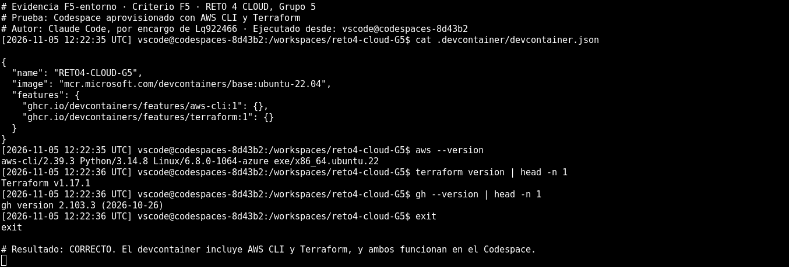

*Figura 3. El `devcontainer` incluye AWS CLI y Terraform, y ambos funcionan en el Codespace. Captura conforme, 5 de noviembre de 2026.*

> **Evidencia pendiente:** vista del Codespace activo en **GitHub → Codespaces**.

### 0.3. Organización de los cambios en GitHub

**Procedimiento.** Cada cambio se registra y se sube a GitHub desde el Codespace. Se añaden rutas concretas, y no `git add .`, para no subir por error un archivo con secretos, y antes de integrar se ejecuta la revisión del apartado [0.5](#05-seguridad-del-repositorio-f12):

```bash
git status && git diff          # Qué ha cambiado.
git add RUTA                    # Solo los archivos revisados.
git commit -m "Mensaje" && git push
```

El flujo colaborativo utiliza ramas de trabajo y **Pull Requests** (PR) para revisar los cambios antes de integrarlos. Las [instrucciones de F2](entrega/INSTRUCCIONES-F2-INTEGRANTES.md) detallan el flujo:

```bash
git clone https://github.com/Lq922466/reto4-cloud-G5.git && cd reto4-cloud-G5
git switch -c NOMBRE-DE-LA-TAREA origin/main
git add RUTA && git commit -m "Mensaje" && git push -u origin NOMBRE-DE-LA-TAREA
gh pr create --base main --title "Título" --body "Qué cambia y cómo se ha comprobado"
```

**Integración en `main`.** Hasta el 18 de noviembre, el trabajo estaba en la rama `cloud-g5-implementacion`. Ese día se integró en `main` con la PR #1, fusionada con un *merge commit* que conserva los commits y sus autores, y se eliminó la rama antigua. Desde entonces, **`main` es la única rama de trabajo y de entrega**.

**Comprobación.** Antes de la integración, la rama de trabajo tenía 44 commits: 32 con la identidad de Cristina (Innnx), 11 de Codex y 1 de Enrique (EnriZx2). Los commits de Innnx incluyen trabajo preparado con Claude Code o con Codex, como indica su mensaje cuando lo declara. Estado de las PR:

| PR | Rama → destino | Abierta por | Estado |
| --- | --- | --- | --- |
| #1 | `cloud-g5-implementacion` → `main` | Cristina | Fusionada el 18 de noviembre; rama de origen eliminada |
| #2 | `enrique-revision-documentacion` → `cloud-g5-implementacion` | Enrique | Fusionada el 6 de noviembre. Su commit se hizo desde la web de GitHub, no desde un terminal |
| #3, #4 y #5 | Ramas de revisión de Enrique, Alexandra e Ibai → `main` | Cuenta de Cristina | Abiertas, con conflictos: borradores preparados con Codex, pendientes de que cada integrante los valide |

Las PR #3 a #5 tienen commits con la identidad de Cristina, así que **no cuentan como trabajo propio de los integrantes**. Para F2 faltan commits y PR de Alexandra e Ibai desde sus cuentas y sus terminales, y un commit de Enrique desde un terminal.


*Figura 4. Historial de commits y PR con los autores reales, anterior a las PR #2 a #5 y a la integración en `main`. Captura conforme, 5 de noviembre de 2026.*

> **Evidencia pendiente:** captura actualizada del historial de `main` y de la lista de PR, con commits y PR de cada integrante desde su cuenta.

### 0.4. Estructura, README y scripts

**Procedimiento.** El repositorio organiza sus componentes por función; el [README.md](README.md) resume el proyecto, da instrucciones rápidas de despliegue y enlaza Docker Hub (F3); y cada script explica al principio qué hace, cuándo se usa y qué efecto tiene (F7).

| Carpeta | Contenido |
| --- | --- |
| [`.devcontainer/`](.devcontainer/devcontainer.json) | Entorno del Codespace |
| [`terraform/`](terraform/) | Infraestructura, script de arranque y claves públicas de los integrantes |
| [`app/`](app/) | Web en sus dos versiones, `Dockerfile`, pila `stack.yml` y despliegue en Swarm |
| [`config/`](config/README.md) | Plantillas SSH, configuración SSH aplicada y configuración de `sshd` |
| [`scripts/`](scripts/) | Actualización de IP, comprobaciones, despliegue, pruebas, capturas y seguridad |
| [`diagramas/`](diagramas/arquitectura.md) | Mapa de la arquitectura |
| [`practica-individual/`](practica-individual/README.md) | Práctica previa de cada integrante. **Sin contenido** (práctica inicial) |
| [`evidencias/`](evidencias/INDICE.md) y [`entrega/`](entrega/) | Capturas y registros por criterio, y documentos de apoyo a la entrega y la defensa |
| [`tests/`](tests/) | Pruebas automáticas de los scripts, sin recursos reales |

**Comprobación.**


*Figura 5. Existen las carpetas pedidas por la Guía. Se tomó en la rama de trabajo, cuyo árbol es el que se integró en `main`. Captura conforme, 5 de noviembre de 2026.*

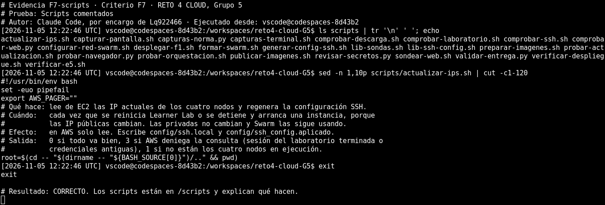

*Figura 6. Los scripts están en `/scripts` y su cabecera explica qué hacen. Captura conforme, 5 de noviembre de 2026.*

Las pruebas de [`tests/`](tests/) simulan AWS, SSH y Terraform y comprueban que los scripts no dan falsos positivos y que Terraform rechaza un SSH abierto a todo Internet. El 18 de noviembre, antes de integrar en `main`, pasaron las 29:

```bash
python3 -m unittest discover -s tests      # Ran 29 tests ... OK
```

### 0.5. Seguridad del repositorio

**Procedimiento.** Se combinan exclusiones en [`.gitignore`](.gitignore) y una revisión automática antes de integrar cambios.

| Excluido por `.gitignore` | Motivo |
| --- | --- |
| `*.tfstate*`, `*.tfplan`, `*.tfvars` (salvo `*.example.tfvars`), `*.auto.tfvars.json`, `**/.terraform/` | Estado, planes y variables locales con datos reales, IP y claves |
| `*.pem`, `*.key`, `*.ppk`, `id_rsa*`, `id_ed25519*`, `*_reto4`, `.ssh/` | Claves privadas. En `terraform/claves/` solo se admiten `.pub` |
| `.aws/`, `credentials`, `.env` | Credenciales |
| `config/ssh.local` y `*.docx` | Configuración SSH generada y documentos de trabajo o del profesor |

**Procedimiento.** [`revisar-secretos.py`](scripts/revisar-secretos.py) revisa las líneas añadidas entre dos commits en busca de credenciales de AWS, tokens de Docker Hub y de GitHub, claves privadas, tokens de Swarm y números de cuenta, y rechaza archivos sensibles por su nombre. Antes comprueba con muestras que su detector funciona, y sale con error si encuentra algo, sin mostrar el secreto.

```bash
python3 scripts/revisar-secretos.py 6f3d838 HEAD      # Todo lo integrado desde las Fases 0 y 1.
```

**Comprobación (18 de noviembre, antes de integrar en `main`).**

- Rango completo de la PR #1: 23 302 líneas añadidas en 382 archivos, **0 coincidencias** y ningún archivo sensible. Las ramas de las PR #3 a #5 tampoco tienen coincidencias.
- Cada uno de los 51 commits de todas las ramas: la única coincidencia es el número de la cuenta pública de Canonical en `owners` de `main.tf`, que identifica las imágenes oficiales de Ubuntu y no es un secreto.
- En todo el historial, el único archivo cuyo nombre coincide con los patrones sensibles es la plantilla `grupo.example.tfvars`, y `git check-ignore` confirma que `terraform/terraform.tfvars` y `config/ssh.local` quedan fuera de Git.
- El script no revisa el contenido de las imágenes: se revisaron a la vista las capturas nuevas. La revisión anterior de todo el historial está en el [registro del repositorio](evidencias/auditoria/registro-repositorio.txt).


*Figura 7. Solo se versiona la plantilla de variables, y la revisión de todo lo integrado desde `6f3d838` no encuentra secretos. Captura conforme, 18 de noviembre de 2026.*

### 0.6. Capturas y pruebas del proyecto

**Procedimiento.** Las capturas técnicas registran el prompt con el hostname y la fecha y hora, y un comentario con la prueba, el resultado y el autor, sin credenciales ni claves. Para cumplirlo de forma repetible se creó [`capturas-norma.py`](scripts/capturas-norma.py):

```bash
python3 -I scripts/capturas-norma.py --listar                                   # Catálogo de 57 capturas.
python3 -I scripts/capturas-norma.py --autor "Nombre (cuenta)" --solo '^C3-nodos$'
```

El script abre una sesión real en `xterm`, en el Codespace o por SSH en un nodo, con un prompt como `[2026-11-05 10:53:32 CET] ubuntu@manager-g5:~$`; escribe en la cabecera la prueba, el criterio y el autor real, que es obligatorio; calcula **CORRECTO** o **NO CORRECTO** comparando la salida real con lo esperado; rechaza cualquier orden que pueda modificar algo; y guarda junto a cada imagen un `.txt` con la misma salida.

**Comprobación.** Hay 32 capturas conformes de los días 5, 6, 9 y 18 de noviembre ([índice](evidencias/capturas-conformes/INDICE.md)). Dos dan **NO CORRECTO** y se conservan como resultado real: `A6-sin-cambios` y `C3-nodos`. Faltan, sobre todo, las de las pruebas de la Fase 5 con la sonda visible y las de la consola de AWS.

### 0.7. Incidencias registradas

- **I0.1. La generación de capturas se bloqueaba** · resuelta. *Problema:* `capturas-norma.py` no terminaba en la captura de C2. *Diagnóstico:* la herramienta `import` de ImageMagick esperaba indefinidamente una ventana cuyo título tenía un acento. *Solución:* identificadores solo ASCII (`C2-cluster`) y tiempo límite en `import`. *Resultado:* el catálogo se genera sin bloqueos.
- **I0.2. El verificador dio por correcta una salida vacía** · resuelta. *Problema:* la primera captura de A6 salió CORRECTO sin salida. *Diagnóstico:* el texto esperado se encontraba en la propia orden escrita. *Solución:* se retiró la captura y el verificador dejó de evaluar la línea de la orden. *Resultado:* ninguna otra captura cambió de resultado.
- **I0.3. Las ramas de Alexandra e Ibai partían de un `main` sin el proyecto** · parcialmente resuelta. *Problema:* se crearon desde `main` cuando el trabajo estaba en otra rama. *Diagnóstico:* `git merge-base` y `git log` frente a la rama de trabajo. *Solución:* las tres ramas de revisión se rehicieron desde el commit `a81b3d5`, hoy en `main`. *Resultado:* faltan commits hechos por cada integrante.
- **I0.4. Tres PR apuntaban a la rama que había que eliminar** · resuelta. *Problema:* las PR #3 a #5 tenían como destino `cloud-g5-implementacion`, y GitHub puede cerrar una solicitud de revisión si se elimina su rama de destino. *Diagnóstico:* rama de destino en `gh pr list`. *Solución:* `gh pr edit NÚMERO --base main` antes de eliminarla, sin tocar sus commits. *Resultado:* siguen abiertas, hacia `main`.
- **I0.5. La revisión de secretos se habría quedado vacía tras la fusión** · resuelta. *Problema:* la captura `seguridad del repositorio-seguridad` revisaba `origin/main..HEAD`, que queda vacío al fusionar, y habría dado CORRECTO sin revisar nada. *Diagnóstico:* revisión del catálogo antes de integrar. *Solución:* base fija `6f3d838`, el último `main` anterior a la integración. *Resultado:* la captura regenerada revisa todo lo integrado, con 0 coincidencias.

### 0.8. Resultado y conclusión

El entorno es reproducible: el Codespace se crea desde el `devcontainer` con AWS CLI y Terraform, el repositorio es privado y tiene la estructura de la Guía, y sus exclusiones y la revisión automática impiden publicar estado, variables, claves y credenciales. Todo el proyecto está en `main` y el profesor tiene acceso. La colaboración sigue incompleta: solo hay una solicitud de revisión fusionada de otro integrante, la de Enrique, hecha desde la web, y no constan commits de Alexandra ni de Ibai desde sus cuentas.


## Fase 1 — AWS y Terraform

**Objetivo.** Acceder a AWS desde el Codespace y definir como código, con Terraform, un manager y tres workers Ubuntu 22.04 en `us-east-1`, con un único grupo de seguridad de mínimos, un script de arranque y salidas con las direcciones y el ID de cada nodo; y registrar las operaciones de validación, planificación y cambios, señalando la destrucción todavía pendiente.

### 1.1. Learner Lab, consola de AWS y región

**Procedimiento.** AWS Academy Learner Lab proporciona una cuenta de AWS temporal. En [AWS Academy](https://awsacademy.instructure.com/) se abre **Launch AWS Academy Learner Lab**, se pulsa **Start Lab** y, con el indicador en verde, **AWS** abre la consola; arriba a la derecha debe verse **N. Virginia (us-east-1)**. En el Codespace se fija la región de la CLI:

```bash
aws configure set region us-east-1 && aws configure set output json
```

**Explicación.** Al terminar la sesión, Learner Lab detiene las instancias. Al volver, cada una **conserva su ID, su disco y su IP privada, pero recibe una IP pública nueva**: por eso el clúster usa IP privadas. Terraform no depende de esta configuración, porque usa la variable `aws_region`.

> **Evidencia pendiente:** captura del panel de Learner Lab en verde y de **EC2 → Instances**, sin el identificador de la cuenta.

### 1.2. Credenciales temporales en el Codespace

**Procedimiento.** En el panel de Learner Lab, **AWS Details → AWS CLI → Show** muestra un bloque `[default]` con el identificador de la clave (`ASIA…`, temporal), la clave secreta y el token de sesión. Los tres se renuevan juntos, así que se sustituye el bloque completo:

```bash
umask 077                          # Los archivos nuevos solo los lee el propio usuario.
nano ~/.aws/credentials            # Pegar el bloque [default] completo.
chmod 600 ~/.aws/credentials
aws sts get-caller-identity > /dev/null && echo "AWS acepta las credenciales"
```

**Explicación.** No se usa `aws configure` porque no pide el token de sesión. `sts get-caller-identity` no necesita permisos especiales y es la forma más sencilla de saber si las credenciales son válidas; su salida va a `/dev/null` porque contiene el número de la cuenta. Las credenciales nunca se versionan ni aparecen en capturas.

**Comprobación.** Tras renovarlas en cada sesión, `sts get-caller-identity` respondió correctamente. No se captura porque mostraría la cuenta.

### 1.3. Comprobación del laboratorio tras cada reinicio

**Procedimiento.** [`comprobar-laboratorio.sh`](scripts/comprobar-laboratorio.sh) dice, sin cambiar nada, si el laboratorio está listo tras cada inicio:

```bash
bash scripts/comprobar-laboratorio.sh      # Solo lectura. Termina con 0 (todo correcto), 2 (algo que corregir) o 3 (AWS deniega la consulta).
```

1. **EC2:** cada instancia con su ID e IP privada esperados y sus controles de estado (`running` no basta: deben estar `ok/ok`).
2. **Regla SSH:** compara la IP pública del Codespace (`curl -s https://checkip.amazonaws.com`) con los orígenes del puerto 22. Si falta, **muestra** la orden exacta para añadirla, sin ejecutarla, y rechaza un SSH abierto a `0.0.0.0/0`.
3. **Web:** pide `/` e `/identidad.txt` a cada IP; la respuesta debe identificar versión y contenedor.
4. **Swarm:** nodos, servicio, réplicas y MTU de las redes, y rechaza que haya más de un manager.

**Comprobación.** El 9 de noviembre por la mañana terminó con código 2: la web respondía, pero no había SSH porque la IP del Codespace había cambiado ([registro](evidencias/auditoria/registro-2026-11-09.txt)). Tras corregir la regla SSH y la topología del clúster, Codex lo repitió y terminó con código 0; esa ejecución consta en su registro de sesión.

> **Evidencia pendiente:** captura conforme de `comprobar-laboratorio.sh` con código 0 el día de la corrección.

### 1.4. Organización del módulo Terraform

**Procedimiento.** El módulo de [`terraform/`](terraform/) separa proveedor, variables, recursos y salidas (A1, F6). Terraform lee todos los `.tf` de la carpeta como un único conjunto; el reparto solo facilita la lectura.

| Archivo | Contenido |
| --- | --- |
| [`provider.tf`](terraform/provider.tf) | Proveedor `hashicorp/aws` `~> 5.0` y región tomada de una variable |
| [`variables.tf`](terraform/variables.tf) | Grupo, tamaños, discos, imagen, accesos SSH y claves públicas, con validaciones |
| [`main.tf`](terraform/main.tf) | Imagen, VPC por defecto, grupo de seguridad, manager y workers |
| [`outputs.tf`](terraform/outputs.tf) | Salida `nodes` con IP pública, IP privada e ID |
| [`scripts/bootstrap.sh.tftpl`](terraform/scripts/bootstrap.sh.tftpl) | Script de arranque de cada nodo |
| [`grupo.example.tfvars`](terraform/grupo.example.tfvars) y `.terraform.lock.hcl` | Plantilla de variables del grupo y versión exacta del proveedor |
| [`claves/`](terraform/claves/) | Claves públicas de los cuatro integrantes (apartado [2.1](#21-claves-propias-de-los-integrantes-b1)) |

```bash
terraform -chdir=terraform init            # Descarga el proveedor fijado en el archivo de bloqueo.
terraform -chdir=terraform fmt -check      # Formato.
terraform -chdir=terraform validate        # Sintaxis y tipos, sin contactar con AWS.
```

**Comprobación.** `fmt` y `validate` fueron correctos el 5, el 9 y el 18 de noviembre.


*Figura 8. El módulo está organizado, usa variables y `terraform validate` es correcto. Captura conforme, 5 de noviembre de 2026.*

**Práctica individual (práctica inicial).** Para este proyecto se decidió partir de la práctica individual de EC2 con Ubuntu 22.04. Este módulo la amplía a cuatro nodos, pero la documentación de la práctica previa de cada integrante todavía no está en [`practica-individual/`](practica-individual/README.md): **evidencia pendiente**.

### 1.5. Variables

**Procedimiento.** Con variables, el mismo código sirve para otro grupo o para otros tamaños sin tocar `main.tf` (A1).

| Variable | Valor por defecto | Uso |
| --- | --- | --- |
| `aws_region` y `grupo` | `us-east-1` y `g5` | Región y sufijo de los nombres: `manager-g5`, `worker1-g5`… |
| `manager_type` y `worker_type` | `t3.medium` y `t3.small` | Tamaños de la Guía |
| `manager_disk_size`, `worker_disk_size` y `disk_type` | 20, 10 y `gp3` | Discos de la Guía, en GB |
| `worker_count` | 3 | Número de workers |
| `ubuntu_ami_name` | `ubuntu/images/hvm-ssd/ubuntu-jammy-22.04-amd64-server-*` | Patrón de la imagen Ubuntu 22.04 |
| `key_name` | `vockey` | Par de claves de AWS de cada instancia |
| `ssh_cidr` y `ssh_additional_cidrs` | Sin valor y `{}` | IP de la máquina de control y otros accesos SSH autorizados, con su descripción |
| `ssh_public_keys` | Sin valor | Claves públicas que instala el script de arranque |

**Procedimiento.** Las variables del grupo van en un archivo local que no se versiona:

```bash
cp terraform/grupo.example.tfvars terraform/terraform.tfvars
# Editar: ssh_cidr = "IP_PROPIA/32", ssh_additional_cidrs = { "IP/32" = "Descripción" } y ssh_public_keys = ["ssh-ed25519 AAAA... comentario"]
```

Las variables sensibles tienen bloques `validation`: Terraform se detiene si un acceso SSH es `0.0.0.0/0` o no es un CIDR IPv4 válido, o si una clave no es una clave pública OpenSSH de una sola línea (por ejemplo, una privada o con saltos de línea de Windows).

**Comprobación.** [`tests/test_terraform_variables.py`](tests/test_terraform_variables.py) comprueba que se aceptan orígenes restringidos y se rechazan los abiertos o mal escritos. Pasó el 10 y el 18 de noviembre.

### 1.6. Imagen Ubuntu y red por defecto

Extracto de [`main.tf`](terraform/main.tf). Un bloque `data` **consulta** algo que ya existe en AWS, sin crearlo:

```hcl
data "aws_ami" "ubuntu" {
  most_recent = true
  owners      = ["<cuenta oficial de Canonical>"]   # El número real está en main.tf.
  filter { name = "name"  values = [var.ubuntu_ami_name] }
  filter { name = "state" values = ["available"] }
}
data "aws_vpc" "default" { default = true }
```

`aws_ami` busca la imagen Ubuntu 22.04 más reciente publicada por Canonical, para aceptar solo imágenes oficiales, y `aws_vpc` obtiene la VPC por defecto que indica la Guía.

> **Advertencia.** Con `most_recent = true`, cuando Canonical publica una imagen nueva Terraform la elige y, como la imagen de una instancia no se puede cambiar, el plan propone **sustituir las instancias**. Ocurrió el 10 de noviembre (incidencia [I1.4](#115-incidencias-reales-y-soluciones)): **no debe ejecutarse un `terraform apply` normal** hasta fijar la imagen.

### 1.7. Grupo de seguridad

**Procedimiento.** Un único grupo de seguridad, `reto4-cloud-g5` (`sg-0c12ecd538a29f8d6`), abre a Internet solo lo imprescindible y limita los puertos de Swarm a los propios nodos.

| Puerto | Protocolo | Origen | Uso |
| --- | --- | --- | --- |
| 22 | TCP | `var.ssh_cidr` y `var.ssh_additional_cidrs`, direcciones `/32` | SSH desde el Codespace y accesos autorizados de los integrantes |
| 22 | TCP | El propio grupo (`self = true`) | Salto SSH del manager a los workers |
| 80 y 8080 | TCP | `0.0.0.0/0` | Web. Para este proyecto se decidió el 8080, aunque ningún servicio lo publica |
| 2377, 7946 y 4789 | TCP, TCP/UDP y UDP | El propio grupo | Gestión de Swarm, comunicación entre nodos y VXLAN de las overlay |
| ICMP | ICMP | El propio grupo | `ping` entre nodos |
| Salida | Todos | `0.0.0.0/0` | Actualizaciones y descarga de imágenes |

**Explicación.** `self = true` admite solo tráfico de instancias con este mismo grupo, sin escribir sus IP; `/32` admite una única dirección. Las reglas se declaran *inline*, dentro del recurso: Terraform considera sobrante cualquier regla creada a mano, por eso los accesos SSH adicionales se declaran en `ssh_additional_cidrs`.

**Observación.** La Guía abre el 22 «desde aula/alumno». Aquí el «alumno» que administra es el Codespace, con su IP `/32`, y los integrantes usan reglas `/32` temporales; además, el 22 se abre al propio grupo para el salto SSH (B5). Ninguna regla abre SSH a Internet.

**Comprobación.**

```bash
aws ec2 describe-security-groups --region us-east-1 --filters Name=group-name,Values=reto4-cloud-g5 \
  --query 'SecurityGroups[].IpPermissions[].{Desde:FromPort,Hasta:ToPort,Protocolo:IpProtocol,CIDR:join(`,`,IpRanges[].CidrIp),Grupo:join(`,`,UserIdGroupPairs[].GroupId)}' \
  --output table
```

El 9 de noviembre, Codex leyó once reglas, todas de mínimos: el SSH externo admitía solo la IP del Codespace (`172.166.151.114/32`) y la regla temporal `88.14.93.201/32` de Enrique, Alexandra e Ibai, que **se mantiene a propósito** hasta que terminen sus pruebas en los workers (apartado [2.6](#26-acceso-de-cada-integrante-desde-su-equipo-b1)) y se retirará con autorización.


*Figura 9. Entrada limitada a SSH `/32`, 80 y 8080 públicos y puertos internos solo entre nodos, antes de la regla temporal. Captura conforme, 6 de noviembre de 2026.*

> **Evidencia pendiente:** reglas de entrada en la consola de EC2 («reglas EC2» en la Rúbrica), y captura conforme tras retirar la regla temporal.

### 1.8. Creación de los cuatro servidores

Extracto de [`main.tf`](terraform/main.tf):

```hcl
resource "aws_instance" "manager" {
  ami                         = data.aws_ami.ubuntu.id
  instance_type               = var.manager_type
  key_name                    = var.key_name
  vpc_security_group_ids      = [aws_security_group.cluster.id]
  associate_public_ip_address = true
  user_data = templatefile("${path.module}/scripts/bootstrap.sh.tftpl", {
    hostname    = "manager-${var.grupo}"
    public_keys = var.ssh_public_keys
  })
  root_block_device { volume_size = var.manager_disk_size  volume_type = var.disk_type }
  tags = { Name = "manager-${var.grupo}", PruebaA6 = "reto4-${var.grupo}" }
}

resource "aws_instance" "workers" {
  count         = var.worker_count
  instance_type = var.worker_type
  user_data     = templatefile(..., { hostname = "worker${count.index + 1}-${var.grupo}", ... })
  tags          = { Name = "worker${count.index + 1}-${var.grupo}" }
  # El resto, igual que el manager, con worker_disk_size.
}
```

**Explicación.** `count` crea varias instancias desde un solo bloque, sin copiar el código tres veces; `count.index` vale 0, 1 y 2, de ahí `worker1-g5` a `worker3-g5`. `templatefile` rellena el script de arranque con el nombre y las claves y lo entrega como `user_data`. `key_name = "vockey"` deja el par del laboratorio como acceso de reserva. La etiqueta `Name` es la que usan la consola y los scripts, y `PruebaA6` es el cambio controlado del apartado [1.12](#112-cambio-controlado-a6).

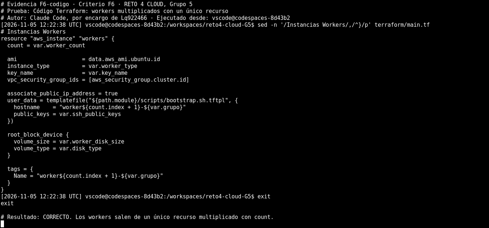

*Figura 10. Los tres workers salen de un único recurso multiplicado con `count`. Captura conforme, 5 de noviembre de 2026.*

**Comprobación.**

```bash
aws ec2 describe-instances --region us-east-1 --filters 'Name=tag:Name,Values=manager-g5,worker?-g5' \
  --query 'Reservations[].Instances[].[Tags[?Key==`Name`]|[0].Value,InstanceType,State.Name,PrivateIpAddress,PublicIpAddress]' \
  --output table
```


*Figura 11. Un manager t3.medium y tres workers t3.small en ejecución, con los controles de estado correctos. Captura conforme, 6 de noviembre de 2026.*

> **Evidencia pendiente:** **EC2 → Instances** en la consola con las cuatro instancias, sus tipos y sus etiquetas («consola EC2» en la Rúbrica).

### 1.9. Script de arranque

[`bootstrap.sh.tftpl`](terraform/scripts/bootstrap.sh.tftpl) se ejecuta como root, con cloud-init, en el primer arranque. Extracto:

```bash
set -euo pipefail                                              # Se detiene ante cualquier error.
hostnamectl set-hostname '${hostname}'                        # manager-g5, worker1-g5…
timedatectl set-timezone Europe/Madrid
install -d -m 0700 -o ubuntu -g ubuntu /home/ubuntu/.ssh
# Añade cada clave de ssh_public_keys a authorized_keys (600) si no estaba ya, con grep -Fxq.
cat > /etc/ssh/sshd_config.d/00-reto4.conf <<'SSH'
PermitRootLogin no
PasswordAuthentication no
KbdInteractiveAuthentication no
SSH
sshd -t && systemctl reload ssh                                # Valida la sintaxis antes de recargar.
apt-get install -y docker.io && systemctl enable --now docker  # Docker activo también tras cada reinicio.
usermod -aG docker ubuntu                                      # ubuntu usa Docker sin sudo.
```

`grep -Fxq` compara la línea exacta, así que repetir el script no duplica claves ni toca `vockey`; `sshd -t` evita dejar el nodo inaccesible por un error de sintaxis.

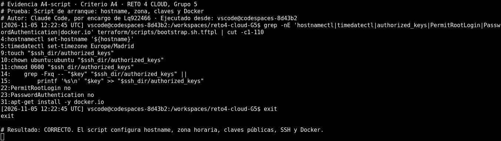

*Figura 12. El script configura hostname, zona horaria, claves públicas, SSH y Docker. Captura conforme, 5 de noviembre de 2026.*

**Comprobación.** En cada nodo, `cloud-init status`, `timedatectl show -p Timezone --value` y `docker --version`. El registro completo del primer arranque del manager está en [`evidencias/prototipo/manager-g5.txt`](evidencias/prototipo/manager-g5.txt).


*Figura 13. En los cuatro nodos terminó cloud-init, con la zona Europe/Madrid y Docker instalado. Captura conforme, 6 de noviembre de 2026.*

### 1.10. Direcciones e información de los servidores

[`outputs.tf`](terraform/outputs.tf) recorre el manager y los workers con una expresión `for` y crea un mapa por nombre:

```hcl
output "nodes" {
  value = {
    for node in concat([aws_instance.manager], aws_instance.workers) :
    node.tags.Name => { public_ip = node.public_ip, private_ip = node.private_ip, id = node.id }
  }
}
```

```bash
terraform -chdir=terraform output -state=ESTADO/terraform.tfstate -json nodes
```

La leen [`generar-config-ssh.sh`](scripts/generar-config-ssh.sh), para crear los alias SSH, y [`formar-swarm.sh`](scripts/formar-swarm.sh), que anuncia Swarm por la IP privada del manager. `ESTADO` es la carpeta privada con el estado de Terraform, fuera del repositorio. Las salidas reflejan el estado guardado, no AWS en tiempo real: tras reiniciar el laboratorio hay que sincronizarlo (apartado [1.13](#113-sincronización-del-estado-con-refresh-only)).


*Figura 14. La salida `nodes` muestra la IP pública, la IP privada y el ID de cada nodo, con las IP públicas del último `apply`. Captura conforme, 6 de noviembre de 2026.*

### 1.11. Creación de la infraestructura: `init`, `validate`, `plan` y `apply`

**Procedimiento.** Ciclo seguido el 4 de noviembre, deducido de los planes y registros conservados:

```bash
terraform init                                     # Descarga el proveedor.
terraform validate                                 # Sintaxis y tipos, sin AWS.
terraform plan -out=reto4-review-cidr.tfplan       # Plan: 5 to add, 0 to change, 0 to destroy.
terraform apply reto4-review-cidr.tfplan           # Apply complete! Resources: 5 added, 0 changed, 0 destroyed.
```

**Explicación.** El plan compara código, estado y AWS, y se guarda en un archivo para revisarlo; `apply` de ese archivo aplica exactamente lo revisado. El **estado** (`terraform.tfstate`) relaciona el código con los recursos reales: no se versiona, está en una carpeta privada del Codespace, y sin él Terraform no podría modificar ni destruir la infraestructura.

**Comprobación.** Se crearon cinco recursos: el grupo de seguridad y las cuatro instancias. [Plan inicial](evidencias/prototipo/reto4-plan.log), [plan con la IP SSH](evidencias/prototipo/reto4-plan-cidr.log) y [apply](evidencias/prototipo/reto4-apply.log).

> **Evidencia pendiente:** la secuencia de validación, plan, cambio y destrucción en capturas conformes; hoy solo consta en registros de texto.

### 1.12. Modificación de la infraestructura

**Procedimiento.** Para demostrar un cambio sin riesgo se añadió a manager-g5 la etiqueta `PruebaA6=reto4-g5`, que se cambia **en el sitio** (`~ update in-place`), sin detener ni sustituir la instancia:

```bash
terraform -chdir=terraform plan -input=false -state=ESTADO/terraform.tfstate \
  -var-file=ESTADO/reto4-local.auto.tfvars.json -var ssh_cidr=IP_ACTUAL/32 -out=a6-apply.tfplan
terraform -chdir=terraform apply -input=false -state=ESTADO/terraform.tfstate a6-apply.tfplan
```

**Comprobación.** El 5 de noviembre, el plan final contenía solo la etiqueta (`Plan: 0 to add, 1 to change, 0 to destroy`) y el apply terminó con `Resources: 0 added, 1 changed, 0 destroyed`; los ID y los discos no cambiaron, y un nuevo plan dio `No changes`. Planes [previo](evidencias/A6-plan-previo.txt), [descartado](evidencias/A6-plan-actual.txt) y [final](evidencias/A6-plan-final.txt), y [apply](evidencias/A6-apply.txt). Tras el reinicio del laboratorio, el plan posterior del 6 de noviembre dio NO CORRECTO: no cambiaba recursos, pero sí las salidas, porque el estado guardaba las IP públicas anteriores.


*Figura 15. Plan posterior al cambio. NO CORRECTO: propone cambios en las salidas, no en los recursos. Captura conforme, 6 de noviembre de 2026.*

### 1.13. Actualización de la información de Terraform

**Procedimiento.** El modo **refresh-only** lee los recursos reales y actualiza solo el estado, sin crear, cambiar ni destruir nada. Se aplica un plan guardado, para aplicar exactamente lo revisado. `COPIA` es una carpeta privada de respaldo:

```bash
cp -p ESTADO/terraform.tfstate COPIA/ && (cd ESTADO && sha256sum terraform.tfstate) > COPIA/SHA256SUMS   # Respaldo.
terraform -chdir=terraform plan -refresh-only -input=false -lock-timeout=30s \
  -state=ESTADO/terraform.tfstate -var-file=ESTADO/reto4-local.auto.tfvars.json -out=COPIA/refresh-only.tfplan
terraform -chdir=terraform show -json COPIA/refresh-only.tfplan    # resource_changes debe estar vacío.
terraform -chdir=terraform apply -input=false -lock-timeout=30s -state=ESTADO/terraform.tfstate COPIA/refresh-only.tfplan
terraform -chdir=terraform output -state=ESTADO/terraform.tfstate -json nodes
```

**Comprobación.** El 9 de noviembre, un plan de solo lectura de Codex no tenía acciones sobre recursos; solo estaban desactualizadas las IP y DNS públicos y las reglas SSH guardadas. El 10 de noviembre, con autorización de Cristina, Claude Code lo aplicó: `Resources: 0 added, 0 changed, 0 destroyed`, y las salidas pasaron a coincidir con AWS. El registro y la copia del estado están en una carpeta privada, fuera de Git.

> **Evidencia pendiente:** extracto del registro del `apply -refresh-only` sin datos de la cuenta, y captura de `terraform output nodes` coincidiendo con EC2.

Después, el `plan` normal de solo lectura propuso sustituir las cuatro instancias por la imagen de Ubuntu nueva (incidencia [I1.4](#115-incidencias-reales-y-soluciones)), así que A6 no está cerrado.

### 1.14. Destrucción (pendiente)

No se ha ejecutado. Con autorización, sería:

```bash
terraform -chdir=terraform plan -destroy -state=ESTADO/terraform.tfstate -var-file=ESTADO/reto4-local.auto.tfvars.json -out=destroy.tfplan
terraform -chdir=terraform apply -state=ESTADO/terraform.tfstate destroy.tfplan
```

El 5 de noviembre se generó `plan -destroy` solo como información, sin aplicarlo: `Plan: 0 to add, 0 to change, 5 to destroy` ([registro](evidencias/A6-plan-actual.txt)). Aplicarlo borra instancias, discos y clúster y obliga a repetir las Fases 1 a 4; como la Rúbrica exige que todo funcione durante la corrección, se deja para el final, con autorización y tras consultarlo con el profesor.

> **Evidencia pendiente:** la destrucción real y su captura, cuando se decida.

### 1.15. Incidencias registradas

- **I1.1. Credenciales caducadas o revocadas** · resuelta, se repite en cada sesión. *Problema:* `UnauthorizedOperation` (política `voc-cancel-cred`, durante E5) o `RequestExpired`. *Diagnóstico:* `comprobar-laboratorio.sh` termina con código 3 y `aws sts get-caller-identity` falla: la sesión de Learner Lab había terminado o era otra. *Solución:* iniciar el laboratorio y sustituir el bloque completo de `~/.aws/credentials` (apartado [1.2](#12-credenciales-temporales-en-el-codespace)). *Resultado:* AWS vuelve a aceptar las consultas. Registros del [4](evidencias/E5-verificacion-posterior.txt), del [5](evidencias/auditoria/registro-acceso-en-vivo.txt) y del [9 de noviembre](evidencias/auditoria/registro-2026-11-09.txt).
- **I1.2. El plan de A6 incluía un segundo cambio** · resuelta. *Problema:* además de la etiqueta, proponía cambiar el grupo de seguridad. *Diagnóstico:* la regla SSH real no tenía la descripción que declaraba el código. *Solución:* se descartó ese plan, se alineó el código con la regla real, sin tocar AWS, y se usó la IP vigente en `ssh_cidr`. *Resultado:* el plan final contenía solo la etiqueta ([descartado](evidencias/A6-plan-actual.txt) y [final](evidencias/A6-plan-final.txt)).
- **I1.3. Estado y salidas desactualizados tras reiniciar el laboratorio** · resuelta. *Problema:* el plan posterior a A6 dio NO CORRECTO por `Changes to Outputs`, y `terraform output` mostraba IP que ya no existían. *Diagnóstico:* `plan -refresh-only` de solo lectura: cero acciones sobre recursos y diferencias solo en IP, DNS y reglas SSH. *Solución:* `apply -refresh-only` autorizado, con copia previa (apartado [1.13](#113-sincronización-del-estado-con-refresh-only)). *Resultado:* las salidas coinciden con EC2; falta versionar la evidencia.
- **I1.4. El plan normal propone sustituir las cuatro instancias** · **pendiente**. *Problema:* el 10 de noviembre, el `plan` de solo lectura dio `Plan: 4 to add, 0 to change, 4 to destroy`, con `ami ... # forces replacement`. *Diagnóstico:* `terraform show -json` del plan: el único atributo que fuerza la sustitución es `ami`. Por `most_recent = true`, Terraform elige la imagen `...-server-20261109`, y las instancias usan `ubuntu/images/hvm-ssd/ubuntu-jammy-22.04-amd64-server-20261021`. *Solución propuesta, no aplicada:* fijar esa imagen en `ubuntu_ami_name` de las variables privadas, o añadir `lifecycle { ignore_changes = [ami] }` a las instancias, y repetir el plan hasta obtener `No changes`; requiere autorización. *Precaución:* se borró ese plan para que nadie lo aplique. **No debe ejecutarse un `terraform apply` normal hasta corregirlo: destruiría y recrearía los cuatro nodos y el clúster.**
- **I1.5. Las reglas SSH añadidas a mano quedaban fuera de Terraform** · resuelta. *Problema:* la regla temporal y las sustituciones de la regla del Codespace no estaban en el código, y un plan habría propuesto retirarlas. *Diagnóstico:* el `plan -refresh-only` mostraba reglas reales distintas de las guardadas. *Solución:* la variable `ssh_additional_cidrs` (commit `9dab86d`) declara los accesos adicionales con su descripción y rechaza `0.0.0.0/0`. *Resultado:* el plan del 10 de noviembre no proponía cambios en el grupo de seguridad.
- **I1.6. Interrupción del primer plan refresh-only** · resuelta. *Problema:* el proceso terminó con código 137 al reiniciarse el editor. *Diagnóstico:* `sha256sum -c` confirmó que el estado era idéntico a la copia y no quedaba bloqueo ni proceso de Terraform. *Solución:* repetir el plan. *Resultado:* el segundo plan terminó sin acciones sobre recursos.

### 1.16. Resultado y conclusión

Terraform creó la infraestructura del proyecto con un único módulo: variables de grupo, tamaños, discos e imagen; workers multiplicados con `count`; un grupo de seguridad que solo abre a Internet el 80, el 8080 y el 22 a direcciones `/32`; un script de arranque que deja cada nodo con su nombre, Europe/Madrid, claves, SSH endurecido y Docker; y salidas con IP e ID. El estado está sincronizado con AWS desde el 10 de noviembre. A6 no está cerrado: el plan normal propone sustituir las instancias por la imagen nueva (I1.4), falta la destrucción y la secuencia no está en capturas conformes.


## Fase 2 — Acceso SSH

**Objetivo.** Administrar los cuatro servidores por SSH con claves públicas propias, sin contraseñas ni acceso de root: entrar con un nombre corto, llegar a los workers por su IP privada a través del manager, ejecutar órdenes en todos a la vez con `sudo` y copiar archivos de forma verificable.

### 2.1. Claves propias de los integrantes

**Procedimiento.** Cada integrante generó en su equipo un par Ed25519 con frase de paso. La clave privada no sale de su equipo; la pública se versiona en [`terraform/claves/`](terraform/claves/). El Codespace usa su propia clave, `~/.ssh/reto4_g5`.

```bash
ssh-keygen -t ed25519 -C "NOMBRE-reto4" -f ~/.ssh/NOMBRE_reto4     # Pide una frase de paso.
ssh-keygen -lf ~/.ssh/NOMBRE_reto4.pub                              # Huella SHA-256, para comprobarla después.
```

| Clave | Tipo | Huella | Cómo llega a los nodos |
| --- | --- | --- | --- |
| `vockey` | RSA 2048 | `SHA256:dSdE2bRgx+xf29ZBOfEM7wBA9wD8+++htV5P8ROuZ9c` | AWS, por `key_name` |
| `reto4-g5-codespace` | Ed25519 | `SHA256:+Z2k+zLsyhswZxNWG/HxbdnlEyyCFbiTPPUXSvUXT1Y` | `ssh_public_keys` y script de arranque |
| Cristina, `cristina-reto4` | Ed25519 | `SHA256:CCR0qvMqSW8DopOop+RzmuWU7lu/USgKep7m+2fN5zA` | `instalar-clave-publica.sh` |
| Enrique, `EnriZx2-reto4` | Ed25519 | `SHA256:qDmJbNSoN432FHt3g+C6whK0IMM7wxroJOtKo1rZJys` | `instalar-clave-publica.sh` |
| Alexandra, `alexguerth-reto4` | Ed25519 | `SHA256:FJm/tkGxAxFBJKam0EQ1C5jpXbQ7konNpo8SRFHl1rs` | `instalar-clave-publica.sh` |
| Ibai, `ibai-reto4` | Ed25519 | `SHA256:zYEmGi4uoe3ljIm8NsFkKSXTcRw3hrm57WiWtjqSyp8` | `instalar-clave-publica.sh` |

**Cómo se instalaron.** Las claves de los integrantes se añadieron a `authorized_keys` de los cuatro nodos sin recrear las instancias, con [`instalar-clave-publica.sh`](scripts/instalar-clave-publica.sh): primero se comprueba y, con autorización, se instala.

```bash
for n in cristina enrique alexandra ibai; do
    bash scripts/instalar-clave-publica.sh --comprobar "terraform/claves/${n}_reto4.pub"; echo "salida=$?"
done
for n in cristina enrique alexandra ibai; do                    # Solo con autorización expresa.
    bash scripts/instalar-clave-publica.sh --instalar "terraform/claves/${n}_reto4.pub" || break
done
```

El script solo acepta una clave pública Ed25519 de una línea; revisa antes los cuatro nodos y se detiene si alguno no responde; guarda una copia `authorized_keys.antes-FECHA` y **añade** la clave sin borrar `vockey` ni la del Codespace; comprueba el resultado con `ssh-keygen` y restaura la copia si algo falla; y no duplica una clave que ya esté.

**Observaciones.** La Guía pone las claves públicas en el script de arranque. Terraform no lee `terraform/claves/`: el arranque instala las de `ssh_public_keys`, que al crear los nodos solo tenía la del Codespace, y las de los integrantes llegaron después; si se recrearan los nodos habría que añadirlas a esa variable. Además, la Guía deja `vockey` «como acceso de reserva» y la Rúbrica pide «vockey sustituida»: se conserva, como dice la Guía, hasta confirmarlo con el profesor.

**Comprobación.** El 9 de noviembre, con autorización de Cristina, `--comprobar` dio `ausente` antes y `presente` después, con código 0 en los cuatro nodos. Cada nodo quedó con seis claves, sin duplicados, con permisos 700 y 600 y con `vockey` y la clave del Codespace intactas ([registro](evidencias/auditoria/registro-2026-11-09-b1.txt)). Las cuatro públicas son Ed25519 válidas y distintas, y no hay claves privadas en el repositorio ni en su historial.

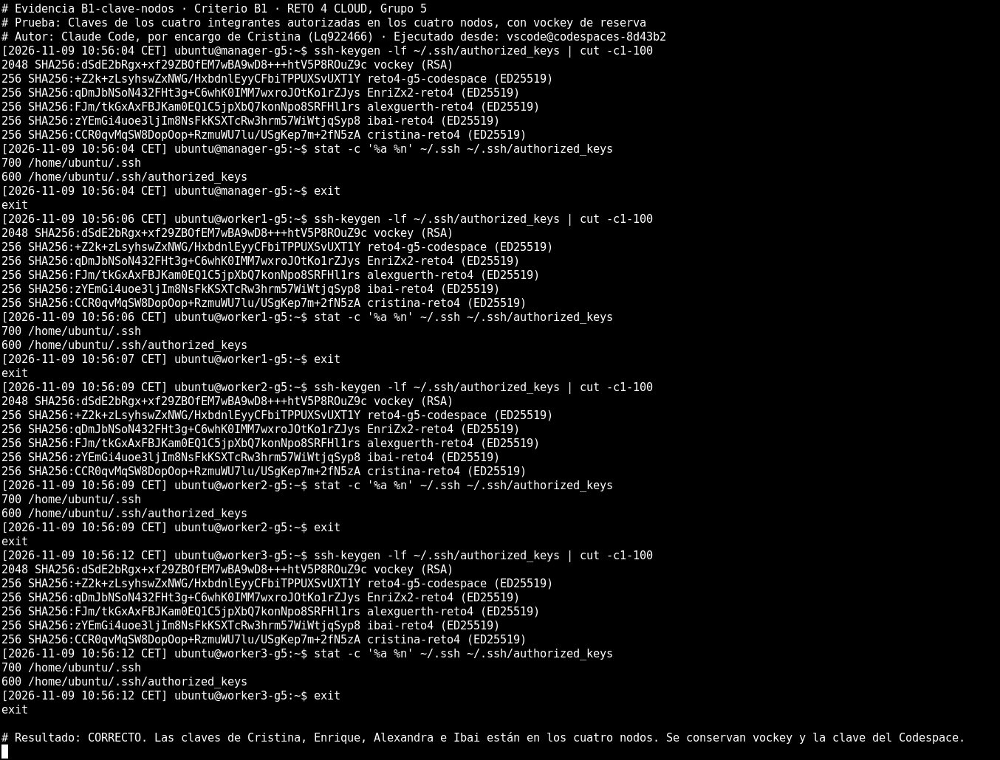

*Figura 16. CORRECTO: las claves de Cristina, Enrique, Alexandra e Ibai están en los cuatro nodos, y se conservan `vockey` y la clave del Codespace. Captura conforme, 9 de noviembre de 2026.*

> **Evidencia pendiente:** captura `B1-repositorio` con las cuatro `.pub` en `main` y las privadas excluidas por `.gitignore`.

### 2.2. Conexión SSH mediante nombres sencillos

**Procedimiento.** Para entrar con `ssh manager-g5`, sin escribir usuario, IP ni clave, el cliente usa un archivo de configuración. Como la IP pública del manager cambia en cada sesión, [`actualizar-ips.sh`](scripts/actualizar-ips.sh) lo **genera** a partir de la [plantilla](config/ssh_config.example):

```bash
bash scripts/actualizar-ips.sh                                       # Lee las IP de EC2 y regenera config/ssh.local.
install -m 600 config/ssh_config.usuario.example ~/.ssh/config       # Una vez: contiene «Include .../config/ssh.local».
ssh -G manager-g5 2>/dev/null | grep -E '^(user|hostname|hostkeyalias) '   # Cómo resuelve SSH el alias.
```

Extracto de la configuración generada ([`config/ssh_config.aplicado`](config/ssh_config.aplicado)):

```text
Host manager-g5
    HostName IP_PUBLICA_DEL_MANAGER
    HostKeyAlias manager-g5
Host worker1-g5
    HostName 172.31.17.168          # worker2-g5 y worker3-g5, igual, con su IP privada.
Host worker?-g5
    ProxyJump manager-g5
Host manager-g5 worker?-g5
    User ubuntu
    IdentityFile ~/.ssh/reto4_g5
    IdentitiesOnly yes
    BatchMode yes
```

**Explicación.** `Host` es el nombre corto y `HostName`, la dirección real. `HostKeyAlias` guarda la huella del servidor con su nombre, así que no hay que aceptarla de nuevo cuando cambia la IP. `User ubuntu` evita entrar como root, `IdentityFile` con `IdentitiesOnly` usa solo esa clave, y `BatchMode` hace que falle en lugar de pedir contraseña. Con `Include`, `~/.ssh/config` no cambia: solo se regenera `config/ssh.local`, escrito primero en un temporal para no dejarlo nunca a medias.


*Figura 17. Los alias se resuelven solo con el nombre corto. Captura conforme, 5 de noviembre de 2026.*

**Comprobación.** `ssh manager-g5` y `ssh worker3-g5` entran sin escribir IP, usuario ni clave.


*Figura 18. Se entra usando solo el nombre corto, también en un worker por salto. Captura conforme, 6 de noviembre de 2026.*

### 2.3. Conexión segura a los servidores internos

```bash
ssh -G worker1-g5 2>/dev/null | grep -E '^(hostname|proxyjump) '   # hostname 172.31.17.168 · proxyjump manager-g5
ssh worker1-g5 hostname -I                                         # Igual con worker2-g5 y worker3-g5.
```

**Explicación.** Con `ProxyJump`, el cliente conecta con el manager y, a través de él, con la IP privada del worker. La autenticación la hace el propio cliente con su clave, que **nunca** se copia al manager, y los workers no aceptan SSH desde Internet: solo desde el propio grupo de seguridad.

**Comprobación.** Los tres workers responden con su IP privada `172.31.x.x`.


*Figura 19. Los tres workers se alcanzan por IP privada a través del manager. Captura conforme, 6 de noviembre de 2026.*

### 2.4. Sin root ni contraseña, y permisos

```bash
sudo sshd -T | grep -E '^(permitrootlogin|passwordauthentication) '   # En cada nodo.
stat -c '%a %n' ~/.ssh ~/.ssh/authorized_keys                          # En cada nodo.
stat -c '%a %n' ~/.ssh ~/.ssh/reto4_g5 ~/.ssh/config                   # En el Codespace.
```

**Explicación.** El script de arranque crea [`/etc/ssh/sshd_config.d/00-reto4.conf`](config/sshd_00-reto4.conf): `PermitRootLogin no` obliga a entrar como `ubuntu` y usar `sudo`, que registra cada orden; `PasswordAuthentication no` y `KbdInteractiveAuthentication no` dejan solo las claves. `sshd -T` muestra la configuración **efectiva**, más fiable que leer un archivo. Los permisos 700 (carpeta) y 600 (archivos) son necesarios porque `sshd` rechaza claves que otros usuarios puedan modificar, y el cliente rechaza una clave privada legible por otros.

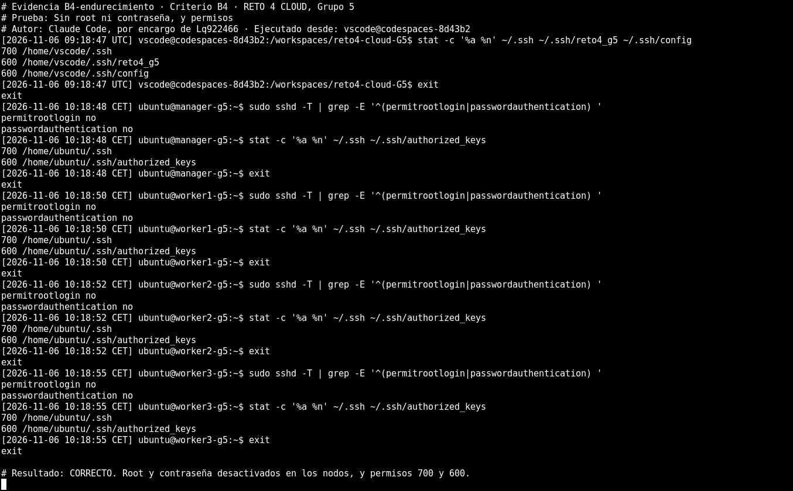

*Figura 20. Root y contraseña desactivados en los cuatro nodos, y permisos 700 y 600. Captura conforme, 6 de noviembre de 2026.*

### 2.5. Órdenes simultáneas, control total y copia de archivos

```bash
bash scripts/comprobar-ssh.sh                        # hostname, fecha y versión de Docker en los cuatro nodos a la vez.
sudo -n true && echo "permisos de sudo: correcto"     # Dentro de cada nodo.
```

[`comprobar-ssh.sh`](scripts/comprobar-ssh.sh) lanza cada conexión en segundo plano con `&` y espera a todas con `wait`: las órdenes se ejecutan **a la vez** y falla si falla cualquier nodo. `sudo -n` falla en lugar de pedir contraseña, así que demuestra el control total sin contraseña.


*Figura 21. La misma orden se ejecuta a la vez en los cuatro nodos, y `sudo` funciona en todos. Captura conforme, 6 de noviembre de 2026.*

Para copiar archivos se usa `scp`, que va por el mismo canal cifrado y usa los mismos alias, incluido el salto. Si el SHA-256 coincide en los dos extremos, la copia es idéntica:

```bash
d=$(mktemp -d); scp -q worker1-g5:/etc/hostname "$d/copia"; sha256sum "$d/copia"   # En el Codespace.
sha256sum /etc/hostname                                                            # En worker1-g5.
```

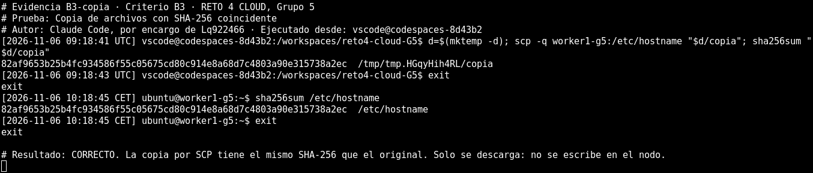

*Figura 22. La copia por SCP tiene el mismo SHA-256 que el original. La captura solo descarga, para no escribir en el nodo; la subida se comprobó el 4 de noviembre ([registro](evidencias/prototipo/fase2-3.txt)). Captura conforme, 6 de noviembre de 2026.*

### 2.6. Acceso de cada integrante desde su equipo

**Procedimiento.** Para demostrar que cada integrante entra con su propia clave, debe conectarse desde su equipo a los cuatro nodos ([procedimiento completo](entrega/PROCEDIMIENTO-CLAVES.md), para Linux, WSL, Git Bash y Windows):

1. Obtiene su IP pública (`curl -s https://checkip.amazonaws.com`) y, con autorización, se añade una regla temporal `/32` en `ssh_additional_cidrs`.
2. Configura su `~/.ssh/config` como en el apartado [2.2](#22-archivo-config-y-nombres-cortos-b2), con su clave en `IdentityFile`.
3. Entra en los cuatro nodos, ejecuta `whoami`, `hostname` y `date -Is`, y hace la captura con el comentario de la norma.
4. Al terminar todos, se retira la regla temporal.

El servidor registra en `/var/log/auth.log` la huella de la clave aceptada, así que se puede demostrar **desde el nodo** quién entró, de forma independiente de la captura del integrante.

**Comprobación.** La regla temporal `88.14.93.201/32` está abierta desde el 9 de noviembre. Ese día:

| Integrante | manager-g5 | worker1-g5 | worker2-g5 | worker3-g5 |
| --- | --- | --- | --- | --- |
| Cristina | Demostrado | Demostrado | Demostrado | Demostrado |
| Enrique, Alexandra e Ibai | Demostrado | Pendiente | Pendiente | Pendiente |

«Demostrado» significa que hay captura del integrante y que el nodo registra el acceso con la huella de su clave. Enrique, Alexandra e Ibai entraron desde PowerShell con `ssh -i`; Cristina usó un archivo `config` y entró en los workers por salto, tras comprobar la huella de cada servidor. Ningún nodo registra fallos de autenticación.


*Figura 23. Enrique entra en manager-g5 con su clave `enrique_reto4` desde PowerShell. Captura de Enrique, 9 de noviembre de 2026, sin el comentario de la norma.*


*Figura 24. Alexandra entra en manager-g5 con su clave `alexandra_reto4`. Captura de Alexandra, 9 de noviembre de 2026, sin el comentario de la norma.*


*Figura 25. Ibai entra en manager-g5 con su clave `ibai_reto4`. Captura de Ibai, 9 de noviembre de 2026, sin el comentario de la norma.*

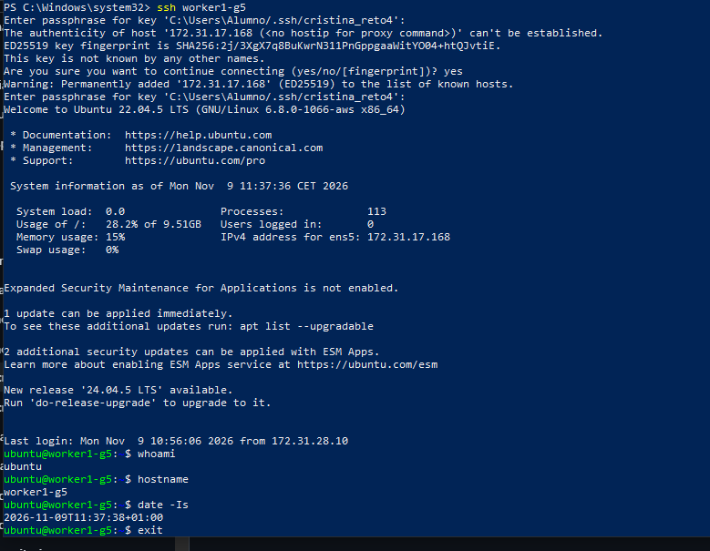

*Figura 26. Cristina entra en worker1-g5 por salto, con su clave. Captura de Cristina, 9 de noviembre de 2026, sin el comentario de la norma. También hay capturas de [manager-g5](evidencias/capturas-integrantes/B1-acceso-cristina-manager.png), [worker2-g5](evidencias/capturas-integrantes/B1-acceso-cristina-worker2.png), [worker3-g5](evidencias/capturas-integrantes/B1-acceso-cristina-worker3.png) y del [alias con su clave](evidencias/capturas-integrantes/B1-cristina-config-alias.png).*

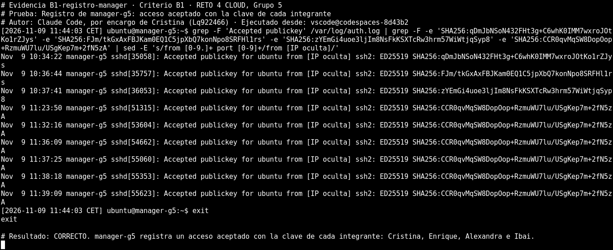

*Figura 27. CORRECTO: manager-g5 registra un acceso aceptado con la clave de cada integrante. Captura conforme, 9 de noviembre de 2026.*


*Figura 28. CORRECTO: los cuatro nodos registran un acceso aceptado con la clave de Cristina. Captura conforme, 9 de noviembre de 2026.*

**Límites.** Las capturas de los integrantes muestran el prompt y la fecha, pero no el comentario de la norma; además, los cuatro usaron el perfil de Windows `C:\Users\Alumno`, y no se puede saber si fue un equipo o varios del aula.

> **Evidencia pendiente:** acceso de Enrique, Alexandra e Ibai a los tres workers, con capturas comentadas; capturas `B1-registro-enrique`, `B1-registro-alexandra` y `B1-registro-ibai`; y retirada autorizada de la regla temporal.

### 2.7. Incidencias registradas

- **I2.1. Pérdida del SSH al cambiar la IP pública del Codespace** · resuelta, se repitió tres veces. *Problema:* `ssh: connect to host IP_DEL_MANAGER port 22: Connection timed out`, mientras la web seguía respondiendo. *Diagnóstico:* la IP de salida del Codespace no es fija; `comprobar-laboratorio.sh` mostró, por ejemplo, que la regla admitía `172.166.151.115/32` y el Codespace salía por `172.166.151.114`. *Solución:* con autorización, **añadir** la regla nueva, comprobar el SSH y solo entonces **retirar** la antigua, para no perder nunca el acceso:

  ```bash
  aws ec2 authorize-security-group-ingress --region us-east-1 --group-id sg-0c12ecd538a29f8d6 --protocol tcp --port 22 --cidr IP_NUEVA/32
  bash scripts/comprobar-ssh.sh
  aws ec2 revoke-security-group-ingress --region us-east-1 --group-id sg-0c12ecd538a29f8d6 --protocol tcp --port 22 --cidr IP_ANTIGUA/32
  bash scripts/actualizar-ips.sh
  ```

  *Resultado:* los cuatro nodos respondieron tras cada sustitución ([6](evidencias/auditoria/registro-2026-11-06.txt) y [9 de noviembre](evidencias/auditoria/registro-2026-11-09-b1.txt)).
- **I2.2. Los alias apuntaban a la IP anterior del manager** · resuelta con un procedimiento. *Problema:* tras cada reinicio, `ssh manager-g5` intentaba conectar con una IP antigua. *Diagnóstico:* `ssh -G manager-g5 | grep hostname` frente a la IP de EC2. *Solución:* `actualizar-ips.sh` regenera los alias, y `HostKeyAlias` evita volver a aceptar la huella. *Resultado:* `comprobar-ssh.sh` responde en los cuatro nodos.
- **I2.3. La clave pública de Cristina tenía un salto de línea de Windows** · resuelta. *Problema:* el archivo terminaba en `CRLF`, y con ese `\r` no cumplía el formato de una línea que exigen el script y la validación de Terraform. *Diagnóstico:* comprobación de solo lectura antes de instalarla. *Solución:* retirar el `\r` sin tocar la clave. *Resultado:* la huella siguió siendo `SHA256:CCR0qvMq…` y la clave se instaló en los cuatro nodos.

### 2.8. Resultado y conclusión

Con la clave del Codespace, el acceso permite la administración remota: nombres cortos (B2), workers por IP privada con salto (B5), órdenes simultáneas con `sudo` y copia SCP verificada (B3), y root y contraseña desactivados con permisos 700 y 600 (B4). Las claves de los cuatro integrantes están en los cuatro nodos y Cristina entró con la suya en todos. **B1 sigue parcial:** Enrique, Alexandra e Ibai solo han entrado en manager-g5, sus capturas no tienen el comentario de la norma, falta `B1-repositorio` y hay que aclarar `vockey` con el profesor.


## Fase 3 — Docker Swarm

**Objetivo.** Formar un clúster Docker Swarm con los cuatro nodos comunicados por IP privada, crear una red ingress overlay propia con MTU 1450 y una overlay para el servicio, y comprobar que los cuatro nodos están activos con el manager como líder.

### 3.1. Docker y conectividad por IP privada

Docker lo instala el script de arranque (apartado [1.9](#19-script-de-arranque-a4)). Desde manager-g5:

```bash
docker --version
for ip in 172.31.17.168 172.31.29.192 172.31.31.183; do ping -c 2 -W 2 $ip | tail -n 3; done
```

El ICMP solo se admite desde el propio grupo de seguridad, así que este `ping` también comprueba esa regla. Los cuatro nodos usan Docker 29.1.3: en un clúster conviene la misma versión en todos.

**Comprobación.** El 4 de noviembre se hicieron los 16 `ping` entre todos los pares de nodos, con 0 % de pérdida ([registro](evidencias/prototipo/fase2-3.txt)).


*Figura 29. Docker funciona y el `ping` por IP privada no pierde paquetes. Captura conforme, 6 de noviembre de 2026.*

### 3.2. Inicialización del clúster por IP privada

[`formar-swarm.sh`](scripts/formar-swarm.sh) se ejecuta una vez desde el Codespace. Sus órdenes principales:

```bash
manager_ip=$(terraform -chdir=terraform output -json nodes | jq -er '."manager-g5".private_ip')
ssh manager-g5 docker swarm init --advertise-addr "$manager_ip"
token=$(ssh manager-g5 docker swarm join-token -q worker)
printf '%s\n' "$token" | ssh workerN-g5 "read -r token && docker swarm join --token \"\$token\" '$manager_ip:2377'"
ssh manager-g5 docker node ls
```

**Explicación.**

- `--advertise-addr` fija la dirección que el manager anuncia: la **IP privada**, 172.31.28.10. Con la pública, el clúster se rompería al reiniciar el laboratorio.
- El token de unión (`SWMTKN-…`) es una credencial. El script comprueba su formato, lo pasa por la entrada estándar para que no aparezca en la lista de procesos y lo borra con `unset` al terminar.
- Antes de cada paso consulta `docker info`, así que se puede repetir sin rehacer lo ya hecho.
- Swarm usa el 2377/TCP para la gestión, el 7946/TCP y UDP para el estado de los nodos y el 4789/UDP para las overlay (VXLAN).

**Comprobación.** Los tres workers respondieron `This node joined a swarm as a worker`, y `docker info` muestra `NodeAddr=172.31.28.10`.

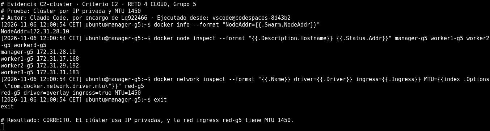

*Figura 30. El clúster usa IP privadas y la red ingress `red-g5` tiene MTU 1450. Captura conforme, 6 de noviembre de 2026.*

### 3.3. Redes internas del clúster

[`configurar-red-swarm.sh`](scripts/configurar-red-swarm.sh) se ejecuta en el manager antes de publicar el primer servicio:

```bash
printf 'y\n' | docker network rm ingress
docker network create --driver overlay --ingress --opt com.docker.network.driver.mtu=1450 red-g5
docker network create --driver overlay --opt com.docker.network.driver.mtu=1450 red-app-g5
docker network inspect --format '{{.Name}} {{.Driver}} {{.Ingress}} {{index .Options "com.docker.network.driver.mtu"}}' red-g5 red-app-g5
```

**Explicación.**

- Una **red overlay** se extiende por todos los nodos: los contenedores se comunican como en una misma red, encapsulados en VXLAN.
- La **red ingress** es la overlay del *routing mesh*: recibe el tráfico de un puerto publicado en cualquier nodo y lo reparte entre las réplicas. Se sustituye la de Docker por `red-g5` porque la Guía pide una personalizada; solo puede haber una y no se cambia con servicios publicados.
- `red-app-g5` es la overlay propia del servicio web (C4).
- **MTU 1450:** la red de AWS usa 1500 bytes y VXLAN añade 50. Así el paquete cabe sin fragmentarse, lo que según la Guía evita «cuelgues o lentitud».

**Comprobación.** Salida: `red-g5 overlay ingress=true MTU=1450` y `red-app-g5 overlay ingress=false MTU=1450`. Dentro de los contenedores, las interfaces miden 1400 (medido en manager-g5 y worker3-g5); la diferencia coincide con la cabecera VXLAN, pero no se ha confirmado la causa. Conviene confirmar con el profesor que la Guía se refiere al valor de la red, que es el configurado.


*Figura 31. Existe la red overlay propia `red-app-g5`, con MTU 1450. Captura conforme, 6 de noviembre de 2026.*

### 3.4. Validación de los nodos y de sus roles

**Procedimiento.** Para este proyecto se decidió cuatro nodos activos, con el manager como líder y tres workers. La prueba E8 (apartado [5.9](#59-e8-elección-de-un-nuevo-líder)) obliga a promover temporalmente dos workers a managers, así que después hay que devolver el clúster a esa topología.

**Explicación.** Los managers deciden por mayoría con **Raft**. Con un solo manager, si cae, los contenedores siguen sirviendo la web pero nadie puede gestionar el clúster; con tres, la mayoría es dos y se tolera la caída de uno. Por eso la Guía pide un manager en funcionamiento normal y la promoción de dos workers solo para E8. En `docker node ls`, `STATUS` (`Ready` o `Down`) indica si el nodo se comunica, `AVAILABILITY` (`Active` o `Drain`) si admite tareas y `MANAGER STATUS` (`Leader`, `Reachable` o vacío) su papel.

**Historia de los roles.** El clúster se formó con un manager líder y tres workers. Para E8 se promovieron worker1-g5 y worker2-g5, y siguieron como managers; con tres managers, el líder cambió con la prueba y con los reinicios del laboratorio. El 6 de noviembre la captura conforme de C3 dio **NO CORRECTO**. El 9 de noviembre, con autorización de Cristina, Codex devolvió el clúster a la topología prevista.

**Cómo se corrigió.** Se bajan los dos managers de uno en uno, **primero el que no es líder**, para no dejar nunca el clúster sin mayoría:

```bash
docker node ls                     # Antes: tres managers. Ese día el líder era worker1-g5.
docker node demote worker2-g5      # 1. El manager que no es líder.
docker node ls                     # Dos managers Reachable y cuatro nodos Ready/Active.
docker node demote worker1-g5      # 2. El líder. El liderazgo pasa a manager-g5.
docker node ls                     # Comprobar sin repetir nada, aunque la orden anterior dé un error.
```

**Comprobación.** Salida de `docker node ls` tras la corrección, del registro de sesión de Codex:

```text
ID                            HOSTNAME     STATUS    AVAILABILITY   MANAGER STATUS   ENGINE VERSION
xf46ytyuxo4bvn8lbxixhfhtv *   manager-g5   Ready     Active         Leader           29.1.3
m69w5hsyyyegwivfhoi8fbihd     worker1-g5   Ready     Active                          29.1.3
7zff6zyro5ir31bz19ozwmt4q     worker2-g5   Ready     Active                          29.1.3
ci4mgenau4xvzypqk3ljka8fi     worker3-g5   Ready     Active                          29.1.3
```

El servicio siguió en 4/4, con una réplica por nodo, y una sonda en las cuatro IP registró **100 muestras correctas y ningún fallo**. Después, `comprobar-laboratorio.sh` y `verificar-despliegue.sh` confirmaron el mismo estado y HTTP 200 en las cuatro IP.


*Figura 32. Listado de nodos **anterior a la corrección**. NO CORRECTO: los cuatro nodos están activos y manager-g5 es el líder, pero worker1-g5 y worker2-g5 siguen siendo managers tras E8. Captura conforme, 6 de noviembre de 2026.*

> **Evidencia pendiente:** nueva captura `C3-nodos` (`capturas-norma.py --solo '^C3-nodos$'`) con manager-g5 como único `Leader` y tres workers `Ready/Active`. La corrección no está en un registro versionado y el laboratorio se ha reiniciado después.

### 3.5. Incidencias registradas

- **I3.1. Docker pedía confirmación al retirar la red `ingress`** · resuelta. *Problema:* `configurar-red-swarm.sh` falló al crear `red-g5` con `AlreadyExists`. *Diagnóstico:* `docker network ls` seguía mostrando `ingress`: `docker network rm ingress` espera una confirmación y nadie respondió. *Solución:* `printf 'y\n' | docker network rm ingress`. *Resultado:* `red-g5` se creó con `ingress=true` y MTU 1450 ([registro](evidencias/prototipo/fase2-3.txt)).
- **I3.2. Tres managers y líder cambiante tras E8** · resuelta; falta la captura conforme. *Problema:* `docker node ls` mostraba tres managers, y el líder fue worker1-g5, manager-g5, worker2-g5 y de nuevo worker1-g5 según el día. *Diagnóstico:* worker1-g5 y worker2-g5 no se bajaron tras E8, y Raft elige líder nuevo cuando el anterior se reinicia; `comprobar-laboratorio.sh` rechaza desde el 9 de noviembre más de un manager. *Solución:* los dos `demote` del apartado [3.4](#34-validación-de-los-nodos-y-de-sus-roles-c3). *Resultado:* manager-g5 único líder, servicio 4/4 y 100 muestras correctas.
- **I3.3. La comprobación automática falló durante el cambio de líder** · resuelta. *Problema:* tras `docker node demote worker1-g5`, Docker respondió que lo había bajado, pero la comprobación terminó con `AssertionError`. *Diagnóstico:* se comprobó mientras el liderazgo pasaba a manager-g5; `docker node ls` y `docker node inspect`, **sin repetir** el `demote`, mostraron la topología correcta. *Solución:* ninguna orden adicional. *Resultado:* lección aprendida: tras bajar al líder hay que esperar y consultar, nunca repetir la orden.

### 3.6. Resultado y conclusión

El clúster se formó por IP privada con los cuatro nodos. La red ingress es `red-g5`, personalizada y con MTU 1450, y el servicio usa la overlay `red-app-g5`, también con MTU 1450. Tras E8, el 9 de noviembre el clúster volvió a la topología prevista, con manager-g5 como único manager y líder, sin interrumpir la web.


## Fase 4 — Despliegue web

**Objetivo.** Empaquetar la web del Gran Premio de Euskadi en una imagen propia, publicarla en Docker Hub en las versiones 1.0 y 2.0 y desplegarla en Swarm como un servicio de cuatro réplicas en el puerto 80, conectado a la red del grupo y accesible desde la IP pública de cualquiera de los cuatro nodos.

### 4.1. La web y su imagen con Nginx

**Procedimiento.** La web definitiva, en [`app/f1`](app/f1), tiene cinco páginas (`index.html`, `entradas.html`, `sorteo.html`, `acceso.html` y `contacto.html`) con su CSS, su JavaScript y sus imágenes; llegó como un ZIP del grupo y sus autores no constan en Git. Es **estática**: sin base de datos ni código en el servidor, cualquier réplica puede responder cualquier petición, y por eso se puede repartir la carga. Las primeras pruebas usaron un portal provisional ([`app/sitio`](app/sitio)).

**Procedimiento.** [`app/Dockerfile`](app/Dockerfile):

```dockerfile
FROM nginx:alpine
ARG WEB_VERSION
COPY sitio/ /usr/share/nginx/html/
RUN test -s /usr/share/nginx/html/index.html && \
    printf 'version=%s\n' "$WEB_VERSION" > /etc/reto4-version
COPY 40-identidad.sh /docker-entrypoint.d/40-identidad.sh
RUN chmod 0755 /docker-entrypoint.d/40-identidad.sh
HEALTHCHECK --interval=5s --timeout=2s --retries=3 CMD wget -q -O /dev/null http://127.0.0.1/identidad.txt || exit 1
```

`nginx:alpine` sirve los archivos por el puerto 80 con una imagen pequeña; `WEB_VERSION` (1.0 o 2.0) se fija al construir y queda guardada en la imagen, y la construcción falla si no hay `index.html`. El `HEALTHCHECK` comprueba cada 5 segundos que Nginx responde, y Swarm sustituye las réplicas que no están sanas. Al arrancar, la imagen oficial de Nginx ejecuta [`40-identidad.sh`](app/40-identidad.sh), que genera `/identidad.txt` con la versión y el nombre del contenedor (por ejemplo, `version=1.0` y `contenedor=0ec98a04e2fe`). Como el nombre es distinto en cada réplica, no puede ir dentro de la imagen; con él se sabe qué réplica responde, que es lo que pide D1 («imagen propia que identifica el contenedor») y lo que usan las sondas y E1.

### 4.2. Versiones 1.0 y 2.0 y construcción en un nodo

**Procedimiento.** Docker no funciona dentro del Codespace (incidencia [I4.1](#46-incidencias-reales-y-soluciones)), así que [`preparar-imagenes.sh`](scripts/preparar-imagenes.sh) copia a manager-g5 lo necesario de `app/` y llama allí a [`construir-f1.sh`](app/construir-f1.sh) para cada versión:

```bash
bash scripts/preparar-imagenes.sh config/ssh.local manager-g5 reto4-g5/f1-definitiva
# En el manager, para cada versión:
cp -R app/f1/. "$release/"                        # Copia temporal: app/f1 no se modifica.
cp app/f1-release/estado-cloud.html "$release/"   # Solo en la 2.0.
docker build --build-arg "WEB_VERSION=$VERSION" --tag "$IMAGEN:$VERSION" "$contexto"
```

Las dos versiones comparten la web, y la portada muestra su número. **La 2.0** añade [`estado-cloud.html`](app/f1-release/estado-cloud.html), que muestra la versión y la réplica que responde: basta para ver a simple vista la actualización y el rollback de E7. [`construir.sh`](app/construir.sh) usa un contexto temporal con solo lo necesario y rechaza enlaces simbólicos y archivos con apariencia de secreto, para que nunca acaben en la imagen.

**Comprobación.** La comprobación previa de la web dio 5 páginas, 30 archivos y 0 errores, y se obtuvieron dos imágenes de unos 30 MB. Cada versión se probó con un navegador en un contenedor temporal sin puertos publicados, sin tocar el servicio: [construcción](evidencias/D1-imagenes-definitivas.txt), [navegador](evidencias/D1-navegador-registro.txt) y capturas de la [1.0](evidencias/D1-navegador-1.0.png) y la [2.0](evidencias/D1-navegador-2.0.png).

### 4.3. Publicación en Docker Hub y descarga anónima

**Procedimiento.**

```bash
ssh -t -F config/ssh.local manager-g5 docker login -u innnx          # Cristina escribe el token de forma interactiva.
bash scripts/publicar-imagenes.sh config/ssh.local innnx/reto4-f1     # Etiqueta, publica y cierra la sesión.
bash scripts/comprobar-descarga.sh config/ssh.local innnx/reto4-f1    # Descarga sin sesión en los tres workers.
```

`docker login` es interactivo (`-t`) para que el token no quede en ningún script ni registro. [`publicar-imagenes.sh`](scripts/publicar-imagenes.sh) etiqueta `innnx/reto4-f1:1.0` y `:2.0`, las sube y ejecuta siempre `docker logout`. [`comprobar-descarga.sh`](scripts/comprobar-descarga.sh) descarga las dos etiquetas en los workers **sin iniciar sesión**, lo que demuestra que el repositorio es público y que cualquier nodo puede crear réplicas, y compara el *digest* (resumen SHA-256 del contenido publicado) con lo construido.

**Comprobación.** Los tres workers descargaron ambas etiquetas con el mismo digest y el mismo contenido ([publicación](evidencias/D1-publicacion-dockerhub.txt), [descarga](evidencias/D1-descarga-dockerhub.txt) y [vista web](evidencias/D1-dockerhub-etiquetas.png)):

| Etiqueta | Digest |
| --- | --- |
| 1.0 | `sha256:622d83436cb97412b761ca8cd8d6b8e6c4940f4682a7f6fb6940921d599362ca` |
| 2.0 | `sha256:1736eda0abd63aa0ac538b1a9c11bfdb4f64dc1d36c7687cd7be9a52d2cc76f7` |

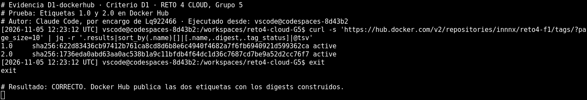

*Figura 33. Docker Hub publica las etiquetas 1.0 y 2.0 con los digests construidos. Captura conforme, 5 de noviembre de 2026.*

### 4.4. Despliegue con `stack.yml`

**Procedimiento.**

```bash
bash scripts/desplegar-f1.sh config/ssh.local innnx/reto4-f1 evidencias/F3-despliegue
# En el manager, app/desplegar.sh ejecuta:
export WEB_IMAGE=innnx/reto4-f1:1.0
docker stack deploy --compose-file stack.yml reto4
```

[`app/stack.yml`](app/stack.yml):

```yaml
services:
  web:
    image: "${WEB_IMAGE}"
    ports:
      - target: 80
        published: 80
        protocol: tcp
        mode: ingress
    networks:
      - red-app-g5
    deploy:
      replicas: 4
      restart_policy:
        condition: any
      update_config:
        parallelism: 1
        order: start-first
        failure_action: rollback
      rollback_config:
        parallelism: 1
        order: start-first
networks:
  red-app-g5:
    external: true
```

**Explicación.** La imagen se elige al desplegar con `WEB_IMAGE`. El puerto 80 se publica en modo `ingress`, es decir, en **todos** los nodos, y el routing mesh lo envía a cualquier réplica. El servicio se conecta a `red-app-g5`, creada en la Fase 3 (`external: true`). Swarm mantiene cuatro réplicas y sustituye cualquier contenedor que termine (`condition: any`, la base de E3). Las actualizaciones cambian una réplica cada vez, arrancan la nueva antes de retirar la antigua (`start-first`) y vuelven atrás solas si fallan; el rollback sigue las mismas reglas. `docker stack deploy` crea el servicio `reto4_web`. [`desplegar-f1.sh`](scripts/desplegar-f1.sh) mantiene sondas durante el despliegue, espera a que converja, comprueba que **cada tarea** usa la imagen de Docker Hub y recorre la web con un navegador.

**Observación.** La Guía llama «red del grupo» a `red-gX`, que define como la red ingress personalizada. Aquí `red-g5` es esa red ingress, y el servicio se conecta además a una overlay propia, `red-app-g5`, que es la que pide C4. El puerto 80 entra siempre por `red-g5`.

**Comprobación.** El 5 de noviembre, el servicio pasó del portal provisional a la web definitiva, `innnx/reto4-f1:1.0`, en 4/4: HTTP 200 en las cuatro IP, 5 páginas sin errores en el navegador y **328 muestras correctas y 0 fallos** en las sondas durante todo el cambio ([registro](evidencias/F3-despliegue/registro.txt)).


*Figura 34. El servicio tiene cuatro réplicas, la red del grupo y política de reinicio. Captura conforme, 6 de noviembre de 2026.*

### 4.5. Acceso por la IP pública de los cuatro nodos

**Procedimiento.**

```bash
aws ec2 describe-instances --region us-east-1 \
  --filters 'Name=tag:Name,Values=manager-g5,worker?-g5' 'Name=instance-state-name,Values=running' \
  --query 'Reservations[].Instances[].[Tags[?Key==`Name`]|[0].Value,PublicIpAddress]' --output text
curl -s -o /dev/null -w '%{http_code}\n' http://IP_PUBLICA/     # 200 si responde.
curl -s http://IP_PUBLICA/identidad.txt                           # Versión y contenedor.
bash scripts/verificar-despliegue.sh config/ssh.local innnx/reto4-f1 1.0
```

En el navegador se abre `http://IP_PUBLICA/`, con `http://`, porque la web no usa HTTPS. Gracias al routing mesh, cualquier nodo acepta la conexión en el puerto 80 aunque no aloje ninguna réplica. El 8080 está abierto en el grupo de seguridad porque lo indica la Guía, pero la pila no lo publica. [`verificar-despliegue.sh`](scripts/verificar-despliegue.sh) comprueba, solo con lectura, las réplicas, la imagen de cada tarea `Running`, el HTTP de las cuatro IP y que respondan varios contenedores.

**Comprobación.** El 5 de noviembre la web definitiva cargó en un navegador gráfico real por las cuatro IP de ese día. El 9 de noviembre dio HTTP 200 y `version=1.0` en las cuatro IP ([registro](evidencias/auditoria/registro-2026-11-09.txt)), y tras corregir C3 `verificar-despliegue.sh` dio 4/4 con HTTP 200 (registro de sesión de Codex).

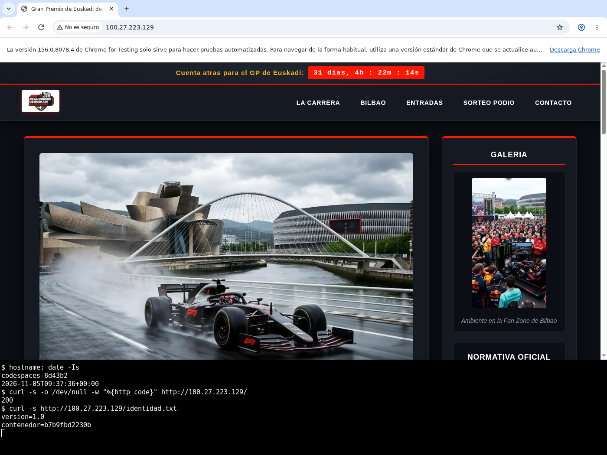

*Figura 35. Web definitiva por la IP pública de manager-g5, con la dirección visible, en un navegador gráfico real. Captura anterior de Claude Code, 5 de noviembre de 2026, sin el comentario de la norma. Capturas de [worker1-g5](evidencias/D3-navegador-worker1-g5.png), [worker2-g5](evidencias/D3-navegador-worker2-g5.png) y [worker3-g5](evidencias/D3-navegador-worker3-g5.png).*

> **Evidencia pendiente:** capturas D3 conformes, con comentario, por las cuatro IP del día de la corrección.

### 4.6. Incidencias registradas

- **I4.1. Docker no funciona dentro del Codespace** · resuelta con una alternativa. *Problema:* las órdenes `docker` fallaban en el Codespace. *Diagnóstico:* `docker info`: el contenedor del Codespace no tiene permisos para ejecutar el motor. *Solución:* construir y probar en manager-g5 con `preparar-imagenes.sh`. *Resultado:* las dos imágenes se construyeron y probaron ([registro](evidencias/D1-imagenes-definitivas.txt)).
- **I4.2. Docker Hub rechazó la primera publicación** · resuelta. *Problema:* `docker push` falló con `access token has insufficient scopes`. *Diagnóstico:* el token no tenía permiso de escritura ([registro](evidencias/D1-publicacion-intento-fallido.txt)). *Solución:* nueva sesión con un token de escritura. *Resultado:* las dos etiquetas se publicaron con los digests esperados.
- **I4.3. El portal provisional y la web definitiva respondían igual** · resuelta. *Problema:* ambas imágenes daban `version=1.0` en `identidad.txt`. *Diagnóstico:* `docker service ps reto4_web` mostraba imágenes distintas con la misma versión. *Solución:* la verificación comprueba la **imagen de cada tarea**, no solo la versión. *Resultado:* las cuatro tareas usaban `innnx/reto4-f1:1.0` ([registro](evidencias/F3-despliegue/registro.txt)).
- **I4.4. Enlaces rotos y una credencial de demostración en la web** · resuelta. *Problema:* cuatro páginas enlazaban a `#escuderias`, que no existía, y el JavaScript traía una credencial de demostración. *Diagnóstico:* [`comprobar-web.py`](scripts/comprobar-web.py) y revisión del código antes de versionarlo. *Solución:* destino `#escuderias` y validador de enlaces (commit `bcfceee`); la credencial se retiró antes del primer commit de la web. *Resultado:* 0 errores en 5 páginas y 30 archivos.

### 4.7. Resultado y conclusión

La web se empaqueta en una imagen propia sobre Nginx que identifica cada contenedor. Las versiones 1.0 y 2.0 están en `innnx/reto4-f1`, con los digests comprobados y descarga anónima desde los workers. La pila define cuatro réplicas en el puerto 80, en `red-app-g5`, con reinicio siempre y actualización y rollback progresivos. El despliegue se hizo sin fallos en las sondas, y la web respondió por las cuatro IP públicas el 5 y el 9 de noviembre.


## Fase 5 — Pruebas de orquestación

**Objetivo.** Demostrar lo que aporta Swarm frente a un servidor único: reparto de carga, escalado, autorreparación, comportamiento ante la caída de un worker y del líder, mantenimiento de nodos y actualización sin cortes con vuelta atrás. Las pruebas se documentan con capturas y registros antes, durante y después de las operaciones, junto con sondas HTTP periódicas.

### 5.1. Cómo se realizaron las pruebas

**Procedimiento.** Las pruebas que modifican el servicio se lanzan con scripts, siempre con autorización expresa, para que sean repetibles y dejen registro:

```bash
bash scripts/probar-orquestacion.sh config/ssh.local innnx/reto4-f1 evidencias/F4-E2 e2         # También e3 y e6.
bash scripts/probar-actualizacion.sh config/ssh.local innnx/reto4-f1 evidencias/F3-actualizacion # E7.
bash scripts/sondear-web.sh http://IP_PUBLICA/identidad.txt                                     # Una sonda suelta.
```

Cada script lee de EC2 las IP vigentes, arranca una sonda por IP con [`sondear-web.sh`](scripts/sondear-web.sh), ejecuta la operación en el manager, espera a que el servicio vuelva a su estado, comprueba el HTTP de las cuatro IP y recorre la web con un navegador, y resume todo en `registro.txt` junto con la salida de cada sonda y las capturas.

**Explicación.** La sonda pide `identidad.txt` **una vez por segundo y por IP**, con un límite de 0,9 s, y anota hora, resultado, versión y contenedor: es el «script que consulta la web cada segundo» de la Guía. [`lib-sondas.sh`](scripts/lib-sondas.sh) detiene la prueba si una IP acumula tres fallos seguidos, la sonda exige que la respuesta identifique versión y contenedor, y el resumen comprueba que cada sonda siguió viva hasta el final (incidencia [I5.4](#510-incidencias-reales-y-soluciones)). E1, E2, E3, E6 y E7 se hicieron primero con el portal provisional ([registro](evidencias/prototipo/fase4-5.txt)) y se repitieron con la web definitiva; este informe presenta esas repeticiones.

> **Evidencia pendiente (toda la fase):** capturas conformes antes, durante y después, con la sonda visible. `capturas-norma.py` las toma con la variable `SONDA` apuntando al registro de la sonda, mientras la persona autorizada ejecuta la prueba.

### 5.2. Distribución de las visitas entre servidores

```bash
for ip in $IPS; do for i in 1 2 3 4; do curl -s --max-time 5 http://$ip/identidad.txt; done; done
```

Cada petición abre una conexión TCP nueva, y el routing mesh (IPVS en la red ingress) reparte las conexiones entre las réplicas, sea cual sea la IP. Si responden contenedores distintos, el reparto funciona: es la evidencia de la Rúbrica, «respuestas distintas».

**Comprobación.** El 5 y el 6 de noviembre, cada IP fue respondida por los mismos cuatro contenedores. El 9 de noviembre, con 48 peticiones, cada IP repartió exactamente 3 peticiones a cada contenedor, y tras corregir C3 se repitió con el mismo resultado.


*Figura 36. Las peticiones por las cuatro IP reciben respuesta de contenedores distintos. Captura conforme, 6 de noviembre de 2026.*

### 5.3. Aumento y reducción de servidores web

```bash
docker service scale --detach=false reto4_web=8      # Después 12, 2 y vuelta a 4.
docker service ps --filter desired-state=running reto4_web
```

`docker service scale` cambia el número deseado de réplicas, y Swarm crea o elimina tareas y las reparte entre los nodos; `--detach=false` espera a que termine.

**Comprobación (5 de noviembre, web definitiva).** Reparto por nodo con HTTP 200 en las cuatro IP tras cada paso: 8/8 (2-2-2-2), 12/12 (3-3-3-3), 2/2 (manager-g5 y worker2-g5) y 4/4 (1-1-1-1). Con 2 réplicas, los nodos sin réplica siguieron respondiendo gracias al routing mesh. Las sondas registraron **562 muestras correctas y 2 tiempos de espera**, ambos al reducir de 12 a 2 (incidencia [I5.1](#510-incidencias-reales-y-soluciones)).

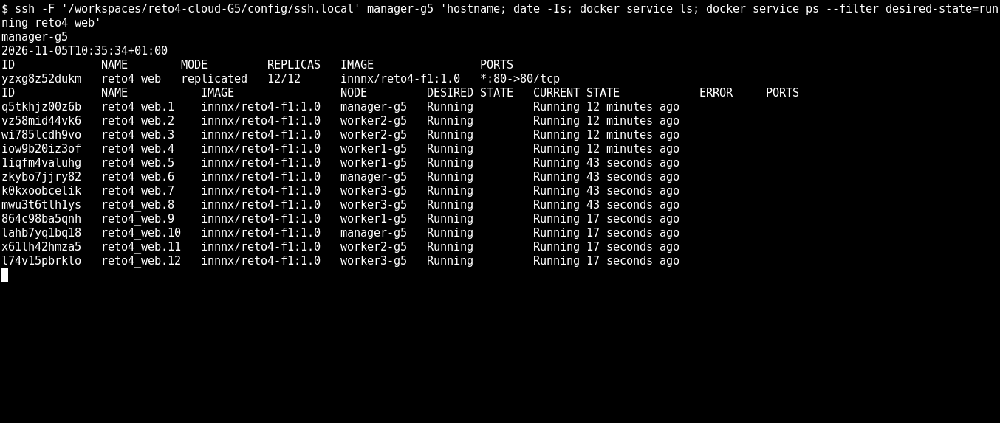

*Figura 37. Doce réplicas repartidas tres por nodo. Captura anterior de Claude Code, 5 de noviembre de 2026, sin el prompt ni el comentario de la norma. Estados [inicial](evidencias/F4-E2/terminal-e2-inicial-4.png), [8](evidencias/F4-E2/terminal-e2-escalado-8.png), [2](evidencias/F4-E2/terminal-e2-escalado-2.png) y [vuelta a 4](evidencias/F4-E2/terminal-e2-escalado-4.png), y [registro](evidencias/F4-E2/registro.txt).*

### 5.4. Recuperación automática de un contenedor

```bash
docker rm -f ID_DEL_CONTENEDOR                       # En el nodo de la tarea elegida; ese día, 223aad67af29 en manager-g5.
docker service ps --filter name=reto4_web.1 reto4_web
```

`docker rm -f` elimina el contenedor como si hubiera fallado. Swarm ve 3 réplicas donde debe haber 4, marca la tarea como fallida y crea otra, por la `restart_policy: condition: any` de la pila.

**Comprobación.** Swarm registró `non-zero exit (137)` (proceso terminado con `SIGKILL`) y creó una tarea nueva en el mismo nodo; en unos 15 segundos el servicio volvía a 4/4. Las sondas registraron **308 muestras correctas y 0 fallos** ([registro](evidencias/F4-E3/registro.txt)).

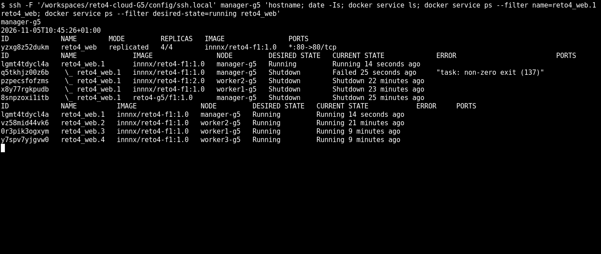

*Figura 38. La tarea eliminada aparece como fallida y otra la sustituye; el servicio vuelve a 4/4. Captura anterior de Claude Code, 5 de noviembre de 2026, sin el prompt ni el comentario de la norma. Estado [antes](evidencias/F4-E3/terminal-e3-antes.png).*

### 5.5. Prueba de fallo de un servidor

**Procedimiento.** Prueba histórica del 4 de noviembre, hecha con Codex y con el **portal provisional**, sobre worker3-g5:

```bash
aws ec2 stop-instances --region us-east-1 --instance-ids i-0446409b26cf0a662    # Detiene worker3-g5.
docker node ls; docker service ps reto4_web                                      # En el manager, durante la parada.
aws ec2 start-instances --region us-east-1 --instance-ids i-0446409b26cf0a662
```

Al detenerse, el nodo deja de enviar señales al manager y Swarm lo marca `Down`; sus tareas se crean en los nodos disponibles y el routing mesh deja de enviarle tráfico.

**Comprobación.** Durante la parada, EC2 informó `stopped`, Swarm marcó worker3-g5 `Down` y la réplica `reto4_web.1` pasó a manager-g5; el servicio mostró `5/4` de forma transitoria, hasta que Swarm confirmó la parada de la tarea antigua. La sonda registró **164 muestras correctas y 0 fallos**, y al volver el nodo quedó `Ready/Active` y el servicio en 4/4. [Registro](evidencias/E4-E5-E8-registro.txt), [estado durante la parada](evidencias/prototipo/E4-worker-down.txt), [sonda](evidencias/prototipo/E4-E5-http.txt) y [análisis](evidencias/auditoria/E4-E8.md).

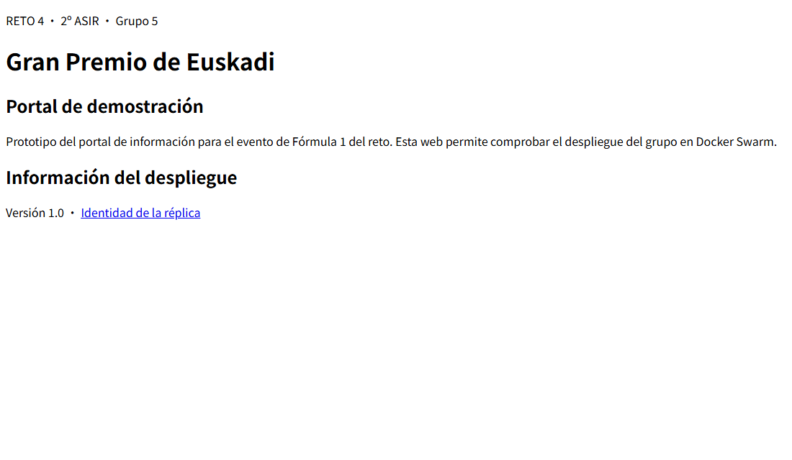

*Figura 39. Portal provisional respondiendo durante la parada de worker3-g5. Captura de Codex, 4 de noviembre de 2026. No muestra IP, hora ni estado del clúster.*

**Límites.** Se hizo con el portal provisional, no consta la URL sondeada y no hay capturas de la consola.

> **Evidencia pendiente:** repetir E4 con la web definitiva y capturas conformes antes, durante y después, según el [plan](entrega/PLAN-C3-E4-E8.md). Detiene una instancia, así que requiere autorización; es también la demostración de caída de nodo de la exposición.

### 5.6. Recuperación de servidores y reinicio del laboratorio

**Procedimiento.** La Rúbrica agrupa dos comprobaciones:

1. **Reincorporación y reequilibrio.** Al volver un nodo, queda `Ready/Active`, pero Swarm no mueve las tareas que ya funcionan. Se reparten de nuevo forzando una actualización réplica a réplica, con `start-first` y sin corte: `docker service update --quiet --detach --force reto4_web`.
2. **Reinicio del laboratorio.** Tras **End Lab** y **Start Lab**, [`verificar-e5.sh`](scripts/verificar-e5.sh) compara con una referencia previa los ID de instancia, volúmenes, controles, IP, SSH, Swarm, redes, réplicas y HTTP: `bash scripts/verificar-e5.sh ~/DIRECTORIO_PRIVADO_DE_RESPALDO`.

**Comprobación.**

- **Reequilibrio:** aplicado en E4 con el portal provisional y en E6 con la web definitiva ([reincorporación](evidencias/prototipo/E5-worker-recuperado.txt) y [reparto](evidencias/prototipo/E5-reparto.txt)).
- **Reinicio del 4 al 5 de noviembre:** mismos ID y volúmenes, controles `ok`, IP públicas nuevas, y SSH, Swarm, redes, 4/4 y HTTP correctos ([antes](evidencias/E5-verificacion-previa.txt) y [después](evidencias/E5-verificacion-final.txt)). Tras los reinicios del 6 y del 9, el clúster volvió solo con las mismas instancias y 4/4.
- **Reinicio del 10 de noviembre:** las salidas sincronizadas de Terraform muestran los mismos ID con IP públicas nuevas, pero **Swarm no se ha comprobado** después.

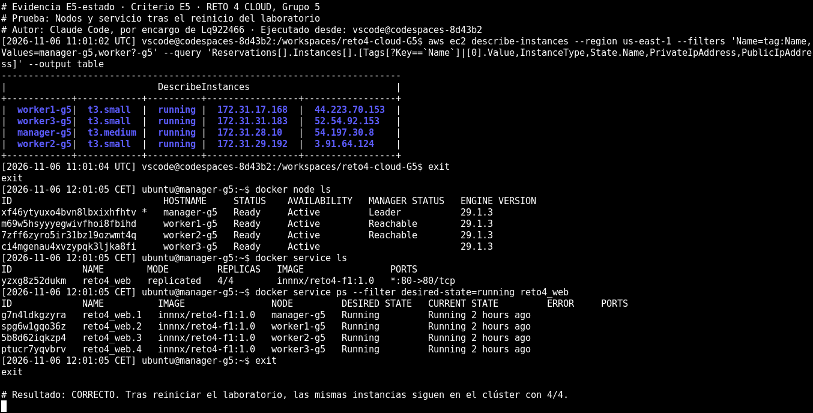

*Figura 40. Tras reiniciar el laboratorio, las mismas instancias siguen en el clúster con el servicio en 4/4 (anterior a la corrección de C3). Captura conforme, 6 de noviembre de 2026.*

### 5.7. Mantenimiento de un servidor

```bash
docker node update --availability drain worker3-g5
docker node update --availability active worker3-g5
docker service update --quiet --detach --force reto4_web
```

`drain` retira un nodo para mantenimiento: Swarm traslada sus tareas y deja de asignarle nuevas, pero el nodo sigue en el clúster. Al volver a `active`, Swarm no mueve las tareas existentes, por eso se fuerza el reequilibrio.

**Comprobación.** Con worker3-g5 en `Drain`, el reparto fue 1-1-2-0 y el servicio siguió en 4/4; tras volver a `Active` y forzar la actualización, quedó una réplica por nodo. Las sondas registraron **488 muestras correctas y 0 fallos** ([registro](evidencias/F4-E6/registro.txt)).


*Figura 41. Durante el mantenimiento: worker3-g5 en `Drain`, su tarea en worker2-g5 y el servicio en 4/4. Captura anterior de Claude Code, 5 de noviembre de 2026, sin el prompt ni el comentario de la norma. Estados [antes](evidencias/F4-E6/terminal-e6-antes.png), [tras volver a Active](evidencias/F4-E6/terminal-e6-active.png) y [tras el reequilibrio](evidencias/F4-E6/terminal-e6-despues-force.png).*

### 5.8. Actualización de la web y vuelta a la versión anterior

```bash
docker service update --quiet --detach=false --image innnx/reto4-f1:2.0 reto4_web
docker service rollback --quiet --detach=false reto4_web
```

Con `parallelism: 1` y `order: start-first`, Swarm arranca una réplica 2.0, espera a que esté en marcha y solo entonces retira una 1.0, hasta cambiar las cuatro: siempre hay réplicas sirviendo. `docker service rollback` vuelve a la configuración anterior con el mismo método, y si la actualización fallara, `failure_action: rollback` volvería atrás sola.

**Comprobación.** El 5 de noviembre, la actualización y el rollback terminaron en 4/4 con la versión esperada en las cuatro IP; el navegador recorrió 6 páginas en la 2.0 y 5 en la 1.0, sin errores, y la página de estado de la 2.0 mostró la versión y la réplica. Las sondas registraron **620 muestras correctas y 0 fallos**, con respuestas de las dos versiones mientras convivían ([registro](evidencias/F3-actualizacion/registro.txt)).


*Figura 42. Después de la actualización, el pie de la portada muestra «Versión 2.0» y el enlace a la página de estado. Captura anterior de Claude Code, 5 de noviembre de 2026, sin la dirección ni el comentario de la norma.*


*Figura 43. Después del rollback, la portada vuelve a la versión 1.0. Captura anterior de Claude Code, 5 de noviembre de 2026, sin la dirección ni el comentario de la norma.*


*Figura 44. Historial de `reto4_web`: tareas 2.0 en `Shutdown` y tareas 1.0 en `Running` tras el rollback. Captura anterior de Claude Code, 5 de noviembre de 2026, sin el prompt ni el comentario de la norma.*

> **Evidencia pendiente:** captura conforme **durante** la actualización, con la sonda mostrando las dos versiones y el navegador.

### 5.9. Sustitución del servidor principal

**Procedimiento.** Prueba histórica del 4 de noviembre, hecha con Codex y con el **portal provisional**:

```bash
docker node promote worker1-g5 worker2-g5                                       # En manager-g5: tres managers.
aws ec2 stop-instances --region us-east-1 --instance-ids i-0e6ebf2af63facc60     # Detiene solo el líder.
docker node ls                                                                  # Desde worker1-g5, otro manager.
aws ec2 start-instances --region us-east-1 --instance-ids i-0e6ebf2af63facc60
```

Con tres managers, la mayoría de Raft es dos: si cae el líder, los otros dos eligen uno nuevo. El listado se hace «desde otro» manager, como pide la Rúbrica, porque el líder caído no puede responder.

**Comprobación.** Extractos de `docker node ls` desde worker1-g5 ([registro](evidencias/E8-eleccion-registro.txt)):

```text
ANTES
xf46ytyuxo4bvn8lbxixhfhtv     manager-g5   Ready     Active         Leader           29.1.3
m69w5hsyyyegwivfhoi8fbihd *   worker1-g5   Ready     Active         Reachable        29.1.3
7zff6zyro5ir31bz19ozwmt4q     worker2-g5   Ready     Active         Reachable        29.1.3

DESPUÉS DE LA PARADA Y LA REINCORPORACIÓN
xf46ytyuxo4bvn8lbxixhfhtv     manager-g5   Ready     Active         Reachable        29.1.3
m69w5hsyyyegwivfhoi8fbihd *   worker1-g5   Ready     Active         Reachable        29.1.3
7zff6zyro5ir31bz19ozwmt4q     worker2-g5   Ready     Active         Leader           29.1.3
```

El liderazgo pasó a **worker2-g5**, el servicio siguió en 4/4 y manager-g5 volvió como `Reachable`, con una IP pública nueva. La sonda registró 38 muestras correctas antes de la parada y 130 después, con **34 segundos sin muestras** entre ambos tramos (incidencia [I5.2](#510-incidencias-reales-y-soluciones)).

**Límites.** No hay ningún `docker node ls` tomado **durante** la parada: la elección se demuestra comparando antes y después. La parada se deduce del cambio de IP pública del manager, porque el registro no contiene `stopped`, y no consta la URL sondeada. Las capturas web de [durante](evidencias/E8-web-parada.png) y [después](evidencias/E8-web-recuperado.png) no muestran IP, hora ni estado del clúster. [Análisis completo](evidencias/auditoria/E4-E8.md). Esta prueba dejó tres managers, que se corrigieron el 9 de noviembre (apartado [3.4](#34-validación-de-los-nodos-y-de-sus-roles-c3)).

> **Evidencia pendiente:** repetir E8 con la web definitiva, una sonda continua y una captura conforme de `docker node ls` desde otro manager **durante** la parada, y volver después a un solo manager. Requiere autorización.

### 5.10. Incidencias registradas

- **I5.1. Dos tiempos de espera durante el escalado (E2)** · causa no determinada; no se repitió. *Problema:* al reducir de 12 a 2 réplicas, una muestra de la sonda de worker1-g5 y otra de la de worker3-g5 superaron 0,9 s en el mismo segundo; las muestras anterior y siguiente fueron correctas. *Diagnóstico:* resumen de las sondas en el [registro](evidencias/F4-E2/registro.txt), que termina con `exit=1`; coincide con la retirada de diez réplicas, pero no hay datos para demostrar la causa. *Solución:* no se ocultaron y se definió un criterio de supervisión: detener la prueba con tres fallos seguidos en una IP, si no se recuperan las réplicas o si una IP sigue fallando al terminar. *Resultado:* E3, E6 y E7 terminaron con 0 fallos; E2 no se presenta como prueba sin fallos.
- **I5.2. Treinta y cuatro segundos sin muestras en E8** · pendiente. *Problema:* la sonda de E8 tiene dos tramos separados por 34 segundos, justo durante la parada del líder. *Diagnóstico:* comparación de la última muestra del [primer tramo](evidencias/prototipo/E8-http.txt) con la primera del [segundo](evidencias/prototipo/E8-http-recuperacion.txt); no consta por qué se interrumpió. *Solución:* solo la repetición de E8 con una sonda continua puede cerrarlo. *Resultado:* la elección del nuevo líder está demostrada; la disponibilidad durante esos 34 segundos, no.
- **I5.3. Reparto desigual tras el despliegue y el rollback** · resuelta. *Problema:* una réplica en manager-g5, otra en worker1-g5, dos en worker2-g5 y ninguna en worker3-g5. *Diagnóstico:* `docker service ps --filter desired-state=running --format '{{.Node}}' reto4_web | sort | uniq -c` ([estado](evidencias/F3-estado-final.txt)); Swarm no mueve tareas que funcionan. *Solución:* `docker service update --force reto4_web`, dentro de E6. *Resultado:* una réplica por nodo.
- **I5.4. Las comprobaciones podían dar falsos positivos** · resuelta. *Problema:* la sonda aceptaba cualquier HTTP 200, aunque fuera una página de error; una sonda muerta con su última muestra correcta no se detectaba; y `verificar-despliegue.sh` aceptaba tareas no `Running` o respuestas de un solo contenedor. *Diagnóstico:* revisión del código con datos simulados. *Solución:* commit `9dab86d`: la sonda exige `version=1.0|2.0` y `contenedor=…`, el resumen comprueba que cada sonda sigue viva y la verificación exige tareas `Running` y varios contenedores, con pruebas automáticas. *Resultado:* las 29 pruebas pasan, y las **2306 muestras correctas** anteriores de despliegue, E2, E3, E6 y E7 contienen todas versión y contenedor, así que siguen siendo válidas.

La verificación de E5 que se detuvo por credenciales revocadas se explica en la incidencia [I1.1](#115-incidencias-reales-y-soluciones).

### 5.11. Resultado y conclusión

| Prueba | Resultado | Muestras de la sonda |
| --- | --- | --- |
| E1 Balanceo | Contenedores distintos por cualquier IP | — |
| E2 Escalado | 8/8, 12/12, 2/2 y 4/4 | 562 correctas y 2 tiempos de espera |
| E3 Autorreparación | Contenedor eliminado y reemplazado, 4/4 | 308 correctas, 0 fallos |
| E4 Caída de un worker (provisional) | `Down`, tarea reubicada y reincorporación | 164 correctas, 0 fallos |
| E5 Reincorporación y reinicio | Mismas instancias y clúster correcto tras cada reinicio comprobado | — |
| E6 Drain | Tarea trasladada, vuelta a Active y una réplica por nodo | 488 correctas, 0 fallos |
| E7 Actualización y rollback | 1.0 → 2.0 → 1.0, en 4/4 | 620 correctas, 0 fallos |
| E8 Nuevo líder (provisional) | Nuevo líder, comparando antes y después | 38 y 130 correctas, con 34 s sin muestras |

Con la web definitiva, Swarm demostró el balanceo, el escalado, la autorreparación, el mantenimiento y la actualización con rollback, y el clúster volvió con las mismas instancias tras cada reinicio comprobado. E4 y E8 solo se hicieron con el portal provisional, y E8 tiene 34 segundos sin muestras. Falta, sobre todo, la serie de capturas conformes con la sonda visible.


## Conclusión general

**Último estado técnico registrado.** Desde el 10 de noviembre no se ha accedido a AWS ni al clúster, así que el estado actual debe comprobarse con `comprobar-laboratorio.sh` en cuanto se inicie el laboratorio.

- **Infraestructura (10 de noviembre).** Las cuatro instancias conservan sus ID, discos e IP privadas, y el estado de Terraform está sincronizado con AWS. El plan normal propone sustituir las instancias por la imagen de Ubuntu nueva (I1.4): **no debe aplicarse** hasta fijar la imagen.
- **Red y SSH (9 de noviembre).** Grupo de seguridad de mínimos, con la regla temporal `88.14.93.201/32` abierta para B1. Las claves de los cuatro integrantes están en los cuatro nodos, sin root ni contraseñas; Cristina entró en todos, y Enrique, Alexandra e Ibai, solo en manager-g5.
- **Swarm y web (9 de noviembre).** manager-g5 único manager y líder con tres workers activos; `reto4_web` en 4/4 con `innnx/reto4-f1:1.0`, HTTP 200 por las cuatro IP y reparto entre los cuatro contenedores.


## Referencias y páginas web utilizadas

**Documentos del profesor.** *CLOUD Reto 4: Web en clúster Docker Swarm creado con Terraform sobre AWS* (Guía del Reto 4, 2.º ASIR) y *Rúbrica 2 ASIR CLOUD Reto 4* (42 criterios, bloques A a G). Originales no versionados; su contraste con el proyecto está en [CONTRASTE-GUIA-RUBRICA.md](entrega/CONTRASTE-GUIA-RUBRICA.md).

**Servicios usados.** [GitHub y GitHub Codespaces](https://github.com), [AWS Academy Learner Lab](https://awsacademy.instructure.com/), [checkip.amazonaws.com](https://checkip.amazonaws.com/), [imágenes del proyecto en Docker Hub](https://hub.docker.com/r/innnx/reto4-f1/tags) e [imagen base de Nginx](https://hub.docker.com/_/nginx).

**Documentación técnica de consulta.**

- GitHub: [contenedores de desarrollo](https://docs.github.com/es/codespaces/setting-up-your-project-for-codespaces/adding-a-dev-container-configuration/introduction-to-dev-containers), [Dev Container Features](https://containers.dev/features) y [Pull Requests](https://docs.github.com/es/pull-requests/collaborating-with-pull-requests/proposing-changes-to-your-work-with-pull-requests/about-pull-requests).
- AWS: [configuración y credenciales de la CLI](https://docs.aws.amazon.com/cli/latest/userguide/cli-configure-files.html), [`sts get-caller-identity`](https://docs.aws.amazon.com/cli/latest/reference/sts/get-caller-identity.html), [`ec2 describe-instances`](https://docs.aws.amazon.com/cli/latest/reference/ec2/describe-instances.html), [`ec2 authorize-security-group-ingress`](https://docs.aws.amazon.com/cli/latest/reference/ec2/authorize-security-group-ingress.html) y [grupos de seguridad](https://docs.aws.amazon.com/AWSEC2/latest/UserGuide/ec2-security-groups.html).
- Terraform: [`count`](https://developer.hashicorp.com/terraform/language/meta-arguments/count), [`templatefile`](https://developer.hashicorp.com/terraform/language/functions/templatefile), [`terraform plan` y refresh-only](https://developer.hashicorp.com/terraform/cli/commands/plan), [`terraform destroy`](https://developer.hashicorp.com/terraform/cli/commands/destroy), [`aws_instance`](https://registry.terraform.io/providers/hashicorp/aws/latest/docs/resources/instance), [`aws_security_group`](https://registry.terraform.io/providers/hashicorp/aws/latest/docs/resources/security_group) y [`aws_ami`](https://registry.terraform.io/providers/hashicorp/aws/latest/docs/data-sources/ami).
- [cloud-init](https://cloudinit.readthedocs.io/en/latest/) y OpenSSH: [`ssh_config`](https://man.openbsd.org/ssh_config) y [`sshd_config`](https://man.openbsd.org/sshd_config).
- Docker: [conceptos de Swarm](https://docs.docker.com/engine/swarm/key-concepts/), [Raft](https://docs.docker.com/engine/swarm/raft/), [administración de managers](https://docs.docker.com/engine/swarm/admin_guide/), [routing mesh](https://docs.docker.com/engine/swarm/ingress/), [redes overlay](https://docs.docker.com/engine/network/drivers/overlay/), [modo drain](https://docs.docker.com/engine/swarm/swarm-tutorial/drain-node/), [actualizaciones progresivas](https://docs.docker.com/engine/swarm/swarm-tutorial/rolling-update/), [`deploy` en Compose](https://docs.docker.com/reference/compose-file/deploy/), [`docker stack deploy`](https://docs.docker.com/reference/cli/docker/stack/deploy/) y [Dockerfile](https://docs.docker.com/reference/dockerfile/).

**Documentos del repositorio.** [README](README.md) · [estado por criterio](REVISION.md) · [índice de evidencias](evidencias/INDICE.md) · [auditoría](evidencias/auditoria/INFORME.md) · [análisis de E4 y E8](evidencias/auditoria/E4-E8.md) · [gestión del grupo](GESTION.md) · [defensa](entrega/DEFENSA.md) · [checklist final](entrega/CHECKLIST-FINAL.md) · [procedimiento de capturas](entrega/PROCEDIMIENTO-CAPTURAS.md) · [procedimiento de claves](entrega/PROCEDIMIENTO-CLAVES.md) · [plan de C3, E4 y E8](entrega/PLAN-C3-E4-E8.md) · [tareas pendientes](entrega/PENDIENTES.md) · [instrucciones de F2](entrega/INSTRUCCIONES-F2-INTEGRANTES.md) · [informe anterior](entrega/historico/PROYECTO-2026-11-09.md)
