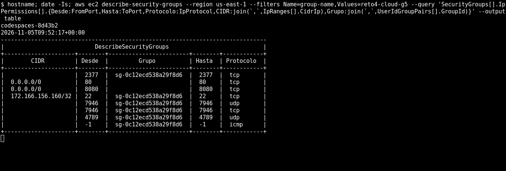

# RETO 4 CLOUD · Grupo 5: informe técnico

Informe de las Fases 0–5 del despliegue en AWS de la web del Gran Premio de Euskadi, con Terraform y Docker Swarm.

- **Repositorio:** `Lq922466/reto4-cloud-G5`, rama `cloud-g5-implementacion`.
- **Imágenes:** [`innnx/reto4-f1`](https://hub.docker.com/r/innnx/reto4-f1/tags), etiquetas 1.0 y 2.0.
- **Estado por criterio:** [REVISION.md](REVISION.md). **Evidencias por criterio:** [INDICE.md](evidencias/INDICE.md).

## Resumen

Se creó con Terraform un clúster de cuatro instancias EC2 con acceso SSH restringido, se formó Docker Swarm por IP privada con
redes overlay de MTU 1450 y se desplegó la web F1 como servicio de cuatro réplicas con imágenes publicadas en Docker Hub.

| Fase | Objetivo | Resultado |
| --- | --- | --- |
| 0 | Entorno y repositorio | Codespaces con AWS CLI y Terraform. Repositorio privado con PR en borrador |
| 1 | Infraestructura | 5 recursos creados con Terraform y un cambio posterior controlado. **Destrucción no ejecutada** |
| 2 | SSH | Alias, salto, root y contraseña desactivados. **Faltan las claves individuales** |
| 3 | Docker Swarm | Clúster y dos redes overlay, MTU 1450 |
| 4 | Web e imágenes | Web definitiva en Docker Hub, desplegada en 4/4 y accesible por las cuatro IP |
| 5 | Orquestación | E1, E2, E3, E6 y E7 con la web definitiva; E5 tras reiniciar el laboratorio. **E4 y E8 solo con el portal provisional** |

**Último estado comprobado (5 de noviembre de 2026, 09:56 UTC):** cuatro nodos Ready/Active, `reto4_web` en 4/4 con
`innnx/reto4-f1:1.0`, una réplica por nodo y HTTP 200 en las cuatro IP.


*Figura 1. Estado final. 5 de noviembre de 2026, 09:56 UTC. Captura: Claude Code. Máquinas: codespaces-8d43b2 y manager-g5.*

**Situación posterior.** A las 11:13 UTC, AWS denegaba las lecturas de EC2 y las cuatro IP no respondían, probablemente porque
terminó la sesión de Learner Lab. No se pudo confirmar el estado de las instancias.
[Detalle de la auditoría](evidencias/auditoria/INFORME.md).

### Cómo leer este informe

- **Autoría.** Los commits de las Fases 0 y 1 iniciales son de Innnx. El trabajo posterior del 4 de noviembre se ejecutó con Codex, y
  el del 5 de noviembre con Claude Code, con autorización expresa para cada operación que cambiaba el servicio o AWS.
- **Comandos.** Cada bloque indica su origen. *Literal* procede de un script o de un registro. *Deducido* significa que el
  registro guarda la salida, pero no la línea de comando exacta.
- **Web definitiva y portal provisional.** Son imágenes distintas, aunque ambas responden `version=1.0`. Se indica en cada prueba.
- **Sondas.** Toman una muestra por segundo y no acreditan disponibilidad continua.
- **Capturas.** La Guía exige ver el prompt con el hostname y la fecha, y un comentario con la prueba, el resultado y el autor. Las de terminal de este
  informe aún no muestran el prompt: se rehará cuando el laboratorio esté activo. [Contraste con la Guía y la Rúbrica](entrega/CONTRASTE-GUIA-RUBRICA.md).

## Arquitectura


*Figura 2. Arquitectura, a partir de [diagramas/arquitectura.md](diagramas/arquitectura.md).*

| Nodo | ID de instancia | Tipo y disco | IP privada | Rol inicial | Rol en Swarm al final |
| --- | --- | --- | --- | --- | --- |
| manager-g5 | `i-0e6ebf2af63facc60` | t3.medium, 20 GB gp3 | 172.31.28.10 | Manager líder | Manager |
| worker1-g5 | `i-066a1ad3b7a8e0db9` | t3.small, 10 GB gp3 | 172.31.17.168 | Worker | **Manager líder** |
| worker2-g5 | `i-0ed6d9c9957251a18` | t3.small, 10 GB gp3 | 172.31.29.192 | Worker | **Manager** |
| worker3-g5 | `i-0446409b26cf0a662` | t3.small, 10 GB gp3 | 172.31.31.183 | Worker | Worker |

Los nombres no cambian, pero los roles sí: worker1-g5 y worker2-g5 se promovieron a managers para probar la elección de líder
de E8. La Guía pide manager líder y tres workers antes de esa prueba, así que hay que decidir el estado final. Las IP públicas cambian cada vez que se detiene una instancia.

## Fase 0: Codespaces y repositorio

**Qué se hizo.** Se preparó un `devcontainer` con AWS CLI y Terraform, y se usó el Codespace como máquina de control. El trabajo se
hizo en `cloud-g5-implementacion`, con la PR #1 en borrador hacia `main`.

```bash
# Literal: comprobación del entorno, con su salida resumida.
hostname; date -Is; aws --version; terraform version; gh --version | head -n 1; ssh -V
# aws-cli/2.39.3 · Terraform v1.17.1 · gh 2.103.3 · OpenSSH_8.9p1
```

**Resultado.** Entorno operativo y repositorio privado con cuatro cuentas con acceso. `terraform.tfvars`, estado, planes, claves y
`config/ssh.local` están excluidos de Git.

**Falta.** Confirmar los integrantes y el acceso del profesor. En el repositorio solo constan commits de Innnx y de Codex, y la PR
de la cuenta Lq922466.

**Evidencias:** [entorno](evidencias/capturas-terminal/F5-entorno.png), [estructura](evidencias/capturas-terminal/F4-estructura.png),
[colaboradores](evidencias/capturas-terminal/F1-colaboradores.png), [historial](evidencias/capturas-terminal/F2-historial.png) y
[archivos sensibles](evidencias/capturas-terminal/F12-archivos-sensibles.png).

## Fase 1: Infraestructura con Terraform

**Qué se hizo.** El módulo [`terraform/`](terraform/) define en `us-east-1` un grupo de seguridad, un manager y tres workers. Los
workers salen de un único recurso multiplicado con `count`. Cada nodo se configura al arrancar con
[`bootstrap.sh.tftpl`](terraform/scripts/bootstrap.sh.tftpl): hostname, zona horaria, claves públicas, endurecimiento de SSH y Docker.

```bash
# Deducido de los registros y de los planes conservados (4 de noviembre).
terraform validate
terraform plan -out=reto4-review-cidr.tfplan
terraform apply reto4-review-cidr.tfplan
# Plan: 5 to add, 0 to change, 0 to destroy.
# Apply complete! Resources: 5 added, 0 changed, 0 destroyed.
```

**Grupo de seguridad `reto4-cloud-g5`:**

| Puerto | Protocolo | Origen | Uso |
| --- | --- | --- | --- |
| 22 | TCP | IP del Codespace `/32` y el propio grupo | SSH externo y salto entre nodos |
| 80 | TCP | `0.0.0.0/0` | Web |
| 8080 | TCP | `0.0.0.0/0` | Lo exige la Guía. La pila no publica ningún servicio en él |
| 2377 | TCP | Propio grupo | Gestión de Swarm |
| 7946 | TCP y UDP | Propio grupo | Comunicación entre nodos |
| 4789 | UDP | Propio grupo | Red overlay |
| ICMP | ICMP | Propio grupo | Comprobación entre nodos |



*Figura 3. Reglas de entrada. 5 de noviembre de 2026, 09:52 UTC. Captura: Claude Code. Máquina: codespaces-8d43b2.*

**Cambio controlado (A6).** Se añadió la etiqueta `PruebaA6=reto4-g5` a manager-g5, regenerando y revisando el plan justo antes.

```bash
# Literal, con rutas abreviadas. ESTADO es el directorio privado con el estado de Terraform.
terraform -chdir=terraform plan -input=false -state=$ESTADO/terraform.tfstate \
  -var-file=$ESTADO/reto4-local.auto.tfvars.json -var ssh_cidr=IP_ACTUAL/32 -out=a6-apply.tfplan
terraform -chdir=terraform apply -input=false -state=$ESTADO/terraform.tfstate a6-apply.tfplan
# Apply complete! Resources: 0 added, 1 changed, 0 destroyed.
```

**Resultado.** Cuatro instancias con sus controles de estado en `ok`, cloud-init completado y zona `Europe/Madrid`. Tras A6, solo
manager-g5 tiene la etiqueta, los ID y discos son los mismos, y un nuevo plan indica `No changes`.

**No demostrado.** La destrucción con `terraform destroy`, que no se ha ejecutado.

**Evidencias:** [módulo y validación](evidencias/capturas-terminal/A1-modulo-terraform.png),
[código](evidencias/capturas-terminal/F6-codigo-instancias.png), [plan](evidencias/prototipo/reto4-plan-cidr.log) y
[apply](evidencias/prototipo/reto4-apply.log) iniciales, [instancias](evidencias/capturas-terminal/A2-instancias.png),
[arranque](evidencias/capturas-terminal/A4-arranque.png), [salida `nodes`](evidencias/capturas-terminal/A5-salida-nodes.png),
[plan](evidencias/A6-plan-final.txt) y [apply](evidencias/A6-apply.txt) de A6, y
[plan posterior](evidencias/capturas-terminal/A6-sin-cambios.png).

## Fase 2: Acceso SSH

**Qué se hizo.** Se generó una configuración con alias, en la que los workers se alcanzan por su IP privada a través de manager-g5.

```bash
# Literal: scripts del repositorio.
bash scripts/generar-config-ssh.sh     # Genera config/ssh.local, excluido de Git.
bash scripts/comprobar-ssh.sh          # Mismo comando en los cuatro nodos, en paralelo.

# Literal: comprobaciones del 5 de noviembre.
ssh -F config/ssh.local -G worker1-g5 | grep -E '^(hostname|proxyjump|user) '
scp -F config/ssh.local worker1-g5:/etc/hostname "$d/hostname-worker1"
sudo sshd -T | grep -E "^(permitrootlogin|passwordauthentication|pubkeyauthentication) "
stat -c '%a %n' ~/.ssh ~/.ssh/authorized_keys
```

**Resultado.** Los cuatro nodos respondieron por su alias, con `proxyjump manager-g5` e IP privada en los workers. La copia SCP
conservó el SHA-256 tanto al subir (4 de noviembre) como al descargar (5 de noviembre). `sudo` funciona, `permitrootlogin` y
`passwordauthentication` están en `no`, y los permisos son 700 y 600.

**Falta.** Las claves individuales. Solo constan `vockey` y la clave del Codespace. Además, la regla SSH permite una única IP y la
del Codespace ha cambiado, así que hay que actualizar esa regla para volver a conectarse desde él.

**Evidencias:** [claves](evidencias/capturas-terminal/B1-claves-autorizadas.png), [alias](evidencias/capturas-terminal/B2-alias.png),
[simultaneidad y sudo](evidencias/capturas-terminal/B3-simultaneo-sudo.png), [copia](evidencias/capturas-terminal/B3-copia-scp.png),
[endurecimiento](evidencias/capturas-terminal/B4-endurecimiento.png), [salto](evidencias/capturas-terminal/B5-salto.png) y
[registro inicial](evidencias/prototipo/fase2-3.txt).

## Fase 3: Docker Swarm y redes

**Qué se hizo.** Se comprobó el ping entre todos los nodos por IP privada, se formó el clúster anunciando la IP privada del manager
y se crearon dos redes overlay.

```bash
# Literal: comandos principales de scripts/formar-swarm.sh y scripts/configurar-red-swarm.sh.
docker swarm init --advertise-addr "$manager_ip"
docker swarm join-token -q worker
docker swarm join --token "$token" "$manager_ip:2377"       # En cada worker.
docker network rm ingress
docker network create --driver overlay --ingress --opt com.docker.network.driver.mtu=1450 red-g5
docker network create --driver overlay --opt com.docker.network.driver.mtu=1450 red-app-g5

# Deducido de la salida: promoción previa a E8.
docker node promote worker1-g5 worker2-g5
```

**Resultado.** Tres nodos se unieron como workers, y luego worker1-g5 y worker2-g5 se promovieron. El ping dio 0 % de pérdida en
todos los pares. Swarm usa las IP privadas `172.31.x.x`, y las redes tienen MTU 1450.

```text
red-g5 driver=overlay ingress=true MTU=1450
red-app-g5 driver=overlay ingress=false MTU=1450
```

**Límite.** La MTU se ha comprobado con `docker network inspect`, no en la interfaz dentro de un contenedor.

**Evidencias:** [ping y formación](evidencias/prototipo/fase2-3.txt), [Docker y ping](evidencias/capturas-terminal/C1-docker-ping.png),
[red-g5](evidencias/capturas-terminal/C2-red-ingress.png), [nodos](evidencias/capturas-terminal/C3-nodos.png),
[red-app-g5](evidencias/capturas-terminal/C4-red-aplicacion.png) y [promoción](evidencias/prototipo/E8-quorum-previo.txt).

## Fase 4: Web e imágenes

**Qué se hizo.** La web del grupo, en [`app/f1`](app/f1), se empaqueta sobre `nginx:alpine`. Al arrancar, cada contenedor genera
`/identidad.txt` con su versión e identificador. La versión 2.0 añade una página de estado de la réplica.

Antes de la web definitiva, las pruebas se hicieron con el portal provisional de [`app/sitio`](app/sitio).

```bash
# Literal: 5 de noviembre.
bash scripts/preparar-imagenes.sh config/ssh.local manager-g5 reto4-g5/f1-definitiva   # Construye y prueba.
ssh -t -F config/ssh.local manager-g5 docker login -u innnx                            # Sesión abierta por el usuario.
bash scripts/publicar-imagenes.sh config/ssh.local innnx/reto4-f1                      # Publica y cierra la sesión.
bash scripts/comprobar-descarga.sh config/ssh.local innnx/reto4-f1                     # Descarga en los tres workers.
bash scripts/desplegar-f1.sh config/ssh.local innnx/reto4-f1 evidencias/F3-despliegue
# Dentro de desplegar-f1.sh, en el manager:
docker stack deploy --compose-file stack.yml reto4
```

La pila [`app/stack.yml`](app/stack.yml) define cuatro réplicas en `red-app-g5`, puerto 80 en modo ingress, reinicio siempre, y
actualización y rollback de una réplica cada vez, arrancando la nueva antes de retirar la anterior.

| Etiqueta | Digest |
| --- | --- |
| 1.0 | `sha256:622d83436cb97412b761ca8cd8d6b8e6c4940f4682a7f6fb6940921d599362ca` |
| 2.0 | `sha256:1736eda0abd63aa0ac538b1a9c11bfdb4f64dc1d36c7687cd7be9a52d2cc76f7` |

**Resultado.**

- Los tres workers descargaron ambas etiquetas sin sesión, con el digest y el contenido de lo construido.
- El servicio pasó del portal provisional a la web definitiva en 4/4.
- Las cuatro IP dieron HTTP 200, y Chromium recorrió las páginas sin errores.
- Las sondas registraron 328 respuestas correctas y 0 fallos.


*Figura 4. Web definitiva por la IP de manager-g5, con Chromium gráfico en un escritorio virtual del Codespace. 5 de noviembre de
2026, 09:37 UTC. Captura: Claude Code. Máquina: codespaces-8d43b2.*

**Límites.** Falta confirmar que el profesor acepta estas capturas. Los enlaces `#` de Bilbao y de los avisos legales no tienen
destino, y los formularios son de demostración y no envían datos.

**Evidencias:** [construcción](evidencias/D1-imagenes-definitivas.txt), [publicación](evidencias/D1-publicacion-dockerhub.txt),
[descarga](evidencias/D1-descarga-dockerhub.txt), [etiquetas](evidencias/D1-dockerhub-etiquetas.png),
[despliegue](evidencias/F3-despliegue/registro.txt), [pila y servicio](evidencias/capturas-terminal/D2-pila-servicio.png),
capturas D3 de [worker1-g5](evidencias/D3-navegador-worker1-g5.png), [worker2-g5](evidencias/D3-navegador-worker2-g5.png) y
[worker3-g5](evidencias/D3-navegador-worker3-g5.png), [método](evidencias/D3-registro.txt) y
[portada completa](evidencias/F3-web-final-1.0-completa.png).

## Fase 5: Orquestación

| Prueba | Web | Resultado | Sondas | Situación |
| --- | --- | --- | --- | --- |
| E1 Balanceo | Definitiva | 16 peticiones por las 4 IP, respondidas por 4 contenedores | — | Completada |
| E2 Escalado | Definitiva | 8/8, 12/12, 2/2 y 4/4 | 562 correctas, 2 tiempos de espera aislados | Completada con observación |
| E3 Autorreparación | Definitiva | Contenedor eliminado y reemplazado, 4/4 | 308 correctas, 0 fallos | Completada |
| E4 Caída de un worker | Provisional | `Down`, tarea reubicada y reincorporación | 164 correctas, 0 fallos | **Parcial** |
| E5 Reinicio del laboratorio | Provisional | Mismas instancias y discos, Swarm y servicio correctos | — | Completada |
| E6 Drain | Definitiva | Tarea migrada, vuelta a Active y una réplica por nodo | 488 correctas, 0 fallos | Completada |
| E7 Actualización y rollback | Definitiva | 1.0 → 2.0 → 1.0, en 4/4 | 620 correctas, 0 fallos | Completada |
| E8 Elección de líder | Provisional | Líder nuevo, comparando antes y después | 38 y 130 correctas, con 34 s sin muestras | **Parcial** |

### E1: balanceo

```bash
# Literal, con la lista de IP abreviada.
for ip in $IPS; do for i in 1 2 3 4; do curl -s --max-time 5 http://$ip/identidad.txt; done; done
```

Las 16 peticiones se repartieron entre los mismos cuatro contenedores, por cualquiera de las cuatro IP.
[Captura](evidencias/capturas-terminal/E1-reparto-peticiones.png).

### E2: escalado

```bash
# Literal.
docker service scale --detach=false reto4_web=8     # También 12, 2 y 4.
```

| Réplicas | Reparto por nodo | HTTP en las 4 IP |
| --- | --- | --- |
| 8/8 | 2-2-2-2 | 200 |
| 12/12 | 3-3-3-3 | 200 |
| 2/2 | 1 en manager-g5 y 1 en worker2-g5 | 200 |
| 4/4 | 1-1-1-1 | 200 |

**Observación.** Durante la reducción de 12 a 2 réplicas, a las 09:35:38 UTC, hubo dos tiempos de espera aislados: una muestra de
34.230.4.20 y otra de 98.81.203.125 superaron el límite de 0,9 s. Las muestras anterior y siguiente fueron correctas. Son 2 de 564
peticiones. **No se ha determinado la causa.**


*Figura 5. Doce réplicas. 5 de noviembre de 2026, 10:35 Madrid. Captura: Claude Code. Máquina: manager-g5.*

[Registro y capturas de cada estado](evidencias/F4-E2/).

### E3: autorreparación

```bash
# Literal, en manager-g5, que alojaba la tarea.
docker rm -f 223aad67af29
docker service ps --filter name=reto4_web.1 reto4_web
```

Swarm marcó la tarea como fallida (`non-zero exit (137)`) y creó `lgmt4tdycl4a` en el mismo nodo. El contenedor se eliminó a las
09:45:01 UTC y a las 09:45:16 UTC el servicio estaba en 4/4.


*Figura 6. Reemplazo de la tarea. 5 de noviembre de 2026, 10:45 Madrid. Captura: Claude Code. Máquina: manager-g5.*

[Registro y capturas](evidencias/F4-E3/).

### E4: caída de un worker (portal provisional)

```bash
# Deducido de la salida: solo sobre worker3-g5.
aws ec2 stop-instances --instance-ids i-0446409b26cf0a662
aws ec2 start-instances --instance-ids i-0446409b26cf0a662
```

EC2 informó `stopped` y Swarm marcó worker3-g5 como `Down`. Su tarea pasó a manager-g5. El servicio mostró `5/4` de forma
transitoria, con la tarea antigua pendiente de confirmar su apagado, y volvió a 4/4 con el nodo reincorporado. Las sondas registraron 164
respuestas correctas y 0 fallos durante la parada.

**Límites.** Solo con el portal provisional. La URL sondeada no consta, no hay capturas de la consola y la captura web no muestra
IP ni hora. [Análisis completo](evidencias/auditoria/E4-E8.md).

**Evidencias:** [registro](evidencias/E4-E5-E8-registro.txt), [estado durante la parada](evidencias/prototipo/E4-worker-down.txt),
[sonda](evidencias/prototipo/E4-E5-http.txt), [reincorporación](evidencias/prototipo/E5-worker-recuperado.txt) y
[captura web](evidencias/E4-web-worker-down.png).

### E5: reinicio de Learner Lab

El reinicio se hizo con End Lab y Start Lab desde AWS Academy.

```bash
# Literal.
bash scripts/verificar-e5.sh ~/DIRECTORIO_PRIVADO_DE_RESPALDO
```

El primer intento se detuvo por una denegación de AWS (`voc-cancel-cred`), que se resolvió renovando las credenciales. Después se
comprobó que los ID y volúmenes raíz coincidían con la referencia previa, los controles estaban en `ok` y las IP públicas habían
cambiado. SSH, Swarm con tres managers, redes, 4/4 y HTTP resultaron correctos. El servicio servía aún el portal provisional.

**Evidencias:** [preparación](evidencias/E5-preparacion.txt), [antes](evidencias/E5-verificacion-previa.txt),
[intento interrumpido](evidencias/E5-verificacion-posterior.txt) y [después](evidencias/E5-verificacion-final.txt).

### E6: drain

```bash
# Literal.
docker node update --availability drain worker3-g5
docker node update --availability active worker3-g5
docker service update --quiet --detach --force reto4_web
```

Con worker3-g5 en Drain, su tarea migró a worker2-g5 (reparto 1-1-2-0) y el servicio siguió en 4/4. Tras volver a Active, la
actualización forzada dejó una réplica por nodo.


*Figura 7. worker3-g5 en Drain. 5 de noviembre de 2026, 10:46 Madrid. Captura: Claude Code. Máquina: manager-g5.*

[Registro y capturas](evidencias/F4-E6/).

### E7: actualización y rollback

```bash
# Literal.
docker service update --quiet --detach=false --image innnx/reto4-f1:2.0 reto4_web
docker service rollback --quiet --detach=false reto4_web
```

La actualización y el rollback fueron progresivos. Cada uno terminó en 4/4, con la versión esperada en las cuatro IP y Chromium sin
errores. La página de estado de la 2.0 mostró la versión y la réplica.

**Evidencias:** [registro](evidencias/F3-actualizacion/registro.txt), [sondas y capturas](evidencias/F3-actualizacion/) e
[historial de tareas](evidencias/capturas-terminal/E7-historial-versiones.png), este último tomado después de la prueba.

### E8: elección de líder (portal provisional)

```bash
# Deducido de la salida: solo sobre manager-g5.
aws ec2 stop-instances --instance-ids i-0e6ebf2af63facc60
aws ec2 start-instances --instance-ids i-0e6ebf2af63facc60
```

Antes de la parada, manager-g5 era el líder de tres managers. Después, worker2-g5 era el líder, manager-g5 volvió como `Reachable` y
el servicio estaba en 4/4. La IP pública de manager-g5 cambió, lo que indica que la instancia llegó a detenerse.

**Límites.**

- No hay ninguna salida de `docker node ls` tomada durante la parada, así que la elección se demuestra comparando antes y después.
- Las sondas tienen 34 segundos sin muestras entre sus dos tramos, y la URL sondeada no consta.
- Solo con el portal provisional y sin capturas de la consola.

[Análisis completo](evidencias/auditoria/E4-E8.md).

**Evidencias:** [registro](evidencias/E8-eleccion-registro.txt), [cuórum previo](evidencias/prototipo/E8-quorum-previo.txt),
[recuperación](evidencias/prototipo/E8-recuperacion.txt) y [comprobación posterior](evidencias/verificacion-posterior.txt).

## Seguridad

- **Secretos.** La revisión de todo el historial no encontró credenciales, claves privadas ni archivos de estado.
  [Registro](evidencias/auditoria/registro-repositorio.txt).
- **Red.** SSH externo limitado a una IP, y puertos de Swarm limitados al propio grupo de seguridad.
- **SSH.** Sin acceso de root ni por contraseña.
- **Docker Hub.** Sesión abierta solo para publicar, con cierre comprobado. El repositorio de imágenes es público.
- **Web.** Se retiró una credencial de demostración del JavaScript antes de versionarla, y los formularios no envían datos.

## Incidencias y soluciones

| Incidencia | Solución o estado | Evidencia |
| --- | --- | --- |
| Docker pedía confirmación al retirar la red `ingress`, y la creación de `red-g5` falló con `AlreadyExists` | Se corrigió el script para confirmar la retirada | [Registro](evidencias/prototipo/fase2-3.txt) |
| Credenciales de AWS rechazadas tras reiniciar el laboratorio | Se renovaron y se completó E5 | [Intento](evidencias/E5-verificacion-posterior.txt) y [resultado](evidencias/E5-verificacion-final.txt) |
| Cuatro páginas enlazaban a `#escuderias`, que no existía | Se añadió el destino y un validador de enlaces | Commit `bcfceee` |
| Docker no puede ejecutarse en el Codespace, por falta de permisos del contenedor | Las imágenes se construyeron en manager-g5 | [Registro](evidencias/D1-imagenes-definitivas.txt) |
| Docker Hub rechazó el primer token (`insufficient scopes`) | Se abrió una sesión nueva y se publicó | [Intento](evidencias/D1-publicacion-intento-fallido.txt) y [resultado](evidencias/D1-publicacion-dockerhub.txt) |
| La regla SSH se había cambiado fuera de Terraform y `ssh_cidr` tenía valores antiguos | Se usó la IP vigente y se alineó el código, sin tocar la regla | [Plan anterior](evidencias/A6-plan-actual.txt) y [final](evidencias/A6-plan-final.txt) |
| El portal provisional y la web definitiva responden `version=1.0` | La verificación comprueba la imagen de cada tarea | [Registro](evidencias/F3-despliegue/registro.txt) |
| Reparto desigual tras el despliegue y el rollback | E6 terminó con una réplica por nodo | [Estado](evidencias/F3-estado-final.txt) y [E6](evidencias/F4-E6/registro.txt) |
| Dos tiempos de espera aislados en E2 | Causa no determinada. Se acordó un criterio de supervisión para E3 y E6 | [Registro](evidencias/F4-E2/registro.txt) |
| AWS y la web dejaron de responder a las 11:07 UTC, y la IP del Codespace cambió | Sin resolver: requiere reiniciar el laboratorio y actualizar la regla SSH | [Auditoría](evidencias/auditoria/INFORME.md) |

## Lo que no se ha demostrado

| Aspecto | Situación |
| --- | --- |
| Destrucción con Terraform (A6) | No ejecutada. Requiere autorización aparte |
| E4 y E8 con la web definitiva | No repetidas. Requiere autorización, porque detienen instancias |
| Estado del clúster durante la parada de E8 | Sin registro |
| Disponibilidad continua | Las sondas son muestras por segundo y, en E2, hubo dos tiempos de espera |
| Claves SSH individuales (B1) | Solo constan `vockey` y la clave del Codespace |
| Estado actual del clúster | Último dato: 09:56 UTC del 5 de noviembre |
| Cumplimiento de la Guía y la Rúbrica | Faltan capturas conformes y trabajo del grupo. [Contraste](entrega/CONTRASTE-GUIA-RUBRICA.md) |

## Referencias

[Criterios](REVISION.md) · [evidencias](evidencias/INDICE.md) · [capturas de terminal](evidencias/capturas-terminal/INDICE.md) ·
[auditoría](evidencias/auditoria/INFORME.md) · [E4 y E8](evidencias/auditoria/E4-E8.md) · [gestión](GESTION.md) ·
[defensa](entrega/DEFENSA.md) · [checklist](entrega/CHECKLIST-FINAL.md) · [contraste](entrega/CONTRASTE-GUIA-RUBRICA.md)
