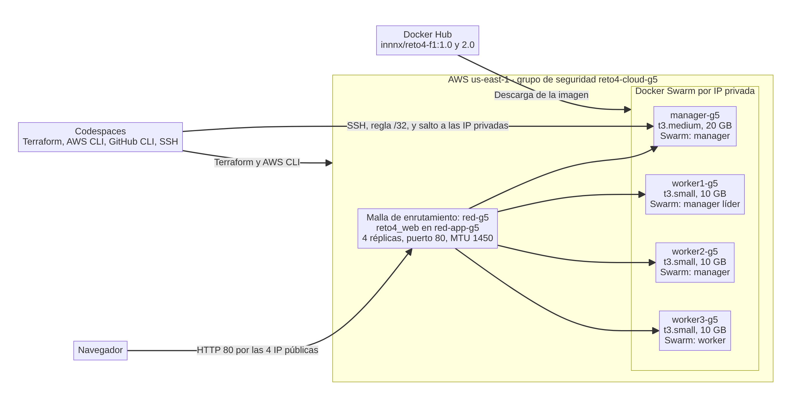

# RETO 4 CLOUD · Grupo 5

Web del Gran Premio de Euskadi desplegada en AWS con Terraform y Docker Swarm. Reto de 2º de ASIR.

| Para ver | Documento |
| --- | --- |
| El informe técnico de las Fases 0–5 | [PROYECTO.md](PROYECTO.md) |
| El estado de los 42 criterios | [REVISION.md](REVISION.md) |
| Qué está completado y qué falta | [Checklist final](entrega/CHECKLIST-FINAL.md) |
| El contraste con la Guía y la Rúbrica | [CONTRASTE-GUIA-RUBRICA.md](entrega/CONTRASTE-GUIA-RUBRICA.md) |
| Cómo obtener capturas según la norma | [PROCEDIMIENTO-CAPTURAS.md](entrega/PROCEDIMIENTO-CAPTURAS.md) |
| El plan pendiente para C3, E4 y E8 | [PLAN-C3-E4-E8.md](entrega/PLAN-C3-E4-E8.md) |
| Las evidencias de cada criterio | [Índice de evidencias](evidencias/INDICE.md) |
| La defensa: guion, demostraciones y preguntas | [DEFENSA.md](entrega/DEFENSA.md) y [presentación](entrega/presentacion-cloud-g5.pptx) |
| La organización del grupo | [GESTION.md](GESTION.md) |
| Las tareas pendientes | [PENDIENTES.md](entrega/PENDIENTES.md) |
| La segunda revisión, del 9 de noviembre, y su matriz de requisitos | [Segunda revisión](entrega/segunda-revision-2026-11-09/README.md) |
| Cómo aportan Enrique, Alexandra e Ibai sus commits y PR (F2) | [INSTRUCCIONES-F2-INTEGRANTES.md](entrega/INSTRUCCIONES-F2-INTEGRANTES.md) |

**Imágenes publicadas:** [`innnx/reto4-f1:1.0` y `innnx/reto4-f1:2.0`](https://hub.docker.com/r/innnx/reto4-f1/tags).

**Rama:** el trabajo está en `cloud-g5-implementacion`, con la PR #1 en borrador hacia `main`. Mientras no se integre, `main` solo
contiene las Fases 0 y 1, y los enlaces de este documento solo funcionan desde `cloud-g5-implementacion`.

**Última comprobación técnica registrada:** 5 de noviembre de 2026, 09:56 UTC, con cuatro nodos Ready/Active, `reto4_web` en 4/4
y HTTP 200 en las cuatro IP. Es un dato histórico, no el estado actual. Para saber si el portal responde ahora, hay que comprobarlo
como se indica en [Acceso al portal web](#acceso-al-portal-web).

## Equipo

| Integrante | GitHub | Productos asignados en el RETO 4 |
| --- | --- | --- |
| Cristina | Lq922466. En los commits figura como Innnx, y en Docker Hub como innnx | 1, Sistemas, y **6, Cloud**: este repositorio |
| Enrique | EnriZx2 | 2, Redes, y 3, IWEB |
| Alexandra | alexguerth | 4, Bases de Datos |
| Ibai | ibaiaretxabalaasir-collab | 5, Seguridad |

[GESTION.md](GESTION.md) recoge la organización acordada, el seguimiento semanal y el uso de asistentes de IA. También separa la
responsabilidad asignada a cada persona del trabajo que consta realmente. Hasta ahora, la única aportación integrada de Enrique,
Alexandra e Ibai es la [revisión de la documentación](entrega/REVISION-ENRIQUE.md) de Enrique, en la PR #2.

## Arquitectura



Cuatro instancias EC2 en `us-east-1`, un grupo de seguridad, Docker Swarm por IP privada y dos redes overlay con MTU 1450. Detalle en
[diagramas/arquitectura.md](diagramas/arquitectura.md).

## Estructura

| Carpeta | Contenido |
| --- | --- |
| [`.devcontainer/`](.devcontainer/devcontainer.json) | Codespaces con AWS CLI y Terraform |
| [`terraform/`](terraform/) | Infraestructura: grupo de seguridad, instancias, arranque y salidas |
| [`config/`](config/README.md) | Plantilla SSH y configuraciones aplicadas. `ssh.local` se genera y no se versiona |
| [`scripts/`](scripts/) | SSH, Swarm, publicación, despliegue, pruebas, capturas y revisión de secretos |
| [`app/`](app/) | `f1`: web definitiva. `f1-release`: extra de la 2.0. `sitio`: portal provisional. Dockerfile y pila |
| [`diagramas/`](diagramas/) | Mapa de arquitectura |
| [`evidencias/`](evidencias/INDICE.md) | Registros y capturas reales, por criterio |
| [`entrega/`](entrega/) | Checklist, defensa, estructura del Word y tareas pendientes |
| [`practica-individual/`](practica-individual/README.md) | Instrucciones y plantilla. **Sin contenido todavía** |

## Acceso al portal web

El portal se sirve por HTTP, en el puerto 80, desde cualquiera de los cuatro nodos: el routing mesh de Swarm reparte cada petición
entre las réplicas. Las IP públicas cambian cada vez que se reinicia Learner Lab, por eso este documento no indica ninguna.

**Solo lectura.** Requiere una sesión activa de Learner Lab y las credenciales renovadas en el Codespace.

```bash
# IP públicas actuales de los nodos en ejecución.
aws ec2 describe-instances --region us-east-1 \
  --filters 'Name=tag:Name,Values=manager-g5,worker?-g5' 'Name=instance-state-name,Values=running' \
  --query 'Reservations[].Instances[].[Tags[?Key==`Name`]|[0].Value,PublicIpAddress]' --output text

# Antes de dar el portal por disponible, comprobar que responde en cada IP.
curl -s -o /dev/null -w '%{http_code}\n' http://IP_PUBLICA/   # 200 si responde.
curl -s http://IP_PUBLICA/identidad.txt                         # Versión y contenedor que ha respondido.
```

[`scripts/comprobar-laboratorio.sh`](scripts/comprobar-laboratorio.sh) hace estas comprobaciones en los cuatro nodos de una vez.
En el navegador se abre `http://IP_PUBLICA/`, escribiendo `http://`, porque el portal no usa HTTPS.

- **Puerto 80:** lo publica la pila, [app/stack.yml](app/stack.yml), en modo `ingress`.
- **Puerto 8080:** el grupo de seguridad lo abre, como indica la Guía, pero ningún servicio lo publica.
- **Salidas de Terraform:** pueden conservar IP de una sesión anterior. Las vigentes son las que devuelve EC2.

## Reproducir el despliegue

Requiere una sesión activa de Learner Lab y las credenciales de AWS en el Codespace. Cada bloque indica su efecto:

| Efecto | Comandos |
| --- | --- |
| **Solo lectura** | `terraform validate`, `terraform plan`, `comprobar-laboratorio.sh`, `comprobar-ssh.sh`, `verificar-despliegue.sh`, `aws ec2 describe-*` |
| **Local:** solo escribe archivos en el Codespace | `cp` de variables, `terraform init`, `generar-config-ssh.sh`, `actualizar-ips.sh`, que en AWS solo lee, e `install` de `~/.ssh/config` |
| **Modifica AWS** | `terraform apply` y los cambios de la regla SSH que propone `comprobar-laboratorio.sh` |
| **Modifica Docker Swarm** | `formar-swarm.sh`, `desplegar-f1.sh`, `probar-actualizacion.sh` y `probar-orquestacion.sh` |
| **Modifica los nodos o Docker Hub**, sin tocar servicios | `preparar-imagenes.sh`, `docker login`, `publicar-imagenes.sh` y `comprobar-descarga.sh` |

Los comandos que modifican crean o cambian recursos reales y deben ejecutarse solo con autorización.

### 1. Infraestructura

**Local y solo lectura:**

```bash
cp terraform/grupo.example.tfvars terraform/terraform.tfvars   # Local. Indicar la IP propia /32 y las claves públicas.
terraform -chdir=terraform init                                # Local: descarga el proveedor.
terraform -chdir=terraform validate                            # Solo lectura.
terraform -chdir=terraform plan -out=reto4.tfplan              # Solo lectura en AWS. Revisar antes de aplicar.
```

**Modifica AWS:**

```bash
terraform -chdir=terraform apply reto4.tfplan
```

El estado de Terraform no se versiona. Debe conservarse para poder gestionar y destruir los recursos.

### 2. SSH y Swarm

**Local y solo lectura:**

```bash
bash scripts/generar-config-ssh.sh    # Local: lee el estado de Terraform y genera config/ssh.local.
install -m 600 config/ssh_config.usuario.example ~/.ssh/config   # Local: permite usar solo: ssh manager-g5
bash scripts/comprobar-ssh.sh         # Solo lectura. Verificar antes las huellas SSH de los servidores.
```

**Modifica Docker Swarm:**

```bash
bash scripts/formar-swarm.sh          # Forma Swarm por IP privada y crea las redes con MTU 1450.
```

### 3. Imágenes y servicio

Docker no puede ejecutarse en este Codespace, así que las imágenes se construyen en un nodo.

**Modifica los nodos o Docker Hub, sin tocar servicios:**

```bash
bash scripts/preparar-imagenes.sh config/ssh.local manager-g5 reto4-g5/f1-definitiva   # Construye y prueba en el nodo.
ssh -t -F config/ssh.local manager-g5 docker login -u CUENTA                          # Abre la sesión de Docker Hub.
bash scripts/publicar-imagenes.sh config/ssh.local CUENTA/REPOSITORIO     # Publica. Cierra la sesión al terminar.
bash scripts/comprobar-descarga.sh config/ssh.local CUENTA/REPOSITORIO   # Descarga las etiquetas en los workers.
```

**Modifica Docker Swarm:**

```bash
bash scripts/desplegar-f1.sh config/ssh.local CUENTA/REPOSITORIO DIRECTORIO_REGISTROS
```

### Al reiniciar Learner Lab

Las IP públicas cambian. Con las credenciales renovadas:

```bash
bash scripts/comprobar-laboratorio.sh  # Solo lectura: EC2, IP, regla SSH, web y Swarm. Propone la regla, sin aplicarla.
bash scripts/actualizar-ips.sh         # Local: en AWS solo lee. Regenera los alias con las IP actuales.
```

Si la regla SSH no coincide con la IP del Codespace, los comandos que muestra `comprobar-laboratorio.sh` **modifican AWS**.

### 4. Comprobaciones

**Solo lectura:** réplicas, imagen y HTTP en las cuatro IP.

```bash
bash scripts/verificar-despliegue.sh config/ssh.local CUENTA/REPOSITORIO 1.0
```

**Modifican Docker Swarm:** actualización y rollback; E2, E3 o E6.

```bash
bash scripts/probar-actualizacion.sh config/ssh.local CUENTA/REPOSITORIO DIRECTORIO_REGISTROS
bash scripts/probar-orquestacion.sh config/ssh.local CUENTA/REPOSITORIO DIRECTORIO_REGISTROS e2
```

## Seguridad

- No se versionan claves privadas, credenciales, estado ni planes de Terraform: [`.gitignore`](.gitignore).
- Antes de integrar cambios, ejecutar `python3 scripts/revisar-secretos.py COMMIT_BASE HEAD`. Solo lectura.
- `python3 scripts/validar-entrega.py` comprueba enlaces, evidencias y estados de los documentos de entrega. Solo lectura.
- Las capturas de AWS no deben mostrar el identificador de la cuenta.
