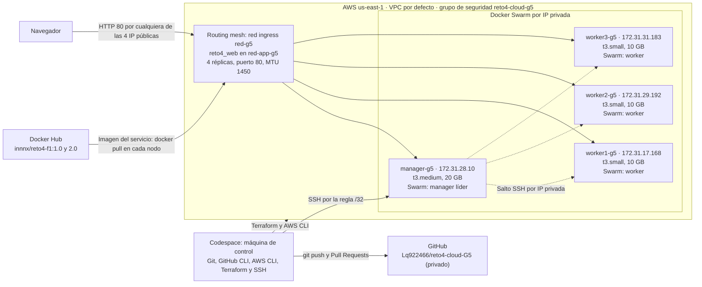

# Arquitectura CLOUD del grupo 5

Mapa de la arquitectura desplegada (criterio F8). Representa la topología que pide la Guía y que se comprobó por última vez el
**9 de noviembre de 2026**, después de devolver el clúster a un solo manager tras la prueba E8. No se ha vuelto a comprobar desde el
reinicio del laboratorio del 10 de noviembre. [Imagen del diagrama renderizado](arquitectura.png).

## Cómo leerlo

- **Nodos y roles.** Terraform crea un manager t3.medium y tres workers t3.small, con los nombres de la Guía. En Swarm,
  manager-g5 es el único manager y el líder, y los tres workers solo ejecutan tareas. Durante la prueba E8 (4 de noviembre) se
  promovieron worker1-g5 y worker2-g5 a managers. Siguieron así hasta el 9 de noviembre, cuando se bajaron de nuevo con
  `docker node demote`. Esa corrección consta en el registro de sesión de Codex; la captura conforme `C3-nodos` versionada es
  anterior (6 de noviembre) y da NO CORRECTO. El detalle está en [PROYECTO.md, apartado 3.4](../PROYECTO.md#34-validación-de-los-nodos-y-de-sus-roles-c3).
- **Servicio.** `reto4_web`, cuatro réplicas de `innnx/reto4-f1:1.0`, una por nodo. El routing mesh responde por el puerto 80 en
  las cuatro IP públicas, aunque el nodo no aloje ninguna réplica.
- **Salto SSH.** manager-g5 es el único punto de entrada por SSH desde fuera. Los workers se alcanzan por su IP privada.
- **Reglas.** SSH externo limitado a direcciones `/32`, HTTP 80 y 8080 públicos, y puertos de Swarm (2377, 7946 y 4789), ICMP y el
  22 interno limitados al propio grupo de seguridad.

Evidencias: [nodos tras corregir C3](../PROYECTO.md#34-validación-de-los-nodos-y-de-sus-roles-c3),
[clúster y red ingress](../evidencias/capturas-conformes/C2-cluster.png), [red del servicio](../evidencias/capturas-conformes/C4-red.png)
y [reglas](../evidencias/capturas-conformes/A3-reglas.png).

## Cómo se genera la imagen

`arquitectura.png` se obtiene renderizando el bloque Mermaid anterior con Mermaid 10.9.1 en Chromium sin interfaz (Playwright), con
el tema por defecto y escala 2. GitHub también dibuja el bloque Mermaid directamente al abrir este archivo.
