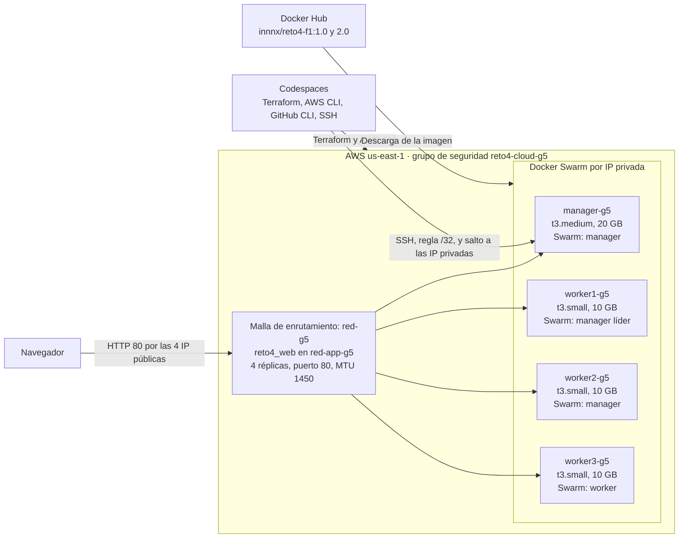

# Arquitectura CLOUD del grupo 5

Estado de la última comprobación: 5 de noviembre de 2026, 09:56 UTC.
[Imagen del diagrama renderizado](arquitectura.png).

## Cómo leerlo

- **Nombres y roles.** Los nombres son los de la creación con Terraform. La configuración inicial era de un manager y tres
  workers. Antes de E8 se promovieron worker1-g5 y worker2-g5 para tener cuórum, así que hoy hay tres managers y un
  worker puro. El líder cambió en E8 y tras el reinicio del laboratorio.
- **Servicio.** `reto4_web`, cuatro réplicas de `innnx/reto4-f1:1.0`, con una réplica por nodo. La malla de enrutamiento
  responde por el puerto 80 en las cuatro IP públicas.
- **Salto SSH.** manager-g5 es el punto de entrada. Desde él se alcanzan los workers por su IP privada.
- **Reglas.** SSH externo limitado a una IP `/32`, HTTP público, y puertos de Swarm e ICMP limitados al propio grupo de
  seguridad.

Evidencias: [nodos](../evidencias/capturas-terminal/C3-nodos.png), [redes](../evidencias/capturas-terminal/C2-red-ingress.png)
y [reglas](../evidencias/capturas-terminal/A3-grupo-seguridad.png).
